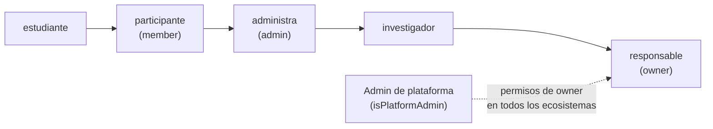

# Actores y glosario

- **Versión:** 1.2
- **Fecha:** 2026-11-10
- **Estado:** vigente
- **Fuentes:** en el repositorio: `apps/backend/src/lib/permissions.ts`, `apps/web/src/lib/miembros.ts`, `apps/web/src/lib/features.ts`, `plan/anonimizacion-y-voces.md`, `plan/adr-corpus-graph.md`, `infra/fleet/edc-1.md`. En la carpeta del proyecto, fuera del repositorio (`cide/plan/`): `briefs/v1-brief-repositorio-voces-resonancias.md`, `reus/260418/` (reunión del 18 de abril de 2026), `reus/260511-kickoff/` (kickoff del 11 de mayo de 2026), las minutas de `docs/Textos del proyecto/Desarrollo (metodología)/` (18 de junio, 3 de julio, 8 de agosto, 21 de octubre), y la bitácora del proyecto (registros del 2026-10-21, 2026-10-27 y 2026-10-28).

## Para quién es y qué responde

Este documento es para cualquier persona que llegue al proyecto y necesite saber quién es quién y qué significa cada palabra. Responde: qué roles institucionales forman el equipo; con qué socios de campo trabaja el proyecto; qué roles existen dentro de la plataforma y qué puede hacer cada uno; qué ecosistemas existen, reales y de prueba; y qué significa cada término, tanto del marco conceptual como del vocabulario técnico. Cuando un dato del equipo es una deducción y no consta en un documento, se marca como **inferido**.

## 1. Equipo y roles institucionales

Los roles se toman de minutas, briefs e informes del proyecto. Cada persona se nombra por su rol; cuando dos comparten rol, se distinguen por su función.

| Rol | Función en el proyecto | Fuente | Certeza |
|---|---|---|---|
| Responsable Técnico (CIDE-DEM) | Investigador principal; decide la estrategia del proyecto y firma el informe de etapa | Informe del 21 de octubre; minutas del 18 de junio y del 8 de agosto | Leído |
| Responsable de desarrollo | Coordina el nodo de programación y lleva el desarrollo y la experiencia de usuario. Es el único desarrollador que sostuvo la construcción y quien toma las decisiones técnicas de desarrollo | `briefing-saptiva-repositorio.docx`; minuta del 18 de junio (tabla de roles); bitácora del proyecto de octubre | Leído |
| Programador de alianzas con proveedores de IA | Llevó las alianzas con proveedores de IA (Maya, Saptiva) y es coautor del briefing de Saptiva. Se le menciona como posible ruta para la estrategia de datos | Minuta del 18 de junio; «Tercera sesión programadores»; informe del 21 de octubre §VI | Leído |
| Programador destinatario de los briefs | Su rol estaba «por definir» el 18 de junio y su continuidad se discutió el 8 de agosto | Reunión del 18 de abril; minutas del 18 de junio y del 8 de agosto; informe del 21 de octubre §VII | Leído |
| Coautor del briefing de Saptiva | Coautor del briefing de Saptiva (2026-04-30) | `briefing-saptiva-repositorio.docx` | Leído. Otro rol: desconocido |
| Colaborador externo de la línea jurídica | Tiene un sistema RAG sobre sentencias mexicanas y es el piloto de la métrica de divergencia o «curvatura». Se prevé su salida del proyecto | Reunión del 18 de abril §3.3 y §5.5; «Ruta crítica (feb 2026)» | Leído |
| Analista matemático y de grafos | Análisis matemático y de grafos sobre la métrica de divergencia | Informe del 21 de octubre §VII | Leído. Que sea la misma persona de una carpeta del material de discapacidades es **inferido** |
| Responsable del marco teórico de las instrucciones | Marco teórico de las instrucciones al modelo de lenguaje | Reunión del 18 de abril §5.3 | Leído |
| Programador con rol por definir | Aparece en la minuta del 18 de junio junto al programador destinatario de los briefs | Minuta del 18 de junio | **Inferido y ambiguo**: puede ser o no el programador de alianzas con proveedores de IA |
| Autora de la nota de gobernanza | Autora de una nota de gobernanza | Nombre del archivo de la nota | Rol **inferido**, desconocido |
| Representante legal | Firma la carta SECIHTI | Carta SECIHTI | Leído |

**Contracción del equipo.** El proyecto convocó a tres o cuatro programadores y el trabajo terminó sostenido por uno (citado del informe del 21 de octubre §II). El informe lo registra como dato metodológico, no como anécdota.

**Apoyo de IA en el desarrollo.** El responsable de desarrollo se apoyó en asistentes de programación con IA (Claude). Cerca de tres cuartas partes de los cambios del repositorio llevan coautoría de Claude (medido con `git log` sobre `main` el 2026-10-29). El informe del 21 de octubre también declara que lo redactó Claude bajo dirección del Responsable Técnico.

## 2. Socios e instituciones de campo

Constan en nombres de archivo y textos del proyecto. No consta un convenio formal con ninguno.

| Socio | Relación con el proyecto | Ecosistema |
|---|---|---|
| IDEPI / INDEPEDI (Ciudad de México) | Coordinó la primera versión del repositorio en Google Forms, en la fase preoperativa | Discapacidad |
| PILARES de la Ciudad de México | Socio de campo citado en textos del proyecto | No consta |
| INSP | Taller de dengue | Dengue |
| Escuela Primaria «Miguel Hidalgo», Cuernavaca | Socio de campo | Dengue y acompañamiento escolar (inferido de los corpus) |
| Maya / MaIA | Empresa mexicana que ofrece nodos de inferencia y renta de DGX Spark. La colaboración no se concretó (`plan/justificacion.md`) | Infraestructura |
| Saptiva | Modelo de lenguaje mexicano. Era la referencia de modelo en el brief v1 §7d. No se adoptó: EDC usa modelos vía OpenRouter y en el Spark | Infraestructura |
| Dueño del DGX Spark | Otra organización presta el equipo donde corren la transcripción y el detector de dev. No consta contrato | Infraestructura |

En algunas transcripciones automáticas, «Saptiva» aparece como «Activa» o «Sativa»; son errores de transcripción (inferido del nombre del briefing).

## 3. Roles del sistema

EDC tiene cinco roles **por ecosistema** y una marca de **administrador de plataforma** por usuario. El rol vive en la membresía de una persona en un ecosistema, así que una misma persona puede ser estudiante en un ecosistema e investigadora en otro (`apps/backend/src/lib/permissions.ts`).

La escalera la fijó el responsable de desarrollo el 2026-10-27:

| Rol (valor en código) | Nombre en la interfaz | Qué hace, en una frase |
|---|---|---|
| `estudiante` | estudiante | Participa como un participante y, si el ecosistema tiene encendida la vista de estudiante, tiene su propia vista con sus temas, sus autores, sus compañeros y la publicación de sus notas. |
| `member` | participante | Conversa con el acervo, sube sus documentos y notas, valora respuestas y explora la Biblioteca y las Conexiones; lo suyo se publica solo al pasar el gate si el ecosistema lo permite. |
| `admin` | administra | Además de lo del participante, sube testimonios, revisa lo retenido, borra documentos, lee los comentarios de las valoraciones y gestiona miembros; la pantalla Miembros no lo ofrece y solo se asigna por datos (`apps/web/src/lib/miembros.ts`). |
| `investigador` | investigador | Es «como admin, pero solo dentro de los ecosistemas que tiene asignados»: además entra al resumen de administración y a la vista docente de seguimiento. Hasta el 2026-11-10 también guardaba Ajustes del ecosistema; desde esa fecha no (desplegado en dev). |
| `owner` | responsable | Tiene los permisos del investigador y además guarda Ajustes del ecosistema (`organization:manage`), gestiona investigadores, cambia el identificador del ecosistema o lo apaga. |
| `isPlatformAdmin` (marca del usuario) | Admin | Administra toda la plataforma: recibe permisos de responsable en todos los ecosistemas activos, crea ecosistemas, decide el respaldo del detector, los estilos de respuesta, las funciones bloqueadas y corre las evaluaciones. |

La matriz completa de permisos está en [Matriz de roles y permisos](../02-requisitos/matriz-roles-y-permisos.md).

### 3.1 Roles del brief que no existen como tales

El brief v1 §5 proponía, como preliminares: super admin, admin de ecosistema, usuario contribuidor, moderador-facilitador y capturador. El kickoff del 2026-05-11 los repitió.

| Rol del brief | Equivalente en EDC |
|---|---|
| Super admin | Administrador de plataforma |
| Admin de ecosistema | `owner` (responsable); `investigador` para todo menos Ajustes |
| Usuario contribuidor | `member` (participante) |
| Moderador-facilitador | No existe como rol. Sus tareas de revisión las hacen `admin`, `investigador` y `owner` |
| Capturador | No existe como rol propio; lo cubre quien tiene el permiso `voces:upload` (administra, investigador, responsable), sin registrar de quién es la voz. Ver [Visión y alcance](vision-y-alcance.md) §7 |

Los roles `estudiante` e `investigador` no estaban en el brief; nacieron con la vista de estudiante y con la necesidad de dar acceso de gestión limitado a investigadores (decisiones del responsable de desarrollo, octubre de 2026).

## 4. Ecosistemas

### 4.1 Ecosistemas reales del proyecto

El informe del 21 de octubre §VIII pide nombrar estos cinco en el informe de Etapa 1:

| Ecosistema | Fenómeno | Estado en la plataforma |
|---|---|---|
| Dengue y prácticas de cuidado | Prevención del dengue en Cuernavaca | Org 6 «Prevención del dengue» en dev, con documentos reales y corpus sintético v2 |
| Capacitismo y discapacidad | «El problema no es la discapacidad sino el capacitismo» (reunión del 2025-08-20) | Org 7 «Discapacidad» en dev, con documentos reales y corpus sintético v2 |
| Traductores no instruidos en contextos institucionales | Traducción comunitaria en salud | Existió como org 1 «Traducción en salud» con corpus sintético v1; retirada por decisión del responsable de desarrollo del 2026-10-27 |
| Medio ambiente y economías solidarias o alternativas | No consta detalle | No creado |
| Semiosis práctica | Estudiantes de semionomía; taller de semiótica de los viernes desde el 2026-08-21 | Org 8 «Semiosis práctica» en dev, con lecturas, casos y registros de clase reales; única con vista de estudiante |

Existe además una **línea jurídica** ligada al trabajo del colaborador externo sobre sentencias. No tiene ecosistema en la plataforma.

### 4.2 Ecosistemas en dev al 2026-10-29

| Id | Nombre | Contenido | Fuente |
|---|---|---|---|
| 6 | Prevención del dengue | Documentos reales y corpus sintético v2 de dengue; algunos se retienen a propósito para la demostración de Revisión | Citado de la bitácora del proyecto (2026-10-28; conteo medido en la ingesta el 2026-10-29 a las 04:38 UTC) |
| 7 | Discapacidad | Documentos reales, «lista C» y corpus sintético v2 de discapacidad | Ídem |
| 8 | Semiosis práctica | Materiales de consulta publicados; los del taller, en borrador hasta tener el consentimiento de sus autores | Decisión del 2026-11-04 |
| 1 | Traducción en salud | Retirado el 2026-10-27 | Bitácora del proyecto (2026-10-27) |
| 3 | Acompañamiento escolar | Retirado el 2026-10-27 | Bitácora del proyecto (2026-10-27) |

En staging («montaje») hay un solo ecosistema, «Montaje» (id 1), creado a mano para pruebas de humo (citado de `infra/fleet/edc-1.md`).

### 4.3 Ecosistemas de prueba

| Origen | Ecosistemas | Uso |
|---|---|---|
| Corpus sintético v1 (`corpus-generativo/`, semilla 445) | traduccion (70), dengue (60), escuela (60), discapacidad (60) | Seed del demo desde el 2026-08-29 y banco de pruebas del RAG. Los conteos son de `MANIFEST.csv` (250 filas) |
| Script `scripts/demo-ecosistemas-4.sh` | Prevención del dengue, Traducción en salud, Discapacidad, Acompañamiento escolar | Reparto del corpus v1 en cuatro ecosistemas por tema (2026-10-21) |
| Corpus sintético v2 (`corpus-generativo/v2/`, 2026-10-26) | Dengue (70 piezas) y Discapacidad (40 testimonios) | Reemplazo del v1, juzgado «un ensayo básico que mostró sus límites» (informe del 21 de octubre §VII) |
| Seed local `seed/demo.ts` | «Organización Demo» | Desarrollo local |

El detalle de cada corpus está en [Corpus y datos de prueba](../04-datos/corpus-y-datos-de-prueba.md).

## 5. Glosario

Cada término lleva una definición en lenguaje llano y, cuando aplica, su nombre en código. Las fuentes están al final de cada fila. Los términos se agrupan en tres bloques: marco conceptual, plataforma y técnica.

### 5.1 Marco conceptual

| Término | Definición | Fuente |
|---|---|---|
| **Repositorio de Voces y Resonancias** | El marco conceptual de EDC: un sistema de doble flujo que recibe voces y devuelve resonancias para que la comunidad las audite | Brief v1 §1 |
| **Ecosistema** | Un grupo de personas en torno a un fenómeno (dengue, discapacidad…) con su propio acervo, temas, roles y funciones activables. En código es una `organization` y, en el servicio de IA, una org `edc-eco-<id>` | Bitácora del proyecto (2026-10-21) |
| **Voz** | Cualquier contribución de un miembro de un ecosistema: texto, audio, video o imagen. En la plataforma, la voz personal es un **testimonio** que pasa siempre por el gate | Reunión del 18 de abril §7; kickoff |
| **Resonancia** | Lo que el sistema genera con el modelo a partir de las voces para devolverlo al campo. El kickoff la redefinió como «sesión de chat con el modelo». En la plataforma es la pestaña **Resonancias** | Reunión del 18 de abril §7; kickoff; brief v1 §3 |
| **Resonancia individual** | Sesión de chat que profundiza la contribución de una persona haciendo preguntas | Brief v1 §3 |
| **Resonancia de corpus o de ecosistema** | Materiales que el sistema genera desde todo el acervo para devolver al campo. Tiene tres usos: A, B y C | Brief v1 §3 |
| **Uso A** | Generar insumos para los talleres de auditoría: estrategias, narrativas prototipo, preguntas detonadoras | Brief v1 §3 |
| **Uso B** | Analizar patrones del acervo: recurrencias, tensiones y silencios | Brief v1 §3 |
| **Uso C** | Modelar la curvatura del campo | Brief v1 §3 |
| **Curvatura** | La forma estructural del campo que atraviesan las voces de un ecosistema, como un sendero que la gente abre al caminar o una geodésica. Corresponde al Uso C y a la Fase 3 | Reunión del 18 de abril §3.3 |
| **Métrica de divergencia** | Cuánto se separan los enunciados de los estudiantes de una línea base generada por IA. Es el componente analítico independiente del software | Informe del 21 de octubre §VII |
| **Auditoría comunitaria** | La sesión en que la comunidad juzga las resonancias («esto nos representa / esto no»). El veredicto es dato del proyecto | Reunión del 18 de abril §3.4; brief v1 §3 |
| **Ciclo** | Captura, categorización, resonancia, auditoría y retroalimentación, y vuelta a empezar | Brief v1 §3 |
| **Capturador** | La persona que registra en campo contribuciones de terceros a nombre de ellos. No existe como rol; quien tiene el permiso `voces:upload` (administra, investigador, responsable) sube testimonios de terceros sin registrar de quién es la voz | Síntesis del kickoff; brief v1 §4 |
| **Moderador o facilitador** | Figura intermedia, prioritaria para el trabajo de campo. No existe como rol en la plataforma | Kickoff; brief v1 §5 |
| **Comprobante ético** | La constancia de cada contribución: aviso de privacidad, consentimiento informado y folio único descargable en PDF. En la plataforma, desde el 2026-11-12, es la constancia de cada subida, con folio `EDC-AAAA-NNNNNN` (`/documentos/<id>/constancia`), que el navegador guarda como PDF | Brief v1 §3; síntesis del kickoff |
| **Operación** | El procedimiento sostenido para capturar voces en territorio. Es la hipótesis central de la Etapa 2 | Informe del 21 de octubre §I |
| **Ventanilla en territorio** | El punto de captura en campo previsto para la Fase 3 | Informe del 21 de octubre §I |
| **Justicia epistémica** | El derecho de cualquier persona a generar sentido sobre su realidad y a integrar su voz a un conocimiento compartido | Brief v1 §2; matriz de Chapultepec |
| **Principios de Chapultepec** | Diez principios humanistas para la IA presentados por SECIHTI y la ATDT el 2026-01-29; el proyecto los adopta como marco ético | Informe del 21 de octubre §IV |
| **Etapa 1** | El periodo financiado por la ministración del 2026-05-06, que cerró el 2026-10-28 | «Estado del Proyecto»; informe del 21 de octubre |
| **Fases 1, 2 y 3** | Las etapas del proyecto según quién opera la captura: el equipo, estudiantes del CIDE y una ventanilla en territorio | Informe del 21 de octubre §I |

### 5.2 Plataforma (lo que ve la persona usuaria)

| Término | Definición | Fuente |
|---|---|---|
| **Testimonio** | Un `contentKind` de valor `testimonio`: una voz personal. Siempre se anonimiza con el gate, nunca guarda quién habla y su grabación no se comparte | Decisión del responsable de desarrollo del 2026-10-21; `Documents.ts` |
| **Documento** | Un `contentKind` de valor `documento`: material subido, como un PDF o una hoja de cálculo. No pasa por el gate salvo que se marque «Anonimizar»; desde el 2026-11-10 esa casilla arranca encendida al subir (desplegado en dev). Si pasa por el gate, su título se redacta para todos salvo quien lo subió y el admin de plataforma (desplegado en dev) | Ídem; `apps/backend/src/lib/contentKind.ts` |
| **Conversación** | Un `contentKind` de valor `conversacion`: los turnos de chat que entran al acervo después del gate | `plan/adr-corpus-graph.md` |
| **Nota** | Un texto escrito en la plataforma por una persona; el estudiante puede publicarla y publicar sus cambios | Historias C1.2 y C3.2 |
| **Generales** | La pestaña de conversación que responde con fuentes citadas [n] | Decisión del responsable de desarrollo (octubre de 2026) |
| **Resonancias (pestaña)** | La pestaña de conversación donde una entrevistadora hace una pregunta a la vez, parte de conceptos del acervo y puede decir «otras personas hablan de…» | `apps/web/src/lib/server/engine/prompt.ts` |
| **Hazme preguntas** | El interruptor que activa el modo entrevista dentro de Generales (`interviewerMode`) | `apps/web/src/lib/features.ts` |
| **Biblioteca** | El acervo publicado de un ecosistema. Es la palabra de la interfaz en lugar de «corpus» | Actualización del 21 de octubre |
| **Conexiones** | El nombre del grafo de conocimiento en la interfaz, en la ruta `/grafo`. Se eligió en lugar de «Grafo» por lenguaje llano | Notas de contexto del equipo |
| **Mis documentos** | La lista de lo que subió la persona, con opción de usarlo en una conversación, fijarlo como contexto, descargar el original o borrarlo | Historias C2.x |
| **Revisión** | La pantalla donde quien tiene permiso aprueba o rechaza los documentos retenidos por el gate. Muestra la cola y el motivo, nunca el texto original | Commits del 28 de agosto de 2026 |
| **Miembros** | La pantalla para agregar personas a un ecosistema y cambiar su rol | Historias F2.x |
| **Ajustes** | La pantalla del responsable del ecosistema donde se encienden o apagan sus funciones. El estilo de respuesta y la sección de plataforma solo los edita el admin de plataforma | Historias F3.x; `apps/web/src/routes/ajustes/+page.server.ts` |
| **Interruptor por ecosistema** | Una función que se activa o desactiva por ecosistema: micrófono en vivo, grafo, vista 3D, modo entrevista, publicación automática, vista de estudiante, entre otras | `apps/web/src/lib/features.ts` |
| **Vista de estudiante** | La ruta `/estudiante`, con temas, autores, compañeros, preguntas para investigar y sugerencias. Solo Semiosis práctica la tiene encendida | Decisión del responsable de desarrollo (octubre de 2026) |
| **Seguimiento** | La vista docente (`/seguimiento`) que muestra la actividad de un estudiante si este dio su consentimiento | Historias E2.x |
| **Consentimiento versionado** | El consentimiento del estudiante para compartir sus testimonios: lleva fecha y versión y nombra a todos los lectores | Commit del 28 de octubre de 2026 |
| **Estilo de respuesta** | El tono y la forma en que el chat de un ecosistema responde; lo elige el admin de plataforma | `apps/web/src/lib/answerStyle.ts` |
| **Valoración** | Las estrellas de 1 a 5 y el comentario opcional que una persona deja sobre una respuesta | Historias B2.x |
| **Micrófono en vivo** | El dictado que muestra el texto mientras se habla. El servidor nunca guarda el texto parcial. Desde el 2026-11-10 se ve al grabar y no pasa al cuadro del chat (desplegado en dev) | `app/api/live/[sid]/route.ts`; auditoría del 2026-11-10, C-13 |
| **Panorama del corpus** | Una pregunta sobre el acervo completo («dame un resumen del corpus») que se responde con los temas principales del grafo y la lista de documentos, sin buscar pasajes | `apps/web/src/lib/server/engine/overview.ts` |
| **Figura pública** | Una persona cuyo nombre se conserva en un `documento` con gate si un admin de plataforma enciende `keepPublicFigures`. Nunca aplica a testimonios | `apps/backend/src/lib/features.ts` |

### 5.3 Técnica

| Término | Definición | Fuente |
|---|---|---|
| **RAG** | Generación con recuperación: el modelo responde a partir de fragmentos recuperados del acervo y los cita | Uso general |
| **Corpus** | El conjunto de textos indexados de un ecosistema en el servicio de IA (`eco-<id>`). También se llama así a los acervos sintéticos de prueba | Bitácora del proyecto |
| **Corpus sintético** | Un acervo inventado a propósito, con datos sembrados para medir la recuperación. EDC tiene v1 y v2 | `corpus-generativo/PROMPT_MAESTRO.md` |
| **Ground truth o regularidad sembrada** | Un dato plantado a propósito en el corpus sintético (lugares, eventos, parentescos) para comprobar si el sistema lo encuentra | `corpus-generativo/resultados/README.md` |
| **`contentKind`** | El campo de `documents` que dice qué tipo de contenido es (`documento`, `testimonio`, `conversacion`). Funciona como control de privacidad: decide si pasa por el gate y si el grafo puede extraer personas | `plan/adr-corpus-graph.md` §3 |
| **`kind`** | El campo de `documents` que dice el formato del archivo (markdown, pdf, docx, audio…). Es distinto de `contentKind` | Ídem |
| **Gate (de anonimización)** | El paso obligatorio que, antes de publicar, quita datos que identifican a personas. Tiene cuatro etapas: estructural, determinista (correos, teléfonos, CURP, RFC, códigos postales, URLs, miembros), detector con modelo y verificación. Solo devuelve `ready` o `hold` y falla cerrado | `apps/backend/src/lib/anonymise/gate.ts` |
| **Detector** | El modelo de lenguaje que, dentro del gate, encuentra nombres y otros datos personales en ventanas de unas 250 palabras. En dev corre en el Spark | `apps/backend/src/lib/anonymise/detector.ts` |
| **Respaldo del detector** | Qué pasa si el Spark falla: `hosted` manda el texto a un modelo hospedado por OpenRouter, con ZDR; `none` retiene, y sin URL del Spark tampoco llama al hospedado. Hoy el valor por defecto es `hosted`, y es el que usa dev desde el 2026-11-09 (citado de `infra/fleet/edc-1.md` §4zzzzzzz) | `apps/backend/src/lib/anonymise/fallbackGenerator.ts`; `apps/backend/src/lib/anonymise/detector.ts` |
| **Held (retenido)** | El estado de un documento que el gate no pudo anonimizar con certeza. Espera revisión humana en Revisión | Bitácora del proyecto |
| **Retenido por consentimiento (`consentHeld`)** | Una marca en un documento cuyos autores no han dado su consentimiento. Mientras la tenga, no se re-anonimiza, no se vuelve a ingerir ni a extraer al grafo y no se publica; no se borra nada. Los ids salen de `CONSENT_IDS_FILE`, por el script `scripts/hold-for-consent.ts`. Levantarla es un `UPDATE` a mano. Desplegado en dev | `apps/backend/src/lib/consentHold.ts` |
| **Re-gate** | Volver a pasar por la compuerta un documento cuyo veredicto se hizo con otros interruptores; antes se retira del acervo y se borran sus copias y sus filas del grafo | `apps/backend/src/lib/anonymisationControls.ts` |
| **ZDR (retención cero de datos)** | La marca `provider.zdr: true` que ai-service manda en cada llamada a OpenRouter: solo responden proveedores que no guardan lo que reciben. DeepInfra, usado para el reordenamiento y el respaldo de vectores, no la lleva | `services/ai-service/src/services/ai/router/adapters/openrouter.ts` |
| **Ready** | El veredicto del gate cuando el texto quedó anonimizado y puede publicarse | `gate.ts` |
| **Seudónimo** | La marca que reemplaza un dato tachado, como `[Persona A]` o `[Domicilio A]`. El mapa vive solo en memoria y para un documento | `apps/backend/src/lib/anonymise/pseudonyms.ts` |
| **Voces sin sujeto** | La decisión de no guardar quién habla en un testimonio, porque un sujeto guardado sería un mapa de reidentificación | Decisión del 2026-08-28; `plan/anonimizacion-y-voces.md` |
| **Fallar cerrado (fail-closed)** | Ante un error o una duda, el sistema niega o retiene en lugar de dejar pasar | Uso general en el código |
| **Publicación** | El paso que lleva un documento listo al acervo compartido del ecosistema | `apps/web/src/lib/publication.ts` |
| **Retirar** | Quitar un documento publicado del acervo. En el servicio de IA, retirar cierra la vigencia del vector; desde el 2026-10-17 también hay borrado real | Auditoría del 2026-10-17 |
| **Orientación (de turnos)** | Los turnos de chat de otros miembros, ya anonimizados, que guían la respuesta pero **nunca se citan** | Decisión del responsable de desarrollo del 2026-10-21 |
| **Variante de cita E** | La forma de citar por defecto: primero los pasajes con [n] y después, si hace falta, conocimiento general marcado como «fuera de los documentos» | Actualización del 21 de octubre |
| **Grafo de conocimiento** | Entidades (temas, lugares, organizaciones, eventos, figuras públicas) y relaciones extraídas del texto ya anonimizado | `plan/adr-corpus-graph.md` |
| **GraphRAG** | Recuperación que usa el grafo además de los pasajes, para preguntas globales sobre el acervo | Ídem §8 |
| **Co-mención** | Una arista «aparecen juntos» entre dos entidades del mismo documento | Bitácora del proyecto (2026-10-21) |
| **Grafo combinado** | La vista «Todos mis ecosistemas», que junta los grafos de varios ecosistemas | Decisión del responsable de desarrollo (octubre de 2026) |
| **Umbral de soporte** | Cuántos documentos deben mencionar una entidad para que aparezca en el grafo. Bajó de 3 a 1 el 2026-10-21 (`GRAPH_MIN_ENTITY_DOCS`) | `apps/backend/src/lib/graph/queries.ts` |
| **`tema` y `lengua`** | Columnas de `documents`: el tema del documento y la lengua de las personas de las que trata, no la del texto | `apps/web/src/lib/lengua.ts` |
| **Rerank (reordenamiento)** | Un segundo modelo que reordena los pasajes recuperados por pertinencia antes de responder | `plan/spark-ai-adopcion.md` |
| **Embeddings (vectores)** | La representación numérica de un texto que permite buscar por significado. EDC usa bge-m3 de 1024 dimensiones | `services/ai-service/src/config/env.ts` |
| **Búsqueda densa e híbrida** | Densa busca por significado; híbrida combina significado y palabras clave. EDC usa densa con rerank porque midió mejor | `apps/backend/src/eval/RESULTS.md` |
| **Condense** | El paso que reescribe una pregunta de seguimiento como pregunta completa antes de buscar | `packages/chat-engine/src/core/condense.ts` |
| **ai-service** | El servicio de IA y RAG agnóstico del dominio, parte del monorepo | `services/ai-service/` |
| **audio-service** | El servicio en Python que solo transcribe audio | `services/audio-service/` |
| **Payload** | El framework del backend: guarda el dominio y emite la identidad | `apps/backend/` |
| **SvelteKit / BFF** | El framework de la web; funciona como intermediario entre el navegador y los servicios | `apps/web/` |
| **Stack de IA** | ai-service y los paquetes `ai-client`, `chat-engine` e `identity-client`: la plataforma de IA del monorepo, agnóstica del dominio | `services/ai-service/`, `packages/` |
| **Spark** | El NVIDIA DGX Spark prestado por otra organización donde corren, en dev, Whisper, el detector y el rerank (desde el 2026-10-21) y los embeddings (desde el 2026-10-22) | `plan/spark-ai-adopcion.md`; `infra/fleet/edc-1.md` |
| **Whisper** | El modelo de transcripción de voz a texto. EDC usa large-v3, solo en español, en el Spark | Decisión del responsable de desarrollo (octubre de 2026) |
| **edc-1** | La única caja de hospedaje de EDC, en Hetzner, con su propio Coolify | `infra/fleet/edc-1.md` |
| **Coolify** | La herramienta que construye y despliega los contenedores en edc-1 | Ídem |
| **RustFS** | El almacén de archivos compatible con S3 que EDC usa en todos los entornos | Ídem |
| **dev** | El entorno de desarrollo y demostración, en `dev.ecosistemasdeconocimiento.com` | Ídem |
| **Montaje** | El entorno de staging (`EDC_ENV=stage`), en `montaje.ecosistemasdeconocimiento.com` | Ídem |
| **Evals** | Las evaluaciones automáticas de calidad del chat y del gate; el panel está en `/admin/evals` | `apps/web/src/lib/server/evals/` |
| **Evidencia (V1, V2, V3)** | Los videos de demostración por rol grabados el 2026-10-28 para el informe de Etapa 1 | `../evidencia/` (carpeta madre) |

## Referencias

En el repositorio:

- `apps/backend/src/lib/permissions.ts`
- `apps/web/src/lib/miembros.ts`
- `apps/web/src/lib/features.ts`
- `apps/backend/src/lib/anonymise/gate.ts`
- `plan/adr-corpus-graph.md`
- `plan/anonimizacion-y-voces.md`
- `plan/spark-ai-adopcion.md`
- `infra/fleet/edc-1.md`

En la carpeta del proyecto (`cide/plan/`):

- `briefs/v1-brief-repositorio-voces-resonancias.md`
- `reus/260418/` y `reus/260511-kickoff/`
- `docs/Textos del proyecto/Desarrollo (metodología)/` (minutas e informe del 21 de octubre)
- Bitácora del proyecto, registros del 2026-10-21, 2026-10-27 y 2026-10-28

Documentos relacionados en `docs/`:

- [Visión y alcance](vision-y-alcance.md)
- [Cronología e hitos](cronologia-e-hitos.md)
- [Matriz de roles y permisos](../02-requisitos/matriz-roles-y-permisos.md)
- [Funciones por ecosistema](../02-requisitos/funciones-por-ecosistema.md)
- [Modelo de datos](../04-datos/modelo-de-datos.md)
- [Corpus y datos de prueba](../04-datos/corpus-y-datos-de-prueba.md)
- [Pila de IA](../03-arquitectura/pila-de-ia.md)
