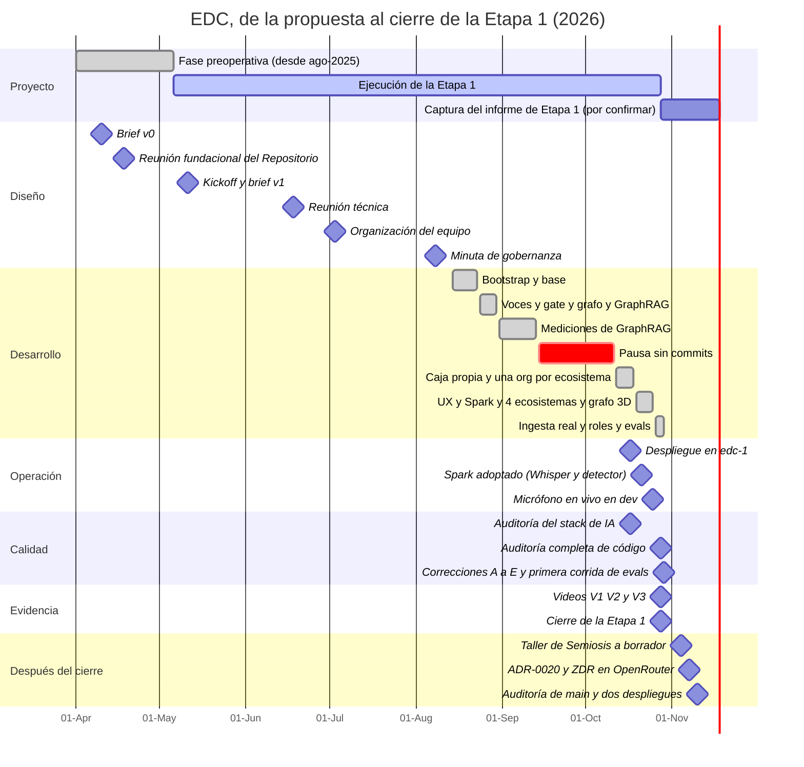

# Cronología e hitos

- **Versión:** 1.3
- **Fecha:** 2026-11-11
- **Estado:** vigente
- **Fuentes:** historial de git de `main` (hasta el 2026-10-29; la §4.1 llega hasta 687ff21e, del 2026-11-11); `infra/fleet/edc-1.md` (bitácora de despliegues §4); `plan/auditoria-ia-2026-10-17.md`; `plan/auditoria-codigo-2026-10-28.md`; `plan/adr-corpus-graph.md`; `plan/spark-chat-eval-2026-10-26.md`; `apps/backend/src/eval/RESULTS.md`. En la carpeta del proyecto, fuera del repositorio (`cide/plan/`): `briefs/v0-brief-proyecto-plataforma-ia.md`, `briefs/v1-brief-repositorio-voces-resonancias.md`, `reus/260418/`, `reus/260511-kickoff/`, minutas de `docs/Textos del proyecto/Desarrollo (metodología)/`, «Estado del Proyecto IH-2025-I-445», la bitácora del proyecto (registros del 2026-10-17, 2026-10-21, 2026-10-27 y 2026-10-28), los resultados de evaluación del 2026-10-29, la carpeta de respaldos de edc-1 y `evidencia/`.

## Para quién es y qué responde

Este documento es para quien redacte el informe de la Etapa 1, para revisores que necesiten ubicar un hecho en el tiempo y para quien herede el desarrollo y quiera entender por qué el código tiene la forma que tiene. Responde: qué pasó y cuándo, de abril a octubre de 2026; cuánto trabajo hubo cada semana y en qué temas; cuándo se auditó, se desplegó y se grabó la evidencia; y cómo cerró la Etapa 1 el 2026-10-28. La §4.1 agrega lo que pasó después, hasta el 2026-11-11. Todas las fechas son absolutas. Los conteos de commits son **medidos** con `git log` sobre `main` el 2026-10-30, por fecha de autor, salvo los de la §4.1, medidos el 2026-11-11.

## 1. Vista general

## 2. Antes de abril de 2026

| Fecha | Hecho | Fuente |
|---|---|---|
| 2025 | Convocatoria «Investigación humanística 2025» y propuesta IH-2025-I-445 | Carta SECIHTI |
| Agosto de 2025 | Comienza la fase preoperativa. Hubo una primera versión del repositorio en Google Forms, coordinada con IDEPI | «Estado del Proyecto» |
| 2025-08-20 | «Tercera sesión programadores ([programador A])»: «el problema no es la discapacidad sino el capacitismo» | Minuta del 20 de agosto de 2025 |
| 2026-01-29 | SECIHTI y la ATDT presentan los Principios de Chapultepec | Informe del 21 de octubre §IV |
| Febrero de 2026 | «Ruta crítica»: integra el marco judicial de [colaborador externo] con el modelo topológico del sentido | `Ruta crítica (feb 2026).docx` |

## 3. Abril a septiembre de 2026: diseño y primera construcción

| Fecha | Hito | Detalle | Fuente |
|---|---|---|---|
| 2026-04-10 | Brief v0 | Plataforma de IA con stack sugerido Next.js/React o FastAPI, PostgreSQL y pgvector | `cide/plan/briefs/v0-brief-proyecto-plataforma-ia.md` (fecha de archivo) |
| 2026-04-18 | Reunión fundacional | Nace el «Repositorio de Voces y Resonancias v1.0»: ciclo, usos A, B y C, glosario. El texto dice «2025», pero la carpeta (`260418`) y el contenido corresponden a 2026 (inferido: errata) | `cide/plan/reus/260418/` |
| 2026-04-30 | Briefing de Saptiva | [programador A] y [coautor del briefing] evalúan Saptiva como modelo mexicano | `briefing-saptiva-repositorio.docx` |
| 2026-05-06 | Ministración | Llegan $150,000 MXN; empiezan los cinco meses de ejecución | «Estado del Proyecto» |
| 2026-05-11 | Kickoff y brief v1 | La voz es una sesión con IA mayéutica; dos taxonomías (tipo y tema); el perfil decide el destino; aparece el capturador; el comprobante con folio es obligatorio; se fijan roles | `cide/plan/reus/260511-kickoff/`; brief v1 |
| 2026-06-18 | Reunión técnica | El responsable de desarrollo presenta un sistema con OpenRouter, RAG, clasificador y streaming. Primera entrega fijada para el 2026-09-15. Se plantea Maya con DGX Spark y una arquitectura que permita cambiar de proveedor. El nombre de archivo dice 2025 (inferido: errata, es 2026) | Minuta del 18 de junio |
| 2026-07-03 | Organización del equipo | Se evalúa Mattermost frente a WhatsApp. No se adelanta la compra de cómputo; se cubre con máquinas de desarrollo, unos $40,000 MXN al mes, hasta octubre (citado de la minuta) | `Reunión_3_julio_2026.docx` |
| 2026-08-08 | Minuta de gobernanza | Gobernanza del nodo técnico, continuidad de [programador B], compra de 5 grabadoras con IA, taller de semiótica los viernes desde el 2026-08-21 | `Minuta_Frenk_8_ago_2026.docx` |
| 2026-08-14 | **Primer commit** | «Bootstrap Ecosistemas de Conocimiento monorepo» | `git log` |
| 2026-08-28 | Decisiones de privacidad y grafo | `contentKind` separado de `kind`; regla de personas por columna; «Voces sin sujeto»; grafo en `edc_backend` con soporte mínimo de 3; borradores por conversación | `plan/adr-corpus-graph.md`; `plan/borradores-por-conversacion.md` |
| 2026-08-29 | Seed de 250 documentos | El demo se puebla con el corpus sintético v1 | Commit del 2026-08-29 |
| 2026-09-05 | Primera medición de GraphRAG | Recall global 0.430 sin grafo contra 0.414 con grafo (citado de `RESULTS.md`, corrida `20260905060010`) | `apps/backend/src/eval/RESULTS.md` |
| 2026-09-08 | Segunda medición de GraphRAG | Tras arreglar el sembrador, recall global de 0.461 a 0.733 con grafo (citado de `RESULTS.md`, corrida `20260908091626`) | Ídem |
| 2026-09-14 a 2026-10-11 | Pausa | Sin actividad en el repositorio durante cuatro semanas (medido con `git log`). Las fuentes no registran el motivo | `git log` |

## 4. Octubre de 2026: infraestructura propia, Spark y cierre

| Fecha | Hito | Detalle | Fuente |
|---|---|---|---|
| 2026-10-14 | Compose para Coolify | Primeros commits de despliegue | `git log` |
| 2026-10-15 | Desmontaje del despliegue anterior | Se retira por completo el despliegue provisional de prueba | Bitácora del proyecto (2026-10-17) |
| 2026-10-16 | Decisiones de IA | Búsqueda por palabra clave en `spanish`; una org del servicio de IA por ecosistema con $5 al mes; rerank en cada turno | Bitácora del proyecto (2026-10-17) |
| 2026-10-16 y 2026-10-17 | **Caja propia edc-1** | EDC queda en su propio servidor Hetzner con su propio Coolify; dev y staging corren la misma versión. «Live since 2026-10-17» | `infra/fleet/edc-1.md` |
| 2026-10-17 | Primer respaldo fuera de la caja | Carpeta `20261017T0421Z` | Carpeta de respaldos de edc-1 (fuera del repositorio) |
| 2026-10-17 | **Auditoría del stack de IA** | Cuatro frentes de revisión. El RAG funciona; pruebas, privacidad y operación tienen un punto rojo cada una. Hallazgos: fuga en vivo de turnos del asistente, superficie de inyección de prompt, sin respaldos programados. Línea base: web 1349/1349, backend 1536/1536, chat-engine 211/211 (citado de `plan/auditoria-ia-2026-10-17.md`) | `plan/auditoria-ia-2026-10-17.md` |
| 2026-10-17 | Búsqueda densa con rerank | MRR@5 de 0.936 para densa contra 0.503 para híbrida, en 189 preguntas (citado de `RESULTS.md`, mediciones 3 y 4) | `apps/backend/src/eval/RESULTS.md` |
| 2026-10-17 | Staging congelado | Staging queda en una versión anterior y no se vuelve a desplegar | `infra/fleet/edc-1.md` §4j |
| 2026-10-21 | **Reunión de cierre con desarrollo** | Última reunión de trabajo de la Etapa 1. La operación se vuelve hipótesis central; se adoptan los Principios de Chapultepec; se acuerda el corpus v2; se acuerda un servidor MCP para operar por voz en la Etapa 2 | Informe del 21 de octubre |
| 2026-10-21 | Decisiones del responsable de desarrollo | Spark para Whisper y detector; testimonios siempre anonimizados; turnos que orientan sin citarse; variante de cita E; umbral del grafo de 3 a 1; cuatro ecosistemas por tema; registro público cerrado | Bitácora del proyecto (2026-10-21) |
| 2026-10-21 | Caída de dev | Una limpieza concurrente de imágenes dejó dev caído unos 8 minutos (citado de `edc-1.md` §4x) | `infra/fleet/edc-1.md` §4x |
| 2026-10-22 | Vectores y transcripción en el Spark | Embeddings bge-m3 en el Spark; Whisper remoto en dev | `infra/fleet/edc-1.md` §4za |
| 2026-10-23 | Cierre de la fuga de `/duplicate` | Fuga por la ruta interna `/duplicate` del framework; corregida y desplegada el 2026-10-23 | `infra/fleet/edc-1.md` §4zf |
| 2026-10-24 y 2026-10-25 | Micrófono en vivo y publicación por el gate | Texto en vivo mientras se dicta (desde el 2026-10-25) | `infra/fleet/edc-1.md` §4zk, §4zl |
| 2026-10-26 | Evaluación del chat en el Spark | El modelo local no iguala al hospedado en respuestas; el condense sí es viable | `plan/spark-chat-eval-2026-10-26.md` |
| 2026-10-26 | Corpus sintético v2 | Dengue (70 piezas) y discapacidad (40 testimonios) | `corpus-generativo/v2/` |
| 2026-10-26 | Ecosistema 8 | Se crea Semiosis práctica en dev | `infra/fleet/edc-1.md` §4zp |
| 2026-10-27 | Decisiones sobre corpus v2 y Semiosis | Funciones por ecosistema, vista de estudiante solo en Semiosis, nombres del personal tachados salvo autores; nueva escalera de roles | Bitácora del proyecto (2026-10-27); `apps/backend/src/lib/permissions.ts` |
| 2026-10-27 y 2026-10-28 | Ingesta de documentos reales | Orgs 6, 7 y 8. Se retiran las orgs 1 y 3 | Bitácora del proyecto (2026-10-28) |
| 2026-10-28 | **Auditoría completa de código** | Once frentes de revisión sobre `main` del 2026-10-28: 1 crítico, 6 altos, 32 medios, 51 bajos (citado de `plan/auditoria-codigo-2026-10-28.md`) | `plan/auditoria-codigo-2026-10-28.md` |
| 2026-10-28 | **Videos de evidencia V1, V2 y V3** | Grabados de forma automática contra dev, por rol. Ver §6 | `evidencia/` |
| 2026-10-28 | Panel de evaluaciones | `/admin/evals` | `git log` |
| **2026-10-28** | **Cierre de la Etapa 1** | Después de esta fecha no hay gasto con cargo a la Etapa 1 | Informe del 21 de octubre §VII |
| 2026-10-29 | Correcciones de auditoría A a E | Lectura de archivos ajenos, re-tirada del veredicto del gate, fuga por espacios, revocación, XSS de citas, retención de texto crudo | `git log`; `plan/auditoria-codigo-2026-10-28.md` |
| 2026-10-29 | Despliegue de dev | Entre 06:45 y 06:50 UTC. Fue el último de la Etapa 1; el siguiente fue el 2026-11-10 (§4.1). Primera corrida de evals por $0.126 USD (citado de la bitácora del proyecto, 2026-10-28) | `infra/fleet/edc-1.md` §4zzzz |
| 2026-10-29 | Último commit de la Etapa 1 | `origin/main` igual a `main`. El trabajo siguió el 2026-11-04 (§4.1) | `git log` |

### 4.1 Noviembre de 2026: correcciones después del cierre

Commits sin merges en `main`, por fecha de autor (medido con `git log --no-merges` sobre 687ff21e el 2026-11-11): 18 el 2026-11-04, 2 el 2026-11-06, 9 el 2026-11-07, 3 el 2026-11-09 y 99 el 2026-11-10.

| Fecha | Hito | Detalle | Fuente |
|---|---|---|---|
| 2026-11-04 | Taller de Semiosis a borrador | Por decisión del 2026-11-04, los materiales del taller esperan el consentimiento de sus autores. Los 76 casos pasan a borrador en dev; nada se borra | `infra/fleet/edc-1.md` §4zzzzz |
| 2026-11-04 | Documentación de la Etapa 1 en el repositorio | Carpeta `docs/` | `git log` (5d8fc1c1) |
| 2026-11-06 | El resto del taller a borrador; vectores de respaldo en DeepInfra | Dev queda con 187 borradores y 566 publicados en la org 8 (medido, citado de `edc-1.md`) | `infra/fleet/edc-1.md` §4zzzzzz |
| 2026-11-07 | **Anonimizar todo por omisión** | Conservar al autor y a los autores citados pasa a interruptores apagados por omisión, con controles por documento, auditoría de cada cambio y re-gate ([ADR-0020](../03-arquitectura/adr/ADR-0020-anonimizar-todo-y-conservar-nombres-por-documento.md)) | `git log` (87e2468f, 491841fb) |
| 2026-11-07 | ZDR en OpenRouter | ai-service pide retención cero de datos en cada llamada a OpenRouter y falla cerrado si no hay proveedor que la cumpla | `git log` (9b755298) |
| 2026-11-09 | Nombres inventados para las cuentas de estudiante de la demo | Las 9 cuentas de estudiante de Semiosis práctica (org 8), sembradas por `apps/backend/src/seed/fixtures/semiosisTrabajos.ts`, tenían nombres inventados pero realistas, que podían coincidir con personas reales. Pasan a nombres que no son palabras del diccionario ni aparecen en el corpus de Semiótica; lo cuidan las pruebas de `src/seed/semiosisDemo.test.ts`. En dev se actualizaron 18 filas de `users.display_name` y `memberships.person_name`, con respaldo previo, y un re-escaneo de las dos bases encontró 0 nombres viejos (citado del reporte de la sesión que hizo el cambio, 2026-11-10). Staging no tenía estudiantes. En dev desde el despliegue de las 05:34 UTC | `git log` (3f14306b); filas de dev: reporte de esa sesión (citado) |
| 2026-11-10 | Despliegue de dev, 05:34 a 05:51 UTC | Entra a dev lo del 2026-11-07. El respaldo del detector vuelve a `hosted` (decisión del 2026-11-09), ahora con ZDR | `infra/fleet/edc-1.md` §4zzzzzzz |
| 2026-11-10 | **Auditoría de `main`** | Cuatro frentes (privacidad, login y permisos, carga y repositorio, chat e interfaz) sobre a84baacf: 54 hallazgos, 7 altos, 23 medios, 24 bajos, ningún crítico | `plan/orchestration/auditoria-2026-11-10/resumen.md` (fuera del repositorio) |
| 2026-11-10 | Dos ramas | `main` solo lleva correcciones de la Etapa 1; la rama `etapa-2`, creada sobre a84baacf, lleva la funcionalidad nueva | `git log` |
| 2026-11-10 | Despliegue de dev, 18:24 a 18:45 UTC | 367c2698: re-gate con reintento, cuentas desactivadas fuera, límites de inicio de sesión, tope de 8 MiB a los cuerpos JSON, registros sin parámetros de consultas. Staging sin tocar | `infra/fleet/edc-1.md` §4zzzzzzzz |
| 2026-11-10 | Primera purga de volcados | Se quedan los 7 más recientes por entorno; en dev se borran 52 volcados y se liberan 1231.3 MB en cada lado (medido, citado de `edc-1.md`) | `infra/fleet/edc-1.md` §7 |
| 2026-11-10 | Despliegue de dev, 23:03 UTC | c4f53632 en backend, web y ai-service; migraciones de 24 a 25 (`consent_held`). De 367c2698 a c4f53632, 47 commits sin merges (medido con `git log --no-merges` el 2026-11-11): Ajustes solo para el responsable, títulos de `documento` con compuerta redactados en todas las superficies, retenido por consentimiento, plazo de 30 días para el cuerpo de los avisos, subidas acotadas por cuenta, roster acotado para estudiantes | versión: `docker ps` en edc-1 (medido el 2026-11-11); migración: reporte del despliegue (citado); `git log` |
| 2026-11-10 | Olas 10 y 11 en `main`, sin desplegar | De c4f53632 a 687ff21e, 26 commits sin merges (medido con `git log --no-merges` el 2026-11-11): filtros por relación y conversaciones nuevas acotados, retenido por consentimiento en rutas, scripts y grafo, registros y respuestas sin el texto de errores crudos (regla `edc/no-raw-error-log`), tiempo de espera del pool de base de datos, conserjes y más formas de fecha en la compuerta | `git log` |

## 5. Actividad por semana

Leído de `git log` sobre `main` el 2026-10-30, por fecha de autor. La semana empieza en lunes. El tema dominante es una lectura de los asuntos de commit.

| Semana (lunes) | Tema dominante |
|---|---|
| 2026-08-10 | Bootstrap, audio-service, migraciones, RustFS, selector de ecosistema, pruebas de extremo a extremo de API y Playwright |
| 2026-08-17 | Fugas de documentos borrados, stemming en español, pruebas en paralelo |
| 2026-08-24 | Valoraciones, vista de contribuciones para admin, **Voces, rol Investigador y gate de anonimización**, Biblioteca, **grafo del corpus y GraphRAG**, pantalla de Revisión, seed de 250 documentos |
| 2026-08-31 | Reintentos ante límites de tasa, documentación del sprint 0 |
| 2026-09-07 | Medición de GraphRAG, columnas `lengua` y `tema`, reglas de entidades del grafo |
| 2026-09-14 a 2026-10-05 | Sin commits |
| 2026-10-12 | Compose para Coolify, runbook de edc-1, una org del servicio de IA por ecosistema, búsqueda en `spanish`, rerank, híbrida tras interruptor, despliegues §4g a §4k |
| 2026-10-19 | Lotes de UX, partición en 4 ecosistemas, grafo 2D y 3D, Whisper remoto en el Spark, turnos almacenados con gate, variante de cita E, detector en el Spark con respaldo hospedado, grafo combinado; despliegues §4l a §4zl |
| 2026-10-26 | Ingesta de carpetas reales, pestañas Generales y Resonancias, interruptores por ecosistema, roles estudiante e investigador, vista de estudiante, consentimiento versionado, estilo de respuesta, wikilinks, rediseños, panel de evals; despliegues §4zm a §4zzzz |

## 6. Hitos por tema

### 6.1 Auditorías

| Fecha | Auditoría | Alcance | Resultado | Estado de lo encontrado |
|---|---|---|---|---|
| 2026-08-29 | Revisión de la regla `fragmento` del grafo | `plan/adr-corpus-graph.md` §16 | Registró que una suite de solo aserciones negativas no distingue «suprimido» de «nunca producido». Regla: cada control de privacidad lleva su prueba positiva | Aplicada |
| 2026-10-17 | Auditoría del stack de IA | Cuatro frentes: grafo (G), ingesta y privacidad (I), chat (C), pruebas y operación (T) | Tres bloqueantes: `/api/graph/retrieve` daba error 500 (G-1); un testimonio publicado mostraba su texto sin redactar (I-1); 648 menciones y 386 relaciones sacadas de texto sin depurar (G-2) (citado de `plan/auditoria-ia-2026-10-17.md`) | Los tres cerrados. Abiertos: T-13 (dos arneses de prueba), I-13 en parte, C-3 |
| 2026-10-28 | Auditoría completa de código | Once frentes de revisión sobre `main` del 2026-10-28 | 1 crítico, 6 altos, 32 medios, 51 bajos. Limpio: JWT, SQL del grafo, aislamiento por organización en el servicio de IA, arranque de seeds (citado de `plan/auditoria-codigo-2026-10-28.md`) | Los siete de «arreglar ahora» cerrados en las ramas A a E, salvo la llave de audio-service (abierta) y la CSP de imágenes (sin verificar). Unos 70 hallazgos medios y bajos quedan listados para después |
| 2026-11-10 | Auditoría de `main` | Cuatro frentes sobre a84baacf: privacidad, login y permisos, carga y repositorio, chat e interfaz | 54 hallazgos: 7 altos, 23 medios, 24 bajos, ningún crítico (citado de `plan/orchestration/auditoria-2026-11-10/resumen.md`, fuera del repositorio) | Parte de las correcciones está desplegada en dev desde el 2026-11-10 (c4f53632), parte está en `main` pendiente de desplegar, y lo clasificado como funcionalidad nueva va a la rama `etapa-2` ([Roadmap](roadmap.md#etapa-2)) |

El detalle está en [Seguridad](../06-privacidad-y-seguridad/seguridad.md) y [Estrategia de pruebas](../07-calidad/estrategia-de-pruebas.md).

### 6.2 Despliegues

- **Entorno.** EDC vive desde el 2026-10-17 en una sola caja, edc-1, con dev y staging. No hay producción. Ver [Infraestructura y entornos](../05-infraestructura/infraestructura-y-entornos.md).
- **Bitácora.** La sección §4 de `infra/fleet/edc-1.md` registra cada despliegue. Los registros citados aquí van del 2026-10-17 (§4g) al 2026-10-29 (§4zzzz).
- **Dev.** Último despliegue de la Etapa 1: el 2026-10-29 a las 06:50 UTC (citado de `edc-1.md` §4zzzz). Después: el 2026-11-10 a las 05:47 UTC, a las 18:33 UTC con 367c2698 (citado de `edc-1.md` §4zzzzzzz y §4zzzzzzzz) y a las 23:03 UTC con c4f53632 (medido con `docker ps` en edc-1 el 2026-11-11).
- **Staging.** Congelado en una versión anterior desde el 2026-10-17 a las 23:03 UTC (citado de `edc-1.md` §4zzzz). Seguía sin tocar el 2026-11-10 (citado de `edc-1.md` §4zzzzzzzz).
- **Respaldos.** 63 respaldos lógicos manuales, del `20261017T0421Z` al `20261029T0643Z`, unos 2.7 GB en total (medido con `ls` y `du` el 2026-10-30 sobre la carpeta de respaldos de edc-1, fuera del repositorio). Desde el 2026-11-10 se conservan los 7 más recientes por entorno (citado de `edc-1.md` §7).

### 6.3 Evaluaciones

| Fecha | Evaluación | Resultado principal (citado) | Fuente |
|---|---|---|---|
| 2026-09-05 | GraphRAG, corrida 1 | El grafo no mejoraba el recall global (0.430 sin grafo, 0.414 con grafo) | `RESULTS.md` |
| 2026-09-08 | GraphRAG, corrida 2 | Recall global de 0.461 a 0.733 con grafo; latencia de 12.6 a 17.2 s | `RESULTS.md` |
| 2026-10-17 | Recuperación | Densa con rerank MRR@5 0.955; densa 0.936; híbrida 0.503 | `RESULTS.md` |
| 2026-10-26 | Chat en el Spark | Tiempo total mediano 7.2 s en el Spark contra 12.6 s hospedado; el juez prefirió al hospedado en 11 de 22 turnos contra 6 | `plan/spark-chat-eval-2026-10-26.md` |
| 2026-10-28 | cite-eval | Citas respaldadas de 69.2 % a 70.9 %, dentro de la dispersión entre repeticiones | Mensaje de commit del 2026-10-28 |
| 2026-10-29 | Primera corrida de `/admin/evals` | Por ecosistema: hit@5 de 0.875 a 1.0; soporte de citas de 0.811 a 0.945. En el ecosistema 6 se filtró el 100 % de los términos privados de un ítem de prueba (3 de 3) | Resultados de evaluación del 2026-10-29 (ecosistemas 6, 7 y 8) |

El detalle y la causa pendiente de la fuga del ecosistema 6 están en [Evaluaciones de IA](../07-calidad/evaluaciones-de-ia.md).

### 6.4 Evidencia en video

Los videos de evidencia son grabaciones por rol contra dev, hechas con especificaciones de Playwright (`apps/web/e2e/evidencia/`), para el informe de la Etapa 1. Hay tres versiones.

| Versión | Hora de grabación (2026-10-28) | Contenido | Videos y duración (medido con ffprobe) |
|---|---|---|---|
| V1 | 00:38 | Datos de ese momento | Admin 288 s; participante 221 s; estudiante 201 s; investigador 204 s |
| V2 | 10:28 a 17:22 | Tras los casos de Semiosis, el corpus v2, los ajustes de Discapacidad y la recarga de la org 7 | Admin 235 s; participante 268 s; investigador 209 s; estudiante 201 s |
| V3 | 18:35 a 19:15 | Tras las lecturas de Semiosis | Admin 37 s; estudiante 33 s; participante 92 s; Discapacidad 83 s; estudiante con nota 120 s; investigador 110 s |

- Un chequeo por reconocimiento de texto sobre los fotogramas confirmó que ningún nombre real aparece en ningún segundo de video (citado de la bitácora del proyecto, 2026-10-28).
- V3 es la última grabación automática. Por decisión posterior, el responsable de desarrollo graba a mano con una cuenta de demostración. La regrabación de admin está pendiente porque los videos de admin anteriores muestran el correo de una cuenta personal. No consta que existan grabaciones manuales al 2026-10-30.

## 7. Cierre de la Etapa 1

El informe del 21 de octubre fijó cinco acciones que vencían con la etapa:

| Acción | Responsable | Vencimiento | Estado al 2026-10-30 |
|---|---|---|---|
| Sesión de trabajo sobre el corpus sintético v2 | Responsable Técnico y desarrollo | 2026-10-24 | Hecha: el corpus v2 existe con fecha del 2026-10-26 |
| Enviar el enlace a la versión mejorada de la plataforma | Desarrollo | Uno o dos días después del 2026-10-21 | No consta en las fuentes (no verificado) |
| Redactar el brief de construcción del corpus sintético y de las pruebas | Ambos | 2026-10-28 | No consta que exista (no verificado) |
| Generar el corpus sintético v2 y reingestarlo | Desarrollo | 2026-10-28 | Hecho: ingerido en las orgs 6 y 7 |
| Resolver la compra del equipo de cómputo y documentar su justificación | Responsable Técnico | 2026-10-28 | Justificación escrita (`plan/justificacion.md`); la compra no consta |

Lo que entrega la Etapa 1, según el párrafo base del informe del 21 de octubre: un prototipo funcional del repositorio de voces y del grafo de conocimiento, un corpus sintético que operó como banco de pruebas y un marco ético alineado con los Principios de Chapultepec. El contraste con el brief está en [Visión y alcance](vision-y-alcance.md) §6.

## 8. Fechas por confirmar

- El año de la reunión del «18 de abril»: el texto dice 2025 y todo lo demás apunta a 2026 (inferido).
- El año de la minuta del «18jun2025»: igual (inferido).
- La fecha final de captura del informe de Etapa 1 (2026-11-18, «por confirmar» en la fuente).
- El motivo de la pausa sin commits del 2026-09-14 al 2026-10-11 no consta.

## Referencias

En el repositorio:

- Historial de git de `main`
- `infra/fleet/edc-1.md`
- `plan/adr-corpus-graph.md`
- `plan/auditoria-ia-2026-10-17.md`
- `plan/auditoria-codigo-2026-10-28.md`
- `plan/spark-chat-eval-2026-10-26.md`
- `plan/justificacion.md`
- `apps/backend/src/eval/RESULTS.md`
- `apps/web/e2e/evidencia/`

En la carpeta del proyecto (`cide/plan/` y `cide/`):

- `cide/plan/briefs/`, `cide/plan/reus/`
- `cide/plan/docs/Textos del proyecto/`
- Bitácora del proyecto (registros de octubre de 2026)
- Resultados de evaluación del 2026-10-29
- Carpeta de respaldos de edc-1

Documentos relacionados en `docs/`:

- [Visión y alcance](vision-y-alcance.md)
- [Roadmap](roadmap.md)
- [Registro de riesgos](registro-de-riesgos.md)
- [Infraestructura y entornos](../05-infraestructura/infraestructura-y-entornos.md)
- [Despliegue y runbook](../05-infraestructura/despliegue-y-runbook.md)
- [Evaluaciones de IA](../07-calidad/evaluaciones-de-ia.md)
- [Índice de ADR](../03-arquitectura/adr/README.md)
