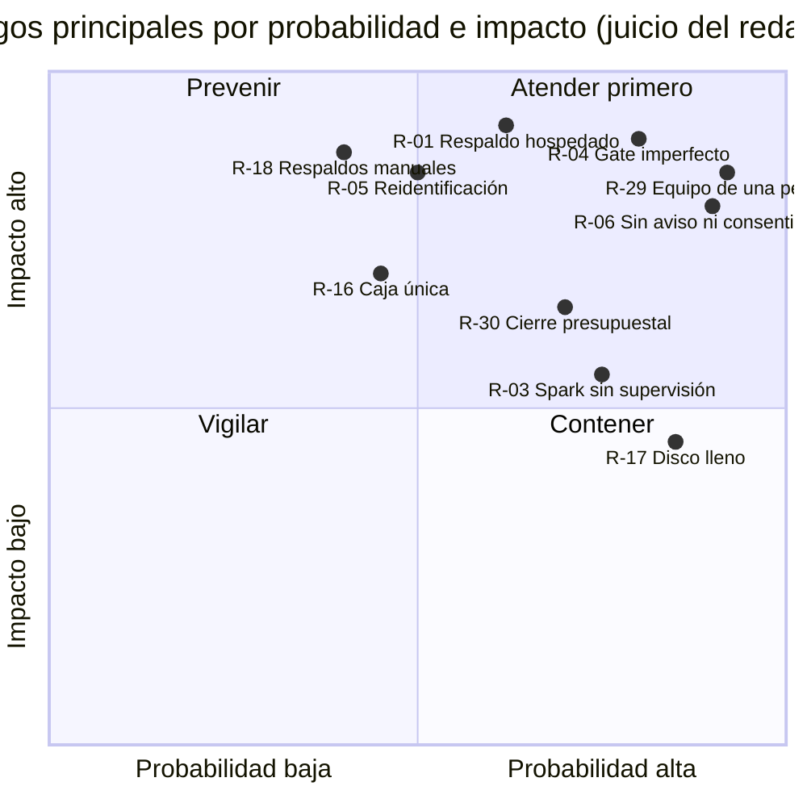

# Registro de riesgos

- **Versión:** 1.1
- **Fecha:** 2026-11-03
- **Estado:** vigente
- **Fuentes:** en el repositorio: `plan/auditoria-ia-2026-10-17.md`, `plan/auditoria-codigo-2026-10-28.md`, `plan/spark-ai-adopcion.md`, `plan/spark-chat-eval-2026-10-26.md`, `plan/anonimizacion-y-voces.md`, `plan/adr-corpus-graph.md`, `infra/fleet/edc-1.md`, `infra/fleet/backups.md`, `infra/fleet/env-manifests.md`, `infra/docker-compose.yml`, `apps/backend/src/lib/anonymise/fallbackGenerator.ts`, `apps/backend/src/lib/graph/queries.ts`, `apps/backend/src/collections/Documents.ts`. Fuera del repositorio: la bitácora del proyecto (registros del 2026-10-21, 2026-10-27 y 2026-10-28), el informe del 21 de octubre y los resultados de evaluación del 2026-10-29.

## Para quién es y qué responde

Este registro es para el Responsable Técnico, para el responsable de desarrollo y para quien evalúe el proyecto desde el CIDE o SECIHTI. Responde: qué puede salir mal en EDC, qué tan probable es, cuánto dañaría, qué lo contiene hoy, qué rol responde y en qué estado está. Consolida los riesgos técnicos, de privacidad, de seguridad, operativos y de proyecto que las auditorías, los planes y la bitácora del proyecto dejaron dispersos.

**Advertencia sobre las calificaciones.** La probabilidad y el impacto de cada riesgo son **juicio de quien redactó este registro** el 2026-10-30, a partir de las fuentes citadas. No salen de una medición ni de un taller de riesgos con el equipo. Conviene que el equipo los revise y los ajuste. Las descripciones y las mitigaciones sí vienen de las fuentes, y cada fila dice de cuál.

## 1. Escalas y convenciones

| Campo | Valores | Significado |
|---|---|---|
| **Probabilidad** | Alta / Media / Baja | Alta: ya ocurrió o es muy probable en los próximos 6 meses. Media: plausible. Baja: requiere una cadena poco probable de hechos |
| **Impacto** | Alto / Medio / Bajo | Alto: daño a personas (exposición de datos), pérdida de datos o detención del proyecto. Medio: degrada el servicio o retrasa entregables. Bajo: molestia o deuda |
| **Severidad** | Crítica / Alta / Media / Baja | Combinación de probabilidad e impacto: Alta y Alto dan Crítica; Alta y Medio o Media y Alto dan Alta; los demás pares dan Media o Baja |
| **Rol responsable** | Responsable técnico / Equipo de desarrollo / Operación / Jurídica | Responsable técnico: Responsable Técnico del proyecto. Equipo de desarrollo: hoy una persona, el responsable de desarrollo. Operación: quien opera la infraestructura (hoy el mismo equipo de desarrollo). Jurídica: área jurídica del CIDE, **por asignar** (no consta en las fuentes) |
| **Estado** | Abierto / Mitigado en parte / Aceptado / Vigilar | Abierto: sin control efectivo. Mitigado en parte: hay control, con huecos. Aceptado: decisión expresa de convivir con él. Vigilar: controlado, pero puede volver |
| **Id** | R-01 a R-41 | Identificadores propios de este registro |

**Contexto que afecta a todas las calificaciones.** Al 2026-10-30 EDC no tiene usuarios reales ni testimonio real de personas externas: los datos de dev son sintéticos, documentos ya existentes del proyecto o desechables (citado de `infra/fleet/edc-1.md`, bitácora de despliegues). Varios riesgos de privacidad tienen hoy impacto bajo y lo tendrán alto el día que llegue el primer testimonio real. La columna de impacto califica ese segundo escenario.

## 2. Mapa de riesgos

## 3. Registro

### 3.1 Privacidad

| Id | Riesgo | Prob. | Impacto | Severidad | Mitigación actual | Rol responsable | Estado | Fuente |
|---|---|---|---|---|---|---|---|---|
| R-01 | **El texto crudo de un testimonio sale a un modelo hospedado.** Si el Spark falla, el detector de anonimización manda el texto sin anonimizar a OpenRouter (respaldo `hosted`, valor por defecto). En staging no hay Spark, así que el detector siempre es hospedado | Media | Alto | **Alta** | Datos sintéticos por ahora. Interruptor de plataforma `detectorFallback` que pasa a `none` (retener). Si la lectura del ajuste falla, el código cae en `none`. Un registro retenido nunca va al modelo hospedado para su título | Equipo de desarrollo | Abierto | `apps/backend/src/lib/anonymise/fallbackGenerator.ts`; `plan/spark-ai-adopcion.md` |
| R-02 | **El Spark pertenece a otra organización.** Recibe texto crudo de testimonios (detector) y voz cruda (transcripción) sin contrato ni acuerdo documentado, y su ubicación física no está confirmada | Alta | Alto | **Crítica** | Conexión cifrada por red privada. Token en el proxy del Spark. Plan de servidor propio | Responsable técnico | Abierto | `plan/spark-ai-adopcion.md` §5 y §7 |
| R-04 | **La anonimización automática falla.** El gate no es determinista. El documento 891 filtró un nombre (citado de la bitácora del proyecto, 2026-10-27); la primera corrida de evals dio `leakRate` 1.0 en un ítem del ecosistema 6 (citado de los resultados de evaluación del 2026-10-29). En la reunión del 21 de octubre se estimó un 99 % de eficacia (estimación verbal, no medida) | Alta | Alto | **Crítica** | Cuatro etapas, verificación de segunda pasada, retención ante cualquier duda, hash que impide re-tirar el veredicto, revisión humana, chequeo de nombres supervivientes tras cada subida, métrica de fuga en `/admin/evals` | Equipo de desarrollo | Mitigado en parte | `apps/backend/src/lib/anonymise/gate.ts` |
| R-05 | **Reidentificación por contexto.** En un ecosistema pequeño basta un oficio, una calle y una pérdida para reconocer a alguien (anexo del informe del 21 de octubre). Agravantes: el umbral del grafo bajó de 3 a 1 mención el 2026-10-21, y el bloque de orientación lleva turnos de otros miembros | Media | Alto | **Alta** | Seudónimos, tachado de colonias y calles, personas privadas excluidas del grafo, grafo solo sobre lo publicado y anonimizado | Responsable técnico | Aceptado (umbral 1 por decisión del 2026-10-21) | `apps/backend/src/lib/graph/queries.ts`; `plan/anonimizacion-y-voces.md` §5 |
| R-06 | **No hay aviso de privacidad, consentimiento informado ni comprobante con folio**, y las conversaciones entran al acervo compartido sin aviso a la persona usuaria | Alta | Alto | **Crítica** | Consentimiento versionado solo para testimonios de estudiantes. Formato de consentimiento fuera del sistema | Responsable técnico | Abierto | Brief v1 §3; `plan/anonimizacion-y-voces.md` §7.2 y §7.5 |
| R-07 | **No hay borrado de cuenta ni canal para derechos ARCO** (acceso, rectificación, cancelación, oposición). Una cuenta con conversación o membresía no se puede borrar en la base | Media | Medio | Media | La persona borra sus documentos y conversaciones, y el borrado llega al servicio de IA | Equipo de desarrollo | Abierto | `apps/backend/src/collections/Users.ts` |
| R-10 | **Retención sin política.** El original crudo vive tanto como el documento; el conserje de conversaciones está apagado; las trazas del servicio de IA guardan la salida del detector, que es la lista de nombres (inferido del código); filas viejas del registro de callbacks conservan transcripciones crudas | Alta | Medio | **Alta** | Las transcripciones nuevas se guardan como longitud y hash; los retiros borran de verdad | Equipo de desarrollo | Abierto | `apps/backend/src/lib/sessionJanitor.ts` |
| R-11 | **El admin de plataforma lee todo, sin bitácora**, incluido el original crudo de los testimonios. Además, la bitácora de revisiones se borra en cascada con el documento | Media | Medio | Media | Solo hay un admin de plataforma; las revisiones se registran mientras exista el documento | Equipo de desarrollo | Abierto | `apps/backend/src/collections/Documents.ts`; `AnonymisationReviews.ts` |
| R-28 | **Retirar no siempre es borrar.** Los turnos de chat que citan un documento después despublicado siguen en el acervo como orientación | Media | Medio | Media | Borrado real de documentos y conversaciones en el servicio de IA desde el 2026-10-17 | Equipo de desarrollo | Aceptado (diferido) | `apps/backend/src/lib/conversationIngest.ts` |
| R-32 | **Datos sensibles por diseño.** Salud (dengue), discapacidad, lengua de las personas, opiniones. Entre los estudiantes podría haber menores; el sistema no registra edad | Alta | Alto | **Crítica** | Gate obligatorio en testimonios; Voces sin sujeto; corpus sintético con adultos de 19 a 82 años (citado de `PROMPT_MAESTRO.md`) | Responsable técnico / Jurídica | Abierto | Informe de privacidad del 2026-10-30 §1 y §5 |
| R-35 | **La evidencia en video expone datos de una cuenta.** Los videos de admin anteriores muestran el correo de una cuenta personal | Alta | Bajo | Media | Chequeo por reconocimiento de texto de nombres reales (ninguno aparece); regrabación manual con una cuenta de demostración | Equipo de desarrollo | Mitigado en parte | Bitácora del proyecto (2026-10-28) |

### 3.2 Seguridad

| Id | Riesgo | Prob. | Impacto | Severidad | Mitigación actual | Rol responsable | Estado | Fuente |
|---|---|---|---|---|---|---|---|---|
| R-08 | **Llave de administración de audio-service con valor por defecto público** en el archivo de despliegue. Esa llave lee transcripciones crudas. No se sabe si dev la usa | Media | Alto | **Alta** | Audio-service no está expuesto a internet de forma directa (inferido de la topología) | Equipo de desarrollo | Abierto | `infra/docker-compose.yml`; auditoría del 2026-10-28, hallazgo 11 |
| R-09 | **Sin cifrado en reposo.** Ni disco, ni Postgres, ni RustFS. Los respaldos no van cifrados y su copia fuera de la caja vive en la laptop del responsable de desarrollo | Media | Alto | **Alta** | Secretos fuera del repositorio; acceso a la caja solo por SSH | Equipo de desarrollo | Abierto | `infra/fleet/backups.md` (diseño no construido); auditoría del 2026-10-17 |
| R-12 | **Sin CSP ni cabeceras de seguridad**; la protección CSRF descansa solo en `SameSite=Lax` | Media | Medio | Media | Imágenes en markdown desactivadas; DOMPurify bloquea `img` e `iframe`; citas construidas sobre el DOM | Equipo de desarrollo | Abierto | `apps/web/svelte.config.js`; `apps/web/src/lib/markdown.ts` |
| R-13 | **Sin límite en inicio de sesión ni en turnos de chat**, y un solo contador de 30 generaciones por minuto para todos los ecosistemas | Media | Medio | Media | Bloqueo de Payload tras 5 intentos; límites del grafo por usuario y ecosistema; el detector se autolimita | Equipo de desarrollo | Abierto | `services/ai-service/src/server.ts` |
| R-14 | **Permisos de servidor amplios.** El contenedor web recibe todos los secretos; backend y servicio de IA entran como superusuario de Postgres; SSH con contraseña habilitada y sin fail2ban según la auditoría del 2026-10-17 (estado actual sin verificar) | Media | Alto | **Alta** | Firewall de Hetzner con solo los puertos 22, 80 y 443 | Equipo de desarrollo | Abierto | Auditoría del 2026-10-17; `infra/fleet/env-manifests.md` §1.5 |
| R-15 | **Credenciales compartidas sin rotar.** Cinco credenciales y la contraseña del admin inicial; la lista de pendientes del proyecto menciona una llave viva en el historial público de `main` (no verificado en esta versión) | Media | Alto | **Alta** | Ninguna confirmada | Equipo de desarrollo | Abierto | Bitácora del proyecto (2026-10-21) |
| R-39 | **Inyección de instrucciones al modelo.** Un documento o una pregunta puede intentar cambiar el comportamiento del chat. Los mensajes `system` inyectados desde el navegador ya se rechazan, pero la parte del motor de chat en el stack de IA sigue abierta | Media | Medio | Media | Cercos del prompt sin identificadores; prueba de inyección en la bitácora §4l; minimizador de datos personales en la salida | Equipo de desarrollo | Mitigado en parte | `plan/auditoria-ia-2026-10-17.md`; auditoría del 2026-10-28, hallazgo 10 |
| R-40 | **Dependencias sin vigilancia.** No hay `pnpm audit`, Dependabot ni Renovate. Starlette 0.41.3 y python-multipart 0.0.20 de audio-service tienen avisos de denegación de servicio conocidos (citado de la auditoría del 2026-10-28) | Media | Medio | Media | Ninguna | Equipo de desarrollo | Abierto | Auditoría del 2026-10-28, sección de bajos |

### 3.3 Técnicos e IA

| Id | Riesgo | Prob. | Impacto | Severidad | Mitigación actual | Rol responsable | Estado | Fuente |
|---|---|---|---|---|---|---|---|---|
| R-19 | **No hay integración continua.** Las pruebas dependen de que alguien las corra a mano; los conteos de pruebas no coinciden entre `TESTING.md` y las notas de contexto del equipo | Alta | Medio | **Alta** | `pnpm test` y `pnpm typecheck` locales; auditorías periódicas | Equipo de desarrollo | Abierto | `TESTING.md` |
| R-23 | **Deuda: arreglos pendientes en el stack de IA.** Hay mejoras pendientes en ai-service y sus paquetes; `ai-client` 0.32 trae un cambio incompatible (verificación estricta de capacidades) | Media | Medio | Media | Lista de mejoras pendientes en el [Roadmap](roadmap.md); correr eslint, typecheck y pruebas de ai-service en cada cambio | Equipo de desarrollo | Vigilar | [ADR-0017](../03-arquitectura/adr/ADR-0017-plataforma-de-ia-agnostica-del-dominio.md) |
| R-24 | **El rerank falla en silencio.** Un error 401 o un timeout devuelven el orden sin reordenar y la respuesta parece normal. Ya hubo timeouts reales en dev | Media | Bajo | Baja | La web reintenta una vez sin rerank | Equipo de desarrollo | Aceptado | `services/ai-service/src/config/env.ts`; `infra/fleet/edc-1.md` |
| R-25 | **El costo registrado está incompleto** y el tope por ecosistema puede agotarse. Las llamadas al Spark y el rerank registran $0 o nada. El tope es $5 USD al mes por ecosistema (citado de `env-manifests.md`); el consumo citado al 2026-10-29 fue de unos $14.78 USD en el ecosistema 7 (citado de la bitácora del proyecto, 2026-10-28), lo que indica que el tope se amplió a mano (inferido) | Media | Bajo | Baja | Reserva atómica de presupuesto que responde 402 al agotarse | Equipo de desarrollo | Vigilar | `services/ai-service/src/services/budget/enforcer.ts` |
| R-26 | **Latencia alta del chat.** DeepSeek vía OpenRouter generó a unos 8.9 tokens por segundo en la evaluación del 2026-10-26 (medido en `plan/spark-chat-eval-2026-10-26.md`); hay esperas de 30 a 60 s sin causa conocida; la caja está en Alemania y los usuarios en México | Alta | Medio | **Alta** | Rerank y condense con timeouts; el Spark es más rápido pero aún no igual de fiel | Equipo de desarrollo | Abierto | `plan/spark-chat-eval-2026-10-26.md` |
| R-27 | **El grafo no tiene cola durable.** Un reinicio o un despliegue pierde la corrida de extracción; un documento de más de unos 96,000 caracteres se trunca sin marca (citado del ADR del grafo §10) | Alta | Bajo | Media | `graphStatus` deja visible el fallo; despliegues agrupados | Equipo de desarrollo | Aceptado (diferido) | `plan/adr-corpus-graph.md` §5.1, §10 |
| R-38 | **Errores de transcripción entran al acervo como hechos.** Lo que Whisper oye mal llega al contexto del chat | Media | Medio | Media | Transcripción como documento editable; el origen se etiqueta en la interfaz | Equipo de desarrollo | Aceptado | `plan/audio-ingest-integration.md` |

### 3.4 Operativos e infraestructura

| Id | Riesgo | Prob. | Impacto | Severidad | Mitigación actual | Rol responsable | Estado | Fuente |
|---|---|---|---|---|---|---|---|---|
| R-03 | **El Spark no tiene supervisión.** Sus servicios corren en sesiones de terminal sin arranque automático: un reinicio los deja caídos. Sin el Spark, dev pierde audio y micrófono en vivo, y el detector cae a hospedado (ver R-01) | Alta | Medio | **Alta** | Respaldos hospedados para vectores y detector; audio con reintentos y cola de fallidos | Operación | Abierto | `plan/spark-ai-adopcion.md` |
| R-16 | **Una sola caja para todo.** Coolify, builds, dev y staging comparten un servidor de 8 GB de RAM. Una caída tumba ambos entornos y el panel; restaurar la imagen revierte los dos a la vez | Media | Alto | **Alta** | Imágenes diarias de Hetzner; respaldos lógicos fuera de la caja | Operación | Aceptado (decisión del 2026-10-16) | `infra/fleet/edc-1.md` §1, §4b |
| R-17 | **El disco se llena con los builds.** Cada despliegue suma de 7 a 16 GB de caché (citado de `edc-1.md` §8). El 2026-10-17 el disco lleno reinició 8 veces la base de Coolify; el 2026-10-21 una limpieza dejó dev caído unos 8 minutos | Alta | Medio | **Alta** | Regla de podar después de cada integración, sin limpiezas concurrentes | Operación | Vigilar | `infra/fleet/edc-1.md` §4c, §4x |
| R-18 | **Respaldos manuales y sin simulacro.** Solo antes de despliegues con migración; sin cron; nunca se ha probado una restauración; el volumen de archivos y la llave `APP_KEY` de Coolify no tienen copia fuera de la caja; staging sin respaldos lógicos desde el 2026-10-17 | Media | Alto | **Alta** | 63 respaldos lógicos manuales con sumas SHA-256 (medido sobre la carpeta de respaldos de edc-1 el 2026-10-30); imágenes diarias de Hetzner (por verificar en el panel) | Operación | Abierto | `infra/fleet/edc-1.md` §4b; `infra/fleet/backups.md` |
| R-20 | **Sin alertas ni monitoreo.** Una caída se descubre a mano | Alta | Medio | **Alta** | Rutas de salud y disponibilidad en cada servicio | Operación | Abierto | Informe de infraestructura del 2026-10-30 §7 |
| R-21 | **Staging desactualizado.** Sigue en una versión anterior desde el 2026-10-17; ya no sirve como réplica de dev | Alta | Bajo | Media | Ninguna | Operación | Abierto | `infra/fleet/edc-1.md` §4zzzz |
| R-22 | **Comportamientos inesperados de Coolify.** Construye la cabeza de `main` y no el SHA pedido; no respeta `${VAR:?}`; su botón de reversión no es fiable; un cambio de variables exige recrear el contenedor | Alta | Bajo | Media | Procedimientos documentados en el runbook | Operación | Vigilar | `infra/fleet/edc-1.md` §3, §4 |
| R-36 | **Documentación inconsistente.** `topology.md`, `runbook.md` y `backups.md` describen una flota de 4 cajas que no existe | Alta | Bajo | Media | Esta documentación en `docs/` parte de `infra/fleet/edc-1.md` | Equipo de desarrollo | Mitigado en parte | Informe de infraestructura del 2026-10-30 §0 |

### 3.5 Proyecto, legal y proveedores

| Id | Riesgo | Prob. | Impacto | Severidad | Mitigación actual | Rol responsable | Estado | Fuente |
|---|---|---|---|---|---|---|---|---|
| R-29 | **El equipo de desarrollo es una persona.** El proyecto convocó a tres o cuatro programadores y el trabajo quedó en uno. Si esa persona falta, nadie más conoce el despliegue, los secretos ni el estado | Alta | Alto | **Crítica** | Documentación exhaustiva (bitácora del proyecto, runbook, esta carpeta `docs/`); asistentes de programación con IA como apoyo | Responsable técnico | Abierto | Informe del 21 de octubre §II |
| R-30 | **Cierre presupuestal.** Después del 2026-10-28 no hay gasto con cargo a la Etapa 1. La compra del servidor propio no consta. El hospedaje y los modelos siguen generando costo mensual | Alta | Medio | **Alta** | Costos bajos medidos: unos $1.86 USD de gasto en dev hacia el 2026-10-24 (citado de `edc-1.md`); caja de unos €12 al mes con respaldos (citado de `edc-1.md`) | Responsable técnico | Abierto | Informe del 21 de octubre §VII |
| R-31 | **Dependencia de proveedores en el extranjero.** Las respuestas y el grafo dependen de OpenRouter (EE. UU.) con DeepSeek de fondo; el rerank de staging de DeepInfra (EE. UU.); el hospedaje de Hetzner (Alemania). Cambios de precio, de política o de disponibilidad pegan directo. Enviar datos ahí es una transferencia internacional sin contrato documentado | Media | Alto | **Alta** | Arquitectura con proveedor intercambiable en el servicio de IA; minimizador de datos personales en la salida; Spark para lo más sensible | Responsable técnico / Jurídica | Abierto | `infra/fleet/edc-1.md`; informe de privacidad §3 y §5 |
| R-33 | **La operación en territorio no está probada.** El proyecto «podría prescindir de casi todo su software, pero no de la operación» (informe del 21 de octubre §I) | Media | Alto | **Alta** | Plan de miniexperimentos con estudiantes en la Etapa 2 | Responsable técnico | Abierto | Informe del 21 de octubre §I |
| R-34 | **El ciclo del brief no se cerró.** No hubo auditoría comunitaria ni veredicto documentado; los criterios de éxito de la Fase 1 se cumplen en parte | Alta | Medio | **Alta** | Narrar la Etapa 1 como andamiaje de proceso y conocimiento (informe del 21 de octubre §VIII) | Responsable técnico | Aceptado | [Visión y alcance](vision-y-alcance.md) §6.3 |
| R-37 | **Material con derechos de autor en el acervo.** 173 lecturas de Semiosis se marcaron como con derechos (heurística «assumed»); la versión V3 de la evidencia incluye 101 en una demostración privada | Media | Medio | Media | Inventario de excluidos en `semiosis-excluidos.tsv`; uso solo en demostración privada | Responsable técnico | Aceptado | Bitácora del proyecto (2026-10-27 y 2026-10-28) |
| R-41 | **Marco legal sin definir.** No está decidido si aplica la ley general para sujetos obligados o la ley para particulares, quién es el responsable formal del tratamiento ni quién atiende quejas. No hay evaluación de impacto formal | Media | Alto | **Alta** | [Evaluación de impacto en privacidad](../06-privacidad-y-seguridad/evaluacion-de-impacto-privacidad.md) en esta documentación | Jurídica | Abierto | Informe de privacidad del 2026-10-30 §5 |

## 4. Resumen

| Severidad | Riesgos | Cuántos |
|---|---|---|
| Crítica | R-02, R-04, R-06, R-29, R-32 | 5 |
| Alta | R-01, R-03, R-05, R-08, R-09, R-10, R-14, R-15, R-16, R-17, R-18, R-19, R-20, R-26, R-30, R-31, R-33, R-34, R-41 | 19 |
| Media | R-07, R-11, R-12, R-13, R-21, R-22, R-23, R-27, R-28, R-35, R-36, R-37, R-38, R-39, R-40 | 15 |
| Baja | R-24, R-25 | 2 |
| **Total** | | **41** |

Los conteos salen de este registro; las severidades son juicio del redactor (ver la advertencia del inicio).

Tres acciones reducen a la vez la mayor parte del riesgo crítico de privacidad, y conviene hacerlas antes de recibir el primer testimonio real:

1. Poner el respaldo del detector en `none` y resolver el alojamiento del modelo detector (R-01, R-02).
2. Construir el aviso de privacidad, el consentimiento y el comprobante (R-06, R-32; ver el [Roadmap](roadmap.md)).
3. Encontrar la causa de la fuga del ecosistema 6 en la primera corrida de evals (R-04).

## 5. Riesgos cerrados desde las auditorías

Se registran para que no se reabran sin saberlo. Están cerrados en el código, verificado el 2026-10-30; no se volvieron a probar.

| Riesgo cerrado | Cierre | Fuente |
|---|---|---|
| Cualquier usuario podía leer el archivo de otro | Corregido | Auditoría del 2026-10-28, crítico 1 |
| Re-tirar el veredicto del gate hasta obtener `ready` | Corregido; migración `20261029_042255` | Ídem, alto 2 |
| El gate dejaba pasar un nombre si el tramo difería en espacios | Corregido | Ídem, alto 3 |
| Revocar a un usuario no le cortaba el chat ni el micrófono; `unlock` abierto | Corregido | Ídem, altos 4 y 5 |
| XSS por la expresión regular de citas | Corregido | Ídem, alto 7 |
| Publicación automática de un documento sin gate | Corregido | Ídem, medio 8 |
| Un testimonio publicado mostraba su texto sin redactar | Corregido en `Documents.ts` | Auditoría del 2026-10-17, I-1 |
| Fuga por la ruta interna `/duplicate` | Corregida y desplegada el 2026-10-23 | `infra/fleet/edc-1.md` §4zf |
| Bypass de autenticación con `Bearer toString` y `trustProxy: true` | `Object.hasOwn`; `TRUSTED_PROXY_HOPS` | Notas de contexto del equipo |

## Referencias

En el repositorio:

- `plan/auditoria-ia-2026-10-17.md`
- `plan/auditoria-codigo-2026-10-28.md`
- `plan/spark-ai-adopcion.md`
- `plan/anonimizacion-y-voces.md`
- `plan/adr-corpus-graph.md`
- `infra/fleet/edc-1.md`, `infra/fleet/backups.md`, `infra/fleet/env-manifests.md`
- `infra/docker-compose.yml`
- `apps/backend/src/lib/anonymise/`
- `apps/backend/src/lib/graph/queries.ts`

Fuera del repositorio:

- Bitácora del proyecto, registros del 2026-10-21, 2026-10-27 y 2026-10-28
- Resultados de evaluación del 2026-10-29

Documentos relacionados en `docs/`:

- [Visión y alcance](vision-y-alcance.md)
- [Roadmap](roadmap.md)
- [Protección de datos](../06-privacidad-y-seguridad/proteccion-de-datos.md)
- [Evaluación de impacto en privacidad](../06-privacidad-y-seguridad/evaluacion-de-impacto-privacidad.md)
- [Seguridad](../06-privacidad-y-seguridad/seguridad.md)
- [Infraestructura y entornos](../05-infraestructura/infraestructura-y-entornos.md)
- [Respaldos y recuperación](../05-infraestructura/respaldos-y-recuperacion.md)
- [Pila de IA](../03-arquitectura/pila-de-ia.md)
