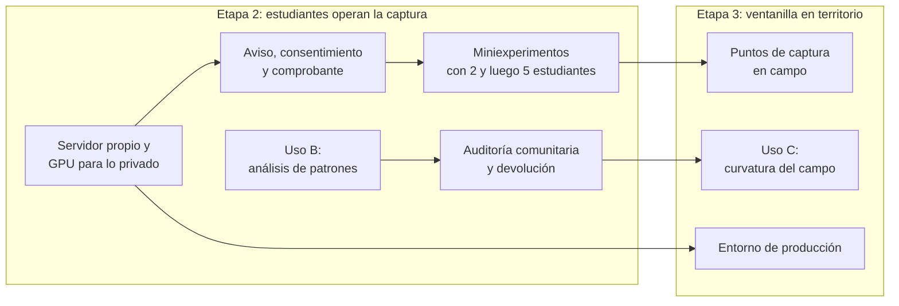

# Roadmap

- **Versión:** 1.1
- **Fecha:** 2026-11-03
- **Estado:** vigente
- **Fuentes:** en el repositorio: `plan/ux-demo-backlog.md`, `plan/corpus-recomendaciones.md`, `plan/spark-ai-adopcion.md`, `plan/spark-chat-eval-2026-10-26.md`, `plan/auditoria-ia-2026-10-17.md`, `plan/auditoria-codigo-2026-10-28.md`, `plan/servidor-desarrollo.md` y `plan/servidor-desarrollo-build.csv`, `plan/justificacion.md`, `plan/adr-corpus-graph.md`, `TESTING.md`, `infra/fleet/edc-1.md`, `infra/fleet/backups.md`, historial de git de `main` (hasta el 2026-10-29). Fuera del repositorio: el brief v1 (2026-05-11), el informe de reunión con desarrollo del 21 de octubre de 2026 (§I a §VIII), la bitácora del proyecto (registros del 2026-10-21 y 2026-10-28) y los resultados de evaluación del 2026-10-29.

## Para quién es y qué responde

Este documento es para quien planee y ejecute las etapas siguientes del proyecto. Responde: hacia dónde va EDC en las Etapas 2 y 3; qué trabajo queda pendiente, agrupado por tema; qué se aplazó a propósito en la Etapa 1 y por qué; y qué decisiones del proyecto siguen abiertas. Lo que sigue es horizonte, no compromiso: ninguna línea tiene fecha ni presupuesto asignado en las fuentes, salvo donde se indica. La prioridad (**Alta**, Media, Baja) es juicio de este documento a partir de las fuentes: Alta significa que bloquea algo o toca privacidad.

Lo construido en la Etapa 1 está en [Visión y alcance](vision-y-alcance.md) §6 y en [Historias de usuario](../02-requisitos/historias-de-usuario.md). La secuencia de hechos está en [Cronología e hitos](cronologia-e-hitos.md).

## 1. Punto de partida

Al cierre de la Etapa 1 (2026-10-28) EDC tiene un prototipo funcional del repositorio de voces y del grafo de conocimiento, un corpus sintético que operó como banco de pruebas y un marco ético alineado con los Principios de Chapultepec (citado del informe del 21 de octubre). Del ciclo del brief v1 existen la captura y la resonancia; faltan la auditoría comunitaria y el veredicto documentado ([Visión y alcance](vision-y-alcance.md) §6.3).

El informe del 21 de octubre fija la premisa de lo que sigue: la Etapa 1 construyó andamiaje, y el problema central pasa a ser la **operación**, el procedimiento sostenido para capturar voces en territorio. El informe advierte que «operable no es pertinente»: un escenario implementable puede ser inútil para el propósito.

## 2. Horizonte: Etapas 2 y 3

### 2.1 Cómo se relacionan fases y etapas

El brief v1 define tres fases por el uso del modelo sobre el acervo. El informe del 21 de octubre §I las redefine por **quién opera la captura**. La correspondencia entre fases y etapas administrativas del convenio no consta en las fuentes; la tabla la propone (inferido: la Fase 1 coincide con la Etapa 1, y las fases siguientes se suceden en el mismo orden).

| Etapa | Fase | Quién opera la captura (informe del 21 de octubre §I) | Uso del modelo (brief v1 §3) |
|---|---|---|---|
| Etapa 1 (cerrada) | Fase 1 | El equipo del proyecto, con corpus sintético y documentos existentes | Uso A: insumos para talleres |
| Etapa 2 | Fase 2 | Estudiantes del CIDE, como operadores y como experimento académico | Uso B: análisis de patrones |
| Etapa 3 | Fase 3 | Una «ventanilla en territorio», el equivalente de una ventanilla de campo | Uso C: curvatura del campo |

Meta a dos años: al menos la mitad de los ecosistemas nutridos y generando inferencia con sentido en el territorio, afinada con las autoridades comunitarias (citado del informe §I).

### 2.2 Etapa 2

| Línea | Qué implica para el software | Depende de | Fuente |
|---|---|---|---|
| **Miniexperimentos con estudiantes del CIDE** | Primero 2 y luego 5 estudiantes como operadores de la captura, y uno de mayor escala hacia el final del segundo ciclo. Semiosis práctica funciona como prototipo del ecosistema de estudiantes, con posible grupo de control. La vista de estudiante ya existe | Diseño del primer miniexperimento (Responsable Técnico); aviso y consentimiento | Informe del 21 de octubre §I, §VIII |
| **Aviso de privacidad, consentimiento y comprobante ético** | Lo que el brief v1 pedía y no se construyó: aviso, consentimiento informado, folio y PDF. Es condición para recibir testimonio real | Decidir cómo registrar el consentimiento sin guardar quién habla | Brief v1 §3 y §4; [Aviso de privacidad y consentimiento](../06-privacidad-y-seguridad/aviso-de-privacidad-y-consentimiento.md) |
| **Operación por voz** | Un servidor MCP (protocolo que permite a un asistente de IA operar herramientas) para usar la plataforma por voz. Las peticiones de campo incluyen dictar una lista de participantes, interfaz en totonaco, versión solo texto, emitir constancias y enviarlas por WhatsApp | Ninguna técnica previa | Informe del 21 de octubre §III |
| **Uso B: análisis de patrones** | Recurrencias, tensiones y silencios del acervo. El grafo y GraphRAG ya adelantan la base | Más acervo real | Brief v1 §3 |
| **Auditoría comunitaria y devolución** | El paso del ciclo que faltó en la Etapa 1: llevar resonancias a la comunidad y registrar el veredicto como dato. El mecanismo de devolución «aún no está diseñado» | Uso A o Uso B con acervo suficiente | Informe del 21 de octubre §IV, principio 4 |
| **Servidor propio y GPU para las cargas privadas** | Ver §3.3 | Compra del equipo | `plan/servidor-desarrollo.md` |
| **Estrategia de datos** | Qué datos, con qué reglas y para quién. El informe la llama «la carencia técnica más seria»; contempla una consultoría en 2027 de unos $30,000 MXN (citado del informe §VI, estimación) | Responsable Técnico | Informe del 21 de octubre §VI |
| **Componente analítico independiente** | La métrica de divergencia con [analista de grafos]: un análisis que no dependa de que el software funcione | Entrega de un componente pendiente del equipo | Informe del 21 de octubre §VII |

### 2.3 Etapa 3

| Línea | Qué implica para el software | Depende de | Fuente |
|---|---|---|---|
| **Ventanilla en territorio** | Puntos de captura en campo. El número de puntos define el alcance territorial real | Miniexperimentos de la Etapa 2; aviso y consentimiento | Informe del 21 de octubre §I |
| **Uso C: curvatura del campo** | Detectar la forma estructural del espacio que atraviesan las personas de un ecosistema. No iniciado en software; la métrica de divergencia es su antecedente | Acervo denso y heterogéneo | Brief v1 §3; informe del 21 de octubre §VII |
| **Entorno de producción** | Hoy solo existen dev y staging. Producción necesita respaldos programados y cifrados, monitoreo y la decisión de dónde alojar | §3.2 | `infra/fleet/edc-1.md` |
| **Diversidad lingüística** | Interfaz en una lengua indígena (principio 9 de Chapultepec). Hoy la interfaz y la transcripción solo existen en español | Modelos con cobertura de náhuatl o zapoteco | Informe del 21 de octubre §IV |

### 2.4 Trabajo fuera del software

El informe del 21 de octubre §VIII lista acciones del equipo que no son código: capturar el informe de Etapa 1 (del 2026-10-28 al 2026-11-18, fecha por confirmar), redactar el brief de construcción del corpus sintético y de las pruebas, definir quién transcribe los audios de campo, una revisión breve de literatura sobre metodologías de IA para problemas sociales, y presentar el prototipo en espacios académicos para reclutar interesados desde noviembre de 2026.

## 3. Trabajo pendiente por tema

### 3.1 Privacidad y seguridad

Antes de recibir el primer testimonio real conviene cerrar los tres primeros puntos ([Registro de riesgos](registro-de-riesgos.md) §4).

| Pendiente | Prioridad | Fuente |
|---|---|---|
| Poner el respaldo del detector de anonimización en `none` (retener en vez de enviar a un modelo hospedado si el Spark falla) y obtener el visto bueno sobre el equipo que aloja el Spark | **Alta** | `apps/backend/src/lib/anonymise/fallbackGenerator.ts`; `plan/spark-ai-adopcion.md` |
| Encontrar la causa de la fuga del ecosistema 6 en la primera corrida de evals: un `documento` sintético terminó `ready` con sus 3 nombres privados. Puede ser el detector, la regla de figuras públicas o el comparador de la evaluación | **Alta** | Resultados de evaluación del 2026-10-29 |
| Construir el aviso de privacidad, el consentimiento y el comprobante (ver §2.2) | **Alta** | Brief v1 §3 y §4 |
| Quitar el valor por defecto público de la llave de administración de audio-service y confirmar qué valor usa dev | **Alta** | `infra/docker-compose.yml`; auditoría del 2026-10-28, hallazgo 11 |
| Rotar la contraseña del admin inicial y cinco credenciales compartidas. Pendiente: confirmar y rotar una de ellas, que podría seguir en el historial de `main` | **Alta** | Bitácora del proyecto (2026-10-21) |
| Límites de tamaño de cuerpo y puertos publicados solo hacia la interfaz local en `infra/docker-compose.override.yml` | Media | Auditoría del 2026-10-28 |
| Comprobar qué hallazgos medios de privacidad (8 a 11) quedaron cubiertos por las correcciones del 2026-10-29 | Media | `plan/auditoria-codigo-2026-10-28.md` |
| Rastrear qué documentos originan nombres de colonias en el grafo | Media | Bitácora del proyecto (2026-10-28) |
| Verificar que la cabecera CSP de imágenes existe; el código muestra la imagen como texto, la cabecera no está verificada | Media | Auditoría del 2026-10-28, hallazgo 6 |
| Política de retención de transcripciones crudas, conserje de conversaciones y trazas del servicio de IA | Media | [Registro de riesgos](registro-de-riesgos.md), R-10 |
| Borrado de cuenta y canal para derechos ARCO | Media | [Registro de riesgos](registro-de-riesgos.md), R-07 |
| Confirmar si se ejecutó en dev la purga de filas del grafo sacadas de texto sin depurar | Baja | `plan/auditoria-ia-2026-10-17.md`, G-2 |

### 3.2 Infraestructura y operación

| Pendiente | Prioridad | Fuente |
|---|---|---|
| Respaldos programados y cifrados de ambas bases y del volumen de archivos, con un simulacro de restauración. Hoy son manuales, sin cifrar y sin prueba | **Alta** | Auditoría del 2026-10-17; `infra/fleet/backups.md` (diseño) |
| Guardar fuera de la caja una copia de la llave `APP_KEY` de Coolify; sin ella, una base de Coolify restaurada no descifra las variables | **Alta** | `infra/fleet/edc-1.md` §2 |
| Alertas de disco, memoria y caída, y monitoreo externo de disponibilidad | Media | Bitácora del proyecto (2026-10-21) |
| Activar integración continua: los flujos de pruebas existen solo dentro de `services/ai-service/.github/` y no corren | Media | `services/ai-service/.github/workflows/ci.yml` |
| Volver a desplegar staging, que sigue en una versión anterior desde el 2026-10-17 | Media | `infra/fleet/edc-1.md` §4zzzz |
| Configurar el webhook de despliegue automático (Coolify indica «auto-deploy on», pero no hay webhook) | Baja | `infra/fleet/edc-1.md` |

### 3.3 IA en el Spark y servidor propio

El NVIDIA DGX Spark prestado sirve hoy la transcripción, el detector de anonimización y los vectores de dev. La dirección es mover esas cargas a hardware que controle el proyecto, para que el texto crudo no salga a terceros ([ADR-0012](../03-arquitectura/adr/ADR-0012-adopcion-del-dgx-spark-por-fases.md)).

| Pendiente | Prioridad | Fuente |
|---|---|---|
| Compra del servidor de desarrollo con GPU: presupuesto de $53,000 MXN con IVA (citado de la bitácora del proyecto, 2026-10-28); lista cotizada de $49,544 MXN con IVA (citado de `plan/servidor-desarrollo-build.csv`, precios del 2026-09-28 al 2026-10-01). Incluye factura CFDI, puesta en marcha y respaldos fuera del sitio. La compra no consta | Media | `plan/servidor-desarrollo.md`; `plan/justificacion.md` |
| Fortalecer el Spark mientras se use: arranque automático tras reinicio y rotación del token | Media | `plan/spark-ai-adopcion.md` |
| Chat en el Spark: ajustar los prompts para Qwen, un endpoint por nivel en ai-service, mover condense y expansión de consulta. Si no basta, probar gpt-oss-120b | Media | `plan/spark-chat-eval-2026-10-26.md` |
| Para inferencia grande, solicitar capacidad pública (Coatlicue o el Clúster Nacional de Cómputo de Alto Rendimiento e IA) | Baja | Informe del 21 de octubre §VI y anexo |
| Liberar el modelo de Whisper cuando está inactivo | Baja | `plan/spark-ai-adopcion.md` |

### 3.4 Corpus y datos

| Pendiente | Prioridad | Fuente |
|---|---|---|
| Antes de recargar el acervo, borrar del servicio de IA los 12 documentos retenidos que siguen publicados ahí (medido el 2026-10-24) | Media | `plan/corpus-recomendaciones.md` |
| Corpus nuevo de unas 280 piezas (costo estimado de $2 a $3.5 USD, inferido en la fuente) | Media | `plan/corpus-recomendaciones.md` |
| Semiosis práctica: reconocimiento de texto para 72 PDF escaneados sin capa de texto y siembra por wikilinks | Media | Bitácora del proyecto (2026-10-28) |
| Volver a medir el estado del grafo en los ecosistemas 6, 7 y 8 tras el despliegue del 2026-10-29 y limpiar 18 entidades huérfanas | Media | Bitácora del proyecto (2026-10-28) |
| Resolver los documentos retenidos a propósito para la demostración de Revisión (1031, 1039 y 1129) | Baja | Bitácora del proyecto (2026-10-28) |
| Limpiar ecosistemas y usuarios de prueba acumulados en dev | Baja | Lista de pendientes del proyecto |

### 3.5 Interfaz y experiencia de uso

| Pendiente | Prioridad | Fuente |
|---|---|---|
| Pruebas de experiencia de uso con personas | Media | Bitácora del proyecto (2026-10-28) |
| Página de funciones por ecosistema para el admin de plataforma | Media | Bitácora del proyecto (2026-10-28) |
| Regrabar los videos de evidencia de admin con una cuenta de demostración, sin mostrar el correo de una cuenta personal | Media | Bitácora del proyecto (2026-10-28) |
| Verificar en dev las correcciones de citas fuera de rango, la tarjeta de adjunto y las citas en Resonancias | Media | Bitácora del proyecto (2026-10-28) |
| Ajustes del micrófono en vivo | Baja | Bitácora del proyecto (2026-10-28) |
| Correcciones menores en el compositor de mensajes y en la colección `Documents` | Baja | Bitácora del proyecto (2026-10-28) |

### 3.6 Calidad, evaluaciones y documentación

| Pendiente | Prioridad | Fuente |
|---|---|---|
| Encontrar la causa de las esperas de 30 a 60 s en el chat | Media | `plan/spark-chat-eval-2026-10-26.md` |
| Revisar el prompt del juez de citas, que aprobó como respaldada una cita sin soporte | Media | Bitácora del proyecto (2026-10-28) |
| Medir el rerank encendido contra apagado; nunca se midió | Baja | `plan/auditoria-ia-2026-10-17.md`, C-8 |
| Volver a correr la evaluación de GraphRAG con la métrica de citas de `/admin/evals` | Baja | `apps/backend/src/eval/RESULTS.md` |
| Métricas de chat por tokens; hoy solo hay costo | Baja | Lista de pendientes del proyecto |
| Mejoras pendientes del stack de IA: ingesta de 1 a 2 millones de caracteres, etiqueta del proveedor de vectores, `fuseMatches`, `title.ts`, exención de datos personales | Baja | Lista de pendientes del proyecto |
| Actualizar `TESTING.md` (conteos del 2026-10-17, llegada de happy-dom a la web) y escribir un README para `scripts/cite-eval/` | Baja | `TESTING.md`; mensaje de commit del 2026-10-28 |
| Marcar `plan/deploy-and-local-demo.md`, `infra/fleet/topology.md`, `runbook.md` y `backups.md` como diseño no construido | Baja | [Infraestructura y entornos](../05-infraestructura/infraestructura-y-entornos.md) |

## 4. Lo que se aplazó a propósito y por qué

El 2026-10-28, antes de grabar la evidencia en video, el proyecto adoptó un criterio de triaje: arreglar de inmediato solo lo que rompía o filtraba datos en los flujos que se iban a grabar, y dejar listado lo demás. Lo que sigue quedó aplazado por ese criterio o por otra razón registrada.

| Aplazado | Por qué | Fuente |
|---|---|---|
| Unos 70 hallazgos medios y bajos de la auditoría del 2026-10-28: equipos creados en otra organización, cambio de correo hacia una dirección sin reclamar, sin tope de reintentos del gate, sin límite de turnos de chat, columnas de control escribibles por REST, CSRF solo con SameSite, cabeceras de seguridad, imagen del servicio de IA como root, audio atascado tras 4 h, WebM que crece 37 veces al pasar a WAV, caída larga del Spark que borra el audio fuente | Criterio de triaje del 2026-10-28: no estaban en los flujos grabados | `plan/auditoria-codigo-2026-10-28.md` |
| Turnos de conversación que citan un documento después despublicado o borrado siguen en el acervo como orientación | Aplazado desde la auditoría del 2026-10-21; el borrado real cubre documentos y conversaciones, no los turnos que los citan | `apps/backend/src/lib/conversationIngest.ts`; `apps/web/src/lib/server/engine/orientation.ts` |
| Borrado de cuenta y de organizaciones; falla si hay conversación o membresía | Sin flujo de autoservicio; las cascadas solo se arreglaron para valoraciones y estudiantes | Auditoría del 2026-10-17 |
| Cola durable para la extracción del grafo; un reinicio pierde la corrida y un documento de más de unos 96,000 caracteres se trunca sin marca | Deuda aceptada en el diseño del grafo | `plan/adr-corpus-graph.md` §5.1, §10 |
| Límites de tasa compartidos entre réplicas; hoy viven en la memoria del proceso | Solo hay una réplica | `plan/adr-corpus-graph.md` §15 |
| Límite de 1,500 nodos en `/grafo` | Rendimiento futuro; no hace falta con el acervo actual | Bitácora del proyecto (2026-10-28) |
| Búsqueda de texto completo en Conexiones | Fuera de los flujos de la demostración | `plan/ux-demo-backlog.md` #31 |
| Fallos por cercos JSON del servicio de IA | Corregido en parte | `plan/ux-demo-backlog.md` #16 |
| Transcripción en GPU para staging y producción; almacenamiento de objetos para producción | No hay producción | Lista de pendientes del proyecto |
| Revisión humana de los testimonios retenidos del corpus sintético; no se puede aprobar en lote | Requiere tiempo humano | Notas de contexto del equipo |
| Unificar los dos arneses de Postgres para pruebas | Deuda de pruebas | `plan/auditoria-ia-2026-10-17.md`, T-13 |
| Quitar unas 150 líneas de un conserje de agenda copiado tres veces | Limpieza sin efecto funcional | Notas de contexto del equipo |
| Varias llaves y presupuestos de IA por ecosistema, con varios servidores de IA | Decidido y sin construir: hoy hay un operador y una llave | [ADR-0015](../03-arquitectura/adr/ADR-0015-un-operador-y-una-llave-de-ia.md) |
| Modelo de chat en hardware propio | La evaluación del 2026-10-26 concluyó que el modelo local aún no iguala al hospedado en las respuestas | [ADR-0013](../03-arquitectura/adr/ADR-0013-chat-no-se-mueve-al-spark.md); `plan/spark-chat-eval-2026-10-26.md` |
| Etiquetas de la vista de administración | Se decidió dejarlas como están | `plan/ux-demo-backlog.md` #17 |

## 5. Decisiones pendientes

Decisiones del proyecto que siguen abiertas al 2026-11-03. Cada una afecta al producto o a la protección de datos.

- **Dónde corren las cargas privadas.** Seguir con el Spark prestado, servidor propio o capacidad pública. La ubicación física del Spark sigue sin confirmar (`plan/spark-ai-adopcion.md` §7; `plan/servidor-desarrollo.md`).
- **Qué pasa si el Spark cae.** Enviar el texto al detector hospedado (`hosted`) o retenerlo (`none`).
- **Qué datos puede ver en crudo el detector hospedado:** direcciones, teléfonos, CURP y RFC.
- **Cuánto tiempo se guarda una transcripción cruda.** No hay política.
- **Si un revisor puede aprobar una retención sobre su propia subida** o se exige otra persona (auditoría del 2026-10-28).
- **Cómo se libera una retención:** el diseño del flujo no consta.
- **Límite de tasa por ecosistema.** Hoy todos comparten un contador de 30 generaciones por minuto (auditoría del 2026-10-28).
- **Si importa la latencia transatlántica** (caja en Alemania, usuarios en México): medir o mover la caja.
- **Qué GPU lleva el servidor propio.** La RTX 5070 de 12 GB cotizada o una RTX 5060 Ti de 16 GB (`plan/servidor-desarrollo.md`).
- **Regla de nodos y tipo de grafo.** Umbral de 1 mención (vigente) o mayor; grafo por ecosistema, general o combinado (informe del 21 de octubre §VI y §VIII).
- **Si se genera el corpus nuevo de unas 280 piezas** (`plan/corpus-recomendaciones.md`).
- **Qué hacer con el audio de prueba**, que es un fragmento de una junta real: conservarlo o borrarlo.
- **Si se conservan los videos automáticos** como respaldo de los grabados a mano.

## Referencias

En el repositorio:

- `plan/ux-demo-backlog.md`
- `plan/corpus-recomendaciones.md`
- `plan/spark-ai-adopcion.md`
- `plan/spark-chat-eval-2026-10-26.md`
- `plan/auditoria-ia-2026-10-17.md`
- `plan/auditoria-codigo-2026-10-28.md`
- `plan/servidor-desarrollo.md`, `plan/servidor-desarrollo-build.csv` y `plan/justificacion.md`
- `plan/adr-corpus-graph.md`
- `TESTING.md`
- `infra/fleet/edc-1.md`, `infra/fleet/backups.md`

Fuera del repositorio:

- Brief v1 del Repositorio de Voces y Resonancias (2026-05-11)
- Informe de reunión con desarrollo del 21 de octubre de 2026
- Bitácora del proyecto, registros del 2026-10-21 y 2026-10-28
- Resultados de evaluación del 2026-10-29

Documentos relacionados en `docs/`:

- [Visión y alcance](vision-y-alcance.md)
- [Cronología e hitos](cronologia-e-hitos.md)
- [Registro de riesgos](registro-de-riesgos.md)
- [Índice de ADR](../03-arquitectura/adr/README.md)
- [Seguridad](../06-privacidad-y-seguridad/seguridad.md)
- [Estrategia de pruebas](../07-calidad/estrategia-de-pruebas.md)
- [Evaluaciones de IA](../07-calidad/evaluaciones-de-ia.md)
- [Despliegue y runbook](../05-infraestructura/despliegue-y-runbook.md)
