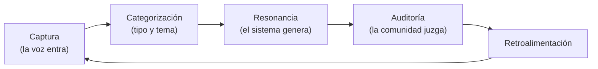

# Visión y alcance de Ecosistemas de Conocimiento

- **Versión:** 1.4
- **Fecha:** 2026-11-12
- **Estado:** vigente
- **Fuentes:** en el repositorio: `plan/anonimizacion-y-voces.md`, `plan/funcionalidades.md`, `plan/spark-ai-adopcion.md`, `plan/spark-chat-eval-2026-10-26.md`, `plan/servidor-desarrollo-build.csv`, `infra/fleet/edc-1.md`, `infra/fleet/env-manifests.md` y el código en `main` del 2026-10-29. En la carpeta del proyecto, fuera del repositorio (`cide/plan/`): `briefs/v1-brief-repositorio-voces-resonancias.md` (brief v1, 2026-05-11), `briefs/v0-brief-proyecto-plataforma-ia.md`, `docs/Textos del proyecto/Desarrollo (metodología)/Informe de reunión con desarrollo — 21 de octubre de 2026.docx` (informe del 21 de octubre), `docs/Textos del proyecto/Proyecto/` (carta SECIHTI, «Estado del Proyecto IH-2025-I-445») y la bitácora del proyecto (registros del 2026-10-21, 2026-10-27 y 2026-10-28).

## Para quién es y qué responde

Este documento es para el equipo del proyecto, para quien revise el informe de la Etapa 1 en el CIDE o en SECIHTI y para quien herede el desarrollo. Responde cinco preguntas. Qué es Ecosistemas de Conocimiento (EDC) y qué problema resuelve. Quién lo financia y con qué. Qué prometía el brief de la Etapa 1 y qué se entregó en realidad, punto por punto. Qué quedó fuera y por qué. Y bajo qué supuestos y restricciones se construyó. Lo que no se construyó se dice con claridad; lo planeado se marca como planeado.

## 1. Qué es EDC

**Ecosistemas de Conocimiento (EDC)** es la plataforma de software del proyecto SECIHTI IH-2025-I-445 del CIDE. Su marco conceptual se llama **Repositorio de Voces y Resonancias**.

El brief v1 lo define así: «no es un archivo documental ni un chatbot. Es un sistema de doble flujo». Recibe contribuciones situadas de las personas de cada ecosistema, que el proyecto llama **voces**. Con el acervo acumulado produce materiales que regresan al campo para que esas mismas comunidades los evalúen y corrijan, que el proyecto llama **resonancias**. Existe para producir ciclos, no para ser consultado (brief v1 §1).

Un **ecosistema** es un grupo de personas en torno a un fenómeno social, como el dengue o la discapacidad. Cada ecosistema tiene su propio acervo, sus temas, sus miembros con roles y sus funciones activables. Técnicamente, cada ecosistema es una organización aislada (ver [Actores y glosario](actores-y-glosario.md)).

La plataforma es **agnóstica a los ecosistemas**: provee la infraestructura de captura, organización, roles, generación y revisión, y cada ecosistema configura encima sus temas, sus instrumentos y su comunidad (brief v1 §1).

### 1.1 Qué hace la plataforma hoy

Al cierre de la Etapa 1 (2026-10-28), EDC permite a las personas de un ecosistema:

- **Aportar material.** Subir documentos (PDF, DOCX, XLSX, XLS, CSV, HTML, Markdown), audio y notas escritas. El audio se transcribe a texto en español. También se puede dictar con el micrófono y ver el texto mientras se habla.
- **Proteger a las personas.** Todo testimonio pasa por un **gate de anonimización** (un filtro automático que tacha nombres, domicilios y datos de contacto antes de publicar). Si el filtro duda, retiene el texto para revisión humana.
- **Conversar con el acervo.** Un chat con **RAG** (generación con recuperación: el modelo responde citando fragmentos del acervo con marcas [n] que llevan a la fuente). Tiene dos pestañas: **Generales**, que responde con fuentes, y **Resonancias**, una entrevistadora que hace preguntas a partir de los conceptos del acervo.
- **Explorar el acervo.** Una **Biblioteca** de lo publicado y un mapa de **Conexiones** (un grafo de conocimiento con temas, lugares, organizaciones y sus relaciones, en 2D y 3D).
- **Aprender e investigar.** Una vista de estudiante y una vista docente de seguimiento, activables por ecosistema.
- **Cuidar el ecosistema.** Pantallas de Revisión, Miembros, Ajustes y un resumen de administración.

El detalle por historia de usuario está en [Historias de usuario](../02-requisitos/historias-de-usuario.md).

Esta sección describe la plataforma al cierre de la Etapa 1. Las correcciones posteriores, hasta la línea de corte del 2026-11-12 (f971d54c, etiqueta `etapa-1-con-correcciones`), están en [Cronología e hitos](cronologia-e-hitos.md) §4.1 y en el [Roadmap](roadmap.md) §3.0; lo que quedó abierto, en el [Roadmap](roadmap.md#lo-que-quedó-abierto-al-cierre-de-la-etapa-1). Ramas: `etapa-1` (52a4a1a1) es la Etapa 1 sin correcciones, `main` la Etapa 1 con correcciones y `etapa-2` el trabajo nuevo.

## 2. El problema que resuelve

El proyecto parte de un problema de circulación del sentido. Las personas que viven un fenómeno, como una epidemia de dengue o una discapacidad, saben cosas que las instituciones no escuchan. Cuando ese saber llega a una institución, suele llegar resumido por un intermediario. El informe del 21 de octubre lo formula así: «la voz se vuelve legible cuando se acumula, no cuando un intermediario la resume» (§V).

EDC responde con tres capacidades:

1. **Acumular voces de forma segura.** Recoger testimonios en cualquier formato, quitarles lo que identifica a las personas y guardarlos organizados por ecosistema.
2. **Devolver al campo.** Usar modelos de lenguaje sobre ese acervo para producir materiales que la comunidad pueda revisar: respuestas con fuentes, preguntas que profundizan un relato, mapas de lo que aparece junto.
3. **Hacer auditable la inferencia.** Cada respuesta cita su fuente, y la meta es que toda inferencia vuelva a la comunidad para ser juzgada («esto nos representa / esto no»).

El horizonte declarado en el brief v1 §2 es la **justicia epistémica**: el derecho de cualquier persona a generar sentido sobre su realidad situada, en vez de habitar el guion de otras realidades. Si el acervo crece lo suficiente, permitiría inferir la **curvatura** del campo (la forma estructural del espacio que atraviesan las personas de un ecosistema). La Etapa 1 no construye esa métrica; siembra el acervo y deja conectado el ciclo que la haría posible.

## 3. Institución, programa, convenio y presupuesto

| Concepto | Dato | Procedencia |
|---|---|---|
| Institución | Centro de Investigación y Docencia Económicas (CIDE). El responsable técnico está adscrito a la DEM-CIDE | Citado de la carta SECIHTI (`cide/plan/docs/Textos del proyecto/Proyecto/`) |
| Financiador | SECIHTI, Dirección de Investigación Humanística | Citado de la carta SECIHTI |
| Programa presupuestario | F003, «Convocatoria Investigación humanística 2025» | Citado de la carta SECIHTI |
| Clave de la propuesta | IH-2025-I-445 | Citado de la carta SECIHTI |
| Nombre institucional | «Ecosistemas de conocimiento y aprendizaje situado: hacia la implementación de plataformas interactivas humanístico-digitales y de código abierto para la construcción ético-dialógica de saberes pluriepistémicos con impacto social» | Citado de la carta SECIHTI |
| Convenio | C-1991/2026. El informe del 21 de octubre usa el nombre «Ecosistemas Glocales de Aprendizaje Situado» | Citado del informe del 21 de octubre, tabla de datos de la reunión |
| Representante legal | Firma la carta en representación de la institución | Citado de la carta SECIHTI |
| Responsable Técnico | Investigador principal, adscrito al CIDE-DEM | Citado del informe del 21 de octubre |
| Ministración de la Etapa 1 | $150,000 MXN, recibida el 2026-05-06 | Citado de «Estado del Proyecto IH-2025-i-445» |
| Partidas citadas | Desarrollo de aplicaciones $50,000; infraestructura y conectividad $40,000; bienes informáticos $30,000 (MXN) | Citado de «Estado del Proyecto». Las tres suman $120,000; la fuente no desglosa los $30,000 restantes (inferido por aritmética) |
| Fase preoperativa | De agosto de 2025 al 2026-05-06 | Citado de «Estado del Proyecto» |
| Cierre de la Etapa 1 | 2026-10-28. Después de esa fecha no hay gasto | Citado del informe del 21 de octubre §VII |
| Captura del informe de Etapa 1 | Del 2026-10-28 al 2026-11-18, fecha por confirmar | Citado del informe del 21 de octubre §VIII |
| Marco ético adoptado | Los diez Principios de Chapultepec (SECIHTI y ATDT, 2026-01-29), con matriz de correspondencia | Citado del informe del 21 de octubre §IV |
| Servidor de desarrollo propio | Presupuesto de $53,000 MXN con IVA; la lista de piezas cotizada suma $49,544 MXN con IVA (precios del 2026-09-28 al 2026-10-01). No consta la compra | Citado de la bitácora del proyecto (2026-10-28) y de `plan/servidor-desarrollo-build.csv` |
| Costo de la caja de hospedaje | Unos €9.99 al mes más unos €2.00 al mes de respaldos (Hetzner, cx33) | Citado de `infra/fleet/edc-1.md` (lista de precios de la API de Hetzner, 2026-10-17) |

Restricción del informe de Etapa 1: «los objetivos, metas y entregables registrados en SALSA no cambian ni una palabra. La evolución metodológica se narra dentro de ellos» (informe del 21 de octubre §VIII). Este documento no reescribe esos entregables; los mapea contra lo construido.

## 4. El ciclo del Repositorio de Voces y Resonancias

El brief v1 §3 define el ciclo completo. La reunión del 18 de abril de 2026 lo fijó con el nombre «generación» en lugar de «resonancia» (`cide/plan/reus/260418/`); el brief del 11 de mayo usa «resonancia».

Qué significa cada paso según el brief, y qué existe hoy en EDC:

| Paso | Qué pide el brief v1 §3 | Qué existe al 2026-10-28 |
|---|---|---|
| Captura | La persona llega por QR o liga, se registra, sube texto, audio, video o imagen, por partes. Recibe un comprobante ético con folio | Subida de documentos, audio, video y notas; dictado en vivo; transcripción. Sin QR, sin registro abierto, sin imagen, sin comprobante |
| Perfil y destino | Un mini-formulario enruta la contribución a una sub-base por tipo de vínculo con el fenómeno | No construido. En el corpus sintético v2 de Discapacidad existe la columna `grupo` con cuatro grupos de vínculo, pero como dato de prueba, no como formulario |
| Categorización | Ejes independientes: tipo de contribución y temática por ecosistema, con temáticas emergentes sugeridas | `contentKind` (`documento`, `testimonio`, `conversacion`) separa tipos con efecto en privacidad. Las columnas `tema` y `lengua` existen en `documents`. El grafo extrae temas de forma automática. No hay menú de temáticas por ecosistema administrado a mano |
| Resonancia individual | Sesión de chat que profundiza la contribución de forma mayéutica | Pestaña **Resonancias** y el interruptor «Hazme preguntas» en Generales |
| Resonancia de corpus (Uso A) | Materiales para llevar a taller, generados del acervo | Parcial: respuestas citadas, «panorama del corpus», «Preguntas para investigar» del estudiante. No hay una función dedicada a generar insumos de taller |
| Auditoría | Sesión comunitaria que evalúa lo generado; el veredicto es dato | Valoración de 1 a 5 estrellas con comentario por respuesta. La auditoría comunitaria no se realizó ni tiene función propia |
| Retroalimentación | Lo auditado regresa al ciclo | Los turnos de conversación, ya anonimizados, entran al acervo como **orientación**: guían respuestas futuras pero nunca se citan |

## 5. Los tres usos del modelo sobre el acervo

El brief v1 §3 distingue tres usos de la «resonancia de ecosistema»:

| Uso | Qué hace | Masa de acervo que necesita | Fase prevista | Estado al 2026-10-28 |
|---|---|---|---|---|
| **A. Insumos para talleres** | Genera materiales concretos para la comunidad (estrategias, narrativas prototipo, preguntas detonadoras), conservando el tono de los testimonios | Poca | Fase 1 | Las piezas técnicas existen (RAG con citas, estilo de respuesta por ecosistema, modo entrevista). No se construyó una función de «generar insumo de taller» ni se hizo el taller |
| **B. Análisis de patrones** | Identifica recurrencias, tensiones y silencios del acervo | Más | Fase 2 | Adelantado en parte: el grafo de conocimiento, GraphRAG (recuperación apoyada en el grafo) y el grafo combinado entre ecosistemas. No hay un informe de patrones |
| **C. Curvatura del campo** | Detecta la forma estructural del espacio que atraviesan las personas | Acervo denso y heterogéneo | Fase 3 | No iniciado en software. La métrica de divergencia del colaborador externo y el analista de grafos es su antecedente (informe del 21 de octubre §VII) |

## 6. Objetivos de la Etapa 1 y criterios de éxito

El brief v1 §4 fija dos entregables «según convenio» y tres criterios de éxito.

### 6.1 Entregable 1: plataforma del repositorio

| # | Capacidad mínima del brief v1 §4 | Estado | Qué se entregó y dónde verlo |
|---|---|---|---|
| 1 | Registro y autenticación de participantes, en 2 pasos como máximo | **Distinto** | Autenticación con correo y contraseña, sesión web por cookie y tokens entre servicios. El registro público está **cerrado** por decisión del responsable de desarrollo del 2026-10-21: las cuentas las crea un administrador o se invitan desde Miembros. Ver [Matriz de roles y permisos](../02-requisitos/matriz-roles-y-permisos.md) |
| 2 | Captura multiformato (texto, audio, video, imagen), por partes | **Parcial** | Texto, notas, PDF, DOCX, hojas de cálculo, HTML, Markdown, audio y video (`apps/backend/src/collections/Documents.ts`, `Media.ts`). Transcripción con Whisper large-v3 y micrófono en vivo desde 2026-10-25. Del video se almacena el archivo y se transcribe su audio; la imagen no se procesa. **No** se aceptan imágenes. La contribución por partes existe de hecho: una conversación admite varios documentos adjuntos |
| 3 | Resonancia individual: chat informado por el acervo y la temática | **Entregado** | Pestaña Resonancias (entrevistadora que hace una pregunta a la vez) y modo «Hazme preguntas» en Generales. El relato de la persona entra al acervo por el gate. Ver [Pila de IA](../03-arquitectura/pila-de-ia.md) |
| 4 | Resonancia de corpus, prueba de concepto del Uso A | **Parcial** | Chat con citas sobre el acervo de un ecosistema, con estilo de respuesta configurable y «panorama del corpus». No hay salida específica para taller |
| 5 | Mini-formulario de perfil que enruta a sub-base | **No construido** | Ver §7 |
| 6 | Categorización por tipo de contribución y temática | **Parcial** | `contentKind`, `tema`, `lengua` y extracción automática de temas al grafo. Ver §7 |
| 7 | Comprobante ético: consentimiento, folio y PDF | **No construido** | Ver §7 |
| 8 | Suscripción opcional a notificaciones | **No construido** | Ver §7 |
| 9 | Panel del participante con historial | **Entregado** | «Mis documentos», lista de conversaciones y la vista de estudiante con sus temas y autores |
| 10 | Vista administrativa con distribución por categorías y perfil | **Parcial** | `/admin` muestra resumen del ecosistema, quién ha aportado y todos los documentos con filtros; `/admin/evals` mide calidad. No hay distribución por perfil porque no hay perfil |
| 11 | Multi-ecosistema con acceso y roles por ecosistema | **Entregado** | Cada ecosistema es una organización aislada, con su propio acervo en el servicio de IA (`edc-eco-<id>`), cinco roles por ecosistema y un administrador de plataforma. Ver [Actores y glosario](actores-y-glosario.md) |
| 12 | Figura del capturador | **No construido** | Ver §7 |

Lo que se entregó y el brief no pedía:

- **Gate de anonimización con revisión humana.** El brief v1 §7e dejaba abierto el componente ético. El proyecto decidió que todo testimonio se anonimiza siempre, que el gate falla cerrado (ante la duda retiene) y que una persona revisa lo retenido en la pantalla Revisión. Ver [Protección de datos](../06-privacidad-y-seguridad/proteccion-de-datos.md).
- **Grafo de conocimiento** («Conexiones») en 2D y 3D, por ecosistema y combinado, con GraphRAG. Adelanta el Uso B.
- **Vista de estudiante y vista docente** para el ecosistema Semiosis práctica, con consentimientos versionados.
- **Funciones activables por ecosistema** (micrófono, grafo, modo entrevista, vista de estudiante, publicación automática, entre otras).
- **Panel de evaluaciones** (`/admin/evals`) que mide soporte de citas, rechazos correctos, recuperación y fugas del gate sobre la ruta real de producción. Ver [Evaluaciones de IA](../07-calidad/evaluaciones-de-ia.md).

### 6.2 Entregable 2: prototipo del ciclo cerrado

| Paso del brief v1 §4 | Estado | Evidencia |
|---|---|---|
| 1. Acervo mínimo cargado | **Entregado** | Corpus sintético v1 (250 piezas, citado de `corpus-generativo/MANIFEST.csv`), corpus sintético v2 de dengue (70) y discapacidad (40), y documentos reales ingeridos en dev el 2026-10-27 y 2026-10-28 en los ecosistemas 6, 7 y 8. Ver [Corpus y datos de prueba](../04-datos/corpus-y-datos-de-prueba.md) |
| 2. Instrucción específica al modelo para el Uso A | **Parcial** | Prompts de Generales y Resonancias y estilos de respuesta por ecosistema (`apps/web/src/lib/server/engine/prompt.ts`). No hay instrucción dedicada a insumos de taller |
| 3. Salida generada | **Entregado como demostración** | Videos de evidencia V1, V2 y V3 grabados el 2026-10-28, por rol |
| 4. Sesión de auditoría con miembros de un ecosistema | **No realizado** | No consta ninguna sesión comunitaria en las fuentes |
| 5. Documentación del veredicto comunitario | **No realizado** | Depende del paso 4 |

### 6.3 Criterios de éxito de la Fase 1

| Criterio del brief v1 §4 | Cumplimiento |
|---|---|
| Una persona puede contribuir de punta a punta y recibir su comprobante | **Parcial.** La contribución de punta a punta funciona (subir, anonimizar, publicar, consultar). El comprobante no existe |
| El acervo queda organizado por temática y por perfil | **Parcial.** Organizado por ecosistema, por tipo (`contentKind`) y por `tema`. No por perfil |
| Existe al menos un ciclo voz, resonancia, auditoría y veredicto documentado | **No cumplido.** Hay voz y resonancia; falta la auditoría comunitaria |

El informe del 21 de octubre propone narrar esta brecha como resultado de **proceso** y de **conocimiento**, no de **transformación**: la Etapa 1 construyó andamiaje (prototipo, marco ético y método) y formuló el problema de la Etapa 2, que es la operación (§VIII, tabla de tres niveles).

## 7. Lo que el brief pedía y no se construyó

Cada punto lleva su motivo cuando las fuentes lo registran. Si no consta un motivo, se dice.

| Función del brief v1 | Qué pedía | Situación | Motivo registrado |
|---|---|---|---|
| **Comprobante ético con folio y PDF** | Al cerrar una contribución, aviso de privacidad, consentimiento informado y folio único, descargable en PDF (brief v1 §3 y §4; síntesis del kickoff del 2026-05-11, donde se declaró obligatorio) | No hay código, ni folio, ni librería de PDF en `apps/*/package.json` (verificado por búsqueda el 2026-10-30) | No consta una decisión de descartarlo. Una complicación de diseño: EDC decidió no guardar quién habla en un testimonio (sin sujeto, para no crear un mapa de reidentificación), así que un folio tendría que vivir desligado del texto (`plan/anonimizacion-y-voces.md` §7.2) |
| **Capturador como rol** | Subir contribuciones a nombre de terceros registrando que la voz es de la persona real (brief v1 §4 y §7c) | No existe como rol ni como modo. Quien tiene permiso `voces:upload` (investigador, responsable, administra) puede subir un testimonio, pero el sistema no registra a quién pertenece la voz | Coherente con la decisión de «Voces sin sujeto» (2026-08-28): guardar el sujeto sería un mapa de reidentificación |
| **Mini-formulario de perfil** | Quién eres y cómo te vinculas con el fenómeno, para enrutar a una sub-base | No construido | No consta. La misma tensión con «Voces sin sujeto» aplica |
| **Suscripción a notificaciones** | Suscripción opcional a avisos del proyecto | No construido; no hay envío de correos ni notificaciones | No consta |
| **Categorización por ejes** | Ejes independientes y extensibles: tipo de contribución (abierto) y temática (menú por ecosistema, con opción abierta) | Hay `contentKind` (tres valores fijos con efecto en privacidad), `tema` como texto libre y extracción automática de temas. No hay menú de temáticas por ecosistema ni ejes configurables | El brief §7b dejaba abierta la moderación del etiquetado. El grafo se priorizó como forma de ver los temas |
| **Auditoría comunitaria del Uso A** | Una sesión con miembros de un ecosistema (Discapacidad como referente) y la documentación del veredicto | No realizada | La Etapa 1 cerró sin procedimiento de captura probado en territorio (informe del 21 de octubre, síntesis). El mecanismo de devolución «aún no está diseñado» (matriz de Chapultepec, principio 4) |
| **Imagen** | Captura en cualquier formato que porte una voz | Texto, audio y video (del video, solo su audio) | No consta |
| **Registro por QR en eventos** | Llegar por QR o liga y registrarse | Registro público cerrado (decisión del 2026-10-21) | Decisión del responsable de desarrollo |
| **Aviso de que las conversaciones alimentan el acervo** | Implícito en el comprobante ético | No hay texto en la interfaz (búsqueda en `apps/web/src`, informe de privacidad del 2026-10-30) | Pendiente. Ver [Aviso de privacidad y consentimiento](../06-privacidad-y-seguridad/aviso-de-privacidad-y-consentimiento.md) |

## 8. Fases del proyecto

### 8.1 Fases según el brief v1 y la reunión del 18 de abril

| Fase | Duración | Qué entrega | Uso del modelo |
|---|---|---|---|
| Fase 1 | Unos 5 meses (citado del brief v1 §4) | Repositorio y prototipo de ciclo completo | Uso A |
| Fase 2 | No consta | Análisis de patrones | Uso B |
| Fase 3 | No consta | Modelado de la curvatura | Uso C |

### 8.2 Redefinición del 21 de octubre de 2026: quién opera la captura

El informe del 21 de octubre §I redefine las fases por **quién opera la captura**, porque eso cambia lo que el software debe proveer. La tabla del documento original no se pudo extraer del archivo docx; lo que sigue viene del texto que la acompaña.

| Fase | Quién opera la captura | Qué debe proveer el software |
|---|---|---|
| Fase 1 (Etapa 1) | El equipo del proyecto, con corpus sintético y documentos existentes (inferido del informe: «la Etapa 1 cierra con un prototipo funcional y sin un procedimiento de captura probado en territorio») | Prototipo del repositorio y del grafo |
| Fase 2 | Estudiantes del CIDE, como operadores y como experimento académico: miniexperimentos con 2 y luego 5 estudiantes, y uno de mayor escala hacia el final del segundo ciclo (citado del informe §I) | Ecosistema de estudiantes; Semiosis práctica funciona como prototipo, con posible grupo de control |
| Fase 3 | Una «ventanilla en territorio», el equivalente de una ventanilla de campo (citado del informe §I) | Puntos de captura en campo. El número de puntos define el alcance territorial real |

Meta a dos años: al menos la mitad de los ecosistemas nutridos y generando inferencia con sentido en el territorio, afinada con las autoridades comunitarias (citado del informe §I).

La **operación** (el procedimiento sostenido para capturar voces en territorio) queda como hipótesis central de la Etapa 2. El informe advierte que «operable no es pertinente»: un escenario implementable puede ser inútil para el propósito.

El horizonte de las Etapas 2 y 3 y el trabajo pendiente están en el [Roadmap](roadmap.md).

## 9. Fuera de alcance de la Etapa 1

Por decisión del brief v1 §6:

- La capa de IA completa más allá del prototipo de Uso A: el análisis de patrones (Uso B) y el modelado de curvatura (Uso C).
- La categorización emergente automatizada, en la que el sistema expande categorías por sí mismo.
- La métrica de curvatura y su operacionalización.

Por decisiones posteriores del proyecto:

- **Entorno de producción.** Solo existen dev y staging (llamado «montaje»); no hay producción (`infra/fleet/edc-1.md`, 2026-10-17). Los datos de dev son desechables y aún no hay usuarios reales.
- **Testimonio real de personas externas.** No se ha recibido. Antes de recibirlo hay que resolver el alojamiento del detector de anonimización (ver [Registro de riesgos](registro-de-riesgos.md), R-01 y R-02).
- **Agentes autónomos.** «No construimos agentes» (decisión del responsable de desarrollo del 2026-10-17).
- **Modelo de chat en hardware propio.** La evaluación del 2026-10-26 concluyó que el modelo local aún no iguala al hospedado en las respuestas del chat (`plan/spark-chat-eval-2026-10-26.md`).
- **Interfaz en otros idiomas.** La interfaz solo existe en español; la transcripción solo acepta español.
- **Integración continua.** No hay CI activo en la raíz del repositorio; las pruebas se corren a mano (ver [Estrategia de pruebas](../07-calidad/estrategia-de-pruebas.md)).

## 10. Supuestos y restricciones

### 10.1 Restricciones

| Restricción | Detalle | Efecto | Procedencia |
|---|---|---|---|
| **Un desarrollador** | El proyecto convocó a tres o cuatro programadores y el trabajo terminó sostenido por uno | Toda la construcción, el despliegue y la operación dependen de una persona. El desarrollo se apoyó en asistentes de programación con IA (cerca de tres cuartas partes de los cambios llevan coautoría de Claude, medido con `git log` el 2026-10-29) | Citado del informe del 21 de octubre §II |
| **DGX Spark prestado** | Un equipo NVIDIA DGX Spark de otra organización sirve la transcripción, el detector de anonimización y los vectores de dev, y probablemente el reordenamiento (no verificado en las variables de Coolify). Se llega por una red privada. EDC no tiene permisos de administrador en él | Si el Spark cae, dev pierde audio y micrófono, y el detector cae a un modelo hospedado por OpenRouter, con retención cero de datos (ZDR) desde el despliegue del 2026-11-10 (citado de `infra/fleet/edc-1.md` §4zzzzzzz). No hay contrato documentado con su dueño | Citado de `plan/spark-ai-adopcion.md` y de `infra/fleet/edc-1.md` |
| **Caja única** | Un solo servidor Hetzner cx33 (4 vCPU, 8 GB de RAM, 80 GB de disco) en Falkenstein, Alemania, con su propio Coolify, construye y sirve dev y staging | Una caída tumba ambos entornos; el disco se llena con los builds | Citado de `infra/fleet/edc-1.md` §1 |
| **Cierre presupuestal** | Después del 2026-10-28 no hay gasto con cargo a la Etapa 1 | La compra del servidor propio y cualquier gasto nuevo dependen de la Etapa 2 | Citado del informe del 21 de octubre §VII |
| **Proveedores de IA en EE. UU.** | Las respuestas del chat y la extracción del grafo usan `deepseek/deepseek-chat-v3.1` vía OpenRouter; el reordenamiento en staging y, desde el 2026-11-06, el respaldo de vectores de dev usan DeepInfra. Desde el 2026-11-07 ai-service pide ZDR a OpenRouter en cada llamada (commit 9b755298); DeepInfra no lleva ZDR | Dependencia externa y transferencia internacional de datos | Citado de `infra/fleet/edc-1.md` |
| **Presupuesto de IA por ecosistema** | $5 USD al mes por ecosistema en el servicio de IA | Una evaluación o una ingesta grande puede agotarlo. Es una decisión, no una necesidad medida | Citado de `infra/fleet/env-manifests.md` (decisión del 2026-10-16) |
| **Entregables registrados** | Los objetivos, metas y entregables en SALSA no cambian | La evolución se narra dentro de ellos | Citado del informe del 21 de octubre §VIII |

### 10.2 Supuestos

- **Los datos de dev son sintéticos o públicos.** Mientras así sea, se acepta que el detector de anonimización caiga a un modelo hospedado si el Spark falla. El supuesto se rompe con el primer testimonio real.
- **La captura en territorio es viable.** El informe del 21 de octubre la juzga «muy probable» por el bagaje antropológico y semiótico del equipo; el cómo sigue abierto.
- **La anonimización automática no es perfecta.** En la reunión del 21 de octubre se estimó un 99 % de eficacia (estimación verbal, no medida). El informe dice que alguien debe firmar ese margen de error (matriz de Chapultepec, principio 2).
- **El Spark seguirá disponible** hasta que exista hardware propio.
- **El grafo con umbral de 1 mención es aceptable** porque los nombres ya llegan anonimizados (decisión del 2026-10-21). El anexo crítico del informe del 21 de octubre advierte que retirar el umbral de tres menciones «invierte la carga de la prueba» en reidentificación.

## Referencias

Documentos del repositorio:

- `plan/anonimizacion-y-voces.md`
- `plan/funcionalidades.md`
- `plan/spark-ai-adopcion.md`
- `infra/fleet/edc-1.md`
- `infra/fleet/env-manifests.md`
- `apps/backend/src/collections/Documents.ts`
- `apps/backend/src/lib/permissions.ts`

Fuentes fuera del repositorio de código, en la carpeta del proyecto `cide/plan/`:

- `cide/plan/briefs/v1-brief-repositorio-voces-resonancias.md` y `v0-brief-proyecto-plataforma-ia.md`
- `cide/plan/reus/260418/` (reunión del 18 de abril de 2026) y `cide/plan/reus/260511-kickoff/`
- `cide/plan/docs/Textos del proyecto/Desarrollo (metodología)/Informe de reunión con desarrollo — 21 de octubre de 2026.docx`
- `cide/plan/docs/Textos del proyecto/Proyecto/` (carta SECIHTI, «Estado del Proyecto IH-2025-I-445»)
- Bitácora del proyecto, registros del 2026-10-21, 2026-10-27 y 2026-10-28

Documentos relacionados en `docs/`:

- [Actores y glosario](actores-y-glosario.md)
- [Cronología e hitos](cronologia-e-hitos.md)
- [Roadmap](roadmap.md)
- [Registro de riesgos](registro-de-riesgos.md)
- [Historias de usuario](../02-requisitos/historias-de-usuario.md)
- [Funciones por ecosistema](../02-requisitos/funciones-por-ecosistema.md)
- [Arquitectura del sistema](../03-arquitectura/arquitectura-del-sistema.md)
- [Pila de IA](../03-arquitectura/pila-de-ia.md)
- [Corpus y datos de prueba](../04-datos/corpus-y-datos-de-prueba.md)
- [Protección de datos](../06-privacidad-y-seguridad/proteccion-de-datos.md)
