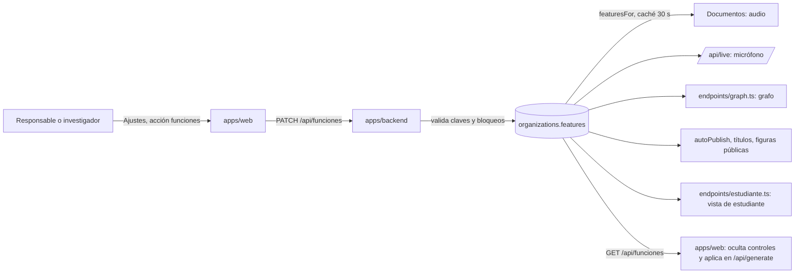
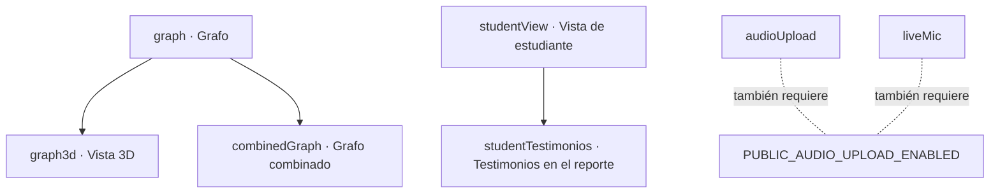

# Funciones por ecosistema

**Versión:** 1.2 · **Fecha:** 2026-11-07 · **Estado:** vigente

**Fuentes:**
- `apps/backend/src/lib/features.ts` (defaults, dónde se aplica cada función, interruptores bloqueados, lectura con caché)
- `apps/web/src/lib/features.ts` (espejo de defaults, etiquetas de la interfaz)
- `apps/web/src/routes/ajustes/secciones.ts` (pestañas y relación padre-hijo)
- `apps/backend/src/globals/PlatformSettings.ts`, `apps/backend/src/lib/platformSettings.ts` (respaldo del detector)
- `apps/backend/src/lib/answerStyle.ts`, `apps/web/src/lib/answerStyle.ts` (estilos de respuesta)
- `apps/web/src/lib/graph.ts` (`GRAPH_SEARCH_ENABLED`)
- `plan/funcionalidades.md`
- Revisiones de código por área hechas para esta documentación (2026-10-30): privacidad, pila de IA, flujos web, modelo de datos, infraestructura y decisiones

## Para quién es y qué responde

Este documento es para responsables e investigadores que configuran un ecosistema, para el administrador de la plataforma y para quien desarrolle. Responde: qué funciones se pueden encender o apagar en cada ecosistema de Ecosistemas de Conocimiento (EDC), qué hace cada una, cuál es su valor inicial, quién puede cambiarla, cuáles dependen de otra y qué pasa si el sistema no puede leerlas. Al final describe los ajustes que no son funciones por ecosistema: estilos de respuesta, respaldo del detector y variables de entorno. Todo se leyó en el código de `main` el 2026-10-30.

## Qué es una función por ecosistema

Una función (en el código, *feature flag*: un interruptor de encendido y apagado) es un valor verdadero o falso que vive por ecosistema en la columna `organizations.features` (tipo `jsonb`, un objeto JSON en Postgres). La decisión de tenerlas por ecosistema es del responsable del proyecto, del 2026-10-27 (citado del encabezado de `apps/backend/src/lib/features.ts`).

Tres reglas gobiernan todas las funciones:

1. **El valor inicial es el comportamiento previo.** Una columna vacía, una clave ausente o un valor que no es booleano se leen como el valor por defecto. Un ecosistema que nadie ha configurado se comporta igual que antes de que existieran las funciones.
2. **Cada función se aplica donde ocurre el trabajo, no solo en la interfaz.** Apagar una función oculta su control en pantalla, y además el servidor rechaza la operación. Por ejemplo, con `audioUpload` apagada, crear un documento de audio responde 403.
3. **Una escritura con una clave desconocida o un valor no booleano se rechaza**, no se ignora. Un error de dedo que no hiciera nada parecería "guardado" (`parseFeaturesPatch`).

Se cambian en Ajustes (`/ajustes`), en cuatro pestañas con interruptores y una quinta de estilo.

## Las 14 funciones

| Clave | Etiqueta en Ajustes | Pestaña | Qué habilita | Default | Dónde se aplica en el servidor |
|---|---|---|---|:-:|---|
| `audioUpload` | Subir audio | Conversación | Subir grabaciones como documento, que se transcriben. Además necesita la variable de entorno de la web `PUBLIC_AUDIO_UPLOAD_ENABLED=1`. | encendida | `collections/Documents.ts` (`refuseDisabledFeatures`): crear `kind=audio` responde 403 |
| `liveMic` | Micrófono en vivo | Conversación | Dictado con texto en vivo en el campo de escritura | encendida | `app/api/live/[sid]/route.ts`: 403 |
| `interviewerMode` | Modo entrevista | Conversación | Interruptor "Hazme preguntas" en conversaciones Generales; con él apagado el sistema siempre responde y no entrevista | encendida | web `api/generate`: omite la heurística de entrevista |
| `chatOrientation` | Conversaciones anteriores como contexto | Conversación | Usa turnos anonimizados de otras conversaciones del ecosistema para orientar la respuesta, sin citarlos | encendida | web `api/generate`: apaga el tramo de orientación |
| `graph` | Grafo | Grafo | La sección Conexiones (`/grafo`) y el uso del grafo al responder | encendida | `endpoints/graph.ts`: vista y entidad responden 404; la recuperación por grafo devuelve vacío |
| `graph3d` | Vista 3D del grafo | Grafo (hija de `graph`) | El botón 3D del mapa | encendida | Solo en la web: es un modo de dibujo sin datos propios en el servidor |
| `combinedGraph` | Incluir en el grafo combinado | Grafo (hija de `graph`) | Que el ecosistema aparezca en la vista conjunta de todos los ecosistemas (`?eco=todos`) | encendida | `endpoints/graph.ts`: exige `graph && combinedGraph` |
| `autoPublishMembers` | Publicar automáticamente lo de participantes | Publicación | Lo que sube un participante se publica solo cuando pasa la compuerta de anonimización | encendida | `lib/autoPublish.ts`: apagada, los borradores de participantes se quedan en borrador |
| `testimonioTitles` | Títulos automáticos para testimonios | Publicación | Un modelo genera un título genérico para cada testimonio | encendida | `lib/testimonioTitle.ts`: apagada, no corre |
| `keepPublicFigures` | Conservar nombres de figuras públicas en documentos | Publicación | La compuerta conserva nombres de figuras públicas, solo en documentos de tipo `documento` que pasan por ella; nunca en testimonios ni conversaciones | apagada | `lib/publicFigures.ts`, dentro de la compuerta |
| `keepDocumentAuthor` | Conservar al autor del documento | Publicación | Valor de partida de cada documento con compuerta y de cada testimonio: conserva el nombre completo de quien subió. Cada documento puede cambiarlo. Sin desplegar ([ADR-0020](../03-arquitectura/adr/ADR-0020-anonimizar-todo-y-conservar-nombres-por-documento.md)) | apagada | La compuerta, sobre un resultado `ready` |
| `keepCitedAuthors` | Conservar autores citados | Publicación | Valor de partida de cada documento con compuerta y de cada testimonio: conserva los nombres de citas bibliográficas y de la lista de referencias. Cada documento puede cambiarlo. Sin desplegar | apagada | La compuerta, sobre un resultado `ready` |
| `studentView` | Vista de estudiante | Estudiantes | Mi investigación (`/estudiante`), Estudiantes (`/seguimiento`), alcance del chat del estudiante y notas publicables | apagada | `endpoints/estudiante.ts`; `lib/studentNotes.ts` |
| `studentTestimonios` | Testimonios de estudiantes en el reporte (anonimizados) | Estudiantes (hija de `studentView`) | El reporte docente lista los testimonios del estudiante, solo en su versión anonimizada | apagada | `endpoints/estudiante.ts`; `lib/student/logic.ts` (`reportTestimonios`) |

Los defaults se leen en `FEATURE_DEFAULTS`, idéntico en `apps/backend/src/lib/features.ts` y `apps/web/src/lib/features.ts`. Las etiquetas salen de `FEATURE_LABELS` en el archivo de la web. Las pestañas salen de `SECCIONES` en `apps/web/src/routes/ajustes/secciones.ts`.

Cinco funciones arrancan apagadas, cada una por una razón registrada:
- `studentView`: solo el ecosistema Semiosis práctica la iba a usar (comentario del 2026-10-27 en `features.ts`).
- `keepPublicFigures`: conserva nombres en el corpus, así que es una elección explícita por ecosistema.
- `studentTestimonios`: decide quién puede leer una voz; mismo criterio que la anterior.
- `keepDocumentAuthor` y `keepCitedAuthors`: por omisión se anonimiza todo (decisión del 2026-11-07, [ADR-0020](../03-arquitectura/adr/ADR-0020-anonimizar-todo-y-conservar-nombres-por-documento.md)).

## Quién puede cambiar cada función

| Funciones | Quién las cambia | Quién las ve solo de lectura |
|---|---|---|
| `audioUpload`, `liveMic`, `interviewerMode`, `chatOrientation`, `graph`, `graph3d`, `combinedGraph`, `autoPublishMembers`, `testimonioTitles`, `studentView`, `keepDocumentAuthor`, `keepCitedAuthors` | Quien tiene `organization:manage` en ese ecosistema (investigador y responsable) y el administrador de plataforma | nadie más entra a Ajustes |
| `keepPublicFigures`, `studentTestimonios` | Solo el administrador de plataforma (`PLATFORM_ADMIN_ONLY_FEATURES`) | Investigador y responsable las ven bloqueadas |

El bloqueo de las dos funciones de plataforma se aplica en tres lugares:
- en `Organizations` (`beforeChange`), que cubre cualquier vía de escritura;
- en `/api/funciones`, que lo revisa primero para dar un error claro: «Solo administración de la plataforma puede cambiar "…"»;
- en la web, donde `PLATFORM_ADMIN_ONLY_FEATURES` actúa como respaldo cerrado: si el backend no dice qué está bloqueado, la interfaz bloquea esas dos.

La comparación se hace sobre valores resueltos: una escritura del objeto completo que omita un `true` guardado cuenta como cambio y se rechaza (`lockedFeatureChange`).

Ninguna de estas reglas guarda una bitácora de quién cambió qué y cuándo. Los cambios de funciones no se auditan (inferido de la búsqueda de colecciones de auditoría; ver [seguridad](../06-privacidad-y-seguridad/seguridad.md)).

## Dependencias padre-hijo

- Un hijo se **oculta, no se borra**, mientras su padre está apagado. Sigue dentro del formulario, así que su valor guardado viaja de ida y vuelta sin cambios (`secciones.ts`).
- Las parejas reflejan reglas del backend: el grafo combinado exige `graph && combinedGraph`; la vista 3D es un modo del grafo; el reporte con testimonios vive dentro de la vista de estudiante.
- Al apagar `studentTestimonios`, el consentimiento de testimonios de los estudiantes se retira (`clearTestimonioConsentWhenOff` en `collections/Organizations.ts`, citado de la revisión de privacidad).
- Trampa de diseño: el formulario de interruptores es un solo `<form>` para todas las pestañas, y una casilla ausente se lee como "apagada". Por eso cada clave debe estar exactamente en una pestaña; una clave que faltara se apagaría en el siguiente guardado. La prueba `secciones.test.ts` lo vigila.

## Qué pasa si falla la lectura

| Lugar | Comportamiento ante una falla | Consecuencia |
|---|---|---|
| Backend (`featuresFor`) | Devuelve los **defaults**, nunca "todo apagado". No guarda la falla en caché. | Un tropiezo de la base de datos no apaga funciones en todo un ecosistema. Pero `studentView`, `keepPublicFigures` y `studentTestimonios` caen en apagado mientras dure la falla. |
| Web (`resolveFeatures`) | Cualquier respuesta rara se lee como defaults: "una lectura fallida nunca oculta nada" (comentario del archivo). | La interfaz puede mostrar un control cuya operación el backend luego rechaza. El backend sigue siendo el control. |
| Caché del backend | Cada ecosistema se guarda 30 s (`TTL_MS = 30_000`, leído en `features.ts`). Un guardado en el mismo proceso limpia la caché al instante. | Con varias réplicas, otra réplica puede ver el valor anterior hasta 30 s (inferido del diseño en memoria por proceso). El comentario del código dice "≤ 60 s", que es el límite que fijó el responsable técnico; el valor real es 30 s. |

## Ajustes que no son funciones por ecosistema

### Estilos de respuesta

| Aspecto | Valor |
|---|---|
| Qué es | Tres textos por ecosistema (Generales, Resonancias y Entrevista) que se añaden al prompt del sistema. Ejemplo: el ecosistema Discapacidad pide responder desde el modelo social de la discapacidad. |
| Dónde vive | Columnas de `organizations` (`apps/backend/src/lib/answerStyle.ts`) |
| Dónde se edita | Pestaña "Estilo de respuesta" de Ajustes, acción `estilo` |
| Quién | Solo el administrador de plataforma (`answerStylesEditable`). Los demás lo ven sin poder editar. |
| Límite | 1,500 caracteres por texto (`ANSWER_STYLE_MAX_LENGTH`, igual en backend y web) |
| Historias | B4.1, B4.2 y F3.3 en [historias de usuario](historias-de-usuario.md) |

### Respaldo del detector de datos personales

El detector es el modelo que, dentro de la compuerta de anonimización, busca nombres y otros datos personales. En dev corre en un equipo DGX Spark prestado. El respaldo decide qué pasa si ese equipo no responde.

| Aspecto | Valor |
|---|---|
| Qué es | Un ajuste global de la plataforma, no por ecosistema: `platform-settings.detectorFallback` |
| Valores | `hosted`: el texto va al modelo hospedado por medio de ai-service (OpenRouter). `none`: el documento queda retenido (falla cerrada). Vacío: se usa la variable de entorno `ANONYMISE_DETECT_FALLBACK`. |
| Default | Vacío; la variable de entorno vale `hosted` por defecto (`fallbackGenerator.ts`), por decisión del responsable del 2026-10-21 (citado de la revisión de la pila de IA) |
| Quién | Solo la marca `isPlatformAdmin`, desde la sección de plataforma de Ajustes (`PATCH /api/plataforma`) |
| Si falla la lectura | Devuelve `none`: falla cerrada, sin caché, para no deshacer un `none` guardado a propósito |
| Caché | 30 s (`TTL_MS` en `apps/backend/src/lib/platformSettings.ts`) |
| Valor de entorno inválido | Si no hay valor guardado y la variable es inválida, la llamada lanza error y el documento queda retenido |
| Riesgo | Con `hosted`, el texto sin anonimizar de un testimonio puede salir a un proveedor externo. El plan es poner `none` antes del primer testimonio real. Ver [protección de datos](../06-privacidad-y-seguridad/proteccion-de-datos.md). |
| Historia | F3.2 |

### Variables de entorno que actúan como funciones

Estas variables se fijan por entorno (dev o staging) en el despliegue. No aparecen en Ajustes y valen para todos los ecosistemas del entorno.

| Variable | Dónde se lee | Qué hace | Default |
|---|---|---|---|
| `GRAPH_SEARCH_ENABLED` | `apps/web/src/lib/graph.ts` (`graphSearchEnabled`) | Muestra el buscador de Conexiones y habilita `/grafo/buscar`. Apagada, oculta la caja y la ruta responde 404. | encendida, salvo que valga `false`, `0`, `off` o `no` (decisión del responsable, 2026-10-21) |
| `PUBLIC_AUDIO_UPLOAD_ENABLED` | `apps/web/src/lib/uploadKind.ts` (`AUDIO_UPLOAD_ENABLED`), en tiempo de ejecución | Muestra los controles de audio y micrófono, y la ruta de subida de la web rechaza audio si está apagada. Hace falta además de `audioUpload` o `liveMic`. Solo dev la tiene, junto al perfil `audio` del despliegue. | apagada salvo que valga `1` (decisión del 2026-10-21, `plan/ux-demo-backlog.md` #8) |
| `GRAPH_MIN_ENTITY_DOCS`, `GRAPH_MIN_EDGE_DOCS`, `GRAPH_MIN_COMENTION_DOCS` | `apps/backend/src/lib/graph/queries.ts` | Cuántos documentos publicados debe tener una entidad o relación para aparecer en el mapa | 1 en los tres (leído en código; bajó de 3 a 1 por decisión del responsable del 2026-10-21) |
| `CHAT_RETRIEVAL_MODE` | web, motor de chat | Modo de recuperación del chat | `dense` (citado de la revisión de la pila de IA) |

## Referencias

- `apps/backend/src/lib/features.ts`
- `apps/web/src/lib/features.ts`
- `apps/web/src/routes/ajustes/secciones.ts`, `apps/web/src/routes/ajustes/+page.server.ts`
- `apps/backend/src/endpoints/funciones.pg.test.ts`, `apps/backend/e2e/featuresLock.e2e.ts`
- `apps/backend/src/globals/PlatformSettings.ts`, `apps/backend/src/lib/platformSettings.ts`
- `apps/backend/src/lib/anonymise/fallbackGenerator.ts`
- `apps/backend/src/lib/answerStyle.ts`, `apps/web/src/lib/answerStyle.ts`
- `apps/web/src/lib/graph.ts`
- [Historias de usuario](historias-de-usuario.md)
- [Matriz de roles y permisos](matriz-roles-y-permisos.md)
- [Pila de IA](../03-arquitectura/pila-de-ia.md)
- [Infraestructura y entornos](../05-infraestructura/infraestructura-y-entornos.md)
- [Manual de usuario](../08-manuales/manual-de-usuario.md)
