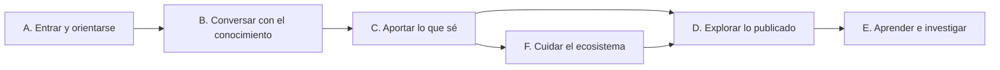

# Historias de usuario

**Versión:** 1.3 · **Fecha:** 2026-11-11 · **Estado:** vigente

**Fuentes:**
- `plan/mapa-historias.md` (generado desde `apps/web/e2e/evidencia/historias.ts`)
- `plan/funcionalidades.md` (inventario por pantalla, leído en código el 2026-10-27)
- `apps/web/e2e/evidencia/*.spec.ts`, `apps/web/e2e/*.spec.ts` y las pruebas unitarias citadas en cada historia
- `TESTING.md` (resultados e2e del 2026-10-17)
- Brief v1 del proyecto, «Repositorio de Voces y Resonancias», documento externo al repo (historias del brief no implementadas)
- Revisiones de código por área hechas para esta documentación (2026-10-30): privacidad, pila de IA, flujos web, modelo de datos, infraestructura y decisiones

## Para quién es y qué responde

Este documento es para el equipo del proyecto, para revisores institucionales y para quien desarrolle la siguiente etapa. Responde tres preguntas: qué puede hacer cada persona en Ecosistemas de Conocimiento (EDC) al cierre de la Etapa 1 (2026-10-28), cómo se comprueba que lo hace, y qué pedía el brief que todavía no existe. Cada historia del mapa lleva su rol, su precondición, criterios de aceptación en formato Dado/Cuando/Entonces, su estado y el archivo de prueba que la respalda.

## Cómo leer este documento

**Roles.** Los nombres de rol son los del mapa de historias. Entre paréntesis va el valor que guarda el sistema.

| Abreviatura | Rol | Valor en el código |
|---|---|---|
| Part. | participante | `member` |
| Est. | estudiante | `estudiante` |
| Inv. | investigador | `investigador` |
| Resp. | responsable | `owner` |
| Admin | administrador de la plataforma | `isPlatformAdmin` |

El rol de ecosistema `admin` (en pantalla, "administra") no aparece en el mapa. Tiene los permisos de revisión, miembros y subida de testimonios, pero no Ajustes ni Administración. Ver [matriz de roles y permisos](matriz-roles-y-permisos.md).

**Estado.** Todas las historias del mapa están implementadas en `main` del 2026-10-29. La versión 1.2 revisa los criterios contra `main` (b7dc944f) el 2026-11-10, y contra lo desplegado en dev (c4f53632, 2026-11-10 a las 23:03 UTC, medido con `docker ps` en edc-1 el 2026-11-11). Un criterio nuevo o cambiado que está en `main` y aún no en dev dice **pendiente de desplegar en dev**. Se distinguen dos estados:
- **implementada**: al menos una prueba automatizada (unitaria, contra Postgres, e2e o spec de evidencia con aserción) comprueba el resultado.
- **implementada sin prueba automatizada**: la historia existe y se graba, pero ninguna prueba comprueba el resultado.

**Evidencia.** Se cita el archivo, sin número de línea. Para abreviar rutas:

| Prefijo | Ruta en el repo |
|---|---|
| `ev/` | `apps/web/e2e/evidencia/` (specs que graban los videos del demo, contra dev, locale `es-MX`) |
| `e2e/` | `apps/web/e2e/` (Playwright contra un stack vivo) |
| `web/` | `apps/web/src/` |
| `be/` | `apps/backend/src/` |
| `be-e2e/` | `apps/backend/e2e/` |

Los specs de evidencia marcados "solo pantalla" muestran la pantalla sin dar el último paso, porque ese paso es definitivo o cambia datos compartidos en dev. En esas historias, la prueba del resultado está en las pruebas unitarias, contra Postgres o e2e de backend.

**Procedencia de las cifras.** Toda cifra dentro de un criterio de aceptación (tiempos de espera, límites, conteos) se leyó el 2026-10-30 en el código o en el spec citado en la línea Evidencia de la misma historia, salvo donde se indique otra procedencia.

**Flags.** Varias historias dependen de una función activable por ecosistema. El detalle de cada una está en [funciones por ecosistema](funciones-por-ecosistema.md).

## Resumen de cobertura

Conteo hecho a mano sobre el mapa (`plan/mapa-historias.md`) y la evidencia de cada historia, el 2026-10-30.

| Temática | Épica | Historias | Con prueba automatizada | Solo pantalla o sin grabar en video |
|---|---|---:|---:|---:|
| A. Entrar y orientarse | A1. Sesión | 2 | 2 | 0 |
| | A2. Ecosistema | 2 | 2 | 0 |
| B. Conversar con el conocimiento | B1. Conversaciones | 11 | 10 | 0 |
| | B2. Valorar respuestas | 3 | 3 | 0 |
| | B3. Hablar en lugar de escribir | 1 | 1 | 0 |
| | B4. Estilo del ecosistema | 2 | 2 | 0 |
| C. Aportar lo que sé | C1. Subir y escribir | 7 | 7 | 3 |
| | C2. Organizar mis documentos | 6 | 6 | 0 |
| | C3. Publicar | 3 | 3 | 1 |
| D. Explorar lo publicado | D1. Biblioteca | 3 | 3 | 0 |
| | D2. Conexiones | 7 | 7 | 0 |
| E. Aprender e investigar | E1. Mi investigación | 8 | 7 | 2 |
| | E2. Acompañar estudiantes | 2 | 2 | 0 |
| F. Cuidar el ecosistema | F1. Revisión | 4 | 4 | 3 |
| | F2. Miembros | 3 | 3 | 2 |
| | F3. Ajustes | 3 | 3 | 3 |
| | F4. Administración | 4 | 4 | 0 |
| **Total** | **17 épicas** | **71** | **69** | **17** |

Lectura de la tabla:
- Las dos historias sin prueba automatizada son B1.7 (alcance de búsqueda del estudiante) y E1.4 (ver mis autores).
- Siete historias se graban sin aserción sobre el resultado en el spec de evidencia y se apoyan solo en pruebas unitarias: B1.7, C2.2, C2.4, D1.1, D1.2, E1.4 y F4.4.
- C1.5, C1.6 y F1.3 no tienen escena en los specs de evidencia. F1.3 y C3.1 sí tienen e2e propio (`e2e/revision.spec.ts` y `e2e/journey.spec.ts`).
- La última corrida completa de e2e registrada es del 2026-10-17, en un stack aislado con proveedor falso (citado de `TESTING.md`). Los resultados están en [estrategia de pruebas](../07-calidad/estrategia-de-pruebas.md).

## A. Entrar y orientarse

### A1. Sesión

#### A1.1 · Iniciar sesión
- **Historia:** Como integrante de un ecosistema quiero entrar con mi correo y mi contraseña para usar la plataforma.
- **Roles:** todos.
- **Precondición:** existe una cuenta activa creada desde Miembros por quien tiene `members:manage`, o por el administrador de la plataforma. El registro abierto está cerrado desde el 2026-10-21.
- **Criterios de aceptación:**
  1. Dado una cuenta activa, cuando llena "Correo electrónico" y "Contraseña" en `/sign-in` y pulsa "Entrar", entonces sale de `/sign-in` y ve el menú principal, o la pantalla Iniciar si es Part. o Est.
  2. Dado credenciales incorrectas, cuando pulsa "Entrar", entonces ve un error en español y la respuesta nunca devuelve el correo ni la contraseña.
  3. Dado que alguien abre `/sign-in?email=…&password=…` con GET, cuando carga la página, entonces el servidor redirige y limpia la URL.
  4. Dado una cuenta desactivada, cuando intenta entrar con la contraseña correcta, entonces recibe la misma respuesta que con una contraseña equivocada (desde el 2026-11-10, A-01; desplegado).
  5. Dado 4 intentos fallidos desde una IP para un mismo correo en una hora, o 100 desde una IP para cualquier correo, cuando vuelve a intentar, entonces recibe 429 con `Retry-After`, antes de que se revise la contraseña (desde el 2026-11-10, A-11; desplegado).
- **Estado:** implementada.
- **Evidencia:** `ev/escena.ts`; `e2e/journey.spec.ts`; `web/routes/sign-in/page.server.test.ts`; `web/lib/server/auth.test.ts`; `be-e2e/identity.e2e.ts`; `be/access/deactivatedAndRemoved.pg.test.ts`; `be/lib/loginRateLimit.pg.test.ts`.

#### A1.2 · Cerrar sesión
- **Historia:** Como integrante quiero cerrar mi sesión para que nadie más use mi cuenta en este equipo.
- **Roles:** todos.
- **Precondición:** sesión abierta.
- **Criterios de aceptación:**
  1. Dado una sesión abierta, cuando pulsa "Cerrar sesión" en el menú o en la pantalla Iniciar, entonces llega a `/sign-in`.
  2. Dado que cerró sesión, cuando revisa sus cookies, entonces la cookie de sesión `chat_auth` ya no existe.
- **Estado:** implementada.
- **Evidencia:** `ev/escena.ts`; `e2e/journey.spec.ts`.

### A2. Ecosistema

#### A2.1 · Elegir un ecosistema
- **Historia:** Como integrante de varios ecosistemas quiero elegir en cuál trabajo para que todo lo que veo y subo quede acotado a él.
- **Roles:** todos, con dos o más ecosistemas.
- **Precondición:** pertenece a dos o más ecosistemas activos. Con uno solo ve una etiqueta fija.
- **Criterios de aceptación:**
  1. Dado dos ecosistemas, cuando abre el selector "Elige un ecosistema" y elige uno, entonces una sola opción queda con `aria-selected=true`.
  2. Dado que cambió de ecosistema, cuando termina la carga, entonces desaparece "Cambiando de ecosistema…" y no aparece "No disponible" ni "Ninguno".
  3. Dado la elección hecha, cuando recarga la página, entonces sigue en el mismo ecosistema (cookie `eco_selected`).
- **Estado:** implementada.
- **Evidencia:** `ev/comun.ts`; `e2e/journey.spec.ts`; `web/routes/api/ecosistemas/server.test.ts`; `web/lib/ecosystems.test.ts`; `web/lib/server/ecosystem.test.ts`.

#### A2.2 · Moverse entre secciones
- **Historia:** Como integrante quiero un menú con las secciones que me tocan para llegar a cada una sin perderme.
- **Roles:** todos; el menú depende del rol.
- **Precondición:** sesión abierta.
- **Criterios de aceptación:**
  1. Dado una sesión, cuando pulsa una entrada del menú, entonces carga esa página.
  2. Dado su rol, cuando ve el menú, entonces solo aparecen las secciones que el rol permite (`visibleNavItems`).
  3. Dado un teléfono que cargó `/biblioteca` directo, cuando usa el menú, entonces sigue navegando del lado del cliente.
  4. Dado cualquier página, cuando navega con teclado, entonces el primer enlace es "Saltar al contenido".
- **Estado:** implementada.
- **Evidencia:** `ev/comun.ts`; `e2e/telefono.spec.ts`; `web/lib/nav.test.ts`; `web/lib/layout.test.ts`.

## B. Conversar con el conocimiento

### B1. Conversaciones

#### B1.0 · Empezar con Iniciar
- **Historia:** Como participante o estudiante quiero un solo botón para empezar para no tener que entender la interfaz completa antes de hablar.
- **Roles:** Part., Est.
- **Precondición:** rol `member` o `estudiante` en el ecosistema seleccionado; entra a `/` sin `?conversaciones`.
- **Criterios de aceptación:**
  1. Dado la pantalla Iniciar, cuando pulsa "Iniciar", entonces se crea una conversación de tipo Resonancias y se abre `/?conversaciones`.
  2. Dado la conversación nueva, cuando termina de cargar, entonces el campo de escritura queda enfocado.
- **Estado:** implementada.
- **Evidencia:** `ev/comun.ts`; `web/lib/inicio.test.ts`.

#### B1.1 · Crear una conversación
- **Historia:** Como integrante quiero abrir una conversación nueva, General o de Resonancias, para separar temas.
- **Roles:** todos.
- **Precondición:** sesión abierta y ecosistema elegido.
- **Criterios de aceptación:**
  1. Dado el panel de conversaciones, cuando elige la pestaña Generales o Resonancias y pulsa "Nueva conversación", entonces aparece el encabezado "Nueva conversación".
  2. Dado una conversación creada, cuando alguien intenta cambiar su tipo, entonces el tipo (`kind`) no cambia: queda fijo al crearla.
- **Estado:** implementada.
- **Evidencia:** `ev/comun.ts`; `ev/v3.ts`; `e2e/journey.spec.ts`; `web/routes/api/sessions/server.test.ts`; `web/lib/stores/app.sessionKind.test.ts`; `be/collections/Sessions.kind.pg.test.ts`.

#### B1.2 · Hacer una pregunta
- **Historia:** Como integrante quiero preguntar al acervo de mi ecosistema para obtener una respuesta basada en sus documentos.
- **Roles:** todos.
- **Precondición:** una conversación abierta.
- **Criterios de aceptación:**
  1. Dado una conversación, cuando escribe y pulsa enviar, entonces aparece una respuesta nueva con su grupo de estrellas "Valora esta respuesta" en menos de 180 s.
  2. Dado la primera pregunta de la conversación, cuando llega la respuesta, entonces la pregunta se ve y el título de la conversación cambia.
  3. Dado una respuesta en curso, cuando pulsa Esc en el campo de escritura, entonces la respuesta se detiene.
  4. Dado que el modelo devuelve una respuesta vacía, cuando termina el turno, entonces el turno se marca como fallido con «Reintentar» y no se guarda un mensaje vacío (desde el 2026-11-10, commit c867ff43; desplegado).
- **Estado:** implementada.
- **Evidencia:** `ev/comun.ts`; `e2e/journey.spec.ts`; `web/routes/api/generate/server.test.ts`; `web/lib/api.turn.test.ts`; `web/lib/api.stream.test.ts`.
- **Nota:** las primeras palabras tardan de 8 a 14 s y a veces hasta 39 s (citado de `plan/ux-demo-backlog.md` #9). Ver [requisitos no funcionales](requisitos-no-funcionales.md).

#### B1.3 · Leer las fuentes citadas
- **Historia:** Como integrante quiero ver de qué documentos sale cada afirmación para verificar la respuesta.
- **Roles:** todos.
- **Precondición:** la respuesta contiene citas `[N]`.
- **Criterios de aceptación:**
  1. Dado una respuesta con citas, cuando abre "Fuentes consultadas", entonces ve la lista de fuentes y el control indica `aria-expanded`.
  2. Dado un PDF publicado, cuando pregunta por su contenido en una conversación nueva, entonces ese PDF sale citado.
  3. Dado un borrador subido en la conversación A, cuando pregunta en la conversación B, entonces el borrador nunca aparece como fuente.
- **Estado:** implementada.
- **Evidencia:** `ev/comun.ts`; `e2e/journey.spec.ts`; `e2e/retrieval.spec.ts`; `web/lib/citationLinks.test.ts`; `web/lib/citationOrdinals.test.ts`; `web/lib/server/engine/sources.test.ts`.

#### B1.4 · Contar una experiencia en Resonancias
- **Historia:** Como integrante quiero contar una experiencia propia para que el sistema me haga preguntas y la relacione con lo que otras personas han dicho.
- **Roles:** todos.
- **Precondición:** una conversación de tipo Resonancias.
- **Criterios de aceptación:**
  1. Dado una conversación Resonancias, cuando envía un relato, entonces llega una respuesta con estrellas.
  2. Dado el modo Resonancias, cuando el modelo responde, entonces lo hace como entrevistadora: una sola pregunta, sin listas.
- **Estado:** implementada.
- **Evidencia:** `ev/comun.ts`; `web/lib/server/engine/resonancias.test.ts`; `web/lib/sessionKind.test.ts`.

#### B1.5 · Renombrar una conversación
- **Historia:** Como integrante quiero ponerle nombre a una conversación para encontrarla después.
- **Roles:** todos.
- **Precondición:** la conversación es suya.
- **Criterios de aceptación:**
  1. Dado una conversación, cuando pulsa renombrar, escribe un nombre y pulsa Enter, entonces hay exactamente una fila con ese nombre.
  2. Dado el nombre nuevo, cuando recarga, entonces el nombre persiste (`PATCH /api/sessions/[id]`).
- **Estado:** implementada.
- **Evidencia:** `ev/comun.ts`; `web/routes/api/sessions/[id]/server.test.ts`; `web/lib/sessionTitle.test.ts`.

#### B1.6 · Borrar una conversación
- **Historia:** Como integrante quiero borrar una conversación para que no quede rastro de ella.
- **Roles:** todos.
- **Precondición:** la conversación es suya.
- **Criterios de aceptación:**
  1. Dado una conversación, cuando pulsa borrar y confirma en el diálogo propio de la aplicación, entonces el número de filas baja en uno.
  2. Dado el borrado, cuando el backend termina, entonces se borran en cascada sus valoraciones, sus mensajes y los documentos que solo pertenecían a ella.
  3. Dado una conversación ajena, cuando alguien intenta borrarla, entonces el backend lo impide.
- **Estado:** implementada.
- **Evidencia:** `ev/comun.ts`; `be/lib/conversationUploads.pg.test.ts`; `be/collections/Sessions.ownerGuard.pg.test.ts`.

#### B1.7 · Buscar solo en mis trabajos o en los de mis compañeros
- **Historia:** Como estudiante quiero acotar la búsqueda a mis trabajos o a los de mis compañeros para estudiar un material concreto.
- **Roles:** Est.
- **Precondición:** función `studentView` encendida y rol `estudiante`.
- **Criterios de aceptación:**
  1. Dado la cabecera del chat, cuando abre "Buscar en", entonces ve "Todo el ecosistema", "Mis trabajos" y "Mis compañeros".
  2. Dado que elige un alcance distinto de "Todo el ecosistema", cuando lo selecciona, entonces el alcance queda visible con el borde resaltado.
  3. Dado el alcance "Mis trabajos", cuando pregunta, entonces las fuentes salen solo de sus trabajos. Este criterio no tiene prueba.
- **Estado:** implementada sin prueba automatizada. El spec solo cambia la opción y la regresa; no se encontró prueba unitaria del filtro (búsqueda con grep, 2026-10-30).
- **Evidencia:** `ev/estudiante.spec.ts`; componente `web/lib/components/Chat.svelte`.

#### B1.8 · Pedir que me haga preguntas
- **Historia:** Como integrante quiero que el sistema me entreviste en una conversación General para profundizar lo que sé.
- **Roles:** todos.
- **Precondición:** función `interviewerMode` encendida; conversación de tipo Generales.
- **Criterios de aceptación:**
  1. Dado una conversación Generales, cuando pulsa el interruptor "Hazme preguntas", entonces el interruptor queda con `aria-checked="true"`.
  2. Dado el interruptor encendido, cuando vuelve a la conversación, entonces el estado se recuerda para esa conversación.
  3. Dado `interviewerMode` apagado, cuando escribe, entonces el sistema siempre responde y no entrevista.
- **Estado:** implementada.
- **Evidencia:** `ev/comun.ts`; `web/lib/entrevista.test.ts`; `web/lib/server/engine/turnMode.test.ts`.

#### B1.9 · Pedir un panorama del corpus
- **Historia:** Como integrante quiero preguntar de qué trata el acervo para orientarme antes de hacer preguntas puntuales.
- **Roles:** todos.
- **Precondición:** conversación Generales.
- **Criterios de aceptación:**
  1. Dado la pregunta "¿Qué temas recorre el corpus de este ecosistema?", cuando la envía, entonces la respuesta no busca pasajes: cita el grafo y la lista de lo publicado.
  2. Dado esa respuesta, cuando abre las fuentes, entonces las ve listadas.
  3. Dado una pregunta sobre un tema concreto ("…el corpus de Semiosis práctica"), cuando la envía, entonces no se trata como panorama.
- **Estado:** implementada.
- **Evidencia:** `ev/v3.ts`; `ev/investigador.v3.spec.ts`; `web/lib/server/engine/overview.test.ts`.

#### B1.10 · Preguntar por los datos de una hoja de cálculo
- **Historia:** Como integrante quiero preguntar por los datos de una hoja de cálculo para no tener que leerla fila por fila.
- **Roles:** todos.
- **Precondición:** subió un `.xlsx` a la conversación (C1.7); queda fijado por defecto y en estado `listo`.
- **Criterios de aceptación:**
  1. Dado la hoja fijada, cuando pregunta por un dato de la hoja, entonces llega una respuesta.
  2. Dado un documento fijado, cuando se arma el turno, entonces su contenido completo va como contexto.
- **Estado:** implementada. El texto exacto de la respuesta no se comprueba.
- **Evidencia:** `ev/v3.ts`; `ev/participante.v3.spec.ts`; `web/routes/api/generate/pinned.test.ts`.

### B2. Valorar respuestas

#### B2.1 · Valorar una respuesta
- **Historia:** Como integrante quiero calificar una respuesta de 1 a 5 estrellas para que el equipo sepa si sirvió.
- **Roles:** todos.
- **Precondición:** hay una respuesta del asistente.
- **Criterios de aceptación:**
  1. Dado una respuesta, cuando pulsa la cuarta estrella, entonces esa estrella queda con `aria-checked=true` y desaparece `aria-busy`.
  2. Dado el foco en el grupo de estrellas, cuando usa las flechas, Inicio o Fin, entonces la valoración se mueve con el teclado.
  3. Dado que cambió la valoración, cuando se guarda, entonces aparece el aviso "Valoración guardada: N de 5.".
  4. Dado una valoración guardada, cuando recarga, entonces la valoración sigue y hay una sola fila.
- **Estado:** implementada.
- **Evidencia:** `ev/comun.ts`; `e2e/journey.spec.ts`; `web/lib/ratings.test.ts`; `web/lib/primitives/StarRating.svelte.test.ts`; `web/routes/api/sessions/[id]/ratings/server.test.ts`; `be-e2e/ratings.e2e.ts`.

#### B2.2 · Decir por qué sirvió o no
- **Historia:** Como integrante quiero elegir el motivo de mi valoración para que el equipo sepa qué falló o qué funcionó.
- **Roles:** todos.
- **Precondición:** la respuesta ya tiene estrellas.
- **Criterios de aceptación:**
  1. Dado 1 a 3 estrellas, cuando abre los motivos, entonces ve "Cita algo que la fuente no dice", "Se lo inventó", "Le faltó lo importante", "No se entiende" e "Idioma o tono equivocado".
  2. Dado 4 o 5 estrellas, cuando abre los motivos, entonces ve "Coincide con la fuente", "Fácil de verificar", "Se entiende bien" y "Respondió todo".
  3. Dado el motivo "Otro" con texto libre, cuando otra persona consulta la valoración, entonces solo quien tiene `ratings:read-comments` lee ese texto.
- **Estado:** implementada.
- **Evidencia:** `ev/comun.ts`; `web/lib/ratings.test.ts`.

#### B2.3 · Quitar una valoración
- **Historia:** Como integrante quiero quitar mi valoración para corregir un clic por error.
- **Roles:** todos.
- **Precondición:** la respuesta tiene una valoración suya.
- **Criterios de aceptación:**
  1. Dado una valoración, cuando pulsa quitar, entonces se borra (`DELETE /api/sessions/[id]/ratings`).
  2. Dado el borrado, cuando el backend termina, entonces no quedan filas huérfanas.
- **Estado:** implementada.
- **Evidencia:** `ev/comun.ts`; `web/routes/api/sessions/[id]/ratings/server.test.ts`; `be/collections/Ratings.deletePaths.pg.test.ts`.

### B3. Hablar en lugar de escribir

#### B3.1 · Dictar con el micrófono
- **Historia:** Como integrante quiero dictar en lugar de escribir para contar mi experiencia sin teclear.
- **Roles:** todos.
- **Precondición:** función `liveMic` encendida y la variable de entorno de la web `PUBLIC_AUDIO_UPLOAD_ENABLED=1`. Solo en dev: staging no tiene transcripción.
- **Criterios de aceptación:**
  1. Dado el micrófono disponible, cuando pulsa iniciar y habla, entonces aparece el reloj de grabación y el texto en vivo muestra palabras en menos de 30 s.
  2. Dado que pulsa detener, cuando termina, entonces el texto en vivo desaparece. Desde el 2026-11-10 el texto en vivo solo se ve mientras graba y no pasa al campo de escritura (auditoría C-13, commit aa73e01f; desplegado).
  3. Dado la grabación terminada, cuando se procesa, entonces el audio (`audio/webm`) se sube como documento de la conversación y pasa por la compuerta de anonimización.
  4. Dado `liveMic` apagado, cuando se llama a `/api/live`, entonces el backend responde 403.
- **Estado:** implementada.
- **Evidencia:** `ev/comun.ts` (solo en el video del participante); `e2e/live-mic.spec.ts`; `web/lib/liveCapture.test.ts`; `web/routes/api/live/[sid]/server.test.ts`.

### B4. Estilo del ecosistema

#### B4.1 · Preguntar en Generales con el estilo del ecosistema
- **Historia:** Como integrante quiero que las respuestas sigan el enfoque de mi ecosistema para que hablen como habla mi comunidad.
- **Roles:** todos.
- **Precondición:** un administrador de plataforma configuró el estilo de Generales (F3.3). Ejemplo: el ecosistema Discapacidad usa el modelo social de la discapacidad.
- **Criterios de aceptación:**
  1. Dado un estilo configurado, cuando pregunta en Generales, entonces llega una respuesta con fuentes.
  2. Dado un estilo configurado, cuando se arma el prompt, entonces el estilo se añade al prompt del sistema.
- **Estado:** implementada. La prueba comprueba que el estilo entra al prompt, no que la respuesta lo siga.
- **Evidencia:** `ev/v3.ts`; `ev/discapacidad.v3.spec.ts`; `web/lib/server/engine/answerStyle.test.ts`.

#### B4.2 · Contar una experiencia en Resonancias con el estilo del ecosistema
- **Historia:** Como integrante quiero que la entrevista de Resonancias siga el enfoque de mi ecosistema.
- **Roles:** todos.
- **Precondición:** estilo de Resonancias configurado (F3.3).
- **Criterios de aceptación:**
  1. Dado un estilo de Resonancias, cuando cuenta una experiencia, entonces llega una respuesta con estrellas.
  2. Dado ese estilo, cuando se arma el prompt de Resonancias, entonces el estilo se añade.
- **Estado:** implementada.
- **Evidencia:** `ev/v3.ts`; `web/lib/server/engine/answerStyle.test.ts`.

## C. Aportar lo que sé

### C1. Subir y escribir

#### C1.1 · Subir un documento
- **Historia:** Como integrante quiero subir un documento para que el sistema lo lea y pueda responder con él.
- **Roles:** todos (`documents:write`).
- **Precondición:** una conversación abierta, o la pantalla Mis documentos.
- **Criterios de aceptación:**
  1. Dado el panel Documentos, cuando pulsa "Subir documento" y elige un PDF, entonces aparece una tarjeta con su título y la placa "Borrador · solo tú".
  2. Dado el PDF subido, cuando termina la ingesta, entonces el estado llega a `listo`.
  3. Dado un participante con `autoPublishMembers` encendida, cuando su documento pasa la compuerta, entonces se publica solo.
- **Estado:** implementada.
- **Evidencia:** `ev/comun.ts`; `e2e/journey.spec.ts`; `web/routes/api/documentos/upload.test.ts`; `web/lib/server/uploadDocument.test.ts`; `web/lib/uploadErrors.test.ts`; `be-e2e/documents.e2e.ts`.

#### C1.2 · Escribir una nota
- **Historia:** Como integrante quiero escribir una nota en la plataforma para aportar sin tener un archivo.
- **Roles:** todos.
- **Precondición:** una conversación abierta.
- **Criterios de aceptación:**
  1. Dado el panel Documentos, cuando pulsa "Nueva nota", entonces el servidor crea la nota y responde 200.
  2. Dado el editor abierto, cuando escribe título y contenido en Markdown, entonces la nota se guarda sola.
- **Estado:** implementada.
- **Evidencia:** `ev/comun.ts`; `ev/estudiante.v3.spec.ts`; `web/lib/components/documentos/NoteSheet.svelte.test.ts`; `web/lib/markdown.dom.test.ts`.

#### C1.3 · Subir un audio
- **Historia:** Como integrante quiero subir una grabación para que se transcriba y entre al acervo.
- **Roles:** todos.
- **Precondición:** función `audioUpload` encendida y variable de entorno de la web `PUBLIC_AUDIO_UPLOAD_ENABLED=1`. Solo en dev.
- **Criterios de aceptación:**
  1. Dado un `.m4a`, cuando lo sube con "Subir documento o audio", entonces la subida responde OK y aparece "Transcripción automática".
  2. Dado la transcripción, cuando termina, entonces el estado llega a `listo` (o `en revisión` si la compuerta retiene) y aparece "Transcripción lista.".
  3. Dado `audioUpload` apagada, cuando se intenta crear un documento de audio, entonces el backend responde 403.
  4. Dado un participante, cuando sube audio, entonces se archiva como `testimonio`.
- **Estado:** implementada.
- **Evidencia:** `ev/comun.ts`; `e2e/journey.spec.ts`; `web/lib/ingest.test.ts`; `be-e2e/audio.e2e.ts`.

#### C1.4 · Corregir una transcripción
- **Historia:** Como integrante quiero corregir la transcripción de mi audio para que el texto diga lo que dije.
- **Roles:** todos. Solo pantalla en el video.
- **Precondición:** el audio sigue en borrador.
- **Criterios de aceptación:**
  1. Dado un audio en borrador, cuando abre la pestaña de transcripción, edita y guarda, entonces el texto se reindexa (`PATCH /api/documents/[id]/transcript`).
  2. Dado un audio ya publicado, cuando intenta guardar, entonces el servidor responde 409 `already_published` (medido en dev el 2026-10-28, citado de la revisión de flujos web).
  3. Dado una retención por la compuerta, cuando la edición es trivial, entonces no libera la retención.
- **Estado:** implementada.
- **Evidencia:** `ev/comun.ts` (no guarda); `web/routes/api/documents/[id]/transcript/server.test.ts`.

#### C1.5 · Elegir qué tipo de aporte es
- **Historia:** Como investigador quiero marcar si lo que subo es un documento o un testimonio para que reciba el trato de privacidad que le toca.
- **Roles:** Inv., Resp., Admin, y también `admin` de ecosistema (`voces:upload`).
- **Precondición:** permiso `voces:upload`.
- **Criterios de aceptación:**
  1. Dado el panel Documentos, cuando abre "Lo que vas a subir es:", entonces ve "Documento" y "Voz / testimonio".
  2. Dado la elección, cuando sube el archivo, entonces el `contentKind` viaja con la subida.
  3. Dado alguien sin `voces:upload`, cuando intenta subir un `testimonio`, entonces el backend lo rechaza.
- **Estado:** implementada. Sin escena en los specs de evidencia.
- **Evidencia:** `web/lib/uploadKind.test.ts`; `web/lib/components/DocsPanel.svelte.test.ts`.

#### C1.6 · Anonimizar un testimonio
- **Historia:** Como investigador quiero pedir que un documento se anonimice para quitar nombres y datos de contacto antes de compartirlo.
- **Roles:** Inv., Resp., Admin, `admin` de ecosistema.
- **Precondición:** permiso `voces:upload`.
- **Criterios de aceptación:**
  1. Dado el tipo "Documento", cuando deja marcada "Anonimizar" y sube, entonces el documento pasa por la compuerta de anonimización. Desde el 2026-11-10 la casilla arranca marcada (commits aa73e01f y 2dda9a8b; desplegado).
  2. Dado el tipo "Voz / testimonio", cuando sube, entonces siempre pasa por la compuerta, sin casilla.
  3. Dado que la compuerta duda, cuando termina, entonces el documento queda "en revisión" (F1).
- **Estado:** implementada. Sin escena en los specs de evidencia.
- **Evidencia:** `be-e2e/anonymisation.e2e.ts`; `be/lib/anonymiseDocument.pg.test.ts`.
- **Nota:** el título dice "testimonio", pero la casilla solo aparece para "Documento", porque un testimonio siempre se anonimiza.

#### C1.7 · Subir una hoja de cálculo
- **Historia:** Como integrante quiero subir una hoja de cálculo para preguntar por sus datos.
- **Roles:** todos.
- **Precondición:** conversación Generales nueva.
- **Criterios de aceptación:**
  1. Dado un `.xlsx`, cuando lo sube, entonces la subida responde OK y el estado llega a `listo`.
  2. Dado la hoja publicada, cuando aparece en la Biblioteca, entonces su tipo dice "Excel" o "CSV".
- **Estado:** implementada.
- **Evidencia:** `ev/v3.ts`; `web/lib/uploadKind.test.ts`; `web/lib/biblioteca.test.ts`.

### C2. Organizar mis documentos

#### C2.1 · Ver mis documentos
- **Historia:** Como integrante quiero ver todo lo que he subido para saber qué está publicado y qué no.
- **Roles:** todos.
- **Precondición:** sesión abierta.
- **Criterios de aceptación:**
  1. Dado documentos propios, cuando entra a Mis documentos (`/documentos`), entonces ve una fila por documento, publicado o no.
  2. Dado documentos ajenos, cuando entra a la misma pantalla, entonces no los ve.
- **Estado:** implementada.
- **Evidencia:** `ev/comun.ts`; `web/lib/misDocumentos.test.ts`; `web/routes/api/documentos/server.test.ts`.

#### C2.2 · Ver los documentos sin conversación
- **Historia:** Como integrante quiero ver los documentos que no están en ninguna conversación para decidir qué hacer con ellos.
- **Roles:** todos.
- **Precondición:** documentos subidos desde Mis documentos.
- **Criterios de aceptación:**
  1. Dado la lista, cuando pulsa "Sin conversación", entonces solo quedan los documentos sueltos.
  2. Dado el filtro, cuando pulsa "Todos", entonces vuelve la lista completa.
- **Estado:** implementada. El spec de evidencia no comprueba el contenido; lo comprueban las pruebas unitarias y contra Postgres.
- **Evidencia:** `ev/comun.ts`; `web/lib/misDocumentos.test.ts`; `be/collections/Documents.looseUpload.pg.test.ts`.

#### C2.3 · Usar un documento en una conversación
- **Historia:** Como integrante quiero llevar un documento a otra conversación para no subirlo dos veces.
- **Roles:** todos.
- **Precondición:** el documento es suyo.
- **Criterios de aceptación:**
  1. Dado Mis documentos, cuando pulsa "Usar", elige una conversación y confirma, entonces el documento queda en las dos conversaciones.
  2. Dado el chat, cuando usa "Usar un documento de otra conversación", entonces ve sus documentos disponibles.
  3. Dado el adjunto, cuando se revisa la base de datos, entonces no hay copia: es el mismo documento.
- **Estado:** implementada.
- **Evidencia:** `ev/comun.ts`; `web/lib/stores/app.attach.test.ts`; `web/routes/api/sessions/[id]/documents/[docId]/server.test.ts`.

#### C2.4 · Fijar un documento como contexto
- **Historia:** Como integrante quiero fijar un documento para que el sistema lo tenga presente en cada respuesta.
- **Roles:** todos.
- **Precondición:** el documento está en la conversación.
- **Criterios de aceptación:**
  1. Dado un documento en la conversación, cuando marca "fijar", entonces queda fijado.
  2. Dado un documento fijado, cuando hace una pregunta, entonces el documento se envía como contexto en ese turno.
- **Estado:** implementada. El spec de evidencia no tiene aserción; lo comprueba la prueba unitaria.
- **Evidencia:** `ev/comun.ts`; `web/routes/api/generate/pinned.test.ts`.

#### C2.5 · Descargar el original
- **Historia:** Como integrante quiero descargar el archivo que subí para recuperarlo tal cual.
- **Roles:** todos, solo sobre lo que subió.
- **Precondición:** el documento es suyo.
- **Criterios de aceptación:**
  1. Dado un documento propio, cuando pulsa descargar, entonces el navegador recibe el archivo.
  2. Dado un documento ajeno, cuando se pide el original, entonces el servidor lo niega.
- **Estado:** implementada.
- **Evidencia:** `ev/comun.ts`; `web/routes/api/documents/[id]/original/server.test.ts`.

#### C2.6 · Eliminar un documento
- **Historia:** Como integrante quiero eliminar un documento mío para retirarlo de la plataforma.
- **Roles:** todos, solo sobre lo propio.
- **Precondición:** el documento es suyo.
- **Criterios de aceptación:**
  1. Dado un documento propio, cuando pulsa eliminar y acepta la confirmación, entonces `DELETE /api/documents/<id>` responde OK.
  2. Dado el borrado, cuando recarga, entonces la fila ya no aparece.
  3. Dado un documento propio ya publicado, cuando lo borra, entonces el servidor exige que tenga una membresía activa con `documents:write` en su ecosistema; su propio borrador lo puede borrar siempre (desde el 2026-11-10, commit 512dcc1f; desplegado).
- **Estado:** implementada.
- **Evidencia:** `ev/comun.ts`; `web/lib/stores/app.deleteDoc.test.ts`.
- **Nota:** en dev se observó que la fila puede quedar en pantalla hasta recargar, aunque el servidor ya respondió 200 (citado de la revisión de flujos web, 2026-10-30).

### C3. Publicar

#### C3.1 · Publicar un documento en el ecosistema
- **Historia:** Como investigador quiero publicar un documento para que todo el ecosistema pueda consultarlo.
- **Roles:** Inv., Resp., Admin, `admin` de ecosistema. Solo pantalla en el video por rol.
- **Precondición:** el documento está en `listo` (o es una nota) y en borrador. Un participante no publica a mano: se publica solo con `autoPublishMembers`.
- **Criterios de aceptación:**
  1. Dado un borrador listo, cuando pulsa "Publicar en mi ecosistema", entonces aparece la confirmación «Vas a compartir "…" con todo tu ecosistema. ¿Continuar?».
  2. Dado que acepta, cuando el servidor recibe la orden, entonces responde 202.
  3. Dado la publicación en curso, cuando termina, entonces la placa pasa de "Borrador · solo tú" a "Publicando…" y luego a "Publicado", y el botón desaparece.
  4. Dado alguien sin membresía activa con `documents:write` en el ecosistema del documento, cuando intenta publicar, entonces se rechaza (desde el 2026-11-10, A-02, commit ce46db7b; desplegado).
  5. Dado un documento con compuerta cuyo re-gate falló o está pendiente, o un documento retenido por consentimiento, cuando intenta publicar, entonces el servidor responde 409 (desde el 2026-11-10, commit 512dcc1f; desplegado).
- **Estado:** implementada.
- **Evidencia:** `e2e/journey.spec.ts` (publica de verdad); `web/lib/publication.test.ts`; `web/routes/api/documents/[id]/publish/server.test.ts`; `be-e2e/publish.e2e.ts` (sin resultado registrado en `TESTING.md`).

#### C3.2 · Publicar mi nota
- **Historia:** Como estudiante quiero publicar mi nota para que forme parte del acervo y de mis temas.
- **Roles:** Est.
- **Precondición:** función `studentView` encendida; la nota tiene 200 caracteres o más y ningún nombre privado.
- **Criterios de aceptación:**
  1. Dado una nota válida, cuando pulsa "Publicar en mi ecosistema" y confirma, entonces la tarjeta pasa por compuerta, ingesta y grafo, y la placa dice "Publicado" en menos de 10 min.
  2. Dado que la nota queda "en revisión" o "rechazada", cuando corre la prueba, entonces la corrida falla.
  3. Dado la nota publicada, cuando entra a Mis temas, entonces aparece un tema nuevo (espera de 8 min en el spec).
- **Estado:** implementada.
- **Evidencia:** `ev/estudiante.v3.spec.ts`; `web/lib/stores/app.publishNote.test.ts`; `be/lib/studentNotes.pg.test.ts`; `be/lib/graph/wikilinks.pg.test.ts`.

#### C3.3 · Publicar los cambios de mi nota
- **Historia:** Como estudiante quiero publicar los cambios de una nota ya publicada para que todos lean la versión nueva.
- **Roles:** Est.
- **Precondición:** la nota está publicada y el cuerpo cambió.
- **Criterios de aceptación:**
  1. Dado una nota publicada y editada, cuando pulsa "Publicar cambios", entonces el documento termina devolviendo el texto nuevo en menos de 10 min.
  2. Dado la publicación, cuando termina, entonces aparece el aviso "Cambios publicados" y la placa sigue en "Publicado".
  3. Dado otra persona del ecosistema, cuando abre la nota en la Biblioteca, entonces lee la frase nueva.
- **Estado:** implementada.
- **Evidencia:** `ev/estudiante.v3.spec.ts`; `web/lib/publication.test.ts`.

## D. Explorar lo publicado

### D1. Biblioteca

#### D1.1 · Buscar en la biblioteca
- **Historia:** Como integrante quiero buscar por título en lo publicado para encontrar un documento.
- **Roles:** todos.
- **Precondición:** hay documentos publicados.
- **Criterios de aceptación:**
  1. Dado la Biblioteca, cuando escribe en el buscador y pulsa Enter, entonces la lista se filtra por título.
  2. Dado un borrador, cuando busca su título, entonces no aparece.
  3. Dado un testimonio, cuando busca el título que la Biblioteca muestra, entonces lo encuentra (commit 00326d1d; desplegado).
  4. Dado un `documento` con compuerta, cuando alguien que no lo subió busca por su nombre de archivo, entonces no lo encuentra: la lista y la búsqueda usan el título redactado (desde el 2026-11-10, P-13; commits 84364f58 y b7dc944f; desplegado).
- **Estado:** implementada. El spec de evidencia no comprueba resultados; lo hacen las pruebas unitarias.
- **Evidencia:** `ev/comun.ts`; `web/routes/api/biblioteca/server.test.ts`; `web/lib/biblioteca.test.ts`.

#### D1.2 · Filtrar por tipo
- **Historia:** Como integrante quiero filtrar lo publicado por tipo y por lengua para acotar lo que leo.
- **Roles:** todos.
- **Precondición:** hay documentos publicados.
- **Criterios de aceptación:**
  1. Dado la Biblioteca, cuando pulsa un filtro (todos, testimonio, audio, pdf, docx, hojas, html, markdown), entonces la lista se filtra.
  2. Dado el selector de lengua, cuando elige una lengua, entonces la lista se filtra y se ocultan todos los testimonios.
- **Estado:** implementada. El spec de evidencia no comprueba resultados; lo hacen las pruebas unitarias.
- **Evidencia:** `ev/comun.ts`; `web/lib/biblioteca.test.ts`; `web/lib/lengua.test.ts`; `web/routes/api/lenguas/server.test.ts`.

#### D1.3 · Leer un documento publicado
- **Historia:** Como integrante quiero leer un documento publicado para conocer su contenido completo.
- **Roles:** todos.
- **Precondición:** el documento está publicado.
- **Criterios de aceptación:**
  1. Dado la lista, cuando abre un documento, o entra directo a `/biblioteca/<id>`, entonces ve su texto.
  2. Dado un documento que pasó por la compuerta, cuando lo abre, entonces ve el texto anonimizado (`redactedText`), nunca el original.
- **Estado:** implementada.
- **Evidencia:** `ev/comun.ts`; `ev/estudiante.v3.spec.ts`; `web/routes/api/biblioteca/[id]/server.test.ts`; `web/lib/biblioteca.excerpt.test.ts`; `be-e2e/testimonyRead.e2e.ts`.

### D2. Conexiones

#### D2.1 · Ver el mapa de conexiones
- **Historia:** Como integrante quiero ver un mapa de temas, lugares, eventos y organizaciones del acervo para descubrir relaciones.
- **Roles:** todos.
- **Precondición:** función `graph` encendida. Si está apagada se ve el aviso de grafo desactivado.
- **Criterios de aceptación:**
  1. Dado `graph` encendida, cuando entra a Conexiones (`/grafo`), entonces ve el mapa, o el aviso de mapa vacío.
  2. Dado un borrador con una entidad, cuando abre el mapa, entonces esa entidad no aparece: solo entra lo publicado.
  3. Dado un testimonio que nombra a una persona, cuando abre el mapa, entonces esa persona no aparece.
- **Estado:** implementada.
- **Evidencia:** `ev/comun.ts`; `e2e/grafo.spec.ts`; `web/routes/grafo/page.server.test.ts`; `web/lib/graph.test.ts`; `web/lib/graphStatus.test.ts`.
- **Nota:** el spec de evidencia reintenta 3 veces porque en dev hubo errores 500 intermitentes el 2026-10-27 (citado del spec).

#### D2.2 · Cambiar a vista 3D
- **Historia:** Como integrante quiero ver el mapa en 3D para separar visualmente los niveles.
- **Roles:** todos.
- **Precondición:** funciones `graph` y `graph3d` encendidas.
- **Criterios de aceptación:**
  1. Dado el mapa en 2D, cuando pulsa "3D" y luego "2D", entonces el mapa cambia de modo.
  2. Dado la vista 3D, cuando elige una altura, entonces hay 4 opciones y la elección se recuerda; en teléfono el selector mide 44 px de alto.
  3. Dado la vista 3D, cuando se dibujan etiquetas, entonces hay como máximo 5 por nivel y no se enciman.
  4. Dado un teléfono, cuando arrastra o pellizca, entonces el mapa responde.
- **Estado:** implementada.
- **Evidencia:** `ev/comun.ts`; `e2e/grafo-zaxis.spec.ts`; `e2e/grafo-labels3d.spec.ts`; `e2e/grafo-touch.spec.ts`; `web/lib/components/graph/viewMode.test.ts`.

#### D2.3 · Buscar un tema, lugar u organización
- **Historia:** Como integrante quiero buscar en el mapa para encontrar un tema concreto.
- **Roles:** todos.
- **Precondición:** variable de entorno `GRAPH_SEARCH_ENABLED` encendida (lo está salvo que valga `false`, `0`, `off` o `no`).
- **Criterios de aceptación:**
  1. Dado el buscador "Buscar en los documentos…", cuando escribe, entonces el servidor devuelve los identificadores que coinciden.
  2. Dado el resultado, cuando se dibuja el mapa, entonces se atenúa lo que no coincide.
- **Estado:** implementada.
- **Evidencia:** `ev/comun.ts`; `ev/v3.ts`; `web/routes/grafo/buscar/server.test.ts`.

#### D2.4 · Explorar lo que se relaciona con un tema
- **Historia:** Como integrante quiero ver los vecinos de un tema para seguir una relación.
- **Roles:** todos.
- **Precondición:** el mapa tiene entidades.
- **Criterios de aceptación:**
  1. Dado una entidad, cuando hace clic en ella y luego en un vecino, entonces el panel muestra los vecinos.
  2. Dado el parámetro `?eco=`, cuando hace clic, entonces el parámetro se conserva.
  3. Dado un teléfono, cuando toca una entidad y luego un espacio vacío, entonces se selecciona y luego se limpia la selección.
- **Estado:** implementada.
- **Evidencia:** `ev/comun.ts`; `e2e/grafo.spec.ts`; `e2e/grafo-touch.spec.ts`; `web/lib/components/graph/selection.test.ts`.

#### D2.5 · Ver cuántas entidades muestra el mapa
- **Historia:** Como integrante quiero saber cuántas entidades muestra el mapa para entender si veo todo.
- **Roles:** todos.
- **Precondición:** el mapa tiene entidades.
- **Criterios de aceptación:**
  1. Dado el mapa, cuando carga, entonces el contador dice "N entidades" o "N de M entidades".
  2. Dado más de 1,500 entidades, cuando carga, entonces el contador dice "1,500 de N entidades" (tope `MAX_VIEW_ENTITIES`, leído en `be/lib/graph/queries.ts`).
- **Estado:** implementada.
- **Evidencia:** `ev/v3.ts`; `e2e/grafo.spec.ts`; `web/lib/graph.test.ts`; `be/lib/graph/viewTotal.pg.test.ts`.

#### D2.6 · Abrir un tema
- **Historia:** Como integrante quiero abrir la ficha de un tema para ver todo lo relacionado con él.
- **Roles:** todos.
- **Precondición:** el tema existe en el mapa.
- **Criterios de aceptación:**
  1. Dado la lista de temas, cuando hace clic en uno, o usa "Mostrar N más" para llegar a él, entonces aparece un encabezado con su nombre.
  2. Dado un enlace `/grafo?eco=…&entidad=…`, cuando lo abre, entonces llega directo a la ficha.
- **Estado:** implementada.
- **Evidencia:** `ev/v3.ts`; `e2e/grafo.spec.ts`.

#### D2.7 · Ver qué documentos sustentan una conexión
- **Historia:** Como integrante quiero ver los documentos detrás de una conexión para comprobar que existe.
- **Roles:** todos.
- **Precondición:** un tema abierto.
- **Criterios de aceptación:**
  1. Dado un tema abierto, cuando hace clic en un vecino "se relaciona con", entonces aparece "Documentos que sustentan esta conexión" o "Documentos donde aparecen los dos", con enlaces a la Biblioteca.
  2. Dado un filtro `?lengua=`, cuando se listan esos documentos, entonces la lista se reduce y no incluye testimonios.
- **Estado:** implementada.
- **Evidencia:** `ev/v3.ts`; `e2e/grafo.spec.ts`.

## E. Aprender e investigar

### E1. Mi investigación

#### E1.1 · Ver mis temas
- **Historia:** Como estudiante quiero ver los temas que salen de mis trabajos para orientar mi investigación.
- **Roles:** Est.
- **Precondición:** función `studentView` encendida y rol `estudiante`.
- **Criterios de aceptación:**
  1. Dado la vista activa, cuando entra a Mi investigación (`/estudiante`), entonces ve sus temas, el aviso de temas pendientes o el aviso de que aún no hay temas.
  2. Dado muchos temas, cuando carga, entonces el backend devuelve 30 como máximo.
  3. Dado `studentView` apagada o un rol distinto de estudiante, cuando abre `/estudiante`, entonces recibe 404.
- **Estado:** implementada.
- **Evidencia:** `ev/comun.ts`; `ev/estudiante.v3.spec.ts`; `web/routes/estudiante/page.server.test.ts`; `web/lib/estudiante.test.ts`; `be/lib/student/queries.pg.test.ts`.

#### E1.2 · Generar preguntas de investigación
- **Historia:** Como estudiante quiero que el sistema me proponga preguntas de investigación para arrancar mi trabajo.
- **Roles:** Est.
- **Precondición:** `studentView` encendida.
- **Criterios de aceptación:**
  1. Dado Mi investigación, cuando pulsa generar preguntas, entonces aparecen preguntas o un mensaje de error en menos de 120 s.
  2. Dado más de 10 pedidos en una hora, cuando vuelve a pulsar, entonces recibe 429 "Intenta más tarde." (límite leído en `web/lib/server/preguntas.ts`).
  3. Dado testimonios en el ecosistema, cuando se arma el pedido al modelo, entonces solo viajan títulos de documentos de tipo `documento`.
- **Estado:** implementada.
- **Evidencia:** `ev/comun.ts`; `web/lib/server/preguntas.test.ts`.

#### E1.3 · Ver a mis compañeros
- **Historia:** Como estudiante quiero ver a mis compañeros y sus temas para encontrar con quién colaborar.
- **Roles:** Est.
- **Precondición:** `studentView` encendida; el compañero dio su consentimiento (`shareWithPeers`).
- **Criterios de aceptación:**
  1. Dado la pestaña Compañeros, cuando abre un compañero, entonces ve su nombre y sus temas.
  2. Dado un compañero sin consentimiento, cuando se pide su página, entonces la ruta responde 404.
  3. Dado un compañero sin `shareWithPeers`, cuando el estudiante lee las membresías del ecosistema por la API, entonces esa fila no aparece; sí aparecen la suya y las del personal (decisión del 2026-11-10, commit f685923d; desplegado).
- **Estado:** implementada.
- **Evidencia:** `ev/estudiante.v3.spec.ts`; `web/routes/estudiante/companero/[id]/page.server.test.ts`; `be/endpoints/estudiante.companero.pg.test.ts`; `be/collections/Memberships.studentRoster.pg.test.ts`.

#### E1.4 · Ver mis autores
- **Historia:** Como estudiante quiero ver los autores que aparecen en mis trabajos para saber a quién estoy leyendo.
- **Roles:** Est.
- **Precondición:** `studentView` encendida.
- **Criterios de aceptación:**
  1. Dado Mi investigación, cuando abre la pestaña Autores, entonces ve la lista de sus autores.
- **Estado:** implementada sin prueba automatizada. El spec abre la pestaña sin comprobar su contenido.
- **Evidencia:** `ev/comun.ts`.

#### E1.5 · Enviar una sugerencia
- **Historia:** Como estudiante quiero enviar una sugerencia al equipo para mejorar el contenido o la plataforma.
- **Roles:** Est. Solo pantalla en el video.
- **Precondición:** `studentView` encendida.
- **Criterios de aceptación:**
  1. Dado la pestaña Sugerir, cuando elige el tipo (contenido, arquitectura o interacción), escribe y envía, entonces la sugerencia se guarda.
  2. Dado que no eligió tipo, cuando envía, entonces recibe 400 "Elige un tipo.".
  3. Dado que no escribió texto, cuando envía, entonces recibe "Escribe tu sugerencia.".
- **Estado:** implementada.
- **Evidencia:** `ev/comun.ts` (no envía); `web/routes/estudiante/page.server.test.ts`.

#### E1.6 · Compartir mi actividad
- **Historia:** Como estudiante quiero decidir qué comparto con mis compañeros y con el equipo para controlar mi privacidad.
- **Roles:** Est. Solo pantalla en el video.
- **Precondición:** `studentView` encendida.
- **Criterios de aceptación:**
  1. Dado la pestaña Privacidad, cuando cambia el interruptor de compartir actividad, entonces se guarda `shareActivity`.
  2. Dado los tres consentimientos (`shareWithPeers`, `shareActivity`, `shareTestimonios`), cuando entra por primera vez, entonces los tres están apagados.
  3. Dado que el texto del consentimiento de testimonios cambió de versión, cuando intenta aceptar la versión anterior, entonces recibe 409 "El texto del consentimiento cambió…".
- **Estado:** implementada.
- **Evidencia:** `ev/comun.ts`; `web/routes/estudiante/page.server.test.ts`; `be/collections/StudentProfiles.deletePaths.pg.test.ts`.

#### E1.7 · Abrir uno de mis temas en el mapa
- **Historia:** Como estudiante quiero abrir uno de mis temas en Conexiones para ver con qué se relaciona.
- **Roles:** Est.
- **Precondición:** `studentView` y `graph` encendidas; tiene al menos un tema.
- **Criterios de aceptación:**
  1. Dado un tema propio, cuando pulsa su enlace, entonces se abre `/grafo?entidad=<id>&eco=<org>` con un encabezado igual al nombre del tema.
  2. Dado un tema que solo aparece en un borrador, cuando lo abre, entonces el panel está vacío.
- **Estado:** implementada. La única prueba es el spec de evidencia, que corre contra dev.
- **Evidencia:** `ev/estudiante.v3.spec.ts`.

#### E1.8 · Ver el trabajo publicado de un compañero
- **Historia:** Como estudiante quiero leer el trabajo publicado de un compañero para aprender de él.
- **Roles:** Est.
- **Precondición:** el compañero consintió y tiene trabajos publicados.
- **Criterios de aceptación:**
  1. Dado la página del compañero, cuando elige uno de sus trabajos, entonces el enlace lleva a la Biblioteca.
  2. Dado un trabajo sin publicar, cuando se arma la lista, entonces no aparece.
- **Estado:** implementada.
- **Evidencia:** `ev/estudiante.v3.spec.ts`; `be/endpoints/estudiante.companero.pg.test.ts`.

### E2. Acompañar estudiantes

#### E2.1 · Ver la actividad de un estudiante
- **Historia:** Como investigador quiero ver la actividad de cada estudiante que lo autorizó para acompañar su trabajo.
- **Roles:** Inv., Resp.
- **Precondición:** `studentView` encendida; la persona tiene `canAdminOrg` y el estudiante dio su consentimiento.
- **Criterios de aceptación:**
  1. Dado Estudiantes (`/seguimiento`), cuando elige un estudiante, entonces ve su reporte.
  2. Dado `studentTestimonios` encendida, cuando abre el reporte, entonces también ve los testimonios del estudiante, anonimizados.
  3. Dado un estudiante sin consentimiento, cuando se pide su reporte, entonces no se muestra.
- **Estado:** implementada.
- **Evidencia:** `ev/comun.ts`; `web/routes/seguimiento/page.svelte.test.ts`; `be/endpoints/estudiante.reporte.pg.test.ts`.

#### E2.2 · Leer las sugerencias
- **Historia:** Como investigador quiero leer las sugerencias de los estudiantes para mejorar el ecosistema.
- **Roles:** Inv., Resp.
- **Precondición:** `studentView` encendida.
- **Criterios de aceptación:**
  1. Dado Estudiantes, cuando carga, entonces ve la lista de sugerencias.
- **Estado:** implementada.
- **Evidencia:** `ev/comun.ts`; `web/routes/seguimiento/page.svelte.test.ts`.

## F. Cuidar el ecosistema

### F1. Revisión

#### F1.1 · Ver los documentos detenidos
- **Historia:** Como investigador quiero ver la cola de documentos que la anonimización detuvo para revisarlos.
- **Roles:** Inv., Resp., Admin, `admin` de ecosistema (`holds:review`).
- **Precondición:** permiso `holds:review` en el ecosistema.
- **Criterios de aceptación:**
  1. Dado Revisión (`/revision`), cuando carga, entonces ve "Documentos retenidos" y la cola.
  2. Dado una tarjeta de la cola, cuando la mira, entonces dice "N datos señalados" y no muestra ningún texto del documento.
  3. Dado alguien sin `holds:review`, cuando entra, entonces recibe 403 y no ve el enlace "Revisión".
- **Estado:** implementada.
- **Evidencia:** `ev/comun.ts`; `e2e/revision.spec.ts`; `web/routes/revision/page.server.test.ts`; `web/lib/holds.test.ts`; `be-e2e/holds.e2e.ts`.

#### F1.2 · Revisar un documento detenido
- **Historia:** Como investigador quiero ver qué datos señaló la compuerta para decidir si el texto es seguro.
- **Roles:** Inv., Resp., Admin, `admin` de ecosistema. Solo pantalla en el video.
- **Precondición:** un documento retenido.
- **Criterios de aceptación:**
  1. Dado un documento retenido, cuando abre `/revision/<id>`, entonces el título es genérico ("Testimonio retenido").
  2. Dado el texto retenido, cuando se muestra, entonces resalta exactamente los identificadores que señaló la compuerta y los lista aparte.
  3. Dado "Corregir el texto", cuando edita, entonces desaparecen los resaltados y aparece un aviso de que ya no corresponden.
- **Estado:** implementada.
- **Evidencia:** `e2e/revision.spec.ts`.

#### F1.3 · Aprobar o rechazar un documento detenido
- **Historia:** Como investigador quiero aprobar o rechazar un documento retenido para que entre a la biblioteca o se descarte.
- **Roles:** Inv., Resp., Admin, `admin` de ecosistema. No se graba en video.
- **Precondición:** un documento retenido sin decidir.
- **Criterios de aceptación:**
  1. Dado un documento retenido, cuando pulsa aprobar y confirma "Aprobar y agregar a la biblioteca", entonces vuelve a `/revision?hecho=approved` con el aviso "Aprobado. El documento va a entrar a la biblioteca.".
  2. Dado la aprobación, cuando se revisa la base de datos, entonces el estado es `approved`, el texto anonimizado es el corregido, el texto retenido queda vacío y hay un registro de auditoría.
  3. Dado que pulsa rechazar, cuando confirma "Esto no se puede deshacer.", entonces se borra el texto retenido.
  4. Dado un documento ya decidido, cuando se vuelve a abrir, entonces responde 404 "No encontramos este documento retenido.".
  5. Dado una retención en la etapa de contenido, cuando intenta aprobarla sin cambiar el texto, entonces no puede; una retención cuyo modelo nunca corrió no muestra texto y solo se rechaza (auditoría P-01, commit 14e958e2; desplegado). Una retención cuya verificación no terminó exige editar las palabras antes de aprobar (commit 346b380d; desplegado).
- **Estado:** implementada.
- **Evidencia:** `e2e/revision.spec.ts`.

#### F1.4 · Retirar un documento publicado
- **Historia:** Como investigador quiero retirar un testimonio ya publicado para sacarlo del acervo si resulta inadecuado.
- **Roles:** Inv., Resp., Admin, `admin` de ecosistema. Solo pantalla en el video.
- **Precondición:** el documento está publicado.
- **Criterios de aceptación:**
  1. Dado un testimonio publicado, cuando pulsa retirar, entonces vuelve a `/revision?hecho=rejected`. La acción es definitiva y no pide confirmación.
  2. Dado un documento que ya no está publicado, cuando se intenta retirar, entonces responde 404 "Este testimonio ya no está publicado.".
- **Estado:** implementada.
- **Evidencia:** `ev/comun.ts` (solo puntero); `web/routes/revision/page.server.test.ts`.

### F2. Miembros

#### F2.1 · Ver los miembros
- **Historia:** Como responsable quiero ver quién pertenece a mi ecosistema para administrar el acceso.
- **Roles:** Inv., Resp., Admin, `admin` de ecosistema (`members:manage`).
- **Precondición:** permiso `members:manage`.
- **Criterios de aceptación:**
  1. Dado Miembros (`/miembros`), cuando carga, entonces ve la lista de miembros.
  2. Dado la lista, cuando se revisa la respuesta, entonces solo trae correo, nombre y rol.
- **Estado:** implementada.
- **Evidencia:** `ev/comun.ts`; `web/routes/miembros/page.server.test.ts`; `be/endpoints/miembros.pg.test.ts`.

#### F2.2 · Agregar un miembro
- **Historia:** Como responsable quiero dar de alta a una persona para que pueda entrar a mi ecosistema.
- **Roles:** Inv., Resp., Admin, `admin` de ecosistema. Solo pantalla en el video.
- **Precondición:** permiso `members:manage`.
- **Criterios de aceptación:**
  1. Dado el formulario, cuando llena correo, nombre y rol y envía, entonces ve una sola vez la contraseña temporal.
  2. Dado un correo que ya existe, cuando lo da de alta, entonces recibe la misma forma de respuesta con una contraseña señuelo, para no revelar quién está en la plataforma.
  3. Dado la contraseña temporal, cuando se revisa la base de datos y los logs, entonces no aparece en claro.
  4. Dado 50 altas de la misma persona en una hora, cuando da de alta otra, entonces recibe 429 con `Retry-After`; un alta que falla no cuenta y la administración de plataforma no tiene tope (`MIEMBROS_RATELIMIT_ADD_USER_MAX` en `apps/backend/src/lib/rateLimit.ts`; commit 0c639102; en `main`).
- **Estado:** implementada. No hay e2e web del alta; la prueba es de backend contra Postgres.
- **Evidencia:** `ev/comun.ts` (llena y borra); `be/endpoints/miembros.pg.test.ts`; `web/lib/miembros.test.ts`.

#### F2.3 · Cambiar el rol de un miembro
- **Historia:** Como responsable quiero cambiar el rol de un miembro para darle o quitarle capacidades.
- **Roles:** Inv., Resp., Admin, `admin` de ecosistema. Solo pantalla en el video.
- **Precondición:** permiso `members:manage`.
- **Criterios de aceptación:**
  1. Dado la fila de un miembro, cuando abre el selector de rol, entonces solo ve roles de rango igual o menor al propio.
  2. Dado un intento de asignar un rol superior por API, cuando llega al backend, entonces se rechaza.
  3. Dado la acción quitar, cuando confirma, entonces el miembro sale del ecosistema.
- **Estado:** implementada.
- **Evidencia:** `ev/comun.ts`; `web/lib/miembros.test.ts`; `be/lib/roles.matrix.pg.test.ts`.

### F3. Ajustes

#### F3.1 · Activar o desactivar funciones
- **Historia:** Como responsable quiero encender o apagar funciones de mi ecosistema para adaptarlo a mi comunidad.
- **Roles:** Resp., Admin (`organization:manage`). Hasta el 2026-11-10 también Inv.; el cambio (commit 50bde2ae) está desplegado. Solo pantalla en el video.
- **Precondición:** permiso `organization:manage` o administrador de plataforma.
- **Criterios de aceptación:**
  1. Dado Ajustes (`/ajustes`), cuando elige una pestaña (Conversación, Grafo, Publicación, Estudiantes), entonces esa pestaña queda con `aria-selected=true`.
  2. Dado un interruptor padre apagado, cuando se dibuja la pestaña, entonces sus hijos se ocultan sin borrarse.
  3. Dado alguien que no es administrador de plataforma, cuando ve `keepPublicFigures` o `studentTestimonios`, entonces esos interruptores salen bloqueados y el backend rechaza el cambio.
  4. Dado un cambio de `keepDocumentAuthor`, `keepCitedAuthors` o `keepPublicFigures`, cuando se guarda, entonces queda una fila en `anonymisation-setting-changes` y se re-anonimiza lo que conservó un nombre bajo el valor anterior; si el borrado falla, la pantalla lo muestra como pendiente y ofrece «Reintentar» (commits 491841fb, 887fae32 y 8107d0ff; desplegado).
  5. Dado un investigador, cuando abre `/ajustes`, entonces recibe 403 «Esta sección es para quien es responsable de un ecosistema.» (desplegado).
- **Estado:** implementada.
- **Evidencia:** `ev/admin.v3.spec.ts`; `ev/comun.ts`; `web/routes/ajustes/page.server.test.ts`; `web/routes/ajustes/secciones.test.ts`; `be/endpoints/funciones.pg.test.ts`; `be-e2e/featuresLock.e2e.ts`.

#### F3.2 · Elegir el respaldo del detector
- **Historia:** Como administrador de plataforma quiero decidir qué pasa si el detector de datos personales no responde para controlar a dónde viaja el texto.
- **Roles:** Admin. Solo pantalla en el video.
- **Precondición:** `isPlatformAdmin`.
- **Criterios de aceptación:**
  1. Dado la sección de plataforma en Ajustes, cuando elige `hosted` o `none` y guarda, entonces el cambio aplica a toda la plataforma (`PATCH /api/plataforma`).
  2. Dado alguien que no es administrador de plataforma, cuando intenta el cambio, entonces se rechaza.
  3. Dado un cambio, cuando se guarda, entonces queda una fila en `anonymisation-setting-changes` con alcance `plataforma` (commit 887fae32; desplegado).
  4. Dado `none` y un entorno sin URL del Spark, cuando corre la compuerta, entonces no llama al modelo hospedado y el documento queda retenido (commit 14e958e2; desplegado).
- **Estado:** implementada.
- **Evidencia:** `ev/admin.v3.spec.ts`; `web/routes/ajustes/page.server.test.ts`.

#### F3.3 · Ajustar el estilo de respuesta
- **Historia:** Como administrador de plataforma quiero escribir el enfoque con que responde cada ecosistema para que el asistente hable en sus términos.
- **Roles:** Admin. Solo pantalla en el video.
- **Precondición:** `isPlatformAdmin` (`answerStylesEditable` verdadero).
- **Criterios de aceptación:**
  1. Dado la pestaña "Estilo de respuesta", cuando edita Generales, Resonancias o Entrevista y guarda, entonces el estilo se usa en B4.
  2. Dado un texto de más de 1,500 caracteres (`ANSWER_STYLE_MAX_LENGTH`, leído en `web/lib/answerStyle.ts`), cuando guarda, entonces se rechaza.
- **Estado:** implementada.
- **Evidencia:** `ev/admin.v3.spec.ts`; `web/lib/server/engine/answerStyle.test.ts`.

### F4. Administración

#### F4.1 · Ver el resumen del ecosistema
- **Historia:** Como responsable quiero ver un resumen de la actividad de mi ecosistema para saber cómo va.
- **Roles:** Inv., Resp., Admin (`canAdminOrg`).
- **Precondición:** `canAdminOrg`.
- **Criterios de aceptación:**
  1. Dado Administración (`/admin`), cuando carga, entonces ve el resumen: quién aporta, audio y transcripciones, uso del chat y opiniones sobre las respuestas.
  2. Dado un investigador o responsable, cuando carga, entonces solo ve sus propios ecosistemas.
  3. Dado otro rol, cuando entra, entonces recibe 403 "Esta sección es solo para administradores.".
- **Estado:** implementada.
- **Evidencia:** `ev/comun.ts`; `web/routes/admin/page.server.test.ts`; `web/lib/components/admin/summary.test.ts`; `web/lib/server/admin.test.ts`.

#### F4.2 · Cambiar de ecosistema
- **Historia:** Como administrador de plataforma quiero buscar y abrir cualquier ecosistema para supervisarlos todos.
- **Roles:** Admin.
- **Precondición:** `isPlatformAdmin`.
- **Criterios de aceptación:**
  1. Dado "Buscar por nombre o clave…", cuando escribe y pulsa Enter, entonces ve el directorio filtrado de ecosistemas.
  2. Dado un administrador acotado, cuando busca, entonces solo ve los suyos.
- **Estado:** implementada.
- **Evidencia:** `ev/comun.ts`; `web/routes/admin/page.server.test.ts`.

#### F4.3 · Ver quién ha aportado
- **Historia:** Como responsable quiero ver quién ha aportado para reconocer la participación.
- **Roles:** Inv., Resp., Admin.
- **Precondición:** `canAdminOrg`.
- **Criterios de aceptación:**
  1. Dado Administración, cuando carga, entonces la sección "Quién ha aportado" es visible.
- **Estado:** implementada.
- **Evidencia:** `ev/comun.ts`; `web/lib/components/admin/summary.test.ts`.

#### F4.4 · Filtrar todos los documentos
- **Historia:** Como responsable quiero filtrar la tabla de documentos por tipo y por publicación para encontrar uno rápido.
- **Roles:** Inv., Resp., Admin.
- **Precondición:** `canAdminOrg`.
- **Criterios de aceptación:**
  1. Dado la tabla de documentos, cuando pulsa un botón de "Filtrar por tipo", entonces la tabla se filtra.
- **Estado:** implementada. El spec de evidencia no comprueba el resultado; lo hace la prueba del componente.
- **Evidencia:** `ev/comun.ts`; `web/lib/components/admin/DocumentsTable.svelte.test.ts`.

## Historias fuera del mapa

Estas capacidades existen en el código (leído el 2026-10-30) pero no están en `plan/mapa-historias.md`. Se redactan aquí para que queden documentadas. Ids con prefijo X.

| Id | Historia | Roles | Precondición | Criterios de aceptación | Estado | Evidencia |
|---|---|---|---|---|---|---|
| X.1 | Como administrador de plataforma quiero correr evaluaciones de calidad y privacidad sobre un ecosistema para medir si las respuestas citan bien y si la compuerta protege. | Admin | `isPlatformAdmin` | Dado `/admin/evals`, cuando ejecuta una corrida, entonces ve hit@k, soporte de citas, rechazos correctos, fuga y sobre-redacción. Dado otro rol, cuando entra, entonces se le niega el acceso. Dado la corrida, cuando termina, entonces su costo se carga al presupuesto del ecosistema y su sesión exclusiva se borra. | implementada | `web/routes/admin/evals/page.server.test.ts`; `web/lib/server/evals/runner.test.ts`; `web/lib/server/evals/score.test.ts` |
| X.2 | Como integrante quiero mencionar un documento con `@` para pedir que la respuesta se base en él. | todos | conversación abierta | Dado el campo de escritura, cuando teclea `@` y unas letras, entonces aparece un autocompletado (`/api/context-search`). Dado la mención, cuando envía, entonces ese documento entra al turno. | implementada sin prueba automatizada (grep sin resultados, 2026-10-30) | `web/routes/api/context-search/+server.ts` |
| X.3 | Como integrante quiero limitar el chat a documentos sobre personas que hablan una lengua para estudiar una comunidad concreta. | todos | hay documentos con `lengua` | Dado el selector `chat-lengua`, cuando elige una lengua, entonces la respuesta solo usa fragmentos de esa lengua y excluye testimonios. | implementada | `e2e/retrieval.spec.ts`; `web/lib/lengua.test.ts` |
| X.4 | Como integrante quiero reintentar la lectura de un documento que falló para no tener que subirlo otra vez. | quien subió el documento | ingesta fallida | Dado un documento con ingesta fallida, cuando pulsa "Reintentar", entonces se vuelve a encolar (`/api/documents/[id]/retry`). Exige membresía activa con `documents:write` (A-02; desplegado). Un documento retenido por consentimiento no se reencola (desplegado). | implementada | `web/routes/api/documents/[id]/retry/server.test.ts` |
| X.5 | Como integrante quiero reconstruir las conexiones de un documento para que aparezca en el mapa si la extracción falló. | quien subió el documento | extracción del grafo fallida | Dado el documento, cuando pulsa "Reconstruir grafo", entonces la extracción se vuelve a programar (`/api/documents/[id]/graph-retry`); nadie más que quien subió puede hacerlo. Exige membresía activa con `documents:write` (desplegado); un documento retenido por consentimiento no se reprograma (desplegado). | implementada | `web/routes/api/documents/[id]/graph-retry/server.test.ts` |
| X.6 | Como integrante quiero reintentar una respuesta que falló para no reescribir la pregunta. | todos | una respuesta con error | Dado una respuesta fallida, cuando pulsa reintentar, entonces se vuelve a pedir la respuesta. | implementada (no verificado que una prueba cubra el botón) | `web/lib/api.turn.test.ts` (prueba el reintento síncrono del mismo turno) |
| X.7 | Como quien subió un documento con compuerta quiero decidir si conserva mi nombre y los autores que cita para que el texto publicado diga lo que corresponde. | quien subió el documento; quien tiene `holds:review` (solo sobre filas retenidas o publicadas, A-07, desplegado); admin de plataforma | documento con compuerta | Dado `/documentos/<id>/anonimizacion`, cuando cambia «Conservar al autor» o «Conservar autores citados», entonces queda una fila en `anonymisation-setting-changes` y, si el veredicto ya no aplica, el documento se retira, se borran sus copias y sus filas del grafo, y vuelve a pasar por la compuerta. Dado alguien que no es admin de plataforma, cuando envía `keepPublicFigures`, entonces recibe 403. Dado un documento retenido por consentimiento, cuando cambia un interruptor, entonces no se re-anonimiza (desplegado). La vista nunca muestra un nombre quitado. | implementada (desplegado desde el 2026-11-10, commits 491841fb y 887fae32) | `be/lib/anonymisationControls.pg.test.ts`; `web/lib/anonimizacion.test.ts`; [ADR-0020](../03-arquitectura/adr/ADR-0020-anonimizar-todo-y-conservar-nombres-por-documento.md) |

## Historias del brief no implementadas

El brief v1 del proyecto («Repositorio de Voces y Resonancias», §3 y §4; documento externo al repo) pide capacidades que no existen al cierre de la Etapa 1. Todas quedan **pendientes**. Ver [roadmap y pendientes](../01-proyecto/roadmap.md).

| Id | Historia | Qué pide el brief | Estado en el código | Estado |
|---|---|---|---|---|
| P.1 | Como participante quiero recibir un comprobante ético al terminar mi aporte para tener constancia de mi consentimiento. | Aviso de privacidad, consentimiento informado y folio único, descargable en PDF, emitido al cerrar la contribución. Es criterio de éxito de la Fase 1. | No hay código, ni folio, ni librería de PDF en `apps/*/package.json` (citado de la revisión de privacidad, 2026-10-30). | pendiente |
| P.2 | Como capturador quiero subir contribuciones a nombre de otra persona para registrar voces en trabajo de campo, dejando claro que la voz es de ella. | Figura del capturador; rol propio o modo del moderador-facilitador. | No existe el rol ni el modo. El tipo "Voz / testimonio" (C1.5) cubre la subida, pero no registra a la persona real, por decisión de no guardar quién habla. | pendiente |
| P.3 | Como participante quiero decir cómo me vinculo con el tema para que mi aporte llegue a la sub-base correcta. | Mini-formulario de perfil (persona con discapacidad, quien vive con, quien trabaja con, quien estudia el tema) que enruta a sub-bases. | No existe el formulario ni las sub-bases. | pendiente |
| P.4 | Como participante quiero suscribirme a las notificaciones del proyecto para enterarme de las sesiones y resultados. | Suscripción opcional a notificaciones. | No hay proveedor de correo ni suscripción. Las contraseñas temporales se entregan a mano por esa misma razón. | pendiente |
| P.5 | Como investigador quiero clasificar cada aporte por varios ejes (tipo de contribución, temática y otros) para analizar el acervo por categorías. | Ejes independientes con varios valores por eje, menú por ecosistema y ejes adicionales. | Hay un campo `contentKind` (documento, testimonio, conversación) y columnas `tema` y `lengua` de un solo valor. No hay ejes configurables ni varios valores por eje. | pendiente |

## Etapa 2

Historias que la revisión del 2026-11-10 dejó como funcionalidad nueva, para la rama `etapa-2` (clasificación citada de `plan/orchestration/auditoria-2026-11-10/login-y-permisos.md`, fuera del repositorio). No están en `main`.

| Id | Historia | Hallazgo |
|---|---|---|
| E2-1 | Como persona dada de alta en Miembros quiero cambiar la contraseña temporal en mi primer acceso, desde la web, para que solo yo la conozca. Hoy la contraseña temporal no caduca y la web no ofrece cambiarla. | A-04 |
| E2-2 | Como integrante quiero cambiar mi correo y confirmarlo desde el correo nuevo. Hoy solo el administrador de plataforma cambia un correo (commit ce46db7b). | A-03 |

## Referencias

- `plan/mapa-historias.md`
- `plan/funcionalidades.md`
- `apps/web/e2e/evidencia/historias.ts`, `apps/web/e2e/evidencia/comun.ts`, `apps/web/e2e/evidencia/escena.ts`
- `apps/web/e2e/journey.spec.ts`, `apps/web/e2e/revision.spec.ts`, `apps/web/e2e/grafo.spec.ts`
- `apps/backend/e2e/`
- `TESTING.md`
- Brief v1 del proyecto, «Repositorio de Voces y Resonancias» (documento externo al repo)
- [Matriz de roles y permisos](matriz-roles-y-permisos.md)
- [Funciones por ecosistema](funciones-por-ecosistema.md)
- [Requisitos no funcionales](requisitos-no-funcionales.md)
- [Estrategia de pruebas](../07-calidad/estrategia-de-pruebas.md)
- [Manual de usuario](../08-manuales/manual-de-usuario.md)
- [Roadmap y pendientes](../01-proyecto/roadmap.md)
