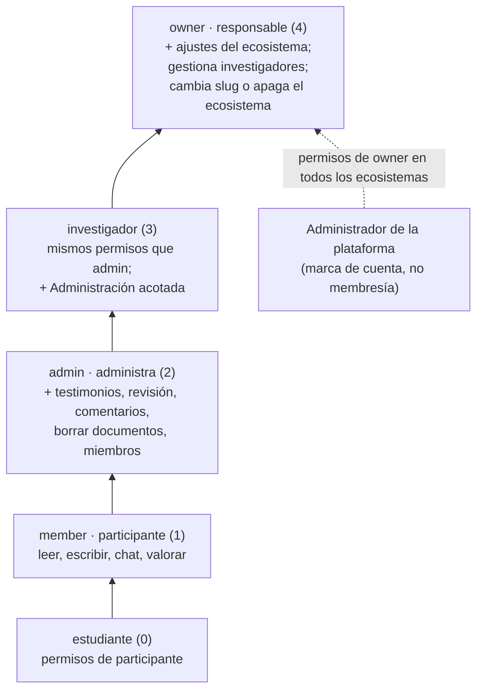
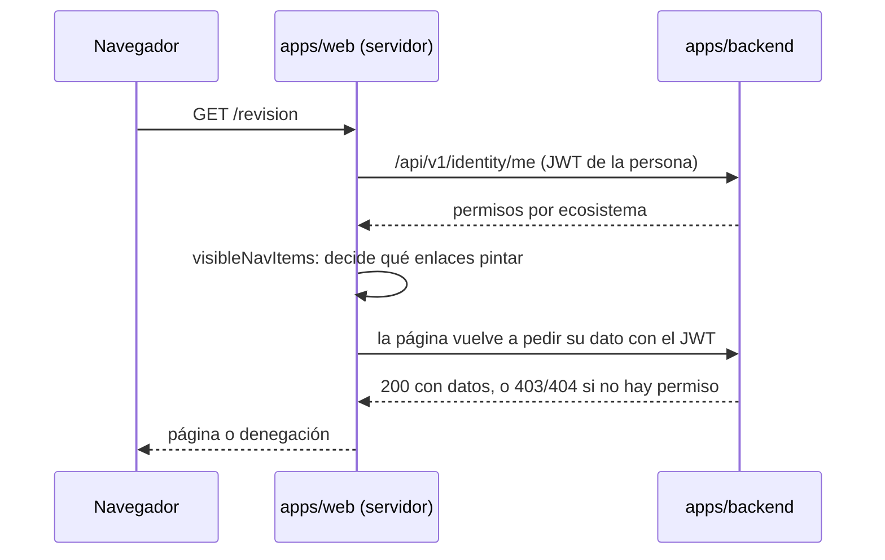

# Matriz de roles y permisos

**Versión:** 1.4 · **Fecha:** 2026-11-12 · **Estado:** vigente

**Fuentes:**
- `apps/backend/src/lib/permissions.ts` (roles, escalera de rango, conjuntos de permisos)
- `apps/web/src/lib/roles.ts` (`canAdminOrg`, `adminOrgIds`)
- `apps/web/src/lib/nav.ts` y `apps/web/src/routes/+layout.server.ts` (menú)
- `apps/web/src/lib/miembros.ts` (roles que ofrece la pantalla Miembros)
- `apps/backend/src/lib/features.ts`, `apps/web/src/lib/publication.ts`
- `plan/funcionalidades.md` (quién ve qué, leído en código el 2026-10-27)
- `plan/mapa-historias.md`
- Brief v1 del proyecto, «Repositorio de Voces y Resonancias», §5 (roles preliminares; documento externo al repo)

## Para quién es y qué responde

Este documento es para quien administra un ecosistema, para revisores que necesitan saber quién puede leer qué, y para quien desarrolle. Responde: qué roles existen en Ecosistemas de Conocimiento (EDC), cómo se ordenan, qué permiso otorga cada uno, qué capacidades dependen de otra cosa que no es un permiso, cómo decide el menú qué mostrar y qué ve cada rol en cada pantalla. Todo lo que dice se leyó en el código de `main` el 2026-10-30 y se volvió a contrastar con `main` (b7dc944f) el 2026-11-10 y con `main` `f971d54c` el 2026-11-12, salvo donde se indica otra procedencia. Estado de dev = `db9a4456`, desplegado el 2026-11-13 a las 03:21 UTC, 2026-11-12 21:21 en la Ciudad de México (measured con `docker ps` por el agente de despliegue; `infra/fleet/edc-1.md` §4zzzzzzzzzzzzzz): todo lo que está en `main` `db9a4456` está desplegado en dev; `db9a4456` agrega a `f971d54c` el consentimiento por recurso.

## Dos niveles de rol

EDC tiene dos niveles de autoridad que no se mezclan:

1. **Rol por ecosistema.** Cada persona tiene una membresía por ecosistema, con un rol. Una misma persona puede ser estudiante en un ecosistema y responsable en otro. Los permisos de un rol valen solo dentro del ecosistema de esa membresía.
2. **Administrador de la plataforma.** Es una marca en la cuenta (`isPlatformAdmin`), no una membresía. Ninguna membresía la otorga. Quien la tiene recibe en todos los ecosistemas activos los permisos de `owner` (`PLATFORM_ADMIN_ROLE = 'owner'` en `apps/backend/src/lib/permissions.ts`), más algunas capacidades exclusivas de plataforma.

Una cuenta inactiva (`isActive = false`) no tiene ningún rol: el servidor la trata como sin membresías. Desde el 2026-10-28, revocar a una persona le corta también el chat y el micrófono en vivo (citado de `plan/auditoria-codigo-2026-10-28.md`). Desde el 2026-11-10 (A-01, commit ce46db7b, desplegado en dev) una cuenta desactivada no inicia sesión (el login responde lo mismo que una contraseña equivocada), sus sesiones se vacían al apagarla, y `Documents`, `Media` y `Ratings` le niegan lectura y escritura, así que tampoco sube. Un `isActive` NULL cuenta como apagado (`isActiveUser` en `apps/backend/src/access/`). Una escritura vieja no la reactiva (commits 6841b71a y b2d6958d, desplegados).

## Roles por ecosistema

| Valor en el código | Nombre en pantalla | Abreviatura en el mapa de historias | Rango | Para qué sirve |
|---|---|---|---:|---|
| `estudiante` | estudiante | Est. | 0 | Conversa, sube y escribe notas. Con la función `studentView` tiene la vista Mi investigación. |
| `member` | participante | Part. | 1 | Conversa, sube documentos y audio, valora respuestas. Lo que sube se publica solo si `autoPublishMembers` está encendida. Es el rol por defecto (`DEFAULT_ORG_ROLE`). |
| `admin` | administra | (no aparece) | 2 | Lo del participante, más subir testimonios, revisar documentos retenidos, leer comentarios de valoraciones, borrar documentos y gestionar miembros. |
| `investigador` | investigador | Inv. | 3 | Lo de `admin`, más la Administración acotada a sus ecosistemas. Desde el 2026-11-10 ya no guarda los ajustes del ecosistema (`/ajustes`); desplegado (commit 50bde2ae). |
| `owner` | responsable | Resp. | 4 | Lo de investigador, más los ajustes del ecosistema (`/ajustes`, `organization:manage`). El rango superior le deja gestionar investigadores, y solo él cambia la clave (`slug`) del ecosistema o lo apaga. |

Un rol de rango 0 por debajo de participante tiene un propósito: un estudiante nunca puede otorgar el rol participante a nadie (comentario en `apps/backend/src/lib/permissions.ts`).

Hasta el 2026-10-27, `investigador` estaba entre `member` y `admin` y no gestionaba a nadie. Esa fecha el responsable del proyecto lo subió por encima de `admin` (citado del comentario en `permissions.ts`).

### Escalera de rango

Los conjuntos de permisos se construyen por acumulación hacia arriba: cada rango incluye todo lo del rango anterior. El código lo explica así: un rango que no trae los permisos del de abajo deja a alguien sin poder hacer lo que su colega de menor rango sí puede.

| Conjunto en `permissions.ts` | Contenido |
|---|---|
| `MEMBER_PERMISSIONS` | `documents:read`, `documents:write`, `chat:use`, `ratings:write` |
| `ESTUDIANTE_PERMISSIONS` | Igual a participante. Lo que añade el estudiante es una vista (función `studentView`), no un permiso. |
| `ADMIN_PERMISSIONS` | Participante más `voces:upload`, `ratings:read-comments`, `holds:review`, `documents:delete`, `members:manage` |
| `INVESTIGADOR_PERMISSIONS` | Igual a `admin` |
| `OWNER_PERMISSIONS` | Investigador más `organization:manage` (desde el 2026-11-10, commit 50bde2ae, desplegado) |

## Matriz de capacidades por rol

● = tiene el permiso en su ecosistema. La columna "Admin plat." vale para todos los ecosistemas activos.

| Permiso | Qué permite | Est. | Part. | Admin eco. | Inv. | Resp. | Admin plat. |
|---|---|:-:|:-:|:-:|:-:|:-:|:-:|
| `documents:read` | Leer lo publicado del ecosistema y lo propio | ● | ● | ● | ● | ● | ● |
| `documents:write` | Subir documentos, audio y notas | ● | ● | ● | ● | ● | ● |
| `chat:use` | Conversar con el acervo | ● | ● | ● | ● | ● | ● |
| `ratings:write` | Valorar respuestas | ● | ● | ● | ● | ● | ● |
| `voces:upload` | Subir testimonios, elegir el tipo de aporte, pedir anonimizar, publicar a mano | | | ● | ● | ● | ● |
| `ratings:read-comments` | Leer el texto libre del motivo "Otro" en las valoraciones | | | ● | ● | ● | ● |
| `holds:review` | Ver, corregir, aprobar o rechazar documentos retenidos; retirar publicados | | | ● | ● | ● | ● |
| `documents:delete` | Borrar documentos del ecosistema | | | ● | ● | ● | ● |
| `members:manage` | Ver, agregar, cambiar de rol y quitar miembros | | | ● | ● | ● | ● |
| `organization:manage` | Cambiar las funciones del ecosistema en `/ajustes`, ver el estado de su re-anonimización y pedir «Reintentar» | | | | | ● | ● |

La matriz tiene una prueba contra Postgres real: `apps/backend/src/lib/roles.matrix.pg.test.ts`. Esa prueba se salta si no hay docker en la máquina que la corre.

`holds:review` está separado de `documents:write` a propósito: anular una compuerta de seguridad que falla cerrada es un acto distinto de archivar material. El día que esas dos cosas deban estar en manos de personas distintas, la separación ya existe (comentario en `permissions.ts`).

## Capacidades que no son permisos

Varias capacidades no salen de la tabla anterior. Dependen del rol directamente, de la marca de plataforma, de una función por ecosistema o del consentimiento de otra persona.

| Capacidad | Quién la tiene | Dónde se decide |
|---|---|---|
| Entrar a Administración (`/admin`), función `canAdminOrg` | Investigador y responsable, solo en sus ecosistemas, y administrador de plataforma. **El `admin` de ecosistema no entra.** | `apps/web/src/lib/roles.ts` (`canAdminOrg`, `adminOrgIds`); control en `apps/web/src/routes/admin/+page.server.ts` |
| Vista de estudiante (`/estudiante`) | Rol `estudiante` con la función `studentView` encendida | `apps/backend/src/endpoints/estudiante.ts`; 404 si no aplica |
| Vista docente (`/seguimiento`), reportes | `canAdminOrg` más el consentimiento `shareActivity` del estudiante | `apps/web/src/routes/seguimiento/+page.server.ts`; 404 si se niega |
| Vista docente, sugerencias | Investigador o responsable | mismo archivo |
| Cambiar la clave (`slug`) o apagar el ecosistema | Solo `owner` | `apps/backend/src/collections/Organizations.ts` |
| Asignar roles | Quien tiene `members:manage`, solo roles de rango igual o menor al propio | `outranks` en `permissions.ts`; `assignableRoles` en `apps/web/src/lib/miembros.ts`; tope en `collections/Memberships.ts` |
| Interruptores de anonimización de un documento (`PATCH /api/documents/:id/anonimizacion`: `keepDocumentAuthor`, `keepCitedAuthors`) | Quien subió el documento; quien tiene `holds:review` en ese ecosistema (admin, investigador, owner), y desde el 2026-11-10 solo sobre filas retenidas o publicadas, nunca sobre el borrador privado de otra persona (A-07, commit 50bde2ae, desplegado); y el administrador de plataforma. Cada cambio deja una fila en `anonymisation-setting-changes` y, si hace falta, vuelve a pasar el documento por la compuerta. Implementado (commit 491841fb, desplegado) | `apps/backend/src/lib/anonymisationControls.ts`; [ADR-0020](../03-arquitectura/adr/ADR-0020-anonimizar-todo-y-conservar-nombres-por-documento.md) |
| `keepPublicFigures` en un documento | Solo el administrador de plataforma, y solo en un `documento`; cualquier otra persona recibe 403. Implementado (commit 887fae32, desplegado). La vista dice qué interruptores puede cambiar quien la abre (`editable`, desplegado) | `apps/backend/src/lib/anonymisationControls.ts` |
| Interruptores de ecosistema solo de plataforma (`keepPublicFigures`, `studentTestimonios`) | Administrador de plataforma. El responsable los ve bloqueados. | `PLATFORM_ADMIN_ONLY_FEATURES` en `apps/backend/src/lib/features.ts`, aplicado en `Organizations` |
| Interruptores de ecosistema `keepDocumentAuthor` y `keepCitedAuthors` | Responsable y administrador de plataforma (`organization:manage`); el investigador ya no (desplegado). Cada cambio queda en `anonymisation-setting-changes` y re-anonimiza lo que conservó un nombre | `apps/backend/src/collections/Organizations.ts` (`auditAnonymisationSwitches`) |
| Respaldo del detector de datos personales (`PATCH /api/plataforma`) | Solo la marca `isPlatformAdmin`; ninguna membresía. Cada cambio queda auditado (commit 887fae32, desplegado) | `apps/backend/src/globals/PlatformSettings.ts` |
| Ver el roster de un ecosistema (Miembros) | Todos ven el roster completo, salvo donde su rol es `estudiante`: ahí ve su propia fila, al personal (roles no estudiante) y a los compañeros que activaron `shareWithPeers`. Decisión del 2026-11-10; desplegado (commit f685923d) | `readMemberships` en `apps/backend/src/collections/Memberships.ts` |
| Estilos de respuesta por ecosistema | Administrador de plataforma (`answerStylesEditable`) | `apps/web/src/lib/answerStyle.ts`; `apps/backend/src/lib/answerStyle.ts` |
| Ver cualquier ecosistema en Conexiones (`?eco=`) y correr evaluaciones (`/admin/evals`) | Administrador de plataforma | `apps/web/src/routes/grafo/+page.server.ts`; `apps/web/src/routes/admin/evals/+page.server.ts` |
| Leer el original crudo de un testimonio o de un `documento` con compuerta | Quien lo subió y el administrador de plataforma | `mayReadGatedOriginal` en `apps/backend/src/collections/Documents.ts` |
| Ver el nombre de archivo de un `documento` con compuerta | Quien lo subió y el administrador de plataforma. Los demás ven el título redactado en todas las superficies (REST, ingesta, citas, biblioteca, chat, grafo, estudiante y vista de anonimización); si la columna `anonymise` es NULL o no viene, el título falla cerrado. Desplegado en dev (commits b2a51aed, 0bfe8ceb, 2f21e91b, a2ba0e19, ed35b605, b7dc944f) | `titleFor` en `apps/backend/src/lib/contentKind.ts`; `mayReadGatedOriginal` |
| Descargar el original de cualquier documento | Solo quien lo subió | `apps/web/src/routes/api/documents/[id]/original/+server.ts` |
| Crear cuentas | Quien tiene `members:manage` (desde `/miembros`) y el administrador de plataforma. El registro abierto está cerrado desde el 2026-10-21. | `apps/backend/src/endpoints/miembros.ts`; `collections/Users.ts` |

### Publicación manual y automática

Publicar significa pasar un documento del borrador privado al acervo compartido del ecosistema. Hay tres caminos, y cuál aplica depende del rol (`apps/web/src/lib/publication.ts`):

| Quién | Cómo publica | Condición |
|---|---|---|
| `admin`, investigador, responsable, administrador de plataforma | A mano, con "Publicar en mi ecosistema" y una confirmación | Permiso `voces:upload`; documento en `listo` |
| Participante (`member`) | Automático, sin botón. Si intenta publicar a mano, la respuesta da el motivo `automatic`. | Función `autoPublishMembers` encendida y que el documento pase la compuerta de anonimización (`apps/backend/src/lib/autoPublish.ts`) |
| Estudiante | Publica su nota a mano | Función `studentView`; la nota tiene 200 caracteres o más (`MIN_NOTE_CHARS` en `apps/backend/src/lib/studentNotes.ts`) y pasa la compuerta |

Con `autoPublishMembers` apagada, lo que sube un participante se queda en borrador.

## Cómo decide el menú y por qué es solo presentación

El menú principal muestra a cada persona solo las secciones que puede usar. El cálculo ocurre en el servidor de la web, en cada carga:

1. `apps/web/src/routes/+layout.server.ts` pide al backend la lista de permisos de la persona (`/api/v1/identity/me`, leído en `apps/web/src/lib/server/holds.ts`).
2. Con esa lista calcula cinco banderas: `canReviewHolds` (`holds:review`), `canManageMembers` (`members:manage`), `canEditFeatures` (`organization:manage`), `vocesUpload` y `studentAccess`.
3. `visibleNavItems` (`apps/web/src/lib/nav.ts`) filtra la lista de secciones con esas banderas, más la marca de plataforma y `adminOrgIds`.

| Marca de la sección en `nav.ts` | Sección | Se muestra si |
|---|---|---|
| (ninguna) | Conversaciones, Mis documentos, Biblioteca, Conexiones | siempre, con sesión |
| `studentOnly` | Mi investigación | es estudiante y `studentView` está encendida |
| `teacherOnly` | Estudiantes | es investigador o responsable y `studentView` está encendida |
| `reviewerOnly` | Revisión | `canReviewHolds` |
| `managerOnly` | Miembros | `canManageMembers` |
| `ownerOnly` | Ajustes | `canEditFeatures` o administrador de plataforma |
| `adminOnly` | Administración | administrador de plataforma o `adminOrgIds` no vacío |

**Ocultar un enlace es solo presentación.** El menú no protege nada. Cada página y cada ruta de API vuelve a preguntar al backend con el token de la persona, y el backend aplica el permiso del ecosistema concreto. Escribir la URL a mano no da acceso:

| Ruta | Respuesta si no hay permiso |
|---|---|
| `/revision`, `/revision/[id]` | 403 (`denyAccess`) |
| `/miembros` | 403 (`denyAccess`) |
| `/ajustes` | 403 con «Esta sección es para quien es responsable de un ecosistema.» |
| `/admin` | 403 "Esta sección es solo para administradores." |
| `/estudiante`, `/seguimiento` | 404, para no revelar que la vista existe |
| `/grafo` con `graph` apagada | aviso de grafo desactivado; la API de vista responde 404 |
| `/api/*` sin sesión | 401 |

El archivo `apps/web/src/lib/roles.ts` lo dice en su cabecera: estas funciones deciden qué mostrar; cada control del servidor vuelve a preguntar.

## Qué ve cada rol, por pantalla

Fuente: `plan/funcionalidades.md` (leído en código el 2026-10-27), contrastado con `nav.ts` el 2026-10-30.

| Pantalla | Est. | Part. | Admin eco. | Inv. | Resp. | Admin plat. |
|---|:-:|:-:|:-:|:-:|:-:|:-:|
| Conversaciones `/` | ● | ● | ● | ● | ● | ● |
| Mis documentos `/documentos` | ● | ● | ● | ● | ● | ● |
| Biblioteca `/biblioteca` | ● | ● | ● | ● | ● | ● |
| Conexiones `/grafo` (función `graph`) | ● | ● | ● | ● | ● | ● |
| Mi investigación `/estudiante` (función `studentView`) | ● | | | | | |
| Estudiantes `/seguimiento` (función `studentView`) | | | | ● | ● | |
| Revisión `/revision` | | | ● | ● | ● | ● |
| Miembros `/miembros` | | | ● | ● | ● | ● |
| Ajustes `/ajustes` | | | | | ● | ● |
| Administración `/admin` | | | | ● | ● | ● |
| Evaluaciones `/admin/evals` | | | | | | ● |

Notas por pantalla:
- **Conversaciones.** Participante y estudiante ven primero la pantalla Iniciar, con un solo botón. Los demás roles entran directo a la interfaz completa.
- **Panel Documentos dentro de la conversación.** Con `voces:upload` aparecen el selector de tipo de aporte, la casilla "Anonimizar" y el botón de publicar.
- **Estudiantes.** El administrador de plataforma tiene `canAdminOrg`, así que el backend le daría los reportes con consentimiento, pero el menú no le muestra la sección porque no es investigador ni responsable en ese ecosistema (inferido de `nav.ts` y de `seguimiento/+page.server.ts`; no verificado en una sesión real).
- **Ajustes.** El responsable ve `keepPublicFigures` y `studentTestimonios` bloqueados. La pestaña de estilo y la sección de plataforma solo son editables por el administrador de plataforma. El investigador recibe 403 «Esta sección es para quien es responsable de un ecosistema.»
- **Administración.** Investigador y responsable solo ven sus ecosistemas; el administrador de plataforma ve el directorio completo.

## Anomalía: el rol `admin` de ecosistema

El rol `admin` (en pantalla, "administra") existe en el código, pero queda fuera de dos lugares donde se esperaría verlo:

1. **No aparece en el mapa de historias.** `plan/mapa-historias.md` tiene columnas Part., Est., Inv., Resp. y Admin, y esa "Admin" es el administrador de la plataforma. Ninguna historia describe lo que hace un `admin` de ecosistema.
2. **La pantalla Miembros no lo ofrece.** `ROLE_OPTIONS` en `apps/web/src/lib/miembros.ts` solo trae estudiante, participante, investigador y responsable. La función `roleLabel` sí sabe mostrarlo ("administra") si alguien ya lo tiene.

Consecuencias:
- Solo se puede tener ese rol por datos sembrados o por escritura directa en la base (inferido; no hay otra ruta en la interfaz).
- Quien lo tiene ve Revisión y Miembros, sube testimonios y publica a mano, pero no entra a Ajustes ni a Administración, porque `canAdminOrg` solo admite investigador, responsable y plataforma.
- Ninguna escena de los specs de evidencia corre con ese rol, así que su experiencia completa no se graba ni se prueba de punta a punta (inferido de la lista de specs en `apps/web/e2e/evidencia/`). La matriz de permisos sí lo cubre en `roles.matrix.pg.test.ts`.

Decisión pendiente del responsable del proyecto: retirarlo, ofrecerlo en Miembros o documentarlo como rol de soporte.

## Correspondencia con los roles del brief

El brief (§5) proponía roles preliminares. Así quedaron en la Etapa 1:

| Rol del brief | Equivalente en EDC | Observación |
|---|---|---|
| Super admin | Administrador de la plataforma (`isPlatformAdmin`) | Marca de cuenta, no membresía |
| Admin de ecosistema | `owner` (responsable); `investigador` para todo menos Ajustes | El valor `admin` existe pero no se ofrece (ver anomalía) |
| Usuario contribuidor | `member` (participante) | Publicación automática con `autoPublishMembers` |
| Moderador-facilitador | Sin equivalente directo; lo más cercano es `investigador`, que revisa y publica | Pendiente |
| Capturador | No existe como rol; lo cubre `voces:upload` (administra, investigador, responsable) | Distinto del brief: no se registra de quién es la voz; ver [historias del brief no implementadas](historias-de-usuario.md#historias-del-brief-no-implementadas) |
| (no previsto) | `estudiante` | Se agregó para el ecosistema Semiosis práctica, con la vista de estudiante |

## Referencias

- `apps/backend/src/lib/permissions.ts`
- `apps/backend/src/lib/roles.matrix.pg.test.ts`
- `apps/web/src/lib/roles.ts`, `apps/web/src/lib/nav.ts`, `apps/web/src/lib/miembros.ts`, `apps/web/src/lib/publication.ts`
- `apps/web/src/routes/+layout.server.ts`, `apps/web/src/hooks.server.ts`
- `apps/backend/src/lib/features.ts`, `apps/backend/src/globals/PlatformSettings.ts`
- `plan/funcionalidades.md`, `plan/mapa-historias.md`
- [Historias de usuario](historias-de-usuario.md)
- [Funciones por ecosistema](funciones-por-ecosistema.md)
- [Actores y glosario](../01-proyecto/actores-y-glosario.md)
- [Seguridad](../06-privacidad-y-seguridad/seguridad.md)
- [API](../03-arquitectura/api.md)
