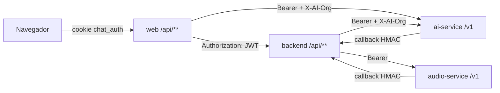
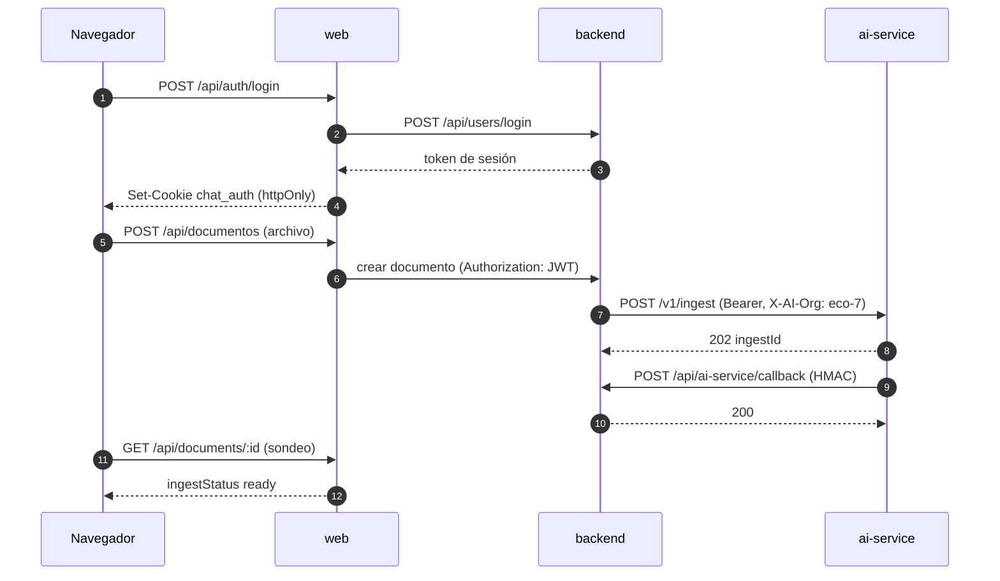

# Referencia de API

- **Versión:** 1.1
- **Fecha:** 2026-11-03
- **Estado:** vigente
- **Fuentes:** `apps/web/src/routes/api/**`, `apps/web/src/hooks.server.ts`, `apps/web/src/lib/server/auth.ts`, `apps/web/Dockerfile`, `apps/web/src/lib/config.ts`, `apps/backend/src/app/api/**`, `apps/backend/src/endpoints/*.ts`, `apps/backend/src/collections/Documents.ts`, `apps/backend/src/collections/Media.ts`, `apps/backend/src/lib/hmac.ts`, `apps/backend/src/lib/jwt/*`, `packages/ai-client/src/callbacks/verify.ts`, `services/ai-service/src/server.ts`, `services/ai-service/src/server-limits.ts`, `services/ai-service/src/plugins/auth.ts`, `services/audio-service/app/main.py`, `services/audio-service/app/routes/*.py`, `services/audio-service/app/live.py`. Rutas verificadas en `main` del 2026-10-29.

## Para quién es y qué responde

Este documento es para desarrolladores que necesitan llamar, cambiar o depurar una interfaz HTTP de Ecosistemas de Conocimiento (EDC). Responde qué rutas expone cada proceso, quién puede llamarlas y para qué, y cuáles son los contratos que cruzan procesos: firmas de callbacks, la cabecera de delegación de org, la cookie de sesión, los tokens de identidad y los límites de tamaño de cuerpo en cada salto. No es una especificación OpenAPI completa: ai-service publica la suya en `/v1/openapi.json`.

La forma general del sistema está en [Arquitectura del sistema](arquitectura-del-sistema.md). Los modelos detrás de cada ruta de IA están en [Pila de IA](pila-de-ia.md).

## 1. Mapa de superficies

| Proceso | Base | Quién la llama | Autenticación |
|---|---|---|---|
| `web` (SvelteKit) | `https://dev.ecosistemasdeconocimiento.com/api/**` y form actions de páginas | Navegador | Cookie `chat_auth` |
| `backend` (Payload + Next.js) | `https://api.dev.ecosistemasdeconocimiento.com/api/**` | `web` (con el JWT del usuario), ai-service y audio-service (callbacks), operadores (panel de Payload) | `Authorization: JWT <token>` de Payload, HMAC en callbacks, `X-Service-Token` en `/v1/identity/resolve` |
| `ai-service` | Red interna, `/v1/**` | `backend` y `web` | `Authorization: Bearer <llave>` más `X-AI-Org` |
| `audio-service` | Red interna, `/v1/transcribe`, `/v1/live`, `/v1/admin` | `backend` | `Authorization: Bearer <llave>` |

Para staging, los dominios son `montaje.` y `api.montaje.`. El navegador nunca llama al backend, a ai-service ni a audio-service: todo pasa por `web` (principio del BFF).

## 2. Rutas de la web (`apps/web/src/routes/api/**`)

### 2.1 Guardia global

`apps/web/src/hooks.server.ts` corre en cada petición:
- Rutas públicas: `/sign-in`, `/sign-up`, `/api/auth/*`, `/api/health*`.
- Con cookie, llama a `GET {BACKEND_URL}/api/users/me` con `Authorization: JWT <token>`. Si el token ya no sirve, borra la cookie.
- Sin sesión: `/api/*` responde 401; un `GET` de página redirige con 303 a `/sign-in`; cualquier otro método responde 401.

Cada ruta reenvía al backend con el JWT del usuario. El navegador nunca manda la org, el dueño ni nombres de corpus; el backend los deriva de la sesión.

### 2.2 Tabla de rutas

"Quién" indica el permiso mínimo que el backend exige; "todos" significa cualquier miembro activo del ecosistema seleccionado.

| Método | Ruta | Propósito | Quién |
|---|---|---|---|
| POST | `/api/auth/login` | Inicia sesión y pone la cookie `chat_auth` | Público |
| POST | `/api/auth/logout` | Cierra sesión en el backend y borra la cookie | Con sesión |
| POST | `/api/auth/register` | Siempre 403: el registro está cerrado desde 2026-10-21 | Público |
| GET, POST | `/api/ecosistemas` | Lista los ecosistemas del usuario / elige uno (cookie `eco_selected`) | Con sesión |
| GET | `/api/funciones` | Interruptores del ecosistema seleccionado, para ocultar funciones en la interfaz | Todos |
| GET, POST | `/api/sessions` | Lista conversaciones / crea una | Todos (`chat:use`) |
| PATCH, DELETE | `/api/sessions/[id]` | Cambia título, estado del panel o alcance / borra con cascada | Dueño de la conversación |
| GET, POST | `/api/sessions/[id]/messages` | Lee o agrega mensajes | Dueño de la conversación |
| GET, POST, DELETE | `/api/sessions/[id]/ratings` | Valoración de 1 a 5 con motivos | Dueño (`ratings:write`) |
| GET, POST | `/api/sessions/[id]/documents` | Documentos de la conversación / subir archivo o crear nota | Dueño (`documents:write`) |
| GET | `/api/sessions/[id]/documents/available` | Documentos propios que se pueden adjuntar | Dueño |
| POST, DELETE | `/api/sessions/[id]/documents/[docId]` | Adjuntar / quitar un documento | Dueño |
| POST | `/api/generate` | Turno de chat en streaming (motor `@edc/chat-engine`) | Dueño (`chat:use`) |
| GET | `/api/context-search` | Autocompletado de menciones `@` | Todos |
| GET, POST | `/api/documentos` | Mis documentos / subida sin conversación | Todos |
| GET, PATCH, DELETE | `/api/documents/[id]` | Estado (para sondeo) / nombre, cuerpo, fijado / borrar | Quien subió; borrar ajeno pide `documents:delete` |
| PATCH | `/api/documents/[id]/note` | Autoguardado de una nota | Quien subió |
| PATCH | `/api/documents/[id]/transcript` | Corregir la transcripción de un borrador y reindexar | Quien subió |
| POST | `/api/documents/[id]/publish` | Publicar o publicar cambios; el cuerpo va vacío | Quien subió |
| POST | `/api/documents/[id]/retry` | Reintentar una ingesta fallida | Quien subió |
| POST | `/api/documents/[id]/graph-retry` | Reconstruir el grafo de un documento | Quien subió |
| GET | `/api/documents/[id]/original` | Descargar el archivo original | Quien subió |
| GET | `/api/biblioteca`, `/api/biblioteca/[id]` | Biblioteca publicada del ecosistema / un documento | Todos |
| GET | `/api/lenguas` | Facetas de lengua de lo publicado | Todos |
| POST, DELETE | `/api/live/[sid]` | Rebanada de audio a texto parcial / fin de grabación | Miembro con `liveMic` encendido |
| GET | `/api/health` | Vida: no revisa dependencias | Público |
| GET | `/api/health/ready` | Listo: revisa dependencias | Público |
| POST | `/grafo/buscar` | Búsqueda de texto en el grafo (fuera de `/api`) | Todos, con interruptor `graph` |

La web no expone una ruta propia para despublicar. El backend sí tiene `POST /api/documents/:id/unpublish` (sección 3.2); la web usa los estados `unpublishing` en la interfaz (`apps/web/src/lib/publication.ts`), pero no se encontró un proxy de despublicación en `apps/web/src/routes/api` (verificado con búsqueda en el código; si existe por otro camino, no verificado).

### 2.3 Form actions

Las páginas SvelteKit tienen acciones de formulario (envíos `POST` a la misma página, que funcionan sin JavaScript):

| Página | Acciones | Quién |
|---|---|---|
| `/sign-in` | `default` | Público |
| `/estudiante` | `perfil`, `sugerir`, `preguntas` | Estudiante con `studentView` |
| `/miembros` | `add`, `role`, `remove` | `members:manage` |
| `/revision` | `rechazar` | `holds:review` |
| `/revision/[id]` | `decide` | `holds:review` |
| `/ajustes` | `funciones`, `estilo`, `plataforma` | `organization:manage`; `estilo` y `plataforma` solo administrador de plataforma |
| `/admin/evals` | `guardar`, `borrar`, `cargar`, `ejecutar` | Administrador de plataforma |

## 3. Endpoints del backend

El backend expone tres tipos de rutas. Las REST automáticas de Payload (`/api/<colección>`, `/api/users/login`, `/api/users/me`). Los endpoints personalizados de Payload, declarados en `apps/backend/src/payload.config.ts` y en las colecciones. Y los route handlers de Next.js en `apps/backend/src/app/api/**`. Todas las negativas por pertenencia responden 404 y no 403, para no confirmar que un ecosistema o un documento existe.

### 3.1 Salud

| Método | Ruta | Propósito |
|---|---|---|
| GET | `/api/health` | Vida del proceso; sin dependencias, para que un fallo de Postgres no reinicie el contenedor en bucle |
| GET | `/api/health/ready` | Disponibilidad: revisa todas sus dependencias, entre ellas almacenamiento y ai-service (`apps/backend/src/lib/readiness.ts`). Para monitores y personas, no para la política de reinicio |

### 3.2 Documentos

Definidos en `apps/backend/src/collections/Documents.ts`.

| Método | Ruta | Propósito | Notas |
|---|---|---|---|
| POST | `/api/documents/:id/publish` | Mueve el borrador al corpus compartido `eco-{org}` | Responde al encolar, no al terminar; la fila queda en `publishing` hasta el callback. Lee bajo control de acceso: solo quien subió publica |
| POST | `/api/documents/:id/unpublish` | Retira del corpus compartido | Estado `unpublishing` hasta el callback |
| PATCH | `/api/documents/:id/note` | Edita el cuerpo de una nota | |
| POST | `/api/documents/:id/retry` | Reintenta la ingesta | |
| POST | `/api/documents/:id/graph-retry` | Reprograma la extracción del grafo | Solo quien subió |

Publicar no es escribir un campo: re-embebe el documento en otro corpus, cuesta tokens y puede fallar a medias. Por eso es un endpoint y no un `PATCH` sobre `publicationStatus`.

### 3.3 Revisión de retenciones

| Método | Ruta | Propósito | Quién |
|---|---|---|---|
| GET | `/api/holds?organization=<id>[&limit=<n>]` | Cola de documentos retenidos por el gate; la lista no lleva texto | `holds:review` |
| GET | `/api/holds/:id` | `heldText` (la salida rechazada del gate), `survivors` como posiciones y el reporte del gate; nunca `extractedText` | `holds:review` |
| POST | `/api/holds/:id` | Decisión: `{ "decision": "approve" }`, `{ "decision": "approve", "text": "…" }` o `{ "decision": "reject", "note": "…" }` | `holds:review` |
| GET | `/api/published?organization=<id>` | Testimonios publicados (y `documento` con gate) que se pueden rechazar después de publicados | `holds:review` |
| POST | `/api/published/:id` | `{ "decision": "reject", "note"?: "…" }`: rechaza un testimonio ya publicado y lo retira | `holds:review` |

Una aprobación escribe primero un registro en `anonymisation-reviews` (quién, cuándo y copia del reporte del gate) y después libera el texto (`apps/backend/src/lib/holdReview.ts`).

### 3.4 Miembros, interruptores y métricas

| Método | Ruta | Propósito | Quién |
|---|---|---|---|
| GET | `/api/miembros` | Personas del ecosistema | `members:manage` o administrador de plataforma |
| POST | `/api/miembros` | Crea una cuenta o agrega una existente. Una cuenta nueva recibe una contraseña temporal que se muestra una sola vez; un correo existente recibe la misma forma de respuesta con una contraseña señuelo | `members:manage` |
| PATCH | `/api/miembros/:id` | Cambia rol | `members:manage` |
| DELETE | `/api/miembros/:id` | Quita la membresía | `members:manage` |
| GET | `/api/funciones`, `/api/funciones/editables` | Interruptores del ecosistema y cuáles puede cambiar quien llama | Miembro / `organization:manage` |
| PATCH | `/api/funciones` | Cambia interruptores | `organization:manage` |
| PATCH | `/api/funciones/estilo` | Cambia los tres estilos de respuesta | Administrador de plataforma |
| PATCH | `/api/plataforma` | Ajustes de plataforma (respaldo del detector) | Administrador de plataforma |
| GET | `/api/metrics/ecosystem?organization=<id>` | Conteos del ecosistema (solo números) | `canAdminOrg` |
| GET | `/api/metrics/usage?organization=<id>` | Panel "Uso del chat": totales de conversaciones, turnos, costo, tiempos y modelos, sin texto | `admin` u `owner` del ecosistema, o administrador de plataforma |
| GET | `/api/lenguas` | Facetas de lengua de lo publicado | Miembro |

### 3.5 Grafo, sesiones, valoraciones, estudiante y evaluaciones

| Método | Ruta | Propósito |
|---|---|---|
| GET | `/api/graph/view?organization=<id>&type=<…>&q=<texto>` | Vista del grafo: solo lo publicado, con soporte mínimo. Límite de 120 por minuto por usuario |
| GET | `/api/graph/entity/:id?organization=<id>` | Detalle de una entidad |
| POST | `/api/graph/retrieve` | `{ organization, query, limit? }`: semillas y consulta expandida para GraphRAG, sin modelo. Límite de 60 por minuto por usuario y 600 por ecosistema |
| GET | `/api/sessions/:id/corpora` | Corpus y `asOf` de una conversación; la web nunca arma nombres de corpus |
| POST | `/api/ratings/upsert` | Crea o actualiza una valoración |
| GET, PATCH, POST | `/api/estudiante`, `/api/estudiante/acceso`, `/perfil`, `/alcance`, `/companero`, `/reportes`, `/reporte`, `/api/sugerencias` | Vista de estudiante; 404 si `studentView` está apagado |
| POST | `/api/evals/session`, `/api/evals/gate`, `/api/evals/seed` | Panel de evaluaciones; solo administrador de plataforma |

Los límites del grafo están citados de `plan/adr-corpus-graph.md` §15 (ADR-0007).

### 3.6 Micrófono en vivo

| Método | Ruta | Propósito |
|---|---|---|
| POST | `/api/live/:sid?offset=N` | Verifica membresía y el interruptor `liveMic`, y reenvía la rebanada a audio-service. Rebanada máxima de 4 MiB, contada mientras se lee (`MAX_SLICE_BYTES` en `apps/backend/src/app/api/live/[sid]/route.ts`) |
| DELETE | `/api/live/:sid` | Termina la sesión de texto parcial |

Las respuestas llevan `Cache-Control: no-store`. El texto parcial nunca se guarda ni se registra.

### 3.7 Receptor de callbacks

| Método | Ruta | Propósito |
|---|---|---|
| POST | `/api/ai-service/callback` | Recibe callbacks de ai-service (`ingest.completed` y otros) y de audio-service (`transcribe.completed`). Un solo verificador y un solo secreto para ambos emisores |

El contrato está en la sección 7.1.

### 3.8 Identidad

El backend es el proveedor de identidad (IdP) de EDC.

| Método | Ruta | Propósito | Autenticación |
|---|---|---|---|
| POST | `/api/users/login` | Inicio de sesión de Payload; devuelve el token de sesión que la web guarda en `chat_auth` | Correo y contraseña |
| GET | `/api/users/me` | Usuario actual con membresías activas | Token de sesión de Payload |
| GET | `/api/.well-known/jwks.json` | Llaves públicas para verificar tokens del IdP | Pública |
| POST | `/api/v1/identity/token` | `{ "audience": "<slug>" }`: canjea la sesión por un token EdDSA de un solo ecosistema. Vida de 900 s como máximo | Sesión de Payload |
| GET | `/api/v1/identity/me` | Perfil y mapa de permisos por ecosistema (el mapa se llama `projects` en la respuesta y contiene slugs) | Sesión de Payload |
| GET | `/api/v1/identity/resolve?email=<e>&organization=<slug>` | De servicio a servicio: qué puede hacer una persona en un ecosistema | `X-Service-Token` |

## 4. API `/v1` de ai-service

### 4.1 Autenticación y límites

- Todo `/v1` pide `Authorization: Bearer <llave>`. Las llaves viven en la variable `API_KEYS` (JSON); no hay tabla de llaves. Cada llave tiene rol `app` o `admin` (`services/ai-service/src/plugins/auth.ts`).
- La llave de EDC tiene `delegateOrgPrefix: "edc-"`, así que acepta la cabecera `X-AI-Org` (sección 7.2).
- Límite de tasa: 100 por minuto en todo `/v1` y 30 por minuto en `/generate*` y `/retrieve/multi`. Agrupa por llave (prefijo de su huella sha256), no por IP; solo cae a la IP cuando la llave es desconocida. Corre antes de la autenticación, con contador compartido en Redis que falla abierto (`services/ai-service/src/server.ts`:94-104 y :447-470).
- Cuerpo máximo de 1 MiB, y 10 MiB en `/v1/ingest` (`services/ai-service/src/server-limits.ts`).

### 4.2 Tabla de rutas

| Método y ruta | Propósito | Auth | Límite | Consumidor en EDC |
|---|---|---|---|---|
| `POST /v1/generate` | Generación asíncrona por cola | app | 30/min | — |
| `POST /v1/generate/sync` | Generación síncrona | app | 30/min | backend (detector hospedado, títulos, grafo); web (condense, expansión, preguntas, juez de evals) |
| `POST /v1/generate/stream` | Generación con SSE (eventos enviados por el servidor) | app | 30/min | web (respuesta de chat) |
| `POST /v1/ingest`, `GET /v1/ingest/:id` | Encolar ingesta / consultar su estado | app | 100/min, 10 MiB | backend |
| `POST /v1/retrieve` | Recuperación en un corpus (densa, híbrida, rerank, `asOf`) | app | 100/min | web |
| `POST /v1/retrieve/multi` | Varios corpus, condense opcional | app | 30/min | web (modo híbrido) |
| `POST /v1/embed` | Embeddings directos | app | 100/min | casi sin uso |
| `GET/POST/DELETE /v1/corpora[/:name]` | Alta, consulta y baja de corpus | app | 100/min | backend |
| `PATCH /v1/corpus/:name/documents/:ext/validity` | Retirar o reactivar un documento (cierra o abre `valid_to`) | app | 100/min | backend (publicar, despublicar) |
| `DELETE /v1/corpus/:name/documents/:ext` | Borrar un documento | app | 100/min | backend |
| `DELETE /v1/corpus/:name` | Borrar un corpus | admin | 100/min | backend con `AI_SERVICE_ADMIN_API_KEY` |
| `POST /v1/corpus/:name/alias` | Alias de corpus | admin | 100/min | — |
| `GET /v1/budget/:org` | Leer presupuesto | app | 100/min | web (panel) |
| `PUT /v1/budget/:org` | Fijar el tope | admin | 100/min | operador |
| `GET /v1/tenant/readiness` | Preparación de una org | app | 100/min | backend |
| `POST /v1/tenant/provision` | Alta de org con presupuesto | admin | 100/min | backend (`provisionEcosystem.ts`) |
| `GET/PUT /v1/registry/*` | Registro de prompts y tipos de unidad | lectura app, escritura admin | 100/min | grafo |
| `POST /v1/route` | Clasificador de capacidad | app | estricto | — |
| `GET /v1/events/:channel` | Eventos | app | 100/min | — |
| `GET /v1/capabilities` | Negociación de capacidades | — | — | backend y web |
| `GET /v1/openrouter/credits` | Saldo de OpenRouter | admin | — | administración |
| `POST/GET /v1/admin/callbacks` | Reentrega de callbacks | admin | — | operador |
| `GET /v1/internal/latest-trace` | Depuración; se niega a arrancar con `NODE_ENV=production` | — | — | pruebas |
| `/v1/openapi.json`, `/v1/docs`, `/health`, `/health/ready`, métricas | Operación | — | — | operador |

Rutas leídas en `services/ai-service/src/server.ts`:397-686 y `services/ai-service/src/routes/*.ts`; el cliente tipado está en `packages/ai-client/src/`.

## 5. audio-service

Autenticación por `Authorization: Bearer <llave>` contra su propio `API_KEYS`, con el mismo formato que ai-service. La org y el proyecto salen siempre de la llave, nunca del cuerpo (`services/audio-service/app/auth.py`). Un trabajo de otra org responde 404 y no 403.

| Método | Ruta | Propósito | Notas |
|---|---|---|---|
| POST | `/v1/transcribe` | Multipart con `file`, `callbackUrl`, `language` (por defecto `es`), `externalId`, `title`, `idempotencyKey`, `metadata`. Responde 202 con `transcribeId` y encola | La ruta no transcribe: valida, guarda el audio, escribe el estado y encola en arq. Máximo 512 MiB (`MAX_UPLOAD_BYTES` en `services/audio-service/app/config.py`) |
| GET | `/v1/transcribe/{id}` | Estado y transcripción cuando termina | |
| POST | `/v1/live/{sid}/chunk?offset=N` | Rebanada de audio WebM/Opus; devuelve el texto parcial | Rebanada de 4 MiB como máximo, sesión de 64 MiB, ventana de 25 s, 6 sesiones simultáneas (`services/audio-service/app/live.py`). 503 si no hay Whisper remoto |
| DELETE | `/v1/live/{sid}` | Termina la sesión y libera la memoria | 204 |
| GET | `/v1/admin/dead-letters` | Trabajos que agotaron reintentos | Operador |
| POST | `/v1/admin/callbacks/{delivery_id}/replay`, GET `/v1/admin/callbacks/{delivery_id}` | Reentrega y consulta de un callback | Operador |
| GET | `/health`, `/health/ready` | Vida y disponibilidad | Solo el contenedor de API los tiene |

## 6. Flujo típico de llamadas

## 7. Contratos

### 7.1 Callbacks HMAC

Lo usan ai-service y audio-service para avisar al backend que terminó un trabajo.

- **Cabeceras:** `X-AIService-Timestamp` (segundos Unix), `X-AIService-Signature` (sha256 en hexadecimal, minúsculas), `X-AIService-Event`. audio-service agrega `X-Callback-Source: audio-service`.
- **Firma:** `HMAC_SHA256(CALLBACK_SECRET, "<timestamp>.<cuerpo crudo>")`. El receptor lee el cuerpo crudo con `req.text()` antes de cualquier `JSON.parse`, porque una ida y vuelta por JSON cambia los bytes y rompe la firma. La comparación es de tiempo constante.
- **Ventana:** el backend acepta una diferencia de reloj de ±900 s (`CALLBACK_SKEW_WINDOW_SECONDS` en `apps/backend/src/lib/hmac.ts`). El paquete compartido `packages/ai-client/src/callbacks/verify.ts` define 300 s y el documento de contrato también dice 300; el backend de EDC no usa ese paquete para verificar. Ver la nota de la sección 9.
- **Idempotencia:** el receptor inserta cada evento en `aiServiceCallbacks` con un índice único sobre su llave natural (`ai_service_callbacks_natural_key_unq`, cuyo nombre forma parte del contrato porque el receptor lo busca en el error del driver). Si la fila ya existía, responde 200 sin repetir el efecto.
- **Códigos de respuesta:** 200 éxito o evento repetido; 400 cuerpo no es JSON (el emisor no reintenta); 401 firma inválida, sello vencido o secreto ausente (el emisor deja de reintentar ese callback); 500 fallo interno (el emisor reintenta). Un manejador que lanza un error borra su fila de deduplicación y responde 500, para que el reintento no se pierda.
- **Reintentos:** ai-service reintenta con el calendario `[0, 5 s, 30 s, 2 min, 10 min]`, unos 12 min 35 s en total (citado de `packages/ai-client/src/callbacks/verify.ts`). audio-service se rinde a los 20 s por intento.
- **Falla silenciosa:** si `CALLBACK_SECRET` no coincide entre emisor y receptor, el documento se queda en `embedding` para siempre y el log muestra un 401 que parece un ataque.

### 7.2 Cabecera `X-AI-Org`

- El backend y la web mandan `X-AI-Org: eco-<id>` en cada llamada a ai-service, donde `<id>` es el id numérico del ecosistema.
- La llave de EDC tiene `delegateOrgPrefix: "edc-"`. La org efectiva es el prefijo más el valor: `edc-eco-<id>`. Uso, trazas y presupuesto se cobran a esa org.
- El valor debe cumplir `^[a-z0-9-]{1,48}$`. Una llave sin prefijo de delegación que mande la cabecera recibe un error (`services/ai-service/src/plugins/auth.ts`).
- Los nombres de corpus (`eco-{orgId}`, `eco-{orgId}-draft-{userId}`) son independientes de la org y se validan en el backend con `^[A-Za-z0-9_]+$` por componente.

### 7.3 Cookie `chat_auth`

- La pone `/api/auth/login` o la acción `default` de `/sign-in` (`apps/web/src/lib/server/auth.ts`).
- Contiene el token de sesión de Payload que devuelve `POST /api/users/login`.
- Atributos: `httpOnly`, `sameSite: 'lax'`, `secure` fuera de desarrollo local, `maxAge` de 7 días.
- La web la reenvía al backend como `Authorization: JWT <token>`. El navegador nunca la puede leer desde JavaScript.
- `eco_selected` es una cookie aparte que guarda el ecosistema elegido.

### 7.4 JWT EdDSA del proveedor de identidad

- Los tokens de `/api/v1/identity/token` se firman con Ed25519 (`alg: "EdDSA"`, `kid` = `AUTH_KEY_ID`; `apps/backend/src/lib/jwt/sign.ts`). La llave se genera con `npm run keygen`.
- Claims: `iss`, `sub` (correo), `aud` (slug del ecosistema), `email`, `name`, `roles`, `perms`, `iat`, `exp`. La audiencia es un ecosistema, así que un token de un ecosistema no sirve en otro.
- Vida de 900 s como máximo (`AUTH_TOKEN_TTL`, recortado si la variable pide más), porque un token emitido no se puede revocar.
- Las llaves públicas se publican en `/api/.well-known/jwks.json`. `packages/identity-client` verifica con JWKS; la web no lo importa y lee `/api/v1/identity/me`.
- El token de sesión de Payload en `chat_auth` es distinto del token EdDSA. Su algoritmo de firma es el de Payload y no se revisó para este documento (no verificado).

### 7.5 Límites de cuerpo por salto

| Salto | Límite | Fuente |
|---|---|---|
| Navegador a `web` (adapter-node) | 512 KB por defecto; la imagen fija `BODY_SIZE_LIMIT=201M` para que quepa un audio de 200 MB más el encabezado multipart | `apps/web/Dockerfile`:42-45 |
| Validación de la web por tipo | 20 MB documentos, 200 MB audio (`MAX_UPLOAD_BYTES`, `MAX_AUDIO_UPLOAD_BYTES`) | `apps/web/src/lib/config.ts` |
| `web` a `backend`, colección `media` | 200 MiB para todo tipo (`MAX_MEDIA_UPLOAD_BYTES`), aplicado en `beforeValidate` como último límite | `apps/backend/src/collections/Media.ts`:227 |
| `backend` `/api/live/:sid` | 4 MiB por rebanada, contada mientras se lee, porque Next.js no pone límite a los route handlers | `apps/backend/src/app/api/live/[sid]/route.ts`:35 |
| `backend`, límite general de 2M | No verificado: no se encontró en `apps/backend/next.config.ts` ni en el código. Next.js aplica por defecto un límite a server actions, no a route handlers | búsqueda en el código, 2026-10-30 |
| A ai-service `/v1` | 1 MiB | `services/ai-service/src/server-limits.ts` |
| A ai-service `/v1/ingest` | 10 MiB (hasta 100 documentos por lote) | `services/ai-service/src/server-limits.ts` |
| A audio-service `/v1/transcribe` | 512 MiB | `services/audio-service/app/config.py`:141 |
| A audio-service `/v1/live` | 4 MiB por rebanada, 64 MiB por sesión | `services/audio-service/app/live.py`:66-68 |

Un desajuste entre saltos tiene un síntoma conocido: el 2026-10-24, en dev, toda grabación de más de unos 2 minutos fallaba porque adapter-node rechazaba el cuerpo con su límite por defecto (citado de `apps/web/Dockerfile`:42).

## 8. Convenciones de error

- Las rutas del backend responden `{ "errors": [{ "message": "…" }] }`; ai-service y audio-service responden `{ "error": "<código>", "message": "…" }`.
- Las negativas por pertenencia son 404, no 403, en holds, métricas, grafo, documentos y trabajos de audio.
- ai-service responde 402 cuando el presupuesto de la org no alcanza o la org no tiene fila de presupuesto.
- Las rutas que llevan texto sensible o estado cambiante responden con `Cache-Control: no-store`.

## 9. Discrepancias conocidas

- **Ventana de los callbacks.** El backend usa ±900 s y su comentario dice que ai-service sella una sola vez al encolar. Ese motivo ya no aplica: ai-service vuelve a sellar y firmar con la hora actual en cada intento (`signBody` en `services/ai-service/src/services/callbacks/emit.ts`, leído el 2026-10-30), y `packages/ai-client` usa ±300 s por eso. La ventana de 900 s funciona, pero es tres veces más amplia que la del contrato. Volver a 300 s es un cambio pendiente que se hace en el mismo commit que actualiza el comentario de `apps/backend/src/lib/hmac.ts`.
- **Límite de tasa por IP.** Las notas de contexto del equipo dicen que ai-service agrupa por IP. El código agrupa por llave. Rige el código.

## Referencias

- `apps/web/src/routes/api/`, `apps/web/src/hooks.server.ts`, `apps/web/src/lib/server/auth.ts`, `apps/web/Dockerfile`, `apps/web/src/lib/config.ts`
- `apps/backend/src/app/api/`, `apps/backend/src/endpoints/`, `apps/backend/src/collections/Documents.ts`, `apps/backend/src/lib/hmac.ts`, `apps/backend/src/lib/jwt/`
- `packages/ai-client/src/callbacks/verify.ts`, `packages/identity-client/`
- `services/ai-service/src/server.ts`, `services/ai-service/src/server-limits.ts`, `services/ai-service/src/plugins/auth.ts`
- `services/audio-service/app/main.py`, `services/audio-service/app/routes/`, `services/audio-service/app/live.py`, `services/audio-service/app/auth.py`
- [Arquitectura del sistema](arquitectura-del-sistema.md) · [Pila de IA](pila-de-ia.md) · [ADR](adr/README.md)
- [Matriz de roles y permisos](../02-requisitos/matriz-roles-y-permisos.md) · [Seguridad](../06-privacidad-y-seguridad/seguridad.md)
- [Guía del desarrollador](../08-manuales/guia-del-desarrollador.md)
