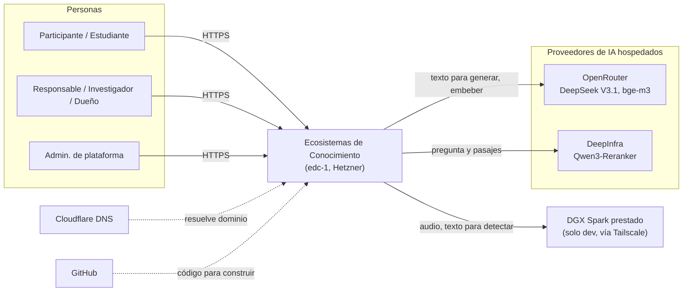
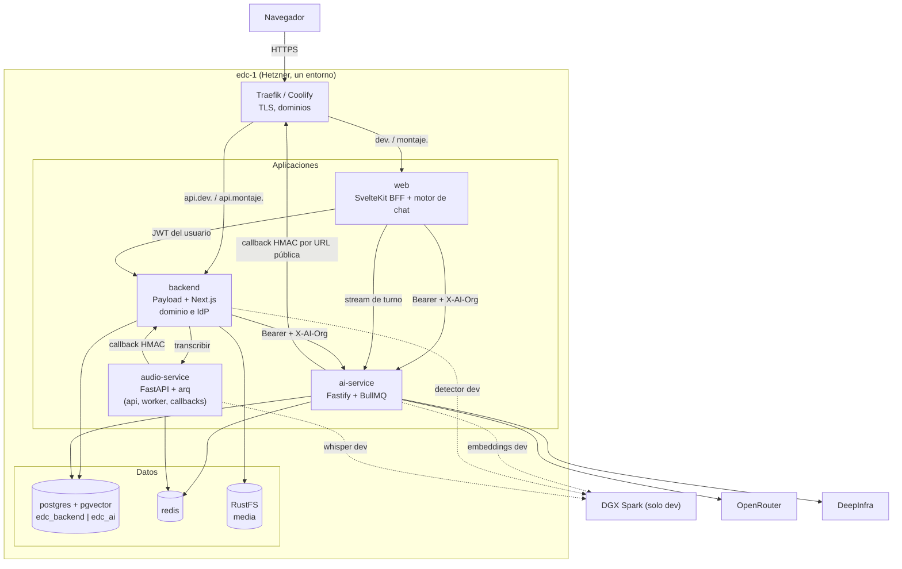
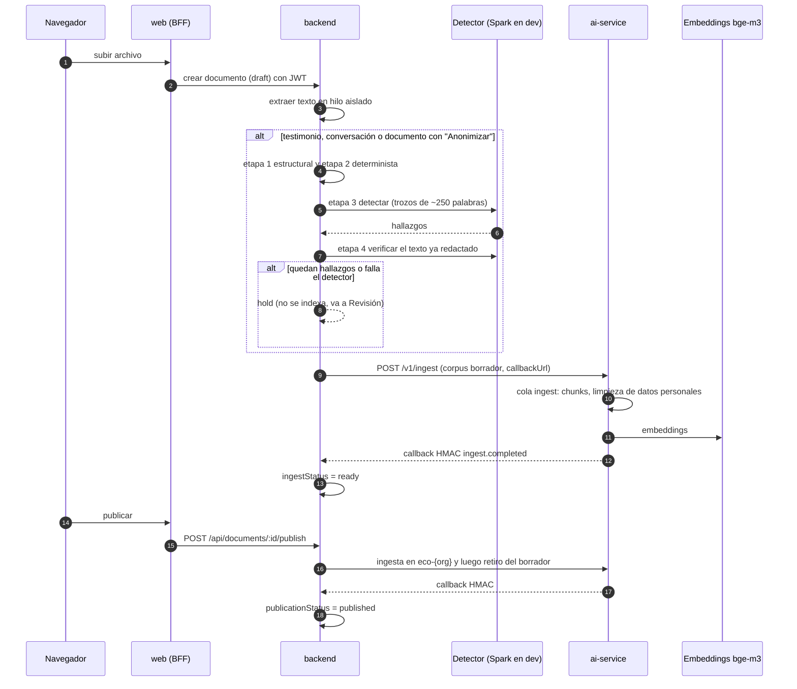
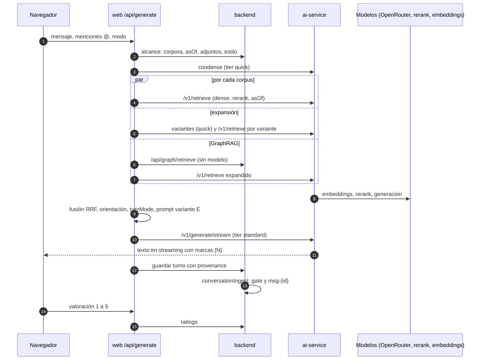
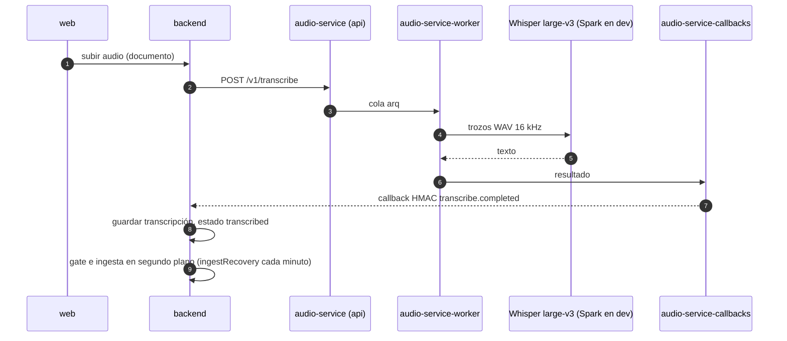
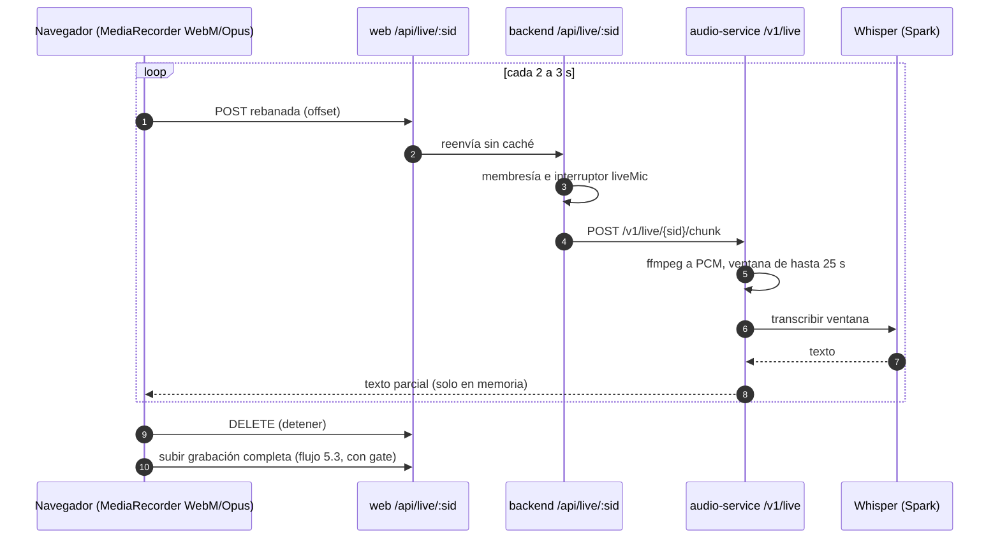
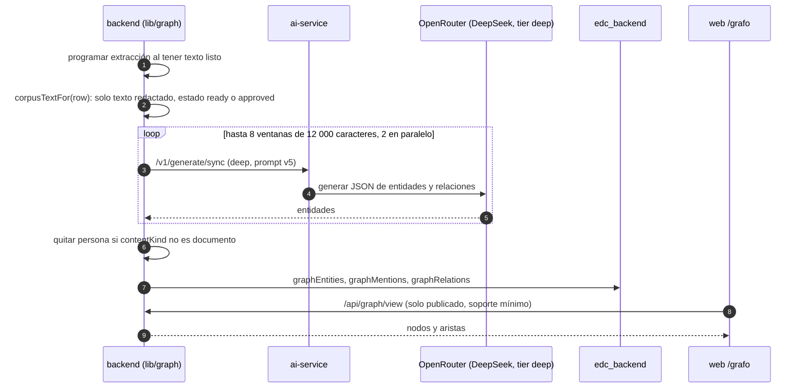
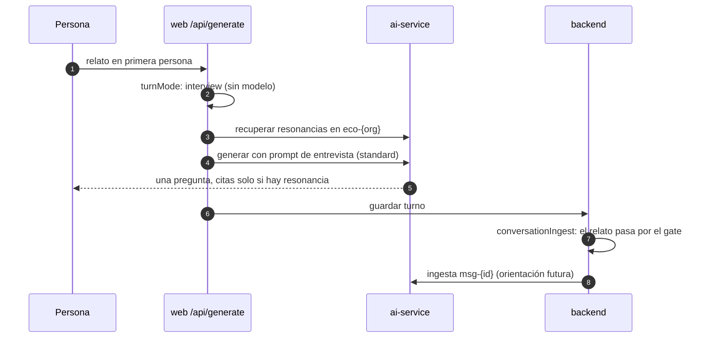

# Arquitectura del sistema

- **Versión:** 1.1
- **Fecha:** 2026-11-03
- **Estado:** vigente
- **Fuentes:** `infra/docker-compose.yml`, `infra/fleet/edc-1.md`, `infra/fleet/env-manifests.md`, notas de contexto del equipo, `plan/adr-corpus-graph.md`, `plan/spark-ai-adopcion.md`, `plan/anonimizacion-y-voces.md`, `apps/backend/src/payload.config.ts`, `apps/backend/src/collections/Documents.ts`, `apps/backend/src/lib/anonymise/gate.ts`, `apps/backend/src/lib/publishDocument.ts`, `apps/backend/src/lib/corpus.ts`, `apps/web/src/routes/api/generate/+server.ts`, `apps/web/src/lib/server/engine/*`, `packages/chat-engine/src/core/*`, `services/ai-service/src/server.ts`, `services/audio-service/app/*`. Código leído en `main` del 2026-10-29.

## Para quién es y qué responde

Este documento es para quien necesita entender cómo está armado Ecosistemas de Conocimiento (EDC) antes de tocarlo, revisarlo o evaluarlo: el equipo del proyecto, revisores institucionales del CIDE y desarrolladores que lleguen después. Responde cinco preguntas. Quién usa el sistema y con qué servicios externos habla. Qué procesos corren y cómo se comunican. Qué piezas internas tiene cada proceso. Cómo viaja un dato en los flujos principales, de la subida de un archivo a una respuesta citada. Y qué principios y límites conocidos explican la forma actual. Usa el modelo C4 (cuatro niveles de zoom sobre un sistema: contexto, contenedores, componentes y código); aquí se cubren los tres primeros.

El detalle de los modelos de lenguaje está en [Pila de IA](pila-de-ia.md). Las rutas HTTP están en [API](api.md). Las decisiones de arquitectura con su historia están en los [ADR](adr/README.md).

## 1. Resumen en un párrafo

EDC es un monorepo con tres aplicaciones y dos servicios de IA. El navegador solo habla con `apps/web`, una aplicación SvelteKit que actúa como BFF (backend for frontend: un servidor intermedio que recibe todas las llamadas del navegador y las reenvía). `apps/web` habla con `apps/backend`, una aplicación Payload CMS sobre Next.js que guarda el dominio (ecosistemas, personas, documentos, conversaciones) y además es el proveedor de identidad. El texto de los documentos pasa por un gate de anonimización en el backend y después se indexa en `services/ai-service`, un servicio Fastify con colas BullMQ que hace RAG (generación con recuperación: el modelo responde citando fragmentos del acervo). El audio se transcribe en `services/audio-service`, un servicio FastAPI con colas arq. Todo corre en una sola máquina Hetzner (`edc-1`) administrada con Coolify, salvo los modelos locales, que corren en un DGX Spark prestado al que solo llega el entorno dev.

## 2. Nivel 1: contexto

### 2.1 Personas usuarias por rol

Los roles viven por ecosistema en la colección `memberships`. El escalafón, de menor a mayor, es `estudiante < member < admin < investigador < owner` (`apps/backend/src/lib/permissions.ts`). El administrador de plataforma no es un rol de membresía sino una marca en la cuenta (`users.isPlatformAdmin`) y en el token se resuelve como `owner` de todos los ecosistemas activos.

| Rol | Nombre en la interfaz | Qué hace en el sistema |
|---|---|---|
| `member` | Participante | Conversa con el acervo, sube documentos y testimonios, publica lo suyo, valora respuestas |
| `estudiante` | Estudiante | Lo mismo que `member`; con el interruptor `studentView` ve además la vista "Mi investigación" |
| `admin` | Responsable | Además revisa retenciones del gate, gestiona miembros y sube voces |
| `investigador` | Investigador | Además administra el ecosistema (página Ajustes) |
| `owner` | Dueño | Además gestiona investigadores, cambia el `slug` y puede apagar el ecosistema |
| Administrador de plataforma | Admin. de plataforma | Crea ecosistemas y cuentas, fija estilos de respuesta, ve `/admin/evals` y el ajuste de respaldo del detector |

La matriz completa está en [Matriz de roles y permisos](../02-requisitos/matriz-roles-y-permisos.md).

### 2.2 Sistemas externos

| Sistema | Para qué lo usa EDC | Quién lo llama |
|---|---|---|
| OpenRouter | Generación de texto (DeepSeek V3.1) para respuestas, reescritura de preguntas, expansión, grafo, juez de evaluaciones; embeddings `bge-m3` en staging y como respaldo en dev; detector de datos personales en staging y como respaldo en dev | `ai-service` |
| DeepInfra | Rerank (reordenamiento de pasajes) con `Qwen3-Reranker-0.6B` en staging; en dev el host no está verificado | `ai-service` |
| DGX Spark prestado (solo dev) | Whisper large-v3, detector Qwen3-30B-A3B, `bge-m3` y `Qwen3-Reranker-0.6B`, detrás de un proxy con token | `backend` (detector, títulos), `ai-service` (embeddings), `audio-service` (Whisper) |
| Hetzner Cloud | La máquina `edc-1` (proyecto `edc`, región fsn1) y sus respaldos | operador |
| Cloudflare DNS | Registros del dominio `ecosistemasdeconocimiento.com` en modo solo DNS (sin proxy), para que Traefik obtenga certificados Let's Encrypt | operador |
| GitHub | Código fuente y llave de despliegue de solo lectura para Coolify | Coolify |

El DGX Spark pertenece a otra organización. Se llega a él por Tailscale (una red privada cifrada entre máquinas) y todos sus servicios salen por un solo proxy con token. Este documento no publica su dirección.

### 2.3 Entornos

Hay dos entornos, dev y staging ("montaje"), en la misma máquina. No hay producción (citado de `infra/fleet/edc-1.md`, 2026-10-29). Dev tiene 9 contenedores y staging 6, porque staging no activa el perfil de audio (citado de `infra/fleet/edc-1.md` §4zzzz). Solo dev usa el Spark. El detalle está en [Infraestructura y entornos](../05-infraestructura/infraestructura-y-entornos.md).

## 3. Nivel 2: contenedores

### 3.1 Inventario

| Contenedor | Tecnología | Responsabilidad | Base de datos | Puerto interno |
|---|---|---|---|---|
| `web` | SvelteKit con adapter-node | Páginas, BFF `/api/**`, motor de chat (`@edc/chat-engine` y `apps/web/src/lib/server/engine`) | ninguna propia | 3000 |
| `backend` | Payload CMS 3 sobre Next.js 15 | Dominio, control de acceso, gate de anonimización, publicación, grafo, proveedor de identidad (JWT EdDSA) | `edc_backend` | 3002 |
| `ai-service` | Node, Fastify, Drizzle, BullMQ | Ingesta, chunking, embeddings, recuperación, rerank, generación, presupuesto, callbacks | `edc_ai` | 3000 |
| `audio-service`, `audio-service-worker`, `audio-service-callbacks` | Python, FastAPI, arq | Transcripción de archivos y micrófono en vivo; una imagen, tres procesos | Redis | 8080 (solo la API) |
| `postgres` | `pgvector/pgvector:pg16` | Dos bases: `edc_backend` y `edc_ai` | — | 5432 |
| `redis` | `redis:7-alpine` con AOF | Colas BullMQ y arq, contador de límite de tasa de ai-service | — | 6379 |
| `rustfs` | RustFS (almacenamiento compatible con S3) | Archivos originales subidos (`media`) | — | interno |
| Traefik (`coolify-proxy`) y Coolify | Proxy inverso y orquestador | TLS, enrutamiento por dominio, despliegue desde GitHub | — | 80/443 |

Los puertos están citados de `infra/fleet/edc-1.md` §3 e `infra/docker-compose.yml`. Cada entorno es un solo recurso Docker Compose de Coolify con su propia red privada, así que el `postgres` de dev y el de staging no se ven entre sí.

### 3.2 Diagrama de contenedores

Dos detalles del diagrama. Primero, ai-service devuelve los callbacks al backend por su URL pública HTTPS, así que la llamada sale y vuelve a entrar por Traefik en la misma máquina (citado de `infra/fleet/env-manifests.md` §2a). Segundo, el dominio `api.` del backend existe para el panel de Payload y el proveedor de identidad; el navegador de un usuario normal no lo usa, porque todas sus llamadas pasan por `web`.

## 4. Nivel 3: componentes

### 4.1 Componentes del backend (`apps/backend`)

| Componente | Archivos principales | Qué hace |
|---|---|---|
| Colecciones Payload | `src/collections/*.ts` | `users`, `organizations`, `memberships`, `teams`, `projects`, `documents`, `media`, `sessions`, `messages`, `ratings`, `studentProfiles`, `suggestions`, `graphEntities`, `graphMentions`, `graphRelations`, `anonymisation-reviews`, `eval-items`, `eval-runs`, `aiServiceCallbacks`; global `platform-settings`. Cada una define su control de acceso como restricciones WHERE por ecosistema |
| Extracción de texto | `src/lib/extract/run.ts`, `src/lib/extract/sandbox.ts` | Saca el texto de PDF, DOCX, XLSX, CSV, HTML y Markdown en un hilo aislado, con guardas contra archivos comprimidos maliciosos |
| Gate de anonimización | `src/lib/anonymiseDocument.ts`, `src/lib/anonymise/gate.ts`, `detector.ts`, `deterministic.ts`, `structural.ts` | Único punto de paso hacia el índice. Cuatro etapas: estructural, determinista, detección por modelo y verificación. Resultado binario: `ready` o `hold` |
| Revisión de retenciones | `src/lib/holdReview.ts`, `src/app/api/holds/*` | Cola de documentos retenidos; aprobar, corregir o rechazar, con registro de auditoría antes de liberar |
| Publicación | `src/lib/publishDocument.ts`, `src/lib/autoPublish.ts`, `src/lib/corpus.ts` | Mueve un documento del corpus borrador al compartido (re-embebe), lo retira al despublicar, borra copias retiradas |
| Ingesta de conversaciones | `src/lib/conversationIngest.ts` | Pasa cada turno por el gate y lo indexa como documento `msg-{id}` para la orientación de turnos futuros |
| Grafo de corpus | `src/lib/graph/*`, `src/endpoints/graph.ts` | Extrae entidades y relaciones con un modelo, las guarda en tres colecciones y las sirve a `/grafo` y a GraphRAG |
| Transcripción | `src/lib/audioClient.ts`, `src/lib/driveTranscribedSoon.ts`, `src/lib/ingestRecovery.ts` | Pide la transcripción a audio-service, recibe el callback y retoma el gate y la ingesta |
| Micrófono en vivo | `src/app/api/live/[sid]/route.ts` | Verifica membresía y el interruptor `liveMic`, y reenvía rebanadas de audio a audio-service |
| Identidad | `src/endpoints/jwks.ts`, `token.ts`, `me.ts`, `resolve.ts`, `src/lib/jwt/*` | Firma tokens EdDSA, publica JWKS, devuelve el mapa de permisos por ecosistema |
| Receptor de callbacks | `src/app/api/ai-service/callback/route.ts`, `src/lib/hmac.ts` | Verifica la firma HMAC, deduplica en `aiServiceCallbacks` y actualiza el documento |
| Aprovisionamiento | `src/lib/provisionEcosystem.ts` | Al crear un ecosistema, da de alta su org en ai-service con presupuesto |
| Barridos programados | `src/lib/ingestRecovery.ts`, `publishJanitor.ts`, `sessionJanitor.ts`, `transcriptionJanitor.ts`, `embeddingJanitor.ts` | Retoman trabajo atorado y limpian restos; corren dentro del proceso del backend |

### 4.2 Componentes de la web (`apps/web`)

El motor de chat está repartido entre el paquete `@edc/chat-engine` (`packages/chat-engine/src/core/*`, lógica sin dependencias del producto) y el adaptador de EDC en `apps/web/src/lib/server/engine/`.

| Componente | Archivo | Qué hace |
|---|---|---|
| Orquestador del turno | `src/routes/api/generate/+server.ts` | Lee el alcance del backend, llama a `prepareTurn()`, genera en streaming y guarda el turno |
| condense | `packages/chat-engine/src/core/condense.ts`, `engine/condenseDeadline.ts` | Reescribe una pregunta de seguimiento como pregunta completa; si falla o tarda, usa la pregunta cruda |
| expand | `engine/expand.ts` | Pide hasta 3 variantes de la pregunta y una respuesta hipotética, y fusiona los resultados con RRF (fusión por rango recíproco) |
| retrieve | `engine/aiClient.ts`, `engine/hybrid.ts`, `src/lib/server/retrieval.ts` | Recupera por corpus con `asOf`; modo `dense` por defecto |
| rerank | `engine/rerank.ts` | Pide a ai-service reordenar el conjunto; reintenta una vez sin rerank si falla |
| orientation | `engine/orientation.ts` | Arma el bloque de orientación con turnos anonimizados de otras personas; ese bloque nunca se cita |
| prompt | `engine/prompt.ts`, `engine/promptSource.ts`, `engine/chunkFence.ts` | Prompt del sistema (variante de cita E), estilo del ecosistema, fragmentos dentro de `<fuente>` |
| turnMode | `engine/turnMode.ts` | Decide sin modelo si el turno es `answer` o `interview` |
| sources | `engine/sources.ts` | Arma la procedencia (`provenance`) para que `[N]` apunte al fragmento N |
| Guardia global | `src/hooks.server.ts` | Valida la cookie `chat_auth` contra el backend en cada petición y bloquea `/api/*` sin sesión |
| Proxy de rutas | `src/routes/api/**` | Reenvía cada acción al backend con el JWT del usuario |

## 5. Flujos de extremo a extremo

### 5.1 Subida, gate, ingesta y publicación

Un archivo entra por `web`, se guarda como documento en estado `draft` y el backend extrae su texto. Si el documento es un testimonio, una conversación o un `documento` marcado "Anonimizar", pasa por el gate. Un `documento` normal no pasa por el gate y se indexa tal cual (`apps/backend/src/lib/anonymiseDocument.ts`). Después del gate, el backend pide a ai-service la ingesta en el corpus borrador de quien subió. Al publicar, el documento se re-embebe en el corpus compartido del ecosistema. Los participantes publican sin revisión previa, siempre detrás del gate (`apps/backend/src/lib/autoPublish.ts`).

Los tamaños del gate (trozos de unas 250 palabras, concurrencia 3, timeout de 90 s) están leídos en `apps/backend/src/lib/anonymise/detector.ts`. El chunking de ai-service (800 tokens con traslape de 100) está leído en `services/ai-service/src/services/rag/chunk.ts`.

### 5.2 Pregunta, recuperación, generación y valoración

Los nombres de corpus nunca se arman en el navegador: el backend los entrega (`Sessions` endpoint `/:id/corpora`). Si los documentos no responden la pregunta, el prompt obliga a la frase fija "Los documentos no hablan de esto." (`apps/web/src/lib/server/engine/prompt.ts`). El detalle de cada paso está en [Pila de IA](pila-de-ia.md), sección "Recuperación y generación".

### 5.3 Audio subido y transcripción

El audio no tiene un pipeline propio. Es otra forma de llenar `extractedText` en la misma fila de `documents` (ADR-0010).

En dev, 130.3 s de audio se decodificaron en 15.4 s y el documento llegó a `published` en 29 s o menos (citado de `infra/fleet/edc-1.md`:1784, medición de 2026-10-25). En staging el perfil de audio está apagado y la transcripción no existe.

### 5.4 Micrófono en vivo

El micrófono en vivo muestra texto parcial mientras la persona habla. El texto parcial es testimonio crudo, anterior al gate: vive solo en la memoria del proceso de audio-service, solo vuelve a quien habla y no se guarda ni se registra. Al detener, la grabación completa sube por el flujo 5.3 y ahí sí pasa el gate.

Primer texto a los 4.14 s y mediana de ida y vuelta por rebanada de 2.29 s (citado de `infra/fleet/edc-1.md`:1782, medición de 2026-10-25 en dev). Donde no hay Whisper remoto el endpoint responde 503 y la grabación sigue funcionando.

### 5.5 Grafo de corpus

Los tipos de entidad son `tema`, `lugar`, `evento`, `organizacion` y `persona`. `persona` se bloquea para testimonios y conversaciones en tres capas: el esquema de respuesta, `personaAllowed()` y un post-filtro (`apps/backend/src/lib/graph/types.ts`). El grafo vive en `edc_backend` y no en `edc_ai` (ADR-0001). La cola de extracción corre en el proceso del backend y no es durable (ver sección 8).

### 5.6 Resonancia (modo entrevista)

Una conversación de tipo `resonancias` corre todos sus turnos con `resonanciasSystemPrompt()`: una entrevistadora que hace una sola pregunta por turno, sin listas, y que puede decir "Otras personas hablan de … [N]" (`apps/web/src/lib/server/engine/prompt.ts`). En una conversación `generales`, el interruptor "Hazme preguntas" o un relato en primera persona activan `interviewSystemPrompt` a través de `turnMode.ts`.

Lo que cuenta la persona entra al acervo como turno ingerido, siempre detrás del gate.

## 6. Multitenancy

Un ecosistema es una fila de `organizations` y funciona como tenant (inquilino: una división lógica de los datos que no se ve con otras). El aislamiento tiene cuatro capas.

| Capa | Mecanismo | Dónde |
|---|---|---|
| Filas en `edc_backend` | Toda fila de negocio lleva `organization`. Las reglas de acceso devuelven restricciones WHERE (`withinMyOrganizations`), así que un id ajeno da 404 y no 403. Sin membresías la regla es `false` | `apps/backend/src/access/index.ts` |
| Dentro del ecosistema | Los borradores son privados por persona; solo lo `published` se comparte (`visibleToCaller`) | `apps/backend/src/collections/Documents.ts` |
| Corpus en ai-service | Compartido `eco-{orgId}`; borrador `eco-{orgId}-draft-{userId}`. Los ids se validan con `^[A-Za-z0-9_]+$` para que nadie inyecte un separador | `apps/backend/src/lib/corpus.ts` |
| Org en ai-service | Backend y web mandan `X-AI-Org: eco-<id>`. La llave tiene `delegateOrgPrefix: "edc-"`, así que la org efectiva es `edc-eco-<id>`. Uso y presupuesto se cobran a esa org | `apps/backend/src/lib/aiClient.ts`, `infra/docker-compose.yml` |

Al crear un ecosistema, el backend llama a `POST /v1/tenant/provision` con un tope de 5 USD al mes (`AI_ECOSYSTEM_BUDGET_USD`; citado de `infra/fleet/env-manifests.md`:140, decisión del responsable, no una necesidad medida). Si esa llamada falla, la creación no se interrumpe y la org queda sin presupuesto; ai-service responde 402 hasta que un operador fija el tope.

Límite conocido: backend y web comparten una sola llave de ai-service. El límite de tasa de ai-service agrupa por llave (`services/ai-service/src/server.ts`), así que todos los ecosistemas comparten un solo contador de 30 generaciones por minuto (inferido de la configuración de una sola llave; ver [Pila de IA](pila-de-ia.md), sección "Riesgos y límites").

## 7. Principios de diseño

### 7.1 El gate es binario y falla cerrado

El gate de anonimización tiene solo dos salidas: `ready` (se indexa el texto redactado) o `hold` (no se indexa y espera revisión humana). No existe "indexar de todos modos". Si el detector falla, el documento se retiene. Una persona con `holds:review` puede aprobar, corregir o rechazar, y la aprobación escribe primero un registro de auditoría en `anonymisation-reviews` (`apps/backend/src/lib/holdReview.ts`). Una excepción vigente: el respaldo del detector hacia un modelo hospedado está encendido por defecto; se describe en [Pila de IA](pila-de-ia.md), sección "Riesgos y límites".

### 7.2 Retirar no es borrar, y por eso existe `asOf`

En ai-service, retirar un documento cierra su `valid_to`; el vector sigue en la base. Una recuperación que no manda `asOf` (la fecha de corte) lo puede ver. Por eso toda recuperación del producto manda `asOf`, y por eso el gate no deja pasar nada dudoso: lo que se indexa no se puede "desindexar" con certeza solo retirándolo. Desde 2026-10-17 existe además un borrado real por documento (`retireDeletedDocument` y `eraseWithdrawnCopies` en `apps/backend/src/lib/publishDocument.ts`), que se usa al borrar y al limpiar copias retiradas.

### 7.3 `contentKind` es un control de privacidad

`documents.kind` describe el formato (pdf, docx, audio). `documents.contentKind` describe la naturaleza: `documento`, `testimonio` o `conversacion` (ADR-0002). De esa columna dependen el gate (un `documento` no pasa por él salvo que se pida), la regla de `persona` en el grafo (ADR-0003), las columnas `lengua` y `tema` (ADR-0008) y qué títulos ven los estudiantes. Clasificar mal un testimonio como `documento` desactiva protecciones, y por eso la columna se fija en el servidor.

### 7.4 ai-service no conoce el dominio

ai-service no sabe qué es un ecosistema, una persona o un testimonio. Recibe corpus con nombre, org opaca, texto y metadatos. Todo lo que tiene significado de dominio (tenencia, permisos, gate, grafo) vive en el backend. Así, un cambio de dominio no toca ai-service.

### 7.5 Plataforma de IA agnóstica del dominio

`services/ai-service` y `packages/*` (ai-client, chat-engine, identity-client) forman la plataforma de IA del monorepo: un servicio y paquetes internos sin conceptos de dominio. ai-service expone `/v1` con corpus, org y presupuesto como únicos conceptos (ADR-0017). Los hallazgos de auditoría se marcan como "EDC" o "stack de IA" según la capa donde se corrigen.

### 7.6 El BFF nunca expone el backend

El navegador solo habla con `web`. Las rutas `/api/**` de `web` reenvían al backend con el JWT del usuario guardado en la cookie `chat_auth` (`httpOnly`). El navegador nunca manda la org, el dueño ni los nombres de corpus: el backend los deriva de la sesión. Así, una petición manipulada no puede escribir en otro ecosistema.

## 8. Límites y decisiones conocidas

| Límite | Consecuencia | Fuente |
|---|---|---|
| Estado en memoria por proceso | Los contadores de límite de tasa del grafo (ADR-0007), el throttle de "Preguntas para investigar" y las sesiones del micrófono en vivo viven en la memoria de un proceso. Con N réplicas, el límite se multiplica por N y el micrófono necesitaría enrutamiento por sesión | `apps/backend/src/endpoints/graph.ts`, `apps/web/src/lib/server/preguntas.ts`, `services/audio-service/app/live.py` |
| Sin cola durable del grafo | La extracción corre dentro del proceso del backend. Un reinicio pierde la corrida en curso; `graphStatus` lo deja visible y existe `graph-retry` | `plan/adr-corpus-graph.md` §5.1 |
| Una sola réplica por servicio | No hay alta disponibilidad; un despliegue interrumpe el servicio | `infra/docker-compose.yml` |
| Spark sin supervisión | Los modelos del Spark corren en tmux; un reinicio los deja caídos hasta que alguien los levanta | no verificado en esta versión |
| Una sola llave de ai-service | Un solo contador de tasa para todos los ecosistemas | `infra/docker-compose.yml`:699 |
| Umbral del grafo | El soporte mínimo bajó de 3 a 1 por decisión del responsable del 2026-10-21; las garantías de reidentificación del ADR original se apoyaban en 3 | `apps/backend/src/lib/graph/queries.ts` |
| Sin producción | Solo dev y staging; staging no tiene audio ni Spark | `infra/fleet/edc-1.md` |

## 9. Decisiones de arquitectura (ADR)

| ADR | Tema |
|---|---|
| ADR-0001 | El grafo vive en `edc_backend` como colecciones Payload, con SQL crudo para los agregados |
| ADR-0002 | `contentKind` es un campo aparte de `kind` y funciona como control de privacidad |
| ADR-0003 | La regla de `persona` se aplica por columna, nunca por juicio del modelo |
| ADR-0004 | Vista única del grafo, solo lo publicado, con soporte mínimo |
| ADR-0005 | GraphRAG siempre activo, fusión RRF, sin enrutamiento |
| ADR-0006 | `fragmento` solo para `documento`, con tope de 120 caracteres |
| ADR-0007 | Límites de tasa del grafo por usuario y por ecosistema, sin bucket por IP |
| ADR-0008 | Columnas `tema` y `lengua` en `documents` |
| ADR-0009 | Los borradores pertenecen a su conversación |
| ADR-0010 | La transcripción es un `Document` de primera clase |
| ADR-0011 | Recuperación densa con rerank, no híbrida |
| ADR-0012 | Adopción del DGX Spark por fases |
| ADR-0013 | El chat no se muda al Spark por ahora |
| ADR-0014 | Migraciones: baseline colapsada, `push` opcional, índices escritos a mano |
| ADR-0015 | Un operador y una sola llave de IA |
| ADR-0016 | Infraestructura propia de EDC |
| ADR-0017 | Plataforma de IA agnóstica del dominio |
| ADR-0018 | Lenguaje llano en la interfaz |
| ADR-0019 | Voces sin sujeto ni nivel de consentimiento |

Los textos completos están en el [índice de ADR](adr/README.md).

## Referencias

- `infra/docker-compose.yml`, `infra/fleet/edc-1.md`, `infra/fleet/env-manifests.md`
- `apps/backend/src/payload.config.ts`, `apps/backend/src/collections/`, `apps/backend/src/lib/`
- `apps/web/src/routes/api/`, `apps/web/src/lib/server/engine/`, `packages/chat-engine/`
- `services/ai-service/src/server.ts`, `services/audio-service/app/`
- `plan/adr-corpus-graph.md`, `plan/spark-ai-adopcion.md`, `plan/anonimizacion-y-voces.md`; notas de contexto del equipo
- [Pila de IA](pila-de-ia.md) · [API](api.md) · [ADR](adr/README.md)
- [Modelo de datos](../04-datos/modelo-de-datos.md) · [Estructura de base de datos](../04-datos/estructura-de-base-de-datos.md)
- [Infraestructura y entornos](../05-infraestructura/infraestructura-y-entornos.md)
- [Protección de datos](../06-privacidad-y-seguridad/proteccion-de-datos.md) · [Seguridad](../06-privacidad-y-seguridad/seguridad.md)
- [Matriz de roles y permisos](../02-requisitos/matriz-roles-y-permisos.md)
