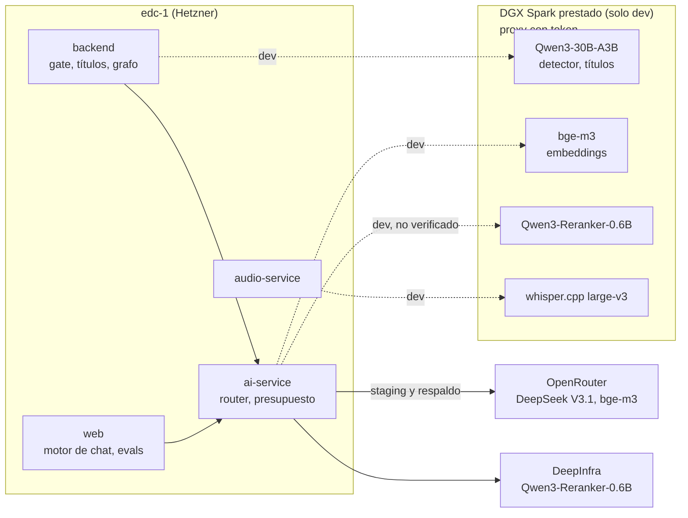

# Pila de IA

- **Versión:** 1.3
- **Fecha:** 2026-11-12
- **Estado:** vigente
- **Fuentes:** `services/ai-service/src/config/env.ts`, `services/ai-service/src/services/registry/resolve.ts`, `services/ai-service/src/services/ai/router/task-profiles.ts`, `services/ai-service/src/services/ai/router/adapters/openrouter.ts`, `services/ai-service/src/services/budget/enforcer.ts`, `services/ai-service/src/db/schema/index.ts`, `apps/backend/src/lib/anonymise/*`, `apps/backend/src/lib/testimonioTitle.ts`, `apps/backend/src/lib/graph/*`, `apps/web/src/lib/server/engine/*`, `apps/web/src/lib/server/evals/*`, `services/audio-service/app/*`, `infra/docker-compose.yml`, `infra/fleet/edc-1.md`, `infra/fleet/env-manifests.md`, `plan/spark-ai-adopcion.md`, `plan/spark-chat-eval-2026-10-26.md`, `apps/backend/src/eval/RESULTS.md`, `apps/backend/src/lib/anonymise/fallbackGenerator.ts`, `apps/backend/src/lib/platformSettings.ts`, `apps/backend/src/lib/refreshAiTitles.ts`, `services/ai-service/src/services/rag/document-title.ts`. Código leído en `main` b7dc944f el 2026-11-10 y revisado contra `main` `f971d54c` el 2026-11-12. Dev corre `f971d54c`, desplegado el 2026-11-12 a las 19:42 UTC (measured con `docker ps` por el agente de despliegue; `infra/fleet/edc-1.md` §4zzzzzzzzzzz).

## Para quién es y qué responde

Este documento es para quien opera, evalúa o cambia la parte de inteligencia artificial de Ecosistemas de Conocimiento (EDC): desarrolladores, el equipo del proyecto y revisores que necesitan saber qué texto sale a quién. Responde qué modelo hace cada tarea y dónde corre, qué corre en el DGX Spark prestado y qué en proveedores hospedados, qué texto exacto sale a cada tercero, cómo se recupera y se genera una respuesta, cuánto cuesta y cómo se controla el gasto, en qué fase va la adopción del Spark, cómo se evalúa la calidad y qué riesgos siguen abiertos.

Glosario mínimo de este documento:
- **Embedding:** vector numérico que representa el significado de un texto; se usa para buscar por similitud.
- **Rerank:** segundo modelo que reordena los pasajes recuperados según qué tan bien responden la pregunta.
- **Tier de esfuerzo:** perfil de ai-service que fija modelo, tokens de salida y temperatura (`quick`, `standard`, `deep`, `maximum`).
- **Hospedado:** modelo que corre en un proveedor externo (OpenRouter, DeepInfra), fuera de la infraestructura del proyecto.
- **Fallback:** camino de respaldo cuando el camino principal falla.

## 1. Mapa general

Toda llamada a modelos hospedados pasa por `ai-service`, salvo dos casos. El backend llama directo al detector del gate y al generador de títulos cuando esos apuntan al Spark (`apps/backend/src/lib/anonymise/openaiCompatGenerator.ts`). Y audio-service llama directo a Whisper en el Spark. Hay dos entornos, dev y staging, en la misma máquina Hetzner. Solo dev usa el Spark; staging no se ha redesplegado desde el 2026-10-17 y todo su tráfico de IA va a proveedores hospedados (citado de `infra/fleet/edc-1.md`:1691-1697, registro del 2026-10-25).

## 2. Modelos por tarea

| Tarea | Modelo | Host en dev | Host en staging | Variables | Fallback | Estado |
|---|---|---|---|---|---|---|
| Embeddings de ingesta y consulta | `baai/bge-m3`, 1024 dimensiones | Spark | OpenRouter (pendiente de pasar a DeepInfra) | `EMBEDDINGS_URL`, `EMBEDDINGS_API_KEY`, `EMBEDDING_MODEL`, `EMBEDDING_DIM`, `EMBEDDINGS_FALLBACK_URL`, `EMBEDDINGS_FALLBACK_API_KEY`, `EMBEDDINGS_FALLBACK_COOLDOWN_S`, `EMBEDDINGS_PRIMARY_TIMEOUT_MS` | En dev, DeepInfra con el mismo modelo desde el 2026-11-06, ante error de red, timeout, 5xx o 429; enfriamiento de 60 s; timeout primario de 5 s en dev (citado de `infra/fleet/edc-1.md`:1294-1324) | En uso en dev desde el 2026-10-22 |
| Embeddings dispersos | `bge-m3` sparse, `sparsevec(250002)` | — | — | `SPARSE_ENABLED` (falso por defecto), `SPARSE_EMBED_URL` | Cae a `tsvector` | Apagado |
| Rerank | `Qwen/Qwen3-Reranker-0.6B` | **No verificado** (Spark o DeepInfra) | DeepInfra, con llave propia de EDC | `RERANK_API_KEY` (si existe, el compose exporta `RERANK_ENABLED=true`), `RERANK_PROVIDER`, `RERANK_URL`, `RERANK_MODEL`, `RERANK_TIMEOUT_MS` = 8000; en web `CHAT_RERANK` | Falla abierto: devuelve el orden fusionado; la web reintenta una vez sin rerank | En uso en ambos entornos |
| Respuesta de chat | `deepseek/deepseek-chat-v3.1`, tier `standard` | OpenRouter | OpenRouter | `CHAT_COMPLETIONS_URL`, `OPENROUTER_API_KEY`; modelo fijo en `EFFORT_PROFILES` | Ninguno entre proveedores; solo reintenta | En uso |
| Condense (reescritura de seguimiento) | DeepSeek V3.1, tier `quick` | OpenRouter | OpenRouter | `CONDENSE_TIMEOUT_MS` (web) | Usa la pregunta cruda | En uso; en el Spark es viable pero no está desplegado |
| Expansión de consulta | DeepSeek V3.1, tier `quick`; hasta 3 variantes y una respuesta hipotética; timeout de 5 s | OpenRouter | OpenRouter | `QUERY_EXPANSION` (web) | Se omite | En uso |
| Detector de datos personales (etapas 3 y 4 del gate) | `qwen3-30b-a3b-instruct-2507` (Q8, llama.cpp) | Spark | DeepSeek V3.1 `quick` vía ai-service | `ANONYMISE_DETECT_URL`, `_API_KEY`, `_MODEL`, `_FALLBACK` (`hosted` o `none`), `_FALLBACK_COOLDOWN_S`, `_CONCURRENCY`, `_TIMEOUT_MS`, `_MIN_GAP_MS`, `ANONYMISE_CHUNK_WORDS`, `ANONYMISE_VERIFY_ROUNDS`; el global `platform-settings.detectorFallback` le gana a la variable | `hosted` por defecto: si el Spark falla, el texto va a OpenRouter, con un enfriamiento de 60 s antes de volver a probar el Spark. `none` retiene, y también impide la llamada hospedada cuando no hay `ANONYMISE_DETECT_URL` (staging): el documento queda retenido con motivo `sin-detector`. Dev volvió a `hosted` el 2026-11-09, con OpenRouter en retención cero (ZDR) (citado de `infra/fleet/edc-1.md`, "Detector fallback to hosted") | En uso en dev: las 6 llamadas registradas las sirvió el Spark (citado de `infra/fleet/edc-1.md`:2173-2179) |
| Títulos de testimonios | El mismo backend que el detector, tier `quick` | Spark primero | Hospedado | `titleClientFromEnv` en `apps/backend/src/lib/testimonioTitle.ts`; interruptor `testimonioTitles` por ecosistema | Sigue el mismo `detectorFallback`. Un registro retenido nunca va al hospedado: solo Spark o queda sin título. Con `none` y sin Spark no hay llamada | En uso |
| Título de un `documento` con compuerta | El detector, una llamada sobre lo que queda del nombre del archivo | Spark | Hospedado (según `detectorFallback`) | `redactTitle` en `apps/backend/src/lib/anonymise/gate.ts` | Falla cerrado: si el detector falla, el título queda neutro ("Documento"); nunca retiene el documento | En uso (commit b2a51aed) |
| Extracción del grafo | DeepSeek V3.1, tier `deep`, prompt `v5` | OpenRouter | OpenRouter | `GRAPH_EXTRACT`, `GRAPH_EXTRACT_EFFORT`, `GRAPH_EXTRACT_WINDOW_CHARS` (12000), `GRAPH_EXTRACT_MAX_WINDOWS` (8), `GRAPH_EXTRACT_MAX_CONCURRENCY` (2), `GRAPH_EXTRACT_TIMEOUT_MS` (660000) | Ninguno: `graphStatus: failed` | En uso |
| Transcripción de archivos | Whisper large-v3 (whisper.cpp) | Spark (`WHISPER_BACKEND=remote`) | No desplegado: perfil `audio` apagado | `WHISPER_BACKEND`, `WHISPER_REMOTE_URL`, `WHISPER_REMOTE_TOKEN`, `WHISPER_REMOTE_TIMEOUT_S` (1800), `WHISPER_REMOTE_MODEL`, `WHISPER_LANGUAGE=es` | Reintentos y luego cola de mensajes muertos | En uso en dev desde 2026-10-22 |
| Transcripción en vivo | Whisper large-v3 sobre ventanas de 0.8 a 25 s | Spark | No disponible: 503 | `COMPOSE_PROFILES=audio`, interruptor `liveMic` por ecosistema | Ninguno: 503 | En uso en dev desde el 2026-10-25 |
| "Preguntas para investigar" (vista de estudiante) | DeepSeek V3.1, tier `standard` por omisión | OpenRouter | OpenRouter | `apps/web/src/lib/server/preguntas.ts` | Lista vacía | En uso; 10 por hora por usuario, contador en memoria |
| Juez de `/admin/evals` | DeepSeek V3.1, tier `quick` | OpenRouter | OpenRouter | `apps/web/src/lib/server/evals/judge.ts` | — | En uso, solo administrador de plataforma |
| Detector NER en ai-service | Sin modelo elegido | — | — | `PII_NER_URL`, `PII_NER_MODEL` | — | Inerte. Las 5 reglas offline (CURP, RFC, correo, teléfono, dirección) sí corren en cada salida |

Los valores por defecto de la tabla están leídos en `services/ai-service/src/config/env.ts`, `infra/docker-compose.yml`:720-737, `apps/backend/src/lib/anonymise/detector.ts` y `services/audio-service/app/config.py`, salvo donde se cita otra fuente.

**Rerank en dev: no verificado.** El registro de dev dice que el token de embeddings de dev (el del proxy del Spark) comparte prefijo de huella con `RERANK_API_KEY` (citado de `infra/fleet/edc-1.md`:1303), de donde se infiere que el rerank de dev ya va al Spark. Ninguna sección lo registra de forma explícita y la sección §4f del mismo archivo sigue diciendo "DeepInfra en ambos entornos". Hay que confirmarlo en las variables de Coolify.

## 3. El DGX Spark prestado

### 3.1 Qué es y cómo se llega

El DGX Spark es una computadora NVIDIA (GB10, 128 GB de memoria unificada, arquitectura ARM64; citado de `plan/spark-ai-adopcion.md` §0) que pertenece a otra organización y se presta al proyecto. El proyecto no tiene permisos de administrador ni Docker en esa máquina (no verificado en esta versión).

- **Red:** la máquina `edc-1` y el Spark se ven por Tailscale (una red privada cifrada basada en WireGuard). El Spark no tiene puerto público. Este documento no publica direcciones.
- **Puerta única:** todos los modelos salen por un proxy con token en el puerto 8178 del Spark. El token vive en las variables de Coolify de `edc-dev` (`EMBEDDINGS_API_KEY`, `ANONYMISE_DETECT_API_KEY`, `WHISPER_REMOTE_TOKEN`) y nunca en el repositorio.
- **Procesos:** los servidores corren en sesiones tmux y se levantan con dos scripts de arranque. No hay supervisor: si el Spark se reinicia, todo queda caído hasta que alguien los levanta (no verificado en esta versión).

### 3.2 Qué corre ahí

| Servicio | Uso en EDC | Quién lo llama |
|---|---|---|
| whisper.cpp large-v3 | Transcripción de archivos y del micrófono en vivo | audio-service |
| Qwen3-30B-A3B-Instruct-2507 (Q8, llama.cpp) | Detector y verificación del gate; títulos de testimonios | backend |
| bge-m3 | Embeddings de ingesta y de consulta | ai-service |
| Qwen3-Reranker-0.6B | Rerank (uso en dev no verificado) | ai-service |

El Spark tiene 4 ranuras de 16 384 tokens de contexto compartidas entre el detector y cualquier otro uso de generación (citado de `plan/spark-chat-eval-2026-10-26.md`).

### 3.3 Qué va a proveedores hospedados

- **OpenRouter:** toda la generación con DeepSeek V3.1 (respuestas, condense, expansión, grafo, preguntas para el estudiante, juez de evals); embeddings y detector en staging. La decisión es pasar todo a DeepInfra; la generación y staging siguen pendientes.
- **DeepInfra:** el rerank en staging (y en dev si el host no es el Spark).

Toda llamada de ai-service a OpenRouter (generación y embeddings) pide retención cero de datos con `provider.zdr: true`, junto con `require_parameters` en modo estricto. Si ningún endpoint con retención cero sirve el modelo, la llamada falla con `OpenRouterNoZdrEndpointError` (embeddings: `OpenRouterEmbeddingNoZdrEndpointError`): no se reintenta, no va a otro proveedor y nunca se reenvía sin `zdr`. No hay interruptor para apagarlo. En el código desde el 2026-11-07 (commit 9b755298) y desplegado en dev; probado en dev el 2026-11-09 con un modelo sin endpoint ZDR, que respondió 404 y se convirtió en `OpenRouterNoZdrEndpointError` (citado de `infra/fleet/edc-1.md`). Los embeddings con `zdr` no se probaron en dev, porque van al Spark con respaldo DeepInfra (`services/ai-service/src/services/ai/router/adapters/openrouter.ts`, `services/ai-service/src/services/ai/embeddings/openrouter.ts`).

ZDR es un parámetro de OpenRouter. Las llamadas que van directo a DeepInfra (rerank en staging, respaldo de embeddings en dev) no lo llevan.

Sin el Spark, dev pierde la transcripción y el micrófono en vivo; los embeddings caen a DeepInfra y el detector cae a OpenRouter con ZDR, porque dev está en `hosted` desde el 2026-11-09. Con `none`, el detector retendría los documentos.

## 4. Qué texto sale a cada tercero

Esta sección enumera el texto concreto que sale de `edc-1` hacia fuera, en qué paso y a quién. "Minimizador" es `minimiseEgress` de ai-service (`services/ai-service/src/services/ai/pii-egress.ts`): una limpieza por reglas que quita CURP, RFC, correos, teléfonos y direcciones, pero no nombres.

| # | Paso | Texto que sale | Destino en dev | Destino en staging | Minimizador |
|---|---|---|---|---|---|
| 1 | Gate, etapa 3 (detectar) | Texto después de las etapas 1 y 2: sin correos, teléfonos, CURP, RFC, códigos postales, URLs ni nombres de miembros conocidos, pero **con nombres de terceros, lugares y detalles**; en trozos de unas 250 palabras. Aplica a testimonios, documentos marcados "Anonimizar" y cada turno de conversación (pregunta y respuesta) | Spark directo | OpenRouter vía ai-service | Solo en el camino por ai-service |
| 2 | Gate, etapa 4 (verificar) | El texto ya redactado | Spark directo | OpenRouter | Igual que 1 |
| 2b | Gate, título de un `documento` con compuerta | Una llamada más al detector sobre el nombre del archivo, después de las reglas fijas y de los seudónimos del texto: solo un nombre que el cuerpo no tenía llega al modelo sin redactar. Sin ronda de verificación. `Documents.ts` y `publishDocument.ts` le pasan el nombre. Desplegado en dev desde el 2026-11-10 | Spark directo | OpenRouter, si `detectorFallback` es `hosted` | Igual que 1 |
| 3 | Títulos de testimonio | Solo el texto redactado (`redactedText`) o retenido (`heldText`); un registro retenido nunca va al hospedado | Spark | OpenRouter (solo no retenidos, y solo con `detectorFallback: hosted`) | Sí, en el hospedado |
| 4 | Embeddings de ingesta | `corpusTextFor(row)`: el texto anonimizado si pasó por el gate; el texto crudo de un `documento` normal | Spark (respaldo DeepInfra) | OpenRouter | Sí, en OpenRouter o DeepInfra |
| 5 | Embeddings de consulta | La pregunta cruda del usuario | Spark (respaldo DeepInfra) | OpenRouter | Sí, en OpenRouter o DeepInfra |
| 6 | Rerank | La pregunta y los pasajes candidatos (unos 40 como máximo) | No verificado | DeepInfra | Sí |
| 7 | Condense y expansión | La pregunta del usuario y el historial reciente | OpenRouter | OpenRouter | Sí |
| 8 | Respuesta de chat | Prompt del sistema y estilo del ecosistema; historial con las preguntas crudas; fragmentos recuperados (anonimizados si pasaron por el gate, crudos si son `documento`); documentos adjuntos o fijados completos; bloque de orientación con turnos anonimizados de otras personas; contexto del grafo | OpenRouter | OpenRouter | Sí |
| 9 | Extracción del grafo | `corpusTextFor(row)`, nunca `extractedText`; solo filas en estado `ready` o `approved`. La re-extracción por lotes (`scripts/reextract-published-graph.ts`) solo lee filas publicadas y no retenidas por consentimiento; está preparada y no se ha corrido. Ninguna extracción corre sobre una fila retenida por consentimiento (el backfill; que el trabajo del grafo se detenga si la fila quedó retenida, aunque llegue mientras corre el modelo, commits 17a5d985, c12a0ab5, 1ac2669e y ca5cf2b4) | OpenRouter | OpenRouter | Sí |
| 10 | Transcripción | El audio completo en trozos WAV de 16 kHz y las rebanadas del micrófono en vivo: voz cruda | Spark | No aplica | No aplica |
| 11 | Preguntas para el estudiante | Títulos y datos de documentos, solo de tipo `documento` | OpenRouter | OpenRouter | Sí |
| 12 | Juez de evals | Respuesta generada y pasajes citados (inferido del diseño del juez por par afirmación-cita) | OpenRouter | OpenRouter | Sí |

Las fuentes de cada fila son `apps/backend/src/lib/anonymise/detector.ts`, `openaiCompatGenerator.ts`, `apps/backend/src/lib/testimonioTitle.ts`, `apps/backend/src/lib/graph/backfill.ts`, `apps/web/src/routes/api/generate/+server.ts`, `apps/web/src/lib/server/engine/orientation.ts`, `services/ai-service/src/services/ai/rerank/rerank-client.ts` y `services/audio-service/app/remote_transcriber.py`. El análisis de privacidad de estos flujos está en [Protección de datos](../06-privacidad-y-seguridad/proteccion-de-datos.md).

## 5. Recuperación y generación

Todo el turno de chat se orquesta en `apps/web/src/routes/api/generate/+server.ts` con `prepareTurn()` de `@edc/chat-engine`.

### 5.1 Recuperación

1. **Alcance.** La web pide al backend los corpus, la fecha `asOf`, el ecosistema y los documentos adjuntos. El navegador nunca nombra un corpus.
2. **Condense.** Si es un seguimiento, la pregunta se reescribe como pregunta completa con el tier `quick`. Si tarda más del límite (`CONDENSE_TIMEOUT_MS`) o falla, se usa la pregunta cruda. El engine define `maxTokens: 80` para este paso, pero ese valor no llega a ai-service y el tope real es el del tier (400).
3. **Recuperación densa por defecto.** `CHAT_RETRIEVAL_MODE=dense`. La recuperación híbrida (densa más palabra clave) existe pero quedó apagada porque midió peor: MRR@5 de 0.503 contra 0.936 de la densa en 189 preguntas (citado de `apps/backend/src/eval/RESULTS.md`; ADR-0011). MRR@5 es la posición promedio inversa del primer documento correcto entre los primeros cinco.
4. **Expansión.** Hasta 3 variantes de la pregunta y una respuesta hipotética, en tier `quick` con timeout de 5 s; cada variante recupera sin rerank (`apps/web/src/lib/server/engine/expand.ts`).
5. **Fusión RRF.** Los resultados se combinan con fusión por rango recíproco, `Σ 1/(60 + rango)`.
6. **Rerank.** Sobre un conjunto de `min(topK × 4, 50)` candidatos y solo con la pregunta original. Falla abierto: si el rerank no responde, se usa el orden fusionado. Nunca se midió el efecto de encenderlo contra apagarlo con los datos actuales (pendiente C-8 de la auditoría de IA del 2026-10-17); con los datos de septiembre la densa con rerank midió 0.955 de MRR@5 (citado de `apps/backend/src/eval/RESULTS.md`).
7. **GraphRAG.** La web llama a `POST /api/graph/retrieve` del backend, que encuentra entidades semilla en el grafo sin usar un modelo y devuelve una consulta expandida (G1) y un resumen determinista (G2). La consulta expandida se recupera sin rerank y entra a la fusión. En la medición de septiembre, GraphRAG cambió 2 de 20 respuestas sin ganancia global medida (citado de `apps/backend/src/eval/RESULTS.md`, 2026-09-05; ADR-0005).
8. **Orientación.** Los turnos anonimizados de otras personas del ecosistema (`msg-{id}`) se recuperan aparte y entran en un bloque de orientación. Ese bloque nunca se cita: solo da contexto de lo que otros han dicho (`apps/web/src/lib/server/engine/orientation.ts`).
9. **Menciones `@`.** Los documentos mencionados se resuelven con `/api/context-search` y entran completos.

### 5.2 Prompt

- **Variante E de citas.** Los fragmentos van dentro de etiquetas `<fuente>` numeradas y el modelo cita con `[N]`, donde `[N]` corresponde a `provenance.chunks[N-1]` (`apps/web/src/lib/server/engine/prompt.ts`).
- **Respuesta fija de rechazo.** Si los fragmentos no responden la pregunta, el modelo debe decir exactamente "Los documentos no hablan de esto."
- **Estilos por ecosistema.** `organizations` tiene tres textos de hasta 1500 caracteres (`answerStyleGenerales`, `answerStyleResonancias`, `answerStyleInterviewer`) que se agregan al prompt del sistema. Solo los cambia un administrador de plataforma (`apps/backend/src/collections/Organizations.ts`).
- **Modo del turno.** `turnMode.ts` decide con reglas, sin modelo, entre `answer` e `interview`. Una conversación `resonancias` usa siempre el prompt de entrevistadora; en `generales`, el interruptor "Hazme preguntas" o un relato en primera persona activan el prompt de entrevista.

### 5.3 Tiers de esfuerzo y tokens

| Tier | Modelo | Tokens de salida | Temperatura | Pases de validación | Muestras | Costo estimado por llamada (USD) | Uso en EDC |
|---|---|---|---|---|---|---|---|
| `quick` | `deepseek/deepseek-chat-v3.1` | 400 | 0.3 | 1 | 1 | 0.000421 | condense, expansión, detector hospedado, títulos, juez |
| `standard` | `deepseek/deepseek-chat-v3.1` | 800 | 0.4 | 1 | 1 | 0.000737 | respuesta de chat, preguntas para estudiante |
| `deep` | `deepseek/deepseek-chat-v3.1` | 3500 | 0.3 | 2 | 1 | 0.00287 | extracción del grafo |
| `maximum` | `deepseek/deepseek-chat-v3.1` | 6000 | 0.3 | 2 | 3 | 0.004845 | no se usa |

Valores leídos en `EFFORT_PROFILES` de `services/ai-service/src/services/registry/resolve.ts`. El costo estimado se calcula ahí mismo con 500 tokens de entrada y el tope de salida, con los precios de la tabla `MODEL_PRICING`. El engine define `chatMaxTokens: 1800`, pero ese valor no llega a ai-service: el tope real de una respuesta es 800 tokens (citado de `plan/spark-ai-adopcion.md`:78).

### 5.4 Respuestas vacías

El 2026-11-10, en dev, 3 de 6 respuestas de chat llegaron de OpenRouter como un 200 sin texto (modelo `unknown`, 0 tokens); una se volvió a servir desde la caché en 0 ms, y los streams que solo mandaban keepalives esperaron 58 s (medido en dev con los logs de ai-service y `edc_ai.traces`; citado del commit 81a7215f). Desde entonces, en `main`:

- **ai-service** trata una respuesta vacía o de solo espacios como error `EmptyCompletion` (`ERR_EMPTY_COMPLETION`, 502; dentro de un stream, un evento de error). Se reintenta dentro de la misma escalera de reintentos (1 intento más 2), no cuenta para el cortacircuitos, deja traza y uso como fallidos y nunca se guarda en la caché (`services/ai-service/src/services/ai/router/empty-completion.ts`; commit 81a7215f).
- **Streams.** Los keepalives ya no reinician la espera. Antes del primer texto la espera es `LLM_STREAM_FIRST_OUTPUT_TIMEOUT_MS` (120 s por omisión, inferido como el doble de la espera entre salidas); después, `LLM_STREAM_STALL_TIMEOUT_MS` (45 s). `packages/ai-client` conoce el código `ERR_EMPTY_COMPLETION` (commit 73801857).
- **web.** Una respuesta vacía es un turno fallido (`empty_answer`), nunca un mensaje vacío guardado. La burbuja dice "La respuesta llegó vacía." con el botón Reintentar, que reenvía el mismo turno una vez (`@edc/chat-engine` 0.9.0, `apps/web/src/routes/api/generate/+server.ts`; commit c867ff43).
- **Cortada en el tope.** Una respuesta sin texto con `finish_reason` `length` es `CompletionTruncated` (`ERR_COMPLETION_TRUNCATED`, 502): no se reintenta, porque pedirla otra vez topa con el mismo tope. La web la muestra como "La respuesta excedió el límite de longitud.", sin Reintentar (`answer_truncated`, `@edc/chat-engine` 0.10.0; commits 3d92c12d y 6406fadb).
- **Costo.** Cada intento vacío entra en el desglose de costo de la llamada (`empty: true`), así que uso, traza y ajuste del presupuesto llevan lo que cobró el proveedor. Una llamada en que todos los intentos salen vacíos no se cobra, y `providerCostUsd` suma el gasto de todos los intentos (commit 3d92c12d).

Desplegado en dev, salvo «Cortada en el tope» y «Costo» (3d92c12d, 6406fadb), en `main` y pendientes de desplegar.

### 5.5 Títulos en ai-service sin volver a embeber

El título de un documento vive en ai-service en tres lugares: `documents.title`, `documents.metadata.title` y el `metadata.title` de cada fragmento, que es lo que la cita muestra. `PATCH /v1/corpus/:name/titles` (rol admin) los reescribe para hasta 200 documentos por llamada sin tocar el texto, los embeddings ni el índice por palabra clave; una prueba de integración fija los bytes del vector. `dryRun` informa sin escribir (`services/ai-service/src/services/rag/document-title.ts`; commit d72094e5).

`apps/backend/scripts/refresh-ai-titles.ts` usa esa ruta para poner en las copias compartida y borrador de cada `documento` con compuerta y cada testimonio publicados su título con compuerta (`documentTitleFor`). Simula por omisión, nunca toca una fila retenida por consentimiento ni un borrador. El 2026-11-10 a las 20:15 UTC, en dev y solo leyendo, había 52 `documento` publicados con compuerta con el título viejo en el corpus compartido (20 en eco-6, 10 en eco-7, 22 en eco-8) y los mismos 52 en las copias borrador (citado del commit d72094e5). El script se aplicó en dev el 2026-11-12: 52 documentos distintos (eco-6 20, eco-7 10, eco-8 22), 104 escrituras contando las dos copias, y una segunda pasada en seco ya no encontró títulos viejos (measured por el agente de despliegue, `infra/fleet/edc-1.md` §4zzzzzzzzz).

### 5.6 Errores en los logs de ai-service

Cada logger pino de ai-service usa un serializador `err` que de un error de base de datos guarda solo la clase, el SQLSTATE, el código de Node y los marcos de la pila; de otro error, el mensaje cortado a 500 caracteres (`services/ai-service/src/errors/log-safe.ts`). La regla `edc/no-raw-error-log` corre en ai-service, salvo en las pruebas (commits 3d92c12d y 4a3aecc1). Las trazas (`telemetry/span.ts`), el registro de arranque (`routes/health.ts`) y cada guarda de texto ocultan el mensaje de Postgres que cita un valor (commit cbf8d7ee).

## 6. Esquema `edc_ai` en resumen

ai-service guarda todo en la base `edc_ai` con Drizzle (`services/ai-service/src/db/schema/index.ts`). El detalle está en [Estructura de base de datos](../04-datos/estructura-de-base-de-datos.md).

| Tabla | Para qué |
|---|---|
| `corpora` | Un corpus por nombre y org: modelo y dimensión de embeddings (1024), estrategia de chunking (`recursive-char`, 800 con traslape de 100), configuración de texto (`spanish` en EDC) |
| `corpus_aliases` | Alias que apuntan a otro corpus |
| `documents` | Documento externo (`external_id`, por ejemplo `msg-86`), texto, título, `valid_from` y `valid_to` |
| `chunks` | Fragmentos con `embedding vector(1024)`, `text_search tsvector`, `sparse_embedding sparsevec(250002)` y vigencia |
| `ingest_requests`, `ingest_jobs` | Estado de la ingesta por lote y por documento |
| `generation_requests`, `generation_jobs` | Generación asíncrona |
| `traces`, `usage_logs` | Cada llamada a un modelo, con tokens y costo real |
| `budget_state`, `budget_reservations` | Presupuesto por org y libro de reservas |
| `llm_configs`, `project_configs`, `registry_entries`, `registry_audit` | Registro de prompts y modelos |
| `callback_deliveries` | Bandeja de salida de callbacks con reintentos |

No hay tabla de orgs ni de llaves: `org` es texto opaco y las llaves viven en la variable `API_KEYS`. El índice de vectores es HNSW con `vector_cosine_ops`, `m=16`, `ef_construction=64` (leído en `services/ai-service/drizzle/0000_baseline.sql`). Cambiar a un modelo de embeddings con otra dimensión obliga a una migración y a re-embeber todos los corpus.

## 7. Costos y presupuesto

### 7.1 Medición por llamada

- El adaptador de OpenRouter guarda el costo que reporta OpenRouter (`costSource: 'openrouter'`). Si falta, lo calcula con la tabla `MODEL_PRICING` (`'pricing-table'`) (`services/ai-service/src/services/ai/router/adapters/openrouter.ts`).
- Precios de la tabla: DeepSeek V3.1 a 0.21 USD por millón de tokens de entrada y 0.79 USD por millón de salida; bge-m3 a 0.01 USD por millón (leído en `services/ai-service/src/services/ai/router/task-profiles.ts`).
- Un modelo que no está en la tabla cuesta 0.
- Las llamadas directas al Spark (detector, títulos) no pasan por ai-service y no aparecen en `traces` ni en `usage_logs`. El rerank tampoco se registra en las tablas de uso.

### 7.2 Topes

- **Reserva atómica.** Antes de cada llamada, ai-service reserva el costo estimado con `UPDATE budget_state … WHERE remaining_usd >= monto` y después ajusta al costo real. Si la org no tiene fila de presupuesto, responde 402 y no llama al modelo (`services/ai-service/src/services/budget/enforcer.ts`).
- **Aviso suave** al 90 % del tope (`soft_cap_pct`), con reinicio mensual por aniversario.
- **5 USD al mes por ecosistema.** `AI_ECOSYSTEM_BUDGET_USD` fija el tope de cada ecosistema nuevo al aprovisionarlo. Es una decisión del responsable, no una necesidad medida (citado de `infra/fleet/env-manifests.md`:140).
- **Base nueva.** Una base `edc_ai` recién creada responde 402 a todo hasta que un operador ejecuta `PUT /v1/budget/edc-eco-<id>` (citado de `infra/fleet/edc-1.md` §6).

### 7.3 Gasto medido

| Medición | Valor | Procedencia |
|---|---|---|
| Gasto local de desarrollo, 2026-08-15 a 2026-10-17 | 2.10 USD en generación y 0.002 USD en embeddings | citado de `plan/spark-ai-adopcion.md`:83 |
| Detector hospedado | 0.00058 USD por llamada; latencia p50 3.8 s, p95 16.4 s | citado de `plan/spark-ai-adopcion.md`:71-79 |
| Chat | 0.306 USD en 274 llamadas | citado de `plan/spark-ai-adopcion.md`:71-79 |
| Grafo | 1.64 USD en 570 llamadas; p50 de 72 s, máximo 190 s | citado de `plan/spark-ai-adopcion.md`:71-79 |
| Gate completo de 4866 palabras | 0.024 USD en 82 s | citado de `plan/spark-ai-adopcion.md`:89-96 |
| Entrevista de 60 minutos por el gate | unos 0.04 USD | inferido en `plan/spark-ai-adopcion.md`:89-96 a partir de la fila anterior |
| `usage_logs` de dev acumulado | 1.86 USD | citado de `infra/fleet/edc-1.md`:1683, registro del 2026-10-24 |
| Una corrida de `/admin/evals` | 0.041 a 0.043 USD por ecosistema | citado de los resultados de evaluación del 2026-10-29, corridas 6 a 8, guardados fuera del repo |

### 7.4 El costo del Spark es 0, y eso está incompleto

Las llamadas al Spark registran 0 USD porque el hardware es prestado y no se factura por uso. Ese 0 no incluye electricidad, depreciación ni el tiempo de quien mantiene los servicios. Además, las llamadas directas del backend al Spark no aparecen en ninguna tabla de uso, así que tampoco hay registro de su volumen. Las cifras de esta sección describen solo lo que pasa por OpenRouter.

## 8. Plan de adopción del Spark

El plan está en `plan/spark-ai-adopcion.md` (2026-10-17) y en ADR-0012. Su conclusión: el dinero no es la razón para mover modelos al Spark, la privacidad sí. El texto crudo de testimonios no debe llegar a un modelo hospedado una vez que haya datos reales. El plan original decía que si el Spark cae el gate retiene, sin caer a un modelo hospedado; el código vigente cae a hospedado por defecto por una decisión posterior del responsable (2026-10-21), válida mientras los datos sean sintéticos. Desde el 2026-11-09 la regla de dev es `hosted` por OpenRouter con ZDR (decisión del responsable, confirmada el 2026-11-10), que sustituye la de no mandar nada a OpenRouter.

| Fase | Qué se mueve | Estado al 2026-10-30 |
|---|---|---|
| 0 | Medir costos y latencias | Hecha (tabla 7.3) |
| 1 | Detector del gate y rerank | Detector en uso en dev desde el 2026-10-21, con respaldo hospedado encendido. Rerank en dev no verificado. Staging sigue hospedado en ambos |
| 2 | Embeddings | En uso en dev desde el 2026-10-22, con respaldo a DeepInfra desde el 2026-11-06. Coseno de 0.99998 o más frente a DeepInfra (medido el 2026-11-06 con dos textos de prueba) |
| 3 | Transcripción | En uso en dev desde 2026-10-22, y micrófono en vivo desde 2026-10-25 |
| 4 | Generación pequeña (condense, expansión, grafo) | No desplegada. Condense en el Spark es viable según la evaluación del 2026-10-26 |
| — | Respuesta de chat | Se queda hospedada (ADR-0013): Qwen3-30B quedó peor que el hospedado en 9 de 22 turnos, contra 2 en sentido contrario (citado de `plan/spark-chat-eval-2026-10-26.md`). Siguiente candidato: gpt-oss-120b |

Mover solo la respuesta de chat al Spark exigiría un cambio en ai-service, porque `CHAT_COMPLETIONS_URL` es global y el router fija `openrouter` en el código (citado de `plan/spark-ai-adopcion.md` §3).

## 9. Evaluaciones

| Herramienta | Qué mide | Cómo |
|---|---|---|
| `/admin/evals` | Calidad de respuesta (`citationSupport`, `refusalAccuracy`, `hit@1/3/5`, estilo) y privacidad (`leakRate`, `overRedaction`, retenciones) | Corre la ruta de producción real (`/api/generate` con condense, expansión, rerank y grafo) y el gate de producción (`/api/evals/gate`); se cobra al ecosistema |
| `scripts/spark-chat-eval` | Spark contra hospedado: tiempo al primer token, total, tokens por segundo, marcas inválidas, juez ciego | `build-prompts.ts`, `run.py`, `check.py` |
| `scripts/cite-eval` | Soporte de citas antes y después de un cambio, solo con el Spark | Reutiliza el prompt de juez de `/admin/evals` |
| `apps/backend/src/eval` | GraphRAG contra recuperación plana | Puntaje mecánico contra `MANIFEST.csv`; resultados en `RESULTS.md` |

Resultados de la última corrida de `/admin/evals` (citados de los resultados de evaluación del 2026-10-29, corridas 6 a 8, guardados fuera del repo):

| Ecosistema | hit@1 | hit@3 | hit@5 | citationSupport | refusalAccuracy | leakRate | overRedaction |
|---|---|---|---|---|---|---|---|
| Prevención del dengue | 0.75 | 1.0 | 1.0 | 0.945 | 1.0 | 1.0 | 0 |
| Discapacidad | 0.875 | 1.0 | 1.0 | 0.811 | 0.9 | 0 | 0.667 |
| Semiosis práctica | 0.5 | 0.75 | 0.875 | 0.921 | 1.0 | 0 | 0 |

El `leakRate` de 1.0 en Prevención del dengue viene de un solo ítem: un `documento` sintético que terminó en `ready` con sus 3 nombres privados presentes. La causa no está investigada (detector, regla de figuras públicas o comparador de la evaluación). Hasta resolverla, el gate no debe describirse como probado para `documento` con "Anonimizar".

El detalle de métricas, metodología y resultados está en [Evaluaciones de IA](../07-calidad/evaluaciones-de-ia.md).

## 10. Configuración de referencia

| Variable | Valor de referencia | Dónde | Nota |
|---|---|---|---|
| `CHAT_RETRIEVAL_MODE` | `dense` | web | ADR-0011 |
| `CHAT_RERANK` | encendido | web | |
| `QUERY_EXPANSION` | encendido | web | |
| `CORPUS_LANGUAGE` | `spanish` | backend | Configuración de búsqueda por palabra clave de Postgres |
| `LLM_REQUEST_TIMEOUT_MS` | 600000 | ai-service | citado de `infra/fleet/env-manifests.md`:109 |
| `GRAPH_EXTRACT_TIMEOUT_MS` | 660000 | backend | Debe quedar por encima del anterior (citado de `infra/fleet/env-manifests.md`:152) |
| `GRAPH_MIN_ENTITY_DOCS`, `GRAPH_MIN_EDGE_DOCS`, `GRAPH_MIN_COMENTION_DOCS` | 1 | backend | Reemplazan a `GRAPH_MIN_SUPPORT` desde 2026-10-21 |
| `ANONYMISE_DETECT_FALLBACK` | `hosted` | backend | En dev, `hosted` por OpenRouter con ZDR (decisión del responsable del 2026-11-09, confirmada el 2026-11-10); `none` sigue disponible. El global `platform-settings.detectorFallback`, que la administración de plataforma cambia en Ajustes, le gana a la variable (caché de 60 s como máximo) |
| `LLM_STREAM_STALL_TIMEOUT_MS`, `LLM_STREAM_FIRST_OUTPUT_TIMEOUT_MS` | 45000, 120000 | ai-service | Sección 5.4 |
| `ANONYMISE_DETECT_MIN_GAP_MS` | 2700 | backend | Unas 22 llamadas por minuto como máximo (inferido de 60 000 / 2700) |
| `AI_ECOSYSTEM_BUDGET_USD` | 5 | backend | Decisión del responsable |

La lista completa de variables, sin valores secretos, está en [Infraestructura y entornos](../05-infraestructura/infraestructura-y-entornos.md).

## 11. Riesgos y límites

1. **El respaldo del detector manda texto sin anonimizar a OpenRouter.** Es el comportamiento por defecto (`ANONYMISE_DETECT_FALLBACK=hosted`, `apps/backend/src/lib/anonymise/fallbackGenerator.ts`). En staging no hay Spark, así que el detector siempre es hospedado mientras el modo sea `hosted` (inferido de `infra/fleet/edc-1.md`:1259-1262, que no lista variables `ANONYMISE_DETECT_*` en staging); con `none`, staging retiene todo documento con compuerta. Dev usó `none` del 2026-11-06 al 2026-11-09; desde entonces usa `hosted`, y toda llamada a OpenRouter pide retención cero (ZDR) y falla cerrada si no hay proveedor que la cumpla (`infra/fleet/edc-1.md` §4zzzzzzz). Staging está fuera de alcance por ahora (decisión del responsable del 2026-11-10).
2. **El Spark es prestado y no tiene supervisión.** Un reinicio deja caídos audio, micrófono en vivo y modelos locales; los embeddings caen a DeepInfra y el detector cae a OpenRouter (con `hosted`, el modo de dev) o retiene los documentos (con `none`).
3. **Siguen saliendo textos crudos a proveedores hospedados:** la pregunta del miembro en condense, expansión, embeddings de consulta y respuesta; el texto de un `documento` sin gate. Si la regla de privacidad del proyecto cubre estos casos es una pregunta abierta (citado de `plan/spark-ai-adopcion.md`, pregunta P6).
4. **Un solo contador de tasa para todo EDC.** Backend y web usan una sola llave de ai-service, y el límite agrupa por llave: 30 generaciones por minuto compartidas entre chat, detector hospedado, títulos, grafo y evaluaciones (inferido de `infra/docker-compose.yml`:712 y `services/ai-service/src/server.ts`:94-104). El detector se autolimita; el grafo no.
5. **Latencia.** DeepSeek por OpenRouter bajó a 8 o 9 tokens por segundo en noches malas (citado de `plan/spark-chat-eval-2026-10-26.md`). Una llamada `deep` del grafo tiene p50 de 72 s y máximo de 190 s (citado de `plan/spark-ai-adopcion.md`:79, medición local hasta 2026-10-17).
6. **Si el Spark se cuelga, el primer turno de chat tarda más:** 11.7 s contra 4.7 s, porque las llamadas en vuelo no ven el enfriamiento del respaldo (citado de `infra/fleet/edc-1.md`:1324).
7. **Retirar no es borrar.** Un vector retirado sigue en la base con `valid_to` cerrado; una recuperación sin `asOf` lo ve. Por eso el gate es binario.
8. **El rerank falla en silencio.** Un 401 o un timeout devuelven el orden fusionado y la respuesta parece normal. Ya hubo timeouts reales en dev (citado de `infra/fleet/edc-1.md`:1031).
9. **No hay enrutamiento por tier en ai-service.** Mover solo el chat a otro host exige un cambio en ai-service.
10. **El costo está incompleto.** El Spark y el rerank registran 0 o nada; el costo de las evaluaciones no incluye esas llamadas (`apps/web/src/lib/server/evals/runner.ts`).
11. **Micrófono en vivo en un solo proceso.** Las sesiones viven en memoria; una segunda réplica de audio-service necesitaría enrutamiento por sesión. ffmpeg no emite nada durante los primeros 7 a 10 s por tubería (`services/audio-service/app/live.py`).
12. **El grafo no tiene cola durable.** La extracción corre dentro del proceso del backend con `GRAPH_EXTRACT_MAX_CONCURRENCY` por proceso.
13. **Tamaños de cuerpo.** adapter-node trae 512 KB por defecto; la imagen web fija `BODY_SIZE_LIMIT=201M`. ai-service acepta 1 MiB y 10 MiB en ingesta. Ver [API](api.md).
14. **Cambiar el modelo de embeddings es caro.** Otra dimensión obliga a migrar y re-embeber todo; HNSW admite como máximo 2000 dimensiones en `vector` (citado de `plan/spark-ai-adopcion.md`:188-200).

## Referencias

- `services/ai-service/src/config/env.ts`, `services/ai-service/src/services/registry/resolve.ts`, `services/ai-service/src/services/ai/router/`, `services/ai-service/src/services/budget/enforcer.ts`, `services/ai-service/src/db/schema/index.ts`
- `apps/backend/src/lib/anonymise/`, `apps/backend/src/lib/testimonioTitle.ts`, `apps/backend/src/lib/graph/`, `apps/backend/src/globals/PlatformSettings.ts`
- `apps/web/src/routes/api/generate/+server.ts`, `apps/web/src/lib/server/engine/`, `apps/web/src/lib/server/evals/`, `packages/chat-engine/src/core/`
- `services/audio-service/app/config.py`, `services/audio-service/app/live.py`, `services/audio-service/app/remote_transcriber.py`
- `infra/docker-compose.yml`, `infra/fleet/edc-1.md`, `infra/fleet/env-manifests.md`
- `plan/spark-ai-adopcion.md`, `plan/spark-chat-eval-2026-10-26.md`, `apps/backend/src/eval/RESULTS.md`
- [Arquitectura del sistema](arquitectura-del-sistema.md) · [API](api.md) · [ADR](adr/README.md)
- [Estructura de base de datos](../04-datos/estructura-de-base-de-datos.md) · [Evaluaciones de IA](../07-calidad/evaluaciones-de-ia.md)
- [Protección de datos](../06-privacidad-y-seguridad/proteccion-de-datos.md) · [Infraestructura y entornos](../05-infraestructura/infraestructura-y-entornos.md)
