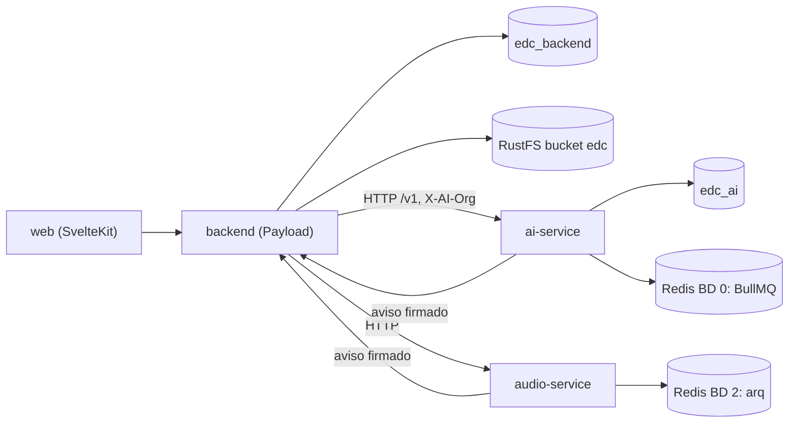

# Estructura de base de datos y almacenamiento

- **Versión:** 1.4
- **Fecha:** 2026-11-12
- **Estado:** vigente
- **Fuentes:** `apps/backend/src/migrations/` (25 migraciones en `main`, `index.ts`, `README.md`, snapshot `20261110_181621_consent_held_reviews_keep.json`), `apps/backend/scripts/migrate.sh`, `apps/backend/src/payload.config.ts`, `apps/backend/src/collections/Media.ts`, `apps/backend/src/lib/storage/plugin.ts`, `apps/backend/src/lib/storage/client.ts`, `apps/web/src/lib/config.ts`, `services/ai-service/src/db/schema/index.ts`, `services/ai-service/drizzle/*.sql`, `services/ai-service/src/queue/`, `services/audio-service/app/config.py`, `services/audio-service/app/store.py`, `services/audio-service/app/worker.py`, `scripts/ai-org-per-ecosystem.sql`, `infra/docker-compose.yml`, `infra/postgres/Dockerfile`. Lectura del código en `main` del 2026-10-29, revisada contra `main` en `b7dc944f` el 2026-11-10, en `687ff21e` el 2026-11-11 y en `f971d54c` el 2026-11-12. Estado de dev: `f971d54c`, desplegado el 2026-11-12 a las 19:42 UTC (measured con `docker ps` por el agente de despliegue; `infra/fleet/edc-1.md` §4zzzzzzzzzzz), sin migración nueva; `payload_migrations` 25, último lote 17.

## Para quién es y qué responde

Este documento es para quien opera o modifica la base de datos de Ecosistemas de Conocimiento (EDC): desarrolladores, operadores y revisores técnicos. Responde qué bases físicas existen, qué tablas e índices tienen, qué reglas hay que respetar al cambiar el esquema, dónde viven los archivos subidos y qué guarda Redis. El modelo conceptual (entidades, reglas de acceso, estados) está en [modelo-de-datos.md](modelo-de-datos.md).

## 1. Panorama

EDC guarda datos en cuatro lugares. Todos corren dentro de cada entorno (dev y staging tienen los suyos) y ninguno se comparte entre entornos.

| Almacén | Tecnología | Qué guarda | Quién escribe |
|---|---|---|---|
| `edc_backend` | Postgres 16 con pgvector (imagen `pgvector/pgvector:pg16`) | Cuentas, ecosistemas, documentos, conversaciones, auditoría, grafo, evaluaciones | Backend Payload, vía migraciones de Payload |
| `edc_ai` | La misma instancia de Postgres, otra base | Corpus, fragmentos con vectores, ingestas, trazas, uso y presupuestos | ai-service, vía migraciones de Drizzle |
| Bucket `edc` | RustFS (almacén compatible con S3) | Bytes de archivos subidos: PDF, DOCX, audio | Backend, vía `@payloadcms/storage-s3` |
| Redis 7 | `redis:7-alpine` con AOF | Colas de trabajo y transcripciones en tránsito | ai-service (BullMQ) y audio-service (arq) |

La instancia de Postgres crea las dos bases con un script de inicio (`infra/postgres/Dockerfile`). Cada entorno tiene su propia red privada de contenedores. La topología completa está en [../05-infraestructura/infraestructura-y-entornos.md](../05-infraestructura/infraestructura-y-entornos.md).

## 2. `edc_backend`: la base de Payload

Payload genera el esquema a partir de la configuración de las colecciones. Los nombres de tabla y columna pasan a minúsculas con guion bajo: la colección `graphEntities` vive en `graph_entities` y el campo `uploadedBy` en `uploaded_by_id`. La fuente de esta sección es el último snapshot, `apps/backend/src/migrations/20261110_181621_consent_held_reviews_keep.json`, más el SQL escrito a mano dentro de las migraciones.

### 2.1 Tablas de negocio

| Tabla | Colección | Contenido |
|---|---|---|
| `users` | `users` | Cuentas e identidad |
| `organizations` | `organizations` | Ecosistemas |
| `memberships` | `memberships` | Rol de una persona en un ecosistema |
| `teams` | `teams` | Equipos |
| `projects` | `projects` | Proyectos |
| `documents` | `documents` | Documentos, notas, testimonios y su estado |
| `media` | `media` | Metadatos de archivos; los bytes están en el bucket |
| `sessions` | `sessions` | Conversaciones |
| `messages` | `messages` | Turnos de conversación |
| `ratings` | `ratings` | Valoraciones de respuestas |
| `anonymisation_reviews` | `anonymisation-reviews` | Bitácora de decisiones humanas sobre textos retenidos |
| `anonymisation_setting_changes` | `anonymisation-setting-changes` | Bitácora de cambios de los interruptores de anonimización y del respaldo del detector |
| `graph_entities` | `graphEntities` | Entidades del grafo |
| `graph_mentions` | `graphMentions` | Menciones de entidades en documentos |
| `graph_relations` | `graphRelations` | Aristas del grafo |
| `student_profiles` | `studentProfiles` | Consentimientos de estudiantes |
| `suggestions` | `suggestions` | Sugerencias de estudiantes |
| `eval_items` | `eval-items` | Preguntas y casos de evaluación |
| `eval_runs` | `eval-runs` | Corridas de evaluación |
| `ai_service_callbacks` | `aiServiceCallbacks` | Avisos de ai-service ya procesados. Una tarea diaria vacía `raw_body` a los 30 días y deja la fila, que es la llave contra duplicados (`lib/callbackRetention.ts`; Implementado y desplegado) |
| `platform_settings` | global `platform-settings` | Ajustes de plataforma (una fila) |

### 2.2 Tablas de relación

Payload guarda las relaciones múltiples y polimórficas en tablas `*_rels`. Cada fila tiene `parent_id`, `path` (el nombre del campo) y una columna por colección destino.

| Tabla | Campo que representa | Columnas destino |
|---|---|---|
| `documents_rels` | `documents.session` | `sessions_id` |
| `sessions_rels` | `sessions.contextScope` | `organizations_id`, `teams_id`, `projects_id`, `memberships_id`, `documents_id` |
| `messages_rels` | `messages.contextRefs` | Las mismas cinco columnas |

### 2.3 Tablas internas de Payload

| Tabla | Para qué |
|---|---|
| `users_sessions` | Sesiones de inicio de sesión. No tiene relación con las conversaciones |
| `payload_kv` | Almacén clave-valor interno |
| `payload_locked_documents` y `payload_locked_documents_rels` | Bloqueo de edición concurrente en el panel |
| `payload_preferences` y `payload_preferences_rels` | Preferencias del panel por usuario |
| `payload_migrations` | Registro de migraciones aplicadas |

### 2.4 Enums

Payload crea un tipo enum de Postgres por cada campo de selección.

| Enum | Valores |
|---|---|
| `enum_users_locale` | `es`, `en` |
| `enum_memberships_role` | `estudiante`, `member`, `admin`, `investigador`, `owner` (el orden del enum no es el rango; `estudiante` se agregó con `ADD VALUE`) |
| `enum_projects_status` | `planning`, `active`, `paused`, `done` |
| `enum_documents_publication_status` | `draft`, `publishing`, `published`, `unpublishing` |
| `enum_documents_kind` | `markdown`, `pdf`, `docx`, `xlsx`, `xls`, `csv`, `html`, `audio` |
| `enum_documents_content_kind` | `documento`, `testimonio`, `conversacion` |
| `enum_documents_anonymisation_status` | `n/a`, `pending`, `held`, `approved`, `rejected`, `ready` |
| `enum_documents_mode` | `full-text`, `rag-retrieve` |
| `enum_documents_ingest_status` | `n/a`, `pending`, `extracting`, `transcribing`, `transcribed`, `embedding`, `ready`, `failed` |
| `enum_documents_graph_status` | `n/a`, `pending`, `extracting`, `ready`, `failed`, `skipped` |
| `enum_sessions_kind` | `generales`, `resonancias` |
| `enum_messages_role` | `user`, `assistant`, `system` |
| `enum_messages_corpus_status` | `pending`, `held-drafts`, `held-gate`, `embedding`, `ingested`, `failed`, `skipped` |
| `enum_ratings_reason` | `not-grounded`, `invented`, `incomplete`, `unclear`, `wrong-language`, `accurate`, `well-sourced`, `clear`, `complete`, `other` |
| `enum_anonymisation_reviews_decision` | `approved`, `rejected` |
| `enum_anonymisation_setting_changes_scope` | `documento`, `ecosistema`, `plataforma` (`plataforma` desde `20261110_070204`) |
| `enum_anonymisation_setting_changes_key` | `keepDocumentAuthor`, `keepCitedAuthors`, `keepPublicFigures`, `detectorFallback` (los dos últimos desde `20261110_070204`) |
| `enum_graph_entities_type` | `tema`, `lugar`, `evento`, `organizacion`, `persona` |
| `enum_graph_relations_type` | `ocurre_en`, `participa_en`, `ubicado_en`, `parte_de`, `afecta_a`, `relacionado_con` |
| `enum_suggestions_kind` | `contenido`, `arquitectura`, `interaccion` |
| `enum_eval_items_kind` | `pregunta`, `privacidad` |
| `enum_eval_items_gate_kind` | `documento`, `testimonio` |
| `enum_eval_runs_status` | `queued`, `running`, `done`, `failed` |
| `enum_platform_settings_detector_fallback` | `hosted`, `none` |

### 2.5 Índices escritos a mano

La configuración de campos de Payload no admite índices compuestos. Estos índices se agregaron con SQL escrito a mano al final de las migraciones. Payload no los conoce: si se arranca con `PAYLOAD_ALLOW_PUSH=1`, el push los borra sin avisar (`apps/backend/src/migrations/README.md`).

| Índice | Tabla | Columnas | Único | Qué protege | Dónde se crea |
|---|---|---|---|---|---|
| `ratings_message_user_unq` | `ratings` | `message_id`, `user_id` | sí | Una valoración por persona y mensaje, aun con peticiones simultáneas | `20260908_092211_baseline` |
| `memberships_user_organization_unq` | `memberships` | `user_id`, `organization_id` | sí | Una membresía por persona y ecosistema | `20260908_092211_baseline` |
| `ai_service_callbacks_natural_key_unq` | `ai_service_callbacks` | `correlation_key`, `event_key`, `event` | sí | Procesar cada aviso una sola vez; su nombre lo busca el código | `20260908_092211_baseline` |
| `documents_organization_publication_status_idx` | `documents` | `organization_id`, `publication_status` | no | Listar publicados por ecosistema | `20260908_092211_baseline` |
| `graph_entities_org_type_key_unq` | `graph_entities` | `organization_id`, `type`, `canonical_key` | sí | Una entidad por ecosistema, tipo y llave | `20260908_092211_baseline` |
| `graph_mentions_document_entity_unq` | `graph_mentions` | `document_id`, `entity_id` | sí | Una mención por documento y entidad | `20260908_092211_baseline` |
| `graph_relations_document_edge_unq` | `graph_relations` | `document_id`, `from_entity_id`, `to_entity_id`, `type` | sí | Una arista por documento | `20260908_092211_baseline` |
| `student_profiles_user_organization_unq` | `student_profiles` | `user_id`, `organization_id` | sí | Un perfil por persona y ecosistema | `20261027_053800_student_view` |

Los índices únicos son simples, no parciales: todas sus columnas son `NOT NULL`, así que una cláusula `WHERE` no aportaría nada (citado de `apps/backend/src/migrations/README.md`). Payload también crea índices simples por cada relación y por cada campo marcado `index: true` (por ejemplo `users.email`, `users.is_platform_admin`, `sessions.kind`); esos sí los conoce y no se listan aquí.

### 2.6 Llaves foráneas: cascade o set null

Payload genera toda llave foránea con `ON DELETE set null`. Varias se reescribieron a mano a `ON DELETE cascade` para que borrar al padre borre a los hijos.

**Reescritas a `cascade`:**

| Tabla | Columnas | Migración |
|---|---|---|
| `graph_mentions` | `document_id`, `entity_id`, `organization_id` | `20260908_092211_baseline` |
| `graph_relations` | `document_id`, `from_entity_id`, `to_entity_id`, `organization_id` | `20260908_092211_baseline` |
| `graph_entities` | `organization_id` | `20260908_092211_baseline` |
| `anonymisation_reviews` | `organization_id`, `reviewer_id`; `document_id` hasta `20261110_181621` (ver abajo) | `20260908_092211_baseline` |
| `ratings` | `message_id`, `session_id`, `organization_id`, `user_id` | `20261020_193707_ratings_fk_cascade` |
| `student_profiles` | `user_id`, `organization_id` | `20261027_061014_student_view_fk_cascade` |
| `suggestions` | `organization_id` | `20261027_061014_student_view_fk_cascade` |
| `documents` | `revision_of_id` | `20261028_231948_documents_note_revisions` |
| `eval_items`, `eval_runs` | `organization_id` | `20261029_060304_evals` |
| `anonymisation_setting_changes` | `organization_id` (`document_id` y `actor_id` quedan en `set null`) | `20261108_001902_documents_anonymise_switches` |

Las tablas `*_rels` traen `cascade` desde la generación de Payload.

**Siguen en `set null`:**

- `memberships`: `user_id`, `organization_id`, `team_id`
- `teams.organization_id`, `projects.team_id`
- `documents`: `organization_id`, `uploaded_by_id`, `media_file_id`, `uploaded_in_session_id`
- `media`: `uploaded_by_id`, `organization_id`
- `sessions`: `user_id`, `organization_id`
- `messages.session_id`
- `suggestions.author_id` (aquí es intencional: la sugerencia sobrevive sin autor), `eval_runs.triggered_by_id`
- `anonymisation_reviews.document_id`, desde `20261110_181621_consent_held_reviews_keep` (antes `cascade`). La columna pasa a admitir nulo y `document_id_snapshot` guarda el id del documento borrado. Así, borrar un documento conserva la decisión que tomó otra persona; solo se van con él las filas de revisión de quien lo borra (`deleteOwnReviewRows` en `Documents.ts`), también al borrar una conversación que se lo lleva (commit 17a3ee49). Implementado y desplegado

**Riesgo 23502.** Varias de esas columnas son `NOT NULL`, porque la relación es requerida. Al borrar al padre, Postgres intenta poner `NULL` y falla con el código 23502 (violación de no nulo). En consecuencia, un `DELETE` directo de un usuario o un ecosistema que tenga membresías, conversaciones o documentos falla en la base, salvo que la aplicación borre antes a los hijos. Este comportamiento está afirmado por una prueba automatizada (`apps/backend/src/collections/Ratings.deletePaths.pg.test.ts`, que espera `23502` al borrar un usuario con conversación y un ecosistema con filas), pero no se ha medido contra la base de dev. Para `messages.session_id` el código ya lo resuelve con el gancho `cascadeConversationDelete` de `Sessions.ts`. Para usuarios y ecosistemas no hay solución equivalente; la prueba lo marca como pendiente de una decisión de producto. Ver [../01-proyecto/registro-de-riesgos.md](../01-proyecto/registro-de-riesgos.md).

**Trampa del snapshot.** El archivo `.json` del snapshot sigue diciendo `set null` en todas las llaves reescritas, porque se genera del esquema de Payload. Si alguien arranca con push o regenera la línea base desde el snapshot, las llaves vuelven a `set null` en silencio y el borrado de documentos se rompe (citado de `apps/backend/src/migrations/README.md`).

### 2.7 Migraciones

Hay 25 migraciones registradas en `apps/backend/src/migrations/index.ts` (leído en `main` `b7dc944f` el 2026-11-10; sin cambio en `687ff21e`, 2026-11-11, ni en `f971d54c`, 2026-11-12). `payload_migrations` pasó de 23 a 24 el 2026-11-10 a las 18:33 UTC (citado, `edc-1.md` §4zzzzzzzz) y a 25 con el despliegue de `c4f53632` a las 23:03 UTC (medido con `docker ps` en edc-1 el 2026-11-11). Los tres despliegues del 2026-11-12 (`a6026876`, `6c0f65ad`, `f971d54c`) no trajeron migración: siguen 25 (measured por el agente de despliegue, `edc-1.md` §4zzzzzzzzz a §4zzzzzzzzzzz). La fecha sale del nombre del archivo. La línea base del 2026-09-08 reemplazó una cadena anterior de ocho migraciones.

| # | Migración | Fecha | Propósito |
|---|---|---|---|
| 1 | `20260908_092211_baseline` | 2026-09-08 | Crea todo el esquema base. Incluye los siete índices escritos a mano y las llaves `cascade` del grafo y de la auditoría |
| 2 | `20261017_231817_documents_uploaded_in_session` | 2026-10-17 | Agrega `documents.uploaded_in_session_id` (set null e índice) |
| 3 | `20261020_193707_ratings_fk_cascade` | 2026-10-20 | Pasa las cuatro llaves de `ratings` a `cascade` (SQL a mano) |
| 4 | `20261024_201817_graph_entities_public_figure` | 2026-10-24 | Agrega `graph_entities.public_figure` |
| 5 | `20261024_230631_documents_testimonio_title` | 2026-10-24 | Agrega `documents.testimonio_title` |
| 6 | `20261026_160000_documents_anonymise` | 2026-10-26 | Agrega `documents.anonymise` (falso por defecto) |
| 7 | `20261026_200000_documents_kind_tabular_html` | 2026-10-26 | Agrega `xlsx`, `csv` y `html` al enum `kind` (a mano) |
| 8 | `20261027_002257_sessions_kind` | 2026-10-27 | Agrega `sessions.kind` e índice |
| 9 | `20261027_020102_feature_switches` | 2026-10-27 | Agrega `organizations.features` y la tabla `platform_settings` |
| 10 | `20261027_053737_memberships_role_estudiante` | 2026-10-27 | Agrega `estudiante` al enum de roles (`ADD VALUE`) |
| 11 | `20261027_053800_student_view` | 2026-10-27 | Crea `student_profiles` y `suggestions` con su índice único |
| 12 | `20261027_061014_student_view_fk_cascade` | 2026-10-27 | Pasa sus llaves a `cascade`; `suggestions.author_id` queda opcional |
| 13 | `20261027_225429_documents_public_figures` | 2026-10-27 | Agrega `keep_public_figures` y `public_figures_kept` |
| 14 | `20261028_054402_student_testimonio_consent` | 2026-10-28 | Agrega `student_profiles.share_testimonios_at` |
| 15 | `20261028_083327_student_testimonio_consent_version` | 2026-10-28 | Agrega `share_testimonios_version` |
| 16 | `20261028_162050_organizations_answer_style` | 2026-10-28 | Agrega los tres `answer_style_*` |
| 17 | `20261028_170129_documents_wiki_links` | 2026-10-28 | Agrega `documents.wiki_links` y `graph_mentions.seeded` |
| 18 | `20261028_231948_documents_note_revisions` | 2026-10-28 | Agrega `processed_body`, `revision_of_id` (único, `cascade`) y `reindex_ingest_id`; rellena `processed_body` |
| 19 | `20261028_235647_documents_kind_xls` | 2026-10-28 | Agrega `xls` al enum `kind` (con `down` a mano) |
| 20 | `20261029_042255_documents_held_text_hash` | 2026-10-29 | Agrega `documents.held_text_hash` |
| 21 | `20261029_060304_evals` | 2026-10-29 | Crea `eval_items` y `eval_runs` (llave a ecosistema en `cascade`) y agrega `sessions.eval_run` |
| 22 | `20261104_075139_documents_authors_kept` | 2026-11-04 | Agrega `documents.authors_kept` |
| 23 | `20261108_001902_documents_anonymise_switches` | 2026-11-08 | Agrega `documents.keep_document_author`, `keep_cited_authors` (boolean, admite nulo) y `cited_authors_kept` (jsonb), y crea `anonymisation_setting_changes` (llave a ecosistema en `cascade`, a mano). En dev desde el 2026-11-10, 05:47 UTC |
| 24 | `20261110_070204_anonymisation_setting_changes_keys` | 2026-11-10 | Agrega `keepPublicFigures` y `detectorFallback` al enum de claves y `plataforma` al de alcance; `anonymisation_setting_changes.organization_id` admite nulo (un cambio de plataforma no tiene ecosistema). Su `down` borra filas de auditoría: solo para bases desechables. En dev desde el 2026-11-10, 18:33 UTC |
| 25 | `20261110_181621_consent_held_reviews_keep` | 2026-11-10 | Agrega `documents.consent_held` (boolean, `NOT NULL`, falso por defecto); `anonymisation_reviews.document_id` admite nulo y su llave pasa a `set null` (a mano); agrega `anonymisation_reviews.document_id_snapshot` (numeric, con índice) y lo rellena. Su `down` borra filas de auditoría. Implementado y desplegado |

**Migraciones 23 a 25.** La 23 acompaña a [ADR-0020](../03-arquitectura/adr/ADR-0020-anonimizar-todo-y-conservar-nombres-por-documento.md). En `cited_authors_kept` cada entrada es `{name, model, at}`; un valor nulo en `keep_document_author` o `keep_cited_authors` hereda el del ecosistema. Las tres se probaron arriba, abajo y arriba en un Postgres 16 desechable (citado de `apps/backend/src/migrations/README.md`). En dev, después del despliegue del 2026-11-10 a las 18:33 UTC, `information_schema` mostró los dos enums con sus valores nuevos y `organization_id` con nulo admitido (citado, `edc-1.md` §4zzzzzzzz). `consent_held` no se rellena en la migración: las filas del taller se marcan con `scripts/hold-for-consent.ts` (ver [../05-infraestructura/despliegue-y-runbook.md](../05-infraestructura/despliegue-y-runbook.md) §6.20). Las claves nuevas `keepDocumentAuthor` y `keepCitedAuthors`, apagadas por defecto, viven dentro de `organizations.features`, que es JSON, así que no cambian el esquema (inferido de que `features` resuelve las claves que faltan con su valor por defecto, `lib/features.ts`).

La tabla de la cadena en `apps/backend/src/migrations/README.md` omite cuatro migraciones (6, 7, 9 y 10) y trae la 22 a la 25. Cada una tiene su propio comentario de cabecera que explica lo que hace.

### 2.8 Reglas de operación

1. **El push está apagado.** En `payload.config.ts` el push solo se activa si `PAYLOAD_ALLOW_PUSH=1` y no se está en pruebas. Ningún entorno compartido lo define. Antes del 2026-08-14 la regla era al revés, y una sola variable olvidada bastaba para perder los índices escritos a mano.
2. **Todo cambio de esquema pasa por `payload migrate:create <nombre>`.** Se cambia la colección, se genera la migración contra una base que ya esté en la versión actual, se revisa el SQL y se versionan el `.ts` y el `.json`. Payload reescribe `index.ts`.
3. **El arranque aplica las migraciones y exige prueba.** El script `start` del backend corre `scripts/migrate.sh` antes de `next start`. Ese script no confía en el código de salida: `payload migrate` puede salir con 0 sin haber hecho nada. Medido en edc-1 el 2026-10-26 con la imagen desplegada ese día: 2 de 12 ejecuciones paralelas de `payload migrate:status` salieron con 0 y sin salida, y un despliegue arrancó con una migración pendiente (citado de `apps/backend/scripts/migrate.sh`). Por eso el script exige la línea `Done.`, reintenta hasta tres veces una ejecución muda y se niega a arrancar si nunca la ve.
4. **El entorno local también usa migraciones.** Desde el 2026-08-14 el `Dockerfile.dev` corre `payload migrate` antes de `next dev`. Así un índice único que bloquea una carrera en dev también la bloquea en local.
5. **Trampa del snapshot.** No regenerar la línea base sin copiar a mano el SQL escrito a mano. Con el snapshot borrado, `migrate:create` produce un `CREATE` completo pero sin índices compuestos ni llaves `cascade`. La última vez el SQL se restauró desde git, no se reescribió, y se verificó en una base desechable con inserciones en conflicto y borrados en cascada (citado de `apps/backend/src/migrations/README.md`).
6. **Push solo para iterar en local.** `PAYLOAD_ALLOW_PUSH=1` sigue disponible para probar cambios de esquema en una base propia. Mientras está activo desaparecen los índices escritos a mano; hay que cortar una migración en lugar de dejar la base en ese estado.

**Pool de conexiones.** El backend espera como máximo 10 s una conexión libre (`connectionTimeoutMillis` en `payload.config.ts`, valor de `apps/backend/src/lib/dbPool.ts`); pasado eso, la petición falla y el pool se recupera. El tamaño sigue en el valor de `pg`, 10. La espera normal más larga fue 1.9 s con 40 altas simultáneas de miembros (medido el 2026-11-10 en torre con Postgres real, citado del comentario de `dbPool.ts`). En `main` (commit c65c63a4).

El procedimiento de despliegue está en [../05-infraestructura/despliegue-y-runbook.md](../05-infraestructura/despliegue-y-runbook.md).

## 3. `edc_ai`: la base de ai-service

ai-service es el servicio de RAG (generación con recuperación: el modelo responde citando fragmentos del acervo). Su esquema se define con Drizzle (un ORM de TypeScript) en `services/ai-service/src/db/schema/index.ts` y se migra con los archivos de `services/ai-service/drizzle/`.

### 3.1 Tablas

| Tabla | Para qué | Campos clave |
|---|---|---|
| `corpora` | Un corpus de documentos | `org`, `project`, `name`, `embedding_model`, `embedding_dim` (1024), `chunk_strategy` (`recursive-char`), `chunk_size` (800), `chunk_overlap` (100), `text_search_config` |
| `corpus_aliases` | Alias que apuntan a otro corpus | |
| `documents` | Un documento dentro de un corpus | `corpus_id`, `external_id` (por ejemplo `msg-86` o el id del documento de Payload), `text`, `title`, `valid_from`, `valid_to`, `language`, `ingest_id` |
| `chunks` | Fragmentos indexados | `ordinal`, `text`, `tokens`, `embedding vector(1024)`, `text_search tsvector`, `sparse_embedding sparsevec(250002)`, `valid_from`, `valid_to`, `metadata` |
| `ingest_requests` | Una petición de ingesta por lote, con `callback_url` | |
| `ingest_jobs` | Estado de ingesta por documento (`queued`, `running`, `completed`, `failed`) | `org`, `ingest_id` |
| `generation_requests`, `generation_jobs` | Generación asíncrona | |
| `traces` | Cada llamada a un modelo, con entrada y salida | |
| `usage_logs` | Tokens y costo real por llamada (`actual_cost_usd`) | |
| `budget_state` | Presupuesto por organización | `org`, `limit_usd`, `remaining_usd`, reinicio mensual, `soft_cap_pct` (90) |
| `budget_reservations` | Reservas de presupuesto por traza o trabajo | |
| `llm_configs`, `project_configs` | Configuración de modelos y proyectos | |
| `registry_entries`, `registry_audit` | Registro versionado de prompts y modelos | |
| `callback_deliveries` | Bandeja de salida de avisos, con reintentos | |

Los valores por defecto entre paréntesis están citados del esquema Drizzle. No hay tablas de organizaciones ni de llaves: `org` es texto opaco y las llaves de API viven en la variable `API_KEYS`.

Las columnas `valid_from` y `valid_to` implementan el retiro: un documento retirado no se borra de inmediato, se cierra su ventana de validez y toda consulta filtra con una fecha de corte.

### 3.2 Índices de búsqueda

| Índice | Tipo | Columna | Fuente |
|---|---|---|---|
| `chunks_embedding_idx` | HNSW, `vector_cosine_ops`, `m=16`, `ef_construction=64` | `embedding` | `drizzle/0000_baseline.sql` |
| `chunks_sparse_embedding_idx` | HNSW, `sparsevec_ip_ops` | `sparse_embedding` | `drizzle/0001_bge_sparse.sql` |
| GIN | índice invertido | `text_search` y `metadata` | `drizzle/0000_baseline.sql` |
| `pg_trgm` | extensión de trigramas para la pierna léxica opcional | `text` | `drizzle/0005_pg_trgm.sql` |

HNSW es un índice de vecinos aproximados: encuentra rápido los fragmentos cuyo vector se parece al de la pregunta. El vector denso de 1024 dimensiones y el vector disperso los produce el modelo de embeddings bge-m3. Cambiar a un modelo de otra dimensión obliga a una migración y a volver a indexar todos los corpus. pgvector admite como máximo 2000 dimensiones en un índice HNSW sobre `vector` (citado de `plan/spark-ai-adopcion.md`, 2026-10-17).

### 3.3 Migraciones de Drizzle

| Archivo | Propósito |
|---|---|
| `0000_baseline.sql` | Esquema base e índice HNSW denso |
| `0001_bge_sparse.sql` | Columna `sparse_embedding` e índice HNSW disperso |
| `0002_ingest_jobs.sql` | Tabla `ingest_jobs` y su enum de estado |
| `0003_budget_reservations.sql` | Tabla `budget_reservations` |
| `0004_chunks_scope_deps.sql` | Estadísticas extendidas para que el planificador sepa que `corpus_id` implica su organización. No crea tablas ni índices |
| `0005_pg_trgm.sql` | Extensión `pg_trgm` |

### 3.4 Búsqueda por palabras en español

La búsqueda por palabras de Postgres usa una configuración de idioma para cortar palabras y quitar terminaciones. El valor por defecto de `corpora.text_search_config` en ai-service es `simple`, que no entiende ningún idioma. El backend de EDC envía `language: 'spanish'` al crear corpus e ingerir (`CORPUS_LANGUAGE`, por defecto `spanish`, en `apps/backend/src/lib/publishDocument.ts` y `apps/backend/src/lib/conversationIngest.ts`). Con eso, "vacunación" y "vacunas" comparten raíz y se encuentran mutuamente. Esta configuración aplica solo a la pierna de palabras clave; la búsqueda por vectores no depende del idioma.

### 3.5 Cómo se mapea un ecosistema en `edc_ai`

| Concepto en EDC | Valor en `edc_ai` |
|---|---|
| Ecosistema con id 7 | `org = 'edc-eco-7'` |
| Corpus compartido | `corpora.name = 'eco-7'` |
| Corpus borrador de la persona 42 | `corpora.name = 'eco-7-draft-42'` |
| Documento de Payload | Una fila de `documents` cuyo `external_id` liga con el documento (formato exacto no verificado) |
| Turno de conversación 86 | `documents.external_id = 'msg-86'` |
| Presupuesto del ecosistema | Fila de `budget_state` con `org = 'edc-eco-7'` |

Los ids son ilustrativos. La explicación del prefijo `edc-` está en la sección 6 de [modelo-de-datos.md](modelo-de-datos.md).

Una base `edc_ai` nueva responde 402 (presupuesto agotado) a todo hasta que se crea el presupuesto de cada organización. El presupuesto falla cerrado: sin fila, no hay llamadas (citado de `infra/fleet/edc-1.md` §6).

## 4. De ecosistema a organización de ai-service: `ai-org-per-ecosystem.sql`

Antes de que cada ecosistema tuviera su organización propia, todo vivía bajo la organización `demo`. El script `scripts/ai-org-per-ecosystem.sql` hace la mudanza.

- Se corre con `psql` contra `edc_ai`. Por defecto es una corrida en seco; solo escribe con `-v apply=1`.
- Mueve de `demo` a `edc-eco-<id>` todo lo ligado a los corpus `eco-<id>` y `eco-<id>-draft-*`: corpus, documentos, fragmentos, alias, `ingest_requests` e `ingest_jobs`.
- Crea una fila de `budget_state` por organización nueva, con el límite de `-v budget_usd` (5 por defecto, citado del script). Si la fila ya existe no la toca.
- No mueve `usage_logs`, `traces`, `generation_*`, `budget_reservations` ni `callback_deliveries`: son historia y se quedan con la organización original.
- Se niega a correr si hay un choque de nombres en el destino.

## 5. Almacenamiento de archivos

### 5.1 Destino

Si existen `S3_ENDPOINT`, `S3_ACCESS_KEY_ID` y `S3_SECRET_ACCESS_KEY`, el backend usa `@payloadcms/storage-s3` sobre la colección `media`, con bucket `edc` y región `us-east-1` por defecto (`apps/backend/src/lib/storage/plugin.ts`, `apps/backend/src/lib/storage/client.ts`). Sin esas variables, los archivos van al disco local en `./media/`. En dev y staging el almacén S3 es RustFS, una instancia propia por entorno, sin dominio público (citado de `infra/docker-compose.yml`).

### 5.2 Sin URLs prefirmadas

Una URL prefirmada es un enlace temporal que da acceso directo al bucket sin pasar por la aplicación. EDC no las usa nunca. Todos los bytes salen por `GET /api/media/file/:filename`, después de la regla de acceso de `Media.ts`. Las opciones `signedDownloads`, `disablePayloadAccessControl`, `clientUploads` y `generateFileURL` están prohibidas por comentario y por configuración en `plugin.ts`. La razón, según el comentario de `plugin.ts`: quien tiene un enlace prefirmado lee los bytes sin sesión ni membresía, y los enlaces terminan pegados en chats y registros.

### 5.3 Prefijos

Cada objeto se guarda bajo `eco_{orgId}/u_{uploaderId}/` (o `eco_none` y `u_none` si falta el dato). El prefijo se calcula al crear y no cambia. Sirve para operar el bucket (respaldos, limpieza, inventario). No es una frontera de acceso.

Desde `74306c42` una subida nueva se guarda con un nombre neutro, su id y la extensión, no con el nombre del archivo original (C-12; Implementado y desplegado). "Descargar original" baja el archivo con el nombre del documento (`28d84f03`).

### 5.4 Tamaño

| Límite | Valor | Dónde |
|---|---|---|
| Servidor, todo archivo | 200 MiB (`MAX_MEDIA_UPLOAD_BYTES`) | `apps/backend/src/collections/Media.ts`, gancho `rejectOversizedUpload` |
| Navegador, audio | 200 MiB (`MAX_AUDIO_UPLOAD_BYTES`), unas 3.5 horas a 128 kbps (inferido del comentario del código) | `apps/web/src/lib/config.ts` |
| Navegador, documentos | 20 MiB (`MAX_UPLOAD_BYTES`) | `apps/web/src/lib/config.ts` |
| audio-service | 512 MiB o 6 horas | Citado del comentario de `apps/web/src/lib/config.ts` |
| Servidor, subidas simultáneas | 2 por cuenta y proceso (`UPLOAD_MAX_CONCURRENT_PER_USER`); la siguiente recibe 429. Implementado y desplegado | `apps/backend/src/lib/uploadSlots.ts` |
| Servidor, cuerpos que no son subida | 8 MiB (`API_BODY_MAX_BYTES`), con o sin `Content-Length`; 408 si el cuerpo se detiene 30 s o tarda más de 120 s (los tiempos, desplegados) | `apps/backend/src/lib/bodyCap.ts`, `apps/backend/src/middleware.ts` |

El comentario de `MAX_UPLOAD_BYTES` dice que el servidor aplica el mismo tope de 20 MiB a documentos. En `Media.ts` solo se encontró el tope general de 200 MiB; el tope de documentos del proxy inverso no se verificó. busboy, el lector de formularios de Payload, corta el archivo en 200 MiB más un byte y cada campo en 1 MiB (`upload.limits` en `apps/backend/src/payload.config.ts`).

### 5.5 Tipos aceptados

La lista es `MEDIA_MIME_TYPES` en `apps/backend/src/collections/Media.ts`.

| Grupo | Tipos | Validación extra |
|---|---|---|
| Documentos | `application/pdf`, DOCX, XLSX, `application/vnd.ms-excel` y `application/x-cfb` (.xls heredado), `text/csv`, `text/html`, `text/markdown`, `text/plain` | `textUploadsAreText` revisa que los de texto sean texto; `legacyExcelUploads` revisa los .xls |
| Audio | mpeg y mp3; mp4, x-m4a, m4a y aac; wav, x-wav y wave; ogg; opus; webm; flac y x-flac | |
| Video: se guarda y se transcribe su audio; la imagen no se procesa (Implementado) | `video/mp4` (mp4) y `video/quicktime` (mov) | `video/webm` está en la lista solo para el WebM de audio del micrófono en vivo: `audioOnlyWebm` rechaza un WebM con pista de video o sin pista de audio y guarda el aceptado como `audio/webm` (`Media.ts:255-303`) |

**Excluidos a propósito:** `application/octet-stream` (tipo genérico, no dice qué es), AMR, 3GPP, WMA, AIFF y MKV.

### 5.6 Borrado

Al borrar un documento, el objeto del bucket se elimina solo después del commit de la transacción, y solo si ningún documento sobreviviente apunta al mismo archivo (`Documents.ts`, `scheduleMediaCleanupHook`). Si la transacción se revierte, el archivo sigue ahí. Los respaldos de archivos se tratan en [../05-infraestructura/respaldos-y-recuperacion.md](../05-infraestructura/respaldos-y-recuperacion.md).

## 6. Redis

Una sola instancia de Redis 7 por entorno, con AOF (registro de escrituras que sobrevive reinicios). ai-service usa la base 0 y audio-service la base 2 (`REDIS_URL` en `infra/docker-compose.yml`). Redis no se respalda a propósito: guarda trabajo en curso, no datos de registro.

### 6.1 Colas BullMQ de ai-service

| Cola | Qué lleva | Reintentos | Retención |
|---|---|---|---|
| `generation` | Un trabajo por unidad de generación | 3, espera exponencial desde 2 s | 1 hora si termina bien, 24 horas si falla (máximo 1000 de cada uno) |
| `ingest` | Un trabajo por documento a ingerir: fragmentar, generar vectores e insertar | 3, espera exponencial desde 5 s | 1 hora si termina bien, 24 horas si falla (máximo 1000 de cada uno) |

Valores citados de `services/ai-service/src/queue/queues.ts`. El trabajo de ingesta lleva el texto completo del documento. Borrar un documento no purga los trabajos que ya están en la cola; ese punto está abierto en ai-service (citado de `plan/auditoria-codigo-2026-10-28.md`; no se verificó si ya se corrigió).

### 6.2 Colas arq de audio-service

arq es una biblioteca de colas de Python sobre Redis.

| Cola o clave | Qué guarda | Vida |
|---|---|---|
| `audio:transcribe` | Trabajos de transcripción | Hasta que se procesan |
| `audio:callbacks` | Entregas de avisos al backend, en su propio proceso para no esperar detrás de una transcripción | Hasta que se entregan |
| `audio:job:{id}` | Estado del trabajo | 24 horas |
| `audio:transcript:{id}` | Transcripción completa, sin anonimizar | 24 horas; baja a 1 hora en cuanto el backend confirma la entrega |
| `audio:callback:{id}` | Copia firmada de cada aviso | 7 días si no se entregó; 1 hora si se entregó |
| `audio:idem:...` | Llave de idempotencia de una petición | 24 horas |
| `audio:dlq:transcribe`, `audio:dlq:callback` | Trabajos y avisos que agotaron sus reintentos | Sin vida fija |
| `audio:worker:ready` | Latido del trabajador | Se renueva sola |

Valores citados de `services/audio-service/app/config.py` y `services/audio-service/app/store.py`. La reducción a 1 hora tras la entrega es una medida de privacidad de la auditoría del 2026-10-28: el aviso `transcribe.completed` lleva el texto crudo y, una vez que el backend lo guardó, no hay razón para conservarlo. Las claves escritas antes de ese cambio no se reescriben (citado de un mensaje de commit). Si un aviso se pierde y vence la transcripción, hay que volver a subir el audio.

## Referencias

- `apps/backend/src/migrations/index.ts`, `apps/backend/src/migrations/README.md`, `apps/backend/src/migrations/20260908_092211_baseline.ts`, `apps/backend/src/migrations/20261110_070204_anonymisation_setting_changes_keys.ts`, `apps/backend/src/migrations/20261110_181621_consent_held_reviews_keep.ts` y su `.json`
- `apps/backend/src/lib/uploadSlots.ts`, `apps/backend/src/lib/bodyCap.ts`, `apps/backend/src/lib/callbackRetention.ts`
- `apps/backend/scripts/migrate.sh`
- `apps/backend/src/payload.config.ts`
- `apps/backend/src/collections/Media.ts`, `apps/backend/src/collections/Documents.ts`, `apps/backend/src/collections/Ratings.deletePaths.pg.test.ts`
- `apps/backend/src/lib/storage/plugin.ts`, `apps/backend/src/lib/storage/client.ts`
- `apps/web/src/lib/config.ts`
- `services/ai-service/src/db/schema/index.ts`, `services/ai-service/drizzle/`
- `services/ai-service/src/queue/queues.ts`, `services/ai-service/src/queue/connection.ts`
- `services/audio-service/app/config.py`, `services/audio-service/app/store.py`, `services/audio-service/app/worker.py`
- `scripts/ai-org-per-ecosystem.sql`
- `infra/docker-compose.yml`, `infra/postgres/Dockerfile`, `infra/fleet/edc-1.md`
- `plan/spark-ai-adopcion.md`, `plan/auditoria-codigo-2026-10-28.md`
- [modelo-de-datos.md](modelo-de-datos.md)
- [corpus-y-datos-de-prueba.md](corpus-y-datos-de-prueba.md)
- [../03-arquitectura/pila-de-ia.md](../03-arquitectura/pila-de-ia.md)
- [../05-infraestructura/infraestructura-y-entornos.md](../05-infraestructura/infraestructura-y-entornos.md)
- [../05-infraestructura/respaldos-y-recuperacion.md](../05-infraestructura/respaldos-y-recuperacion.md)
