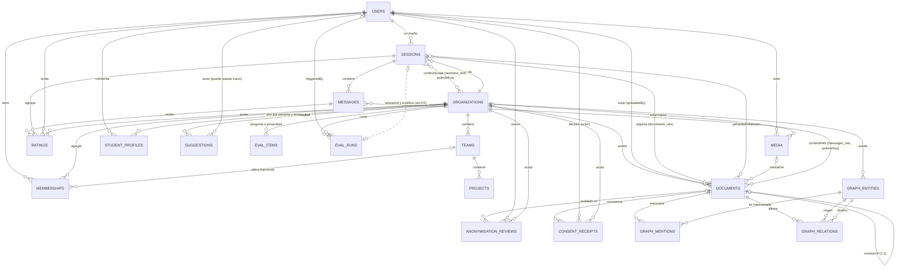
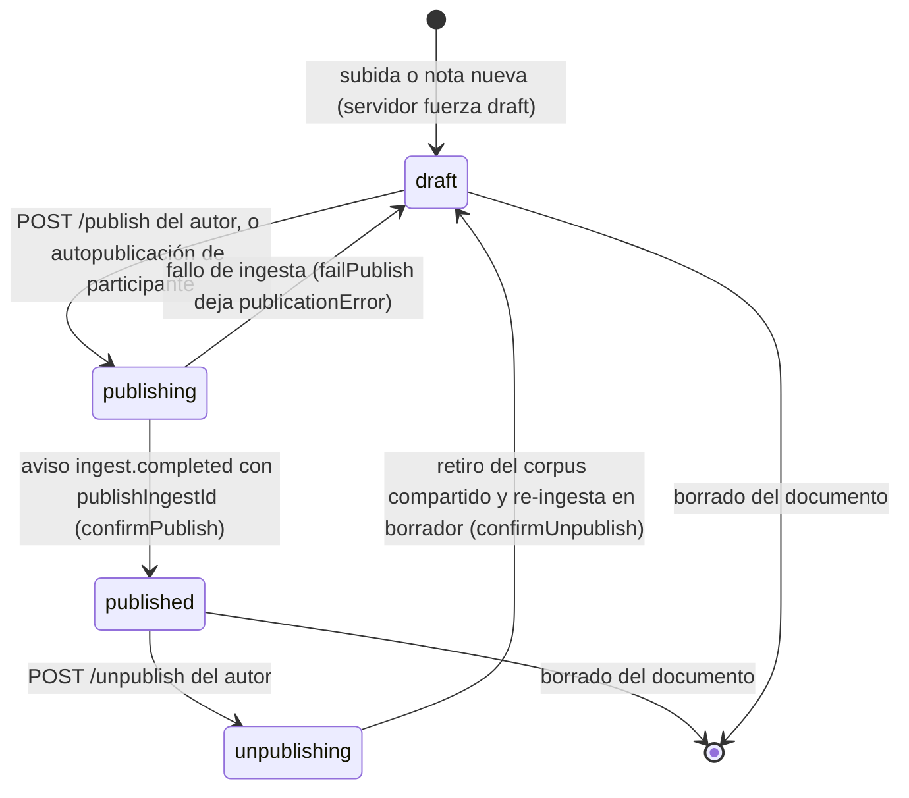
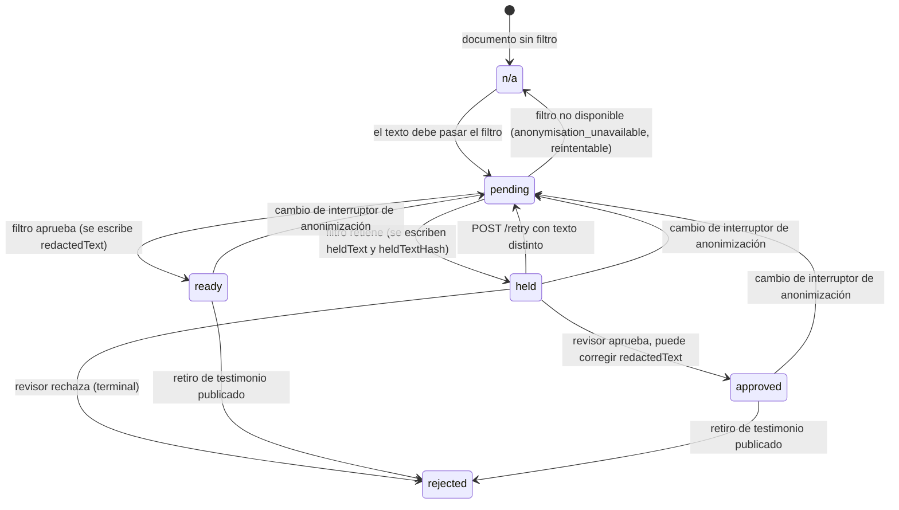
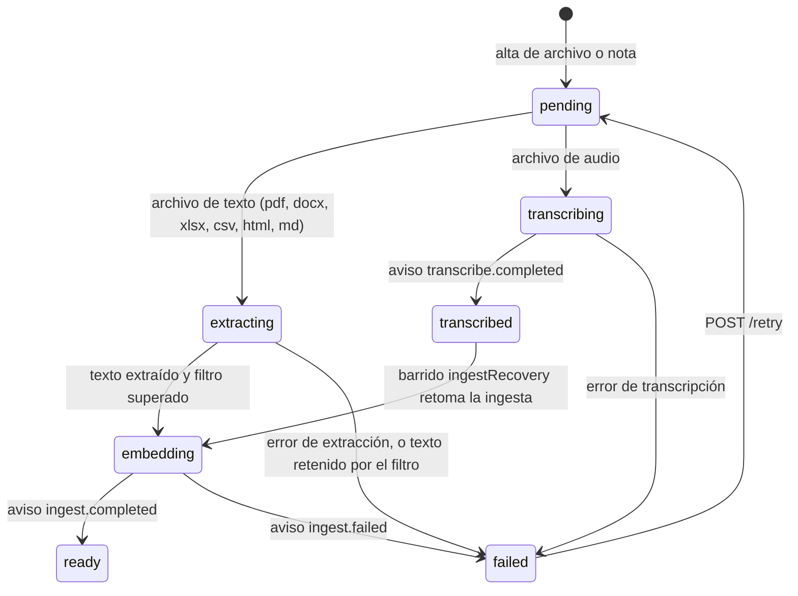
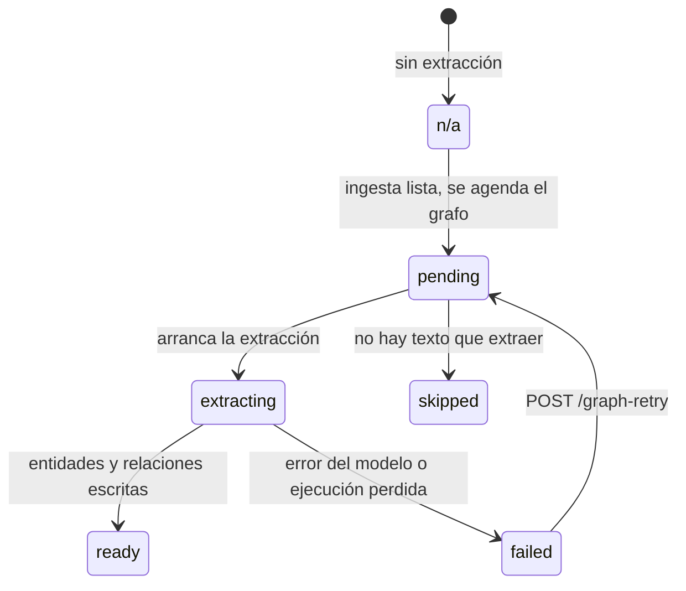
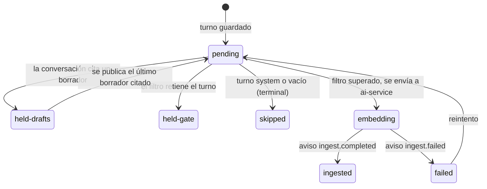
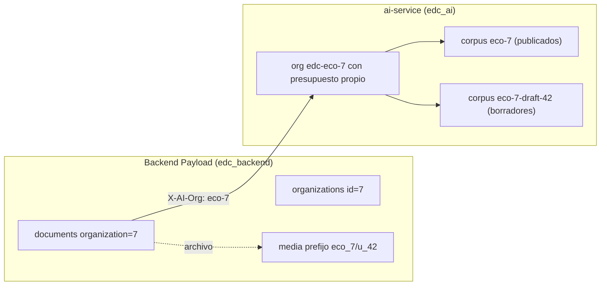

# Modelo de datos

- **Versión:** 1.4
- **Fecha:** 2026-11-12
- **Estado:** vigente
- **Fuentes:** `apps/backend/src/payload.config.ts`, `apps/backend/src/collections/*.ts`, `apps/backend/src/globals/PlatformSettings.ts`, `apps/backend/src/access/index.ts`, `apps/backend/src/lib/permissions.ts`, `apps/backend/src/lib/roles.ts`, `apps/backend/src/lib/corpus.ts`, `apps/backend/src/lib/aiClient.ts`, `apps/backend/src/lib/publishDocument.ts`, `apps/backend/src/lib/anonymiseDocument.ts`, `apps/backend/src/lib/holdReview.ts`, `apps/backend/src/lib/conversationIngest.ts`, `apps/backend/src/lib/autoPublish.ts`, `apps/backend/src/lib/features.ts`, `apps/backend/src/lib/anonymisationControls.ts`, `apps/backend/src/lib/consentHold.ts`, `apps/backend/src/lib/callbackRetention.ts`, `apps/backend/src/lib/graph/orphanJanitor.ts`, notas de contexto del equipo. Lectura del código en `main` del 2026-10-29, revisada contra `main` en `00b943f3` el 2026-11-10 y en `ac8fbf7c` el 2026-11-11. Revisado contra `main` `eb5625f5` el 2026-11-12. Dev corre `eb5625f5`, desplegado el 2026-11-12 a las 19:42 UTC (measured con `docker ps` por el agente de despliegue; `infra/fleet/edc-1.md` §4zzzzzzzzzzz): todo lo que describe este documento está en dev.

## Para quién es y qué responde

Este documento es para quien necesita entender qué guarda Ecosistemas de Conocimiento (EDC) y quién puede ver cada cosa: el equipo del proyecto, revisores institucionales y desarrolladores nuevos. Responde cuatro preguntas. Qué entidades existen y cómo se relacionan. Qué regla de acceso protege cada colección. Por qué estados pasa un documento, un testimonio y un turno de conversación, y quién provoca cada cambio. Cómo se separan los datos de un ecosistema de los de otro. La forma física de las tablas está en [estructura-de-base-de-datos.md](estructura-de-base-de-datos.md). Los datos de prueba están en [corpus-y-datos-de-prueba.md](corpus-y-datos-de-prueba.md).

## 1. Conceptos base

**Payload** es el CMS (sistema de gestión de contenido) que sirve de backend. Cada tipo de dato es una **colección** (una tabla con reglas de acceso, validaciones y ganchos de código). Un **global** es una colección de una sola fila. La lista de colecciones registradas está en `apps/backend/src/payload.config.ts`.

**Ecosistema** es el nombre de producto de la colección `organizations`. Cada ecosistema es un **tenant**: un espacio de datos aislado de los demás. Una persona puede pertenecer a varios ecosistemas con un rol distinto en cada uno.

**Roles por ecosistema.** El escalafón de menor a mayor es `estudiante < member < admin < investigador < owner`. El rango vive en el código (`ROLE_RANK`, `apps/backend/src/lib/permissions.ts`), no en el orden del enum de Postgres. En la interfaz `member` se presenta como participante y `owner` como responsable.

| Rol | Permisos |
|---|---|
| `member` | `documents:read`, `documents:write`, `chat:use`, `ratings:write` |
| `estudiante` | Los mismos que `member`. Lo adicional es una vista (`studentView`), no un permiso |
| `admin` | Los de `member` más `voces:upload`, `ratings:read-comments`, `holds:review`, `documents:delete`, `members:manage` |
| `investigador` | Los mismos que `admin`. Su rango le deja gestionar a todos menos al responsable |
| `owner` | Los de `investigador` más `organization:manage` (Ajustes del ecosistema: sus interruptores y el "Reintentar" de la re-anonimización). Su rango le deja gestionar investigadores, cambiar el `slug` y apagar el ecosistema |

`organization:manage` pasó del investigador al responsable por decisión del 2026-11-10 (`ac16b2a0`). Implementado y desplegado.

**Administrador de plataforma** no es un rol de membresía. Es la casilla `users.isPlatformAdmin`. Al resolver sus permisos se trata como `owner` en todos los ecosistemas activos (`apps/backend/src/lib/permissions.ts`).

**Revocación.** Hay tres interruptores: `users.isActive`, `memberships.isActive` y `organizations.isActive`. Basta con uno en `false` para que el acceso desaparezca.

**Helpers de acceso** (`apps/backend/src/access/index.ts`). `withinMyOrganizations(field)` devuelve una restricción WHERE del tipo "campo dentro de mis ecosistemas". Si la persona no tiene membresías devuelve `false`, nunca una lista vacía. `withinMyOrganizationsWithRole(minRole)` añade un rango mínimo. Como las reglas son filtros y no rechazos, un id ajeno responde 404 y no 403: la API no confirma que el registro exista.

## 2. Diagrama entidad-relación

El diagrama muestra las relaciones lógicas. Las tablas de relación de Payload (`*_rels`) aparecen como relaciones muchos a muchos.

`aiServiceCallbacks` y el global `platform-settings` no tienen relaciones con otras entidades. La relación `contextScope` es polimórfica: puede apuntar a ecosistemas, equipos, proyectos, membresías o documentos; el diagrama solo dibuja una de sus ramas.

## 3. Entidades

### 3.1 `users`: cuentas e identidad

Propósito: la cuenta de cada persona. Payload actúa también como proveedor de identidad: emite el token de sesión que la web guarda en `chat_auth`. ai-service no lee tokens de usuario; usa llaves bearer por proyecto. Archivo: `apps/backend/src/collections/Users.ts`. El backend emite además, en `/v1/identity/token`, JWT EdDSA de un solo ecosistema, que nada consume todavía; el `name` y la audiencia de las tablas de abajo se refieren a ese JWT.

| Campo | Tipo | Notas |
|---|---|---|
| `email`, `hash`, `salt` y demás | autenticación de Payload | `email` tiene índice único y se normaliza a minúsculas |
| `displayName` | texto | Va en el token como `name` |
| `avatarUrl` | texto | |
| `locale` | `es` o `en`, por defecto `es` | |
| `isPlatformAdmin` | casilla, por defecto falso | Solo la lee y escribe un administrador de plataforma |
| `isActive` | casilla, por defecto verdadero | Solo la cambia un administrador de plataforma |

Ganchos: si existe `IDENTITY_ALLOWED_EMAIL_DOMAIN`, al crear solo se admite ese dominio. `afterMe` añade las membresías a la respuesta de `/api/users/me`. La tabla `users_sessions` guarda las sesiones de inicio de sesión de Payload y no tiene relación con las conversaciones.

### 3.2 `organizations`: el ecosistema

Propósito: el tenant. Archivo: `apps/backend/src/collections/Organizations.ts`.

| Campo | Tipo | Notas |
|---|---|---|
| `name` | texto, requerido | |
| `slug` | texto, requerido, único | Audiencia del token. Solo un `owner` lo cambia |
| `description` | texto largo | Se inyecta en el contexto del chat |
| `isActive` | casilla, por defecto verdadero | Solo un `owner` lo cambia |
| `features` | JSON | Interruptores de funciones. Vacío significa valores por defecto |
| `answerStyleGenerales`, `answerStyleResonancias`, `answerStyleInterviewer` | texto largo, máximo 1500 caracteres | Estilo de respuesta por tipo de conversación. Solo los cambia un administrador de plataforma |

Interruptores (`apps/backend/src/lib/features.ts`). Encendidos por defecto: `audioUpload`, `liveMic`, `interviewerMode`, `graph`, `graph3d`, `combinedGraph`, `chatOrientation`, `testimonioTitles`, `autoPublishMembers`. Apagados por defecto: `studentView`, `keepPublicFigures`, `studentTestimonios`, `keepDocumentAuthor` y `keepCitedAuthors`. `keepPublicFigures` y `studentTestimonios` solo los cambia un administrador de plataforma (`PLATFORM_ADMIN_ONLY_FEATURES`). `keepDocumentAuthor` y `keepCitedAuthors` son el valor por omisión de los interruptores de anonimización de cada documento ([ADR-0020](../03-arquitectura/adr/ADR-0020-anonimizar-todo-y-conservar-nombres-por-documento.md)); en dev desde el 2026-11-10. Los cambia quien tiene `organization:manage`, el responsable, o un administrador de plataforma (Implementado y desplegado). Cada cambio escribe su fila de auditoría y, si apaga un interruptor, vuelve a pasar por la compuerta lo que lo heredaba (sección 5.2).

Ganchos: al cambiar `features` se invalida la caché. Si `studentTestimonios` pasa de encendido a apagado, se borra el consentimiento de testimonios en `studentProfiles`. Al crear un ecosistema se aprovisiona su organización en ai-service (sección 6).

### 3.3 `memberships`: el rol de una persona en un ecosistema

Propósito: une `users` con `organizations` y fija el rol. Archivo: `apps/backend/src/collections/Memberships.ts`.

| Campo | Tipo | Notas |
|---|---|---|
| `user` | relación con `users`, requerida | Solo la ve el propio usuario, quien tenga `members:manage` o un administrador de plataforma |
| `organization` | relación con `organizations`, requerida | |
| `role` | uno de los cinco roles, por defecto `member` | |
| `isActive` | casilla, por defecto verdadero | |
| `team` | relación con `teams`, opcional | Solo para mostrar |
| `personName`, `title` | texto | |

Lectura: quien es `estudiante` en un ecosistema ve ahí su propia fila, la del personal y la de los compañeros que activaron `shareWithPeers`; los demás roles ven todas las del ecosistema (decisión del 2026-11-10, `55183149`; Implementado y desplegado).

Reglas: una persona tiene como máximo una membresía por ecosistema (índice único escrito a mano). Nadie se asigna una membresía a sí mismo, ni siquiera un administrador de plataforma. Nadie asigna un rol más alto que el propio. Un ecosistema nunca se queda sin `owner`. No se puede crear una membresía hacia un ecosistema ajeno.

### 3.4 `teams` y `projects`: estructura de trabajo

Propósito: organizar a las personas y su trabajo dentro de un ecosistema. `teams` tiene `name`, `slug`, `organization` y `mission`. `projects` tiene `name`, `slug`, `team`, `status` (`planning`, `active`, `paused`, `done`; por defecto `active`) y `summary`. Un proyecto pertenece a su ecosistema a través de su equipo. Un gancho impide colgar un equipo o proyecto de un ecosistema ajeno.

### 3.5 `documents`: la pieza central

Propósito: todo material que entra al acervo. Un documento puede ser una nota escrita en la app, un archivo subido o una grabación. Su contenido se extrae, pasa por el filtro de anonimización cuando corresponde, se indexa en ai-service y, al publicarse, se comparte con el ecosistema. Archivo: `apps/backend/src/collections/Documents.ts`. El diccionario completo está en la sección 8.

Dos campos definen qué es un documento. `kind` dice el **formato del archivo** (`markdown`, `pdf`, `docx`, `xlsx`, `xls`, `csv`, `html`, `audio`). `contentKind` dice **qué tipo de material es**: `documento` (material de trabajo), `testimonio` (una voz, en el marco del Repositorio de Voces y Resonancias) o `conversacion`. `contentKind` no cambia después de crearse. Crear un `testimonio` exige el permiso `voces:upload`. No existe un campo que identifique al sujeto del testimonio: es una decisión deliberada para no ligar una voz con una persona.

El valor `conversacion` sigue en el enum, pero en la práctica no se crean filas así: los turnos de chat van directo a ai-service como documentos `msg-{messageId}`. Que el valor se conserve por compatibilidad es una inferencia.

### 3.6 `media`: archivos binarios

Propósito: los bytes de cada archivo subido. Usa los campos de carga de Payload (`filename` único, `mimeType`, `filesize`, `url`) más `uploadedBy`, `organization`, `prefix` y `alt`. Archivo: `apps/backend/src/collections/Media.ts`. Las validaciones de tamaño y tipo están en la sección 5 de [estructura-de-base-de-datos.md](estructura-de-base-de-datos.md).

### 3.7 `sessions`: conversaciones

Propósito: una conversación con el asistente. Archivo: `apps/backend/src/collections/Sessions.ts`.

| Campo | Tipo | Notas |
|---|---|---|
| `user` | relación con `users`, requerida, solo lectura | Lo fija el servidor |
| `organization` | relación con `organizations`, requerida | Lo fija el servidor |
| `kind` | `generales` o `resonancias`, por defecto `generales` | `generales` es chat abierto; `resonancias` es estilo entrevista |
| `title` | texto | Por defecto "New chat" |
| `evalRun` | número | Id de una corrida de evaluación, sin llave foránea |
| `lastUsedAt` | fecha | |
| `panelState` | JSON | Estado de la interfaz |
| `contextScope` | relación polimórfica múltiple | Ecosistemas, equipos, proyectos, membresías o documentos que acotan la conversación |

Al borrar una conversación, `cascadeConversationDelete` actúa en este orden: rechaza a quien no es dueño; retira del corpus compartido los turnos ya ingeridos; borra las valoraciones; borra los mensajes; borra los documentos que pertenecen solo a esa conversación. Nunca borra un corpus.

### 3.8 `messages`: turnos de conversación

Propósito: cada pregunta y cada respuesta. Archivo: `apps/backend/src/collections/Messages.ts`.

| Campo | Tipo | Notas |
|---|---|---|
| `session` | relación con `sessions`, requerida | |
| `role` | `user`, `assistant` o `system` | |
| `content` | texto largo, requerido | |
| `generationMeta` | JSON | Modelo, tiempos y datos de generación |
| `provenance` | JSON | Citas de la respuesta |
| `contextRefs` | relación polimórfica múltiple | |
| `corpusStatus` | estado de ingesta al corpus | Ver sección 5.5 |
| `corpusIngestId`, `corpusError` | texto | |
| `redactedText` | texto largo | Versión anonimizada del turno |
| `anonymisationReport` | JSON | Conteos del filtro, sin texto |

Cada turno se ingiere en el corpus compartido del ecosistema como documento `msg-{id}`, después de pasar por el filtro de anonimización.

### 3.9 `ratings`: valoraciones

Propósito: estrellas de 1 a 5 sobre una respuesta, con un motivo (`not-grounded`, `invented`, `incomplete`, `unclear`, `wrong-language`, `accurate`, `well-sourced`, `clear`, `complete`, `other`) y un comentario opcional. Liga `message`, `session`, `organization` y `user`. Una persona deja como máximo una valoración por mensaje (índice único). Se crea o actualiza con `POST /api/ratings/upsert`.

### 3.10 `studentProfiles` y `suggestions`: vista de estudiante

`studentProfiles` guarda los consentimientos de un estudiante en un ecosistema: `shareWithPeers`, `shareActivity` (ambos falsos por defecto), `shareTestimoniosAt` y `shareTestimoniosVersion`. El consentimiento de testimonios es versionado: si cambia el texto del consentimiento, la versión guardada deja de valer. Hay un perfil por persona y ecosistema.

`suggestions` guarda sugerencias de estudiantes al proyecto: `organization`, `author` (opcional; la sugerencia sobrevive de forma anónima si se borra la cuenta), `kind` (`contenido`, `arquitectura`, `interaccion`) y `text` (máximo 2000 caracteres).

### 3.11 Grafo de corpus: `graphEntities`, `graphMentions`, `graphRelations`

Propósito: el grafo de conocimiento que se extrae de los documentos publicados.

- `graphEntities`: `organization`, `type` (`tema`, `lugar`, `evento`, `organizacion`, `persona`), `label`, `canonicalKey`, `publicFigure`, `aliases`. Una entidad es única por ecosistema, tipo y llave canónica.
- `graphMentions`: `organization`, `document`, `entity`, `occurrences`, `snippet`, `seeded`. Una mención es única por documento y entidad.
- `graphRelations`: `organization`, `document`, `fromEntity`, `toEntity`, `type` (`ocurre_en`, `participa_en`, `ubicado_en`, `parte_de`, `afecta_a`, `relacionado_con`). Una arista es única por documento, origen, destino y tipo.

Una tarea diaria del backend borra las entidades que ya no menciona ningún documento (`lib/graph/orphanJanitor.ts`, `GRAPH_ORPHAN_JANITOR_*`; Implementado). Antes quedaban hasta que alguien corría el relleno a mano.

Reglas de privacidad: un testimonio nunca produce nodos `persona`. Cada consulta del grafo filtra por ecosistema y por documentos `published`. El umbral mínimo de soporte por entidad lo rige `GRAPH_MIN_ENTITY_DOCS`; su valor por defecto en el código es 1 (leído en `apps/backend/src/lib/graph/queries.ts`, 2026-10-30), no el 3 que todavía citan las notas de contexto del equipo.

### 3.12 `anonymisation-reviews`: bitácora de revisiones

Propósito: registro de solo inserción de cada decisión humana sobre un texto retenido. Campos: `document`, `documentIdSnapshot`, `organization`, `reviewer`, `decision` (`approved` o `rejected`), `gateStage`, `gateReason`, `gateReport`, `textEdited`, `note` (máximo 1000 caracteres). No guarda el texto revisado. La fila de auditoría se escribe antes de cambiar el documento.

Borrar un documento ya no borra las decisiones de otra persona: `document` queda vacío y `documentIdSnapshot` guarda el id. Solo se van las filas de quien borra. Desde el commit c2f19412 lo mismo vale al borrar una conversación que se lleva un documento retenido; antes sus filas se iban con él (decisión del 2026-10-17). Decisión del 2026-11-10, migración `20261110_181621`; Implementado y desplegado.

### 3.13 `eval-items` y `eval-runs`: evaluaciones

Propósito: el panel de evaluaciones de calidad, solo para administradores de plataforma. `eval-items` guarda preguntas de prueba (`kind` = `pregunta`) y casos de privacidad (`kind` = `privacidad`) con `question`, `expectedDocIds`, `shouldRefuse`, `text`, `privateNames`, `publicNames` y `gateKind`. `eval-runs` guarda cada corrida: `status` (`queued`, `running`, `done`, `failed`), `triggeredBy`, fechas, `estimateUsd`, `costUsd`, `progress`, `models`, `metrics`, `results`, `commitSha`, `sessionId` y `error`. Ver [../07-calidad/evaluaciones-de-ia.md](../07-calidad/evaluaciones-de-ia.md).

### 3.14 `aiServiceCallbacks`: idempotencia de avisos

Propósito: recordar qué avisos (webhooks) de ai-service ya se procesaron, para no procesar dos veces el mismo. Campos: `correlationKey`, `eventKey`, `event`, `receivedAt` y `rawBody` (máximo 100 000 caracteres). El nombre del índice único `ai_service_callbacks_natural_key_unq` forma parte del contrato: la ruta de recepción lo busca en el error del driver para detectar duplicados. Una tarea diaria vacía `rawBody` a los 30 días (`lib/callbackRetention.ts`, `CALLBACK_RETENTION_*`); la fila se queda porque es la llave contra duplicados. Decisión del 2026-11-10; Implementado y desplegado.

### 3.15 Global `platform-settings`

Propósito: ajustes de toda la plataforma. Tiene un campo, `detectorFallback` (`hosted` o `none`), que decide si el detector de nombres puede caer a un modelo hospedado cuando el local no responde. Vacío significa usar la variable de entorno. Si falla la lectura del ajuste, el código usa `none` (cerrado ante la falla). `none` también impide el modelo hospedado cuando no hay URL del detector local, como en staging (P-05). Solo lo cambia un administrador de plataforma, y cada cambio escribe una fila de alcance `plataforma` en `anonymisation-setting-changes`. En dev el ajuste está vacío y la variable vale `hosted` (citado, `edc-1.md` §4zzzzzzz).

### 3.16 `anonymisation-setting-changes`: bitácora de interruptores

Propósito: registro de solo inserción de cada cambio de `keepDocumentAuthor`, `keepCitedAuthors`, `keepPublicFigures` o del ajuste de plataforma `detectorFallback`, una fila por clave cambiada. Archivo: `apps/backend/src/collections/AnonymisationSettingChanges.ts`. En dev desde el 2026-11-10 (tabla a las 05:47 UTC; claves `keepPublicFigures` y `detectorFallback` y alcance `plataforma` a las 18:33 UTC). Campos: `organization` (vacío en un cambio de plataforma), `document` (vacío en un cambio de ecosistema o de plataforma), `actor` (vacío si fue un script), `scope` (`documento`, `ecosistema` o `plataforma`), `key`, `before` y `after` (verdadero, falso o vacío; vacío significa heredar o sin fijar) y `createdAt`. Nunca guarda texto. Un cambio de documento escribe su fila antes del cambio. Un cambio de ecosistema lo escribe un gancho `afterChange` de `Organizations` en la misma transacción, así que cubre `/api/funciones` y la API directa; si falla la fila, falla el cambio. Borrar el documento deja la fila con `document` vacío; borrar el ecosistema la borra.

### 3.17 `consent-receipts`: recibos de consentimiento

Propósito: el recibo de la casilla de consentimiento que se marca al subir cada recurso (`apps/backend/src/collections/ConsentReceipts.ts:26`). Solo se agrega: crear, cambiar y borrar por la API están prohibidos. Se escribe en la misma transacción que el documento (`Documents.ts:4277`): si falla, el alta se deshace. Campos: `document` (vacío al borrar el documento, `set null`), `documentIdSnapshot`, `organization`, `actor` (quien sube), `kind` (solo `upload`), `consentVersion` (versión del texto de la casilla, `UPLOAD_CONSENT_VERSION` en `apps/web/src/lib/uploadConsent.ts`), `contentKind` (`documento`, `testimonio` o `conversacion`) y `createdAt`. Sin columnas de texto (10 columnas, 0 de texto; measured en dev el 2026-11-13 por el agente de despliegue). Registra la declaración de quien sube, nunca de quién son las palabras ([ADR-0019](../03-arquitectura/adr/ADR-0019-voces-sin-sujeto-ni-consentimiento.md), enmienda del 2026-11-12). El folio `EDC-AAAA-NNNNNN` se deriva del año en la Ciudad de México y del id del recibo a 6 cifras (`lib/uploadConsent.ts:84`); no se guarda aparte. La constancia (`GET /api/documents/:id/constancia`, página `/documentos/<id>/constancia`) responde 404 a quien no sea quien subió ni admin. de plataforma (`Documents.ts:5018`). El alta de un documento exige el campo virtual `uploadConsentVersion` (`Documents.ts:4254`): sin él, 400 `upload_consent_required`; con otra versión, 409 `consent_version_changed` (`apps/backend/src/lib/uploadConsent.ts:28-29`); las altas del servidor (revisión de nota, semillas) quedan exentas. Borrar un ecosistema borra sus recibos (`ON DELETE cascade`, migración `20261113_015634_consent_receipts.ts:35`; limitación conocida). Migración `20261113_015634_consent_receipts`; commit `29c54854`. Implementado.

## 4. Reglas de acceso por colección

"Ecosistema" significa los ecosistemas donde la persona tiene membresía activa. "Admin. de plataforma" es `isPlatformAdmin`. Las reglas viven en cada archivo de `apps/backend/src/collections/`.

| Colección | Leer | Crear | Actualizar | Borrar |
|---|---|---|---|---|
| `users` | Uno mismo o admin. de plataforma | Admin. de plataforma | Uno mismo o admin. de plataforma | Admin. de plataforma |
| `organizations` | Miembros del ecosistema | Admin. de plataforma | `owner` (`organization:manage`) o admin. de plataforma | Admin. de plataforma |
| `memberships` | Miembros del ecosistema (el campo `user` tiene regla propia); un `estudiante` solo ve su fila, el personal y los compañeros que comparten (desplegado) | `admin` o superior | `admin` o superior | `admin` o superior |
| `teams` | Miembros del ecosistema | `admin` o superior | `admin` o superior | `admin` o superior |
| `projects` | Miembros del ecosistema (por `team.organization`) | `admin` o superior | `admin` o superior | `admin` o superior |
| `documents` | Los propios en cualquier estado, o los `published` del ecosistema; admin. de plataforma ve todo; una cuenta desactivada no ve nada; las filas de revisión nunca salen | Cualquier cuenta activa | Quien lo subió, con asiento `documents:write` en su ecosistema, o admin. de plataforma | Quien lo subió: su borrador siempre; lo demás solo con asiento `documents:write` (desplegado). Admin. de plataforma |
| `media` | Archivos propios, o detrás de un `documento` publicado sin anonimizar del ecosistema; nunca la grabación de un testimonio | Cualquier cuenta activa | Quien lo subió | Quien lo subió |
| `sessions` | Solo el dueño | Cualquier cuenta activa | Solo el dueño | Solo el dueño |
| `messages` | Dueño de la conversación | Cualquier cuenta activa | Dueño de la conversación | Dueño de la conversación |
| `ratings` | Todo el ecosistema (el comentario solo con `ratings:read-comments`) | Cualquier miembro | Solo el autor | Solo el autor |
| `studentProfiles` | Nadie por la API | Nadie por la API | Nadie por la API | Nadie por la API |
| `suggestions` | Nadie por la API | Nadie por la API | Nadie por la API | Nadie por la API |
| `graphEntities`, `graphMentions`, `graphRelations` | Nadie por la API | Nadie por la API | Nadie por la API | Nadie por la API |
| `anonymisation-reviews` | Admin. de plataforma o quien tenga `holds:review` en ese ecosistema | Nadie por la API | Nadie | Nadie |
| `anonymisation-setting-changes` | Admin. de plataforma o quien tenga `holds:review` en ese ecosistema; las filas de plataforma, solo admin. de plataforma | Nadie por la API | Nadie | Nadie |
| `eval-items`, `eval-runs` | Admin. de plataforma | Admin. de plataforma | Admin. de plataforma | Admin. de plataforma |
| `aiServiceCallbacks` | Admin. de plataforma | Nadie por la API | Nadie | Nadie |
| `consent-receipts` | Quien subió (`actor`) o admin. de plataforma; nunca `holds:review` (`ConsentReceipts.ts:44`) | Nadie por la API (lo escribe el alta del documento) | Nadie | Nadie |
| `platform-settings` (global) | Admin. de plataforma | n/a | Admin. de plataforma | n/a |

Notas sobre la tabla:

1. **Conversaciones privadas sin excepción.** La regla `ownOnly` de `sessions` no tiene excepción para el administrador de plataforma. Nadie lee por la API la conversación de otra persona.
2. **Colecciones de solo servidor.** `studentProfiles`, `suggestions` y las tres del grafo niegan todo por la API. El servidor las maneja desde sus endpoints propios (`apps/backend/src/endpoints/estudiante.ts`, `apps/backend/src/endpoints/graph.ts`) y desde `apps/backend/src/lib/graph/writer.ts`. Que el endpoint de estudiante use `overrideAccess` es inferido; el endpoint no se leyó completo (no verificado en esta versión).
3. **Borrado por rol.** El permiso `documents:delete` (de `admin` hacia arriba) no aparece en la regla de la colección. Lo usa la ruta `app/api/published/[id]/route.ts`, que retira testimonios publicados y exige `holds:review`.
4. **Campos que nadie escribe por la API.** Los campos del filtro de anonimización (`anonymise`, `anonymisationStatus`, `redactedText`, `heldText` y demás) rechazan escrituras de cualquiera, administrador de plataforma incluido. Solo los escribe el servidor.
5. **Consultas que no sirven de oráculo.** Antes de `00b943f3`, los filtros de `documents` por `name`, `uploadedBy`, `session` y `uploadedInSession` estaban restringidos (`constrainGatedQueries`) para que nadie deduzca, filtrando, la existencia de un testimonio ajeno. Desde `00b943f3` es una lista blanca: un filtro u orden sobre cualquier ruta fuera de `GATED_FILTERABLE_PATHS` solo encuentra filas que la persona puede leer completas; aplica también a `document.*` desde `anonymisation-reviews` y `anonymisation-setting-changes` (Implementado y desplegado). Desde bb06ae10, en `main`, todas las colecciones reescriben un filtro que cruza una relación a los ids que la persona puede leer, con tope de 5 búsquedas y 5000 ids por petición (400) y de 2 en curso y 30 por minuto por persona (429) (`apps/backend/src/access/relationFilters.ts`; ver [../03-arquitectura/api.md](../03-arquitectura/api.md) §3.2.1). El detalle está en [../06-privacidad-y-seguridad/seguridad.md](../06-privacidad-y-seguridad/seguridad.md).
6. **Ninguna escritura vieja revierte una columna de `documents`.** Payload llena lo que quien llama no envió con lo que leyó y escribe la fila entera. Por eso cada campo de `documents` pasa por `writtenOnlyWhenSent`: en una actualización se escribe solo si un servidor lo envió, si una persona lo envió y su acceso lo permite (`ingestStatus` e `ingestId`, que se mueven con una edición del texto), o si un hook lo cambió respecto de lo leído; si no, sale del UPDATE y queda el valor guardado. La comparación es profunda, para que una columna `json` cuente como igual. Quedan fuera `consentHeld`, que nunca va en una actualización de Payload (su único escritor es `lib/consentHold.ts`), y `organization` y `uploadedBy`, que no cambian (`everyFieldWrittenOnlyWhenSent` en `apps/backend/src/collections/hooks/writtenOnlyWhenSent.ts`; commits 52d9c325, b6a82121, 999448d7, 2c395252, 9b888ba1, eb5625f5, del 2026-11-11 y 2026-11-12).

El detalle por rol y por pantalla está en [../02-requisitos/matriz-roles-y-permisos.md](../02-requisitos/matriz-roles-y-permisos.md).

## 5. Máquinas de estado

Un documento lleva cuatro estados independientes: publicación, anonimización, ingesta y grafo. Cada uno tiene su columna. Los turnos de conversación tienen un quinto estado propio.

### 5.1 Ciclo de vida del documento (`publicationStatus`)

| Transición | Quién la dispara | Dónde |
|---|---|---|
| alta en `draft` | El servidor, siempre, al crear | `bindDocumentToEcosystem` en `Documents.ts` |
| `draft` a `publishing` | La persona que subió el documento con `POST /api/documents/:id/publish`. Para participantes (`member`, `estudiante`), el sistema, si el filtro dio `ready` o `approved` y `autoPublishMembers` está encendido | `apps/backend/src/lib/publishDocument.ts`, `apps/backend/src/lib/autoPublish.ts` |
| `publishing` a `published` | Aviso de ai-service con el `publishIngestId` | Ruta de avisos `app/api/ai-service/callback/route.ts` |
| `published` a `unpublishing` a `draft` | Solo quien subió el documento | `unpublish` y `confirmUnpublish` en `publishDocument.ts` |
| Retiro de testimonio publicado | Quien tenga `holds:review` (sección 5.2) | `app/api/published/[id]/route.ts` |

Al publicar, el documento se re-ingesta en el corpus compartido `eco-{org}` con el texto que devuelve `corpusTextFor()`. Para contenido con filtro ese texto es `redactedText` y se exige estado `ready` o `approved`. Al confirmar, se retira la copia del corpus borrador. Retirar un documento cierra su ventana de validez en ai-service (`validTo`); toda consulta de recuperación pasa la fecha de corte `asOf`.

### 5.2 Anonimización (`anonymisationStatus`)

El filtro de anonimización (en el código, *gate*) detecta nombres de personas privadas y los reemplaza antes de que el texto llegue al corpus. Aplica cuando `contentKind` no es `documento` o cuando `anonymise` está activo. Es una lista blanca de un solo valor: todo lo que no sea un `documento` sin marca pasa por el filtro. Si falla, falla cerrado (no deja pasar texto).

| Transición | Quién la dispara |
|---|---|
| `n/a` a `pending` a `ready` o `held` | El servidor, dentro de `enqueueIngestForDoc`, al terminar la extracción |
| `held` a `approved` o `rejected` | Una persona con `holds:review` (`admin`, `investigador`, `owner` o administrador de plataforma) desde la pantalla de revisión; código en `apps/backend/src/lib/holdReview.ts` |
| `held` a `pending` | Quien subió el documento con `POST /:id/retry`. Se rechaza mientras el texto no cambie, comparando contra `heldTextHash` |
| `ready` o `approved` a `rejected` | Una persona con `holds:review`, retirando un testimonio ya publicado (`apps/backend/src/lib/rejectPublished.ts`) |
| `ready`, `held` o `approved` a `pending` | Quien puede cambiar los interruptores de anonimización del documento, con `PATCH /:id/anonimizacion`, si el cambio afecta su resultado: se enciende un interruptor que el resultado tenía apagado, o se apaga uno bajo el que conservó un nombre. Si no conservó a nadie, solo se actualiza `anonymisationReport.settings`. Se escribe la auditoría, se retira el documento (compartido y borrador), se borran sus copias en ai-service y sus filas del grafo, vuelve a borrador con las columnas de la compuerta y los tres registros de nombres limpios, y la compuerta corre en segundo plano. `rejected`, sin compuerta o `n/a` solo guardan el ajuste; `pending`, `publishing` y `unpublishing` responden 409; una conversación, 400; una falla de ai-service, 502 sin reiniciar, con el ajuste guardado y la falla marcada (`POST /:id/anonimizacion/reintentar`). El borrado en ai-service va antes del reinicio. Un valor del ecosistema que pasa de encendido a apagado vuelve a pasar de la misma forma lo que lo hereda y conservó un nombre bajo él (`regateInheritors`), con hasta 3 intentos; lo que siga fallando deja `pendingRegate`. Aprobar una retención con interruptores distintos a los de hoy responde 409 (`lib/holdReview.ts`). En dev desde el 2026-11-10 (`lib/anonymisationControls.ts`). Además, quien revisa solo entra a filas retenidas o publicadas (A-07); una fila retenida por consentimiento responde 409 y ningún re-gate la toca; publicar una fila con compuerta cuyo re-gate falló o sigue pendiente responde 409 |

Una edición del texto que reinicia la compuerta, y el `POST /:id/retry` que vuelve a `pending`, escriben `anonymisationStatus` aparte, con `WHERE anonymisation_status = <lo leído>` en la misma transacción. Si una persona revisora decidió entre la lectura y la escritura, nada coincide: 409 y nada se escribe, así el veredicto más nuevo queda (`deferStatusReset` y `applyStatusReset` en `Documents.ts`; commits 999448d7 y 2c395252).

Mientras un documento está `held`, `ingestStatus` queda en `failed` con el código `anonymisation_held` y nada se ingiere. `rejected` es terminal: ese texto nunca entra al corpus. Cada decisión humana escribe primero una fila en `anonymisation-reviews`.

### 5.3 Ingesta (`ingestStatus`)

El valor `n/a` existe para documentos sin contenido que ingerir. La extracción de texto corre en un proceso del backend. La transcripción la hace audio-service (Whisper en un equipo DGX Spark para dev). La indexación (embedding: convertir texto en vectores numéricos para la búsqueda) la hace ai-service. Los avisos llegan a `app/api/ai-service/callback/route.ts`. `ingestStatus` e `ingestId` solo cambian junto con un `extractedText` distinto.

### 5.4 Grafo (`graphStatus`)

El servidor agenda el grafo después de que la ingesta termina. La extracción corre en el mismo proceso del backend (`setImmediate`), así que un reinicio la pierde; el backfill `apps/backend/src/lib/graph/backfill.cli.ts` la recupera. Una ejecución colgada más de 20 minutos se trata como perdida (`GRAPH_STALE_RUN_MS`, citado de `Documents.ts`). El grafo lee el mismo texto que recibió el corpus, nunca `extractedText`. `GRAPH_EXTRACT=off` lo desactiva. El reintento lo pide quien subió el documento.

### 5.5 Corpus de los turnos de conversación (`messages.corpusStatus`)

Lo dispara el gancho `ingestConversationHook` al guardar cada turno. `held-drafts` y `held-gate` son distintos a propósito. El primero se resuelve solo cuando se publica el último borrador citado. El segundo no se reintenta: el filtro ya rechazó ese texto y repetirlo daría la misma respuesta. Un turno en `held-gate` tampoco aparece en la pantalla de revisión humana. Se reintentan `pending`, `held-drafts` y `failed` (`apps/backend/src/lib/conversationIngest.ts`). Al borrar la conversación, los turnos ingeridos se retiran del corpus.

## 6. Multitenancy: cómo se separan los ecosistemas

Hay cuatro capas de separación.

1. **Filas en Postgres.** Toda fila de negocio lleva `organization`, directa o a través de `team.organization` en `projects`. Las reglas de acceso son filtros WHERE. `documents`, `sessions` y `media` fijan el ecosistema y el dueño en el servidor; el cliente no puede enviarlos.
2. **Borradores privados dentro del ecosistema.** Un documento en `draft` solo lo ve quien lo subió. Solo `published` se comparte con el ecosistema.
3. **Corpus en ai-service** (`apps/backend/src/lib/corpus.ts`). Cada ecosistema tiene un corpus compartido `eco-{orgId}`. Cada persona tiene un corpus borrador `eco-{orgId}-draft-{userId}`. Los ids se validan con `^[A-Za-z0-9_]+$` para que nadie inyecte un separador.
4. **Organización en ai-service** (`apps/backend/src/lib/aiClient.ts`, `apps/backend/src/lib/provisionEcosystem.ts`). El backend envía el encabezado `X-AI-Org: eco-<id>`. La llave de EDC tiene el prefijo delegado `edc-`, así que la organización efectiva en ai-service es `edc-eco-<id>`. Esa organización tiene su propio presupuesto. Al crear un ecosistema, el backend llama a `POST /v1/tenant/provision` con 5 USD por defecto (`AI_ECOSYSTEM_BUDGET_USD`, citado del código); si la llamada falla no lanza error. La migración de datos viejos a este esquema se describe en la sección 4 de [estructura-de-base-de-datos.md](estructura-de-base-de-datos.md).

**Archivos.** Cada objeto del bucket lleva el prefijo `eco_{orgId}/u_{uploaderId}`. Sirve para operación (respaldos, limpieza), no como frontera de acceso. Quien decide si alguien puede bajar un archivo es `mediaVisibleToCaller`.

**Límite conocido.** El limitador de peticiones de ai-service agrupa por llave. Como EDC usa una sola llave delegante, todas las organizaciones `edc-*` comparten un mismo contador (citado de `plan/auditoria-codigo-2026-10-28.md`). Ver [../06-privacidad-y-seguridad/seguridad.md](../06-privacidad-y-seguridad/seguridad.md).

Los ids del diagrama son ilustrativos.

## 7. Revisiones de nota

Una nota publicada se edita sin despublicarla. "Publicar cambios" crea una fila oculta de preparación con `revisionOf` apuntando a la nota original. Esa fila nunca sale en la API. La fila de preparación copia los tres valores propios de anonimización de la nota (`keepPublicFigures`, `keepDocumentAuthor`, `keepCitedAuthors`). Cuando la re-ingesta termina, el contenido pasa a la nota original y la fila de preparación desaparece (comportamiento afirmado por `apps/backend/src/lib/studentNotes.pg.test.ts`). La relación es uno a uno (índice único) y se borra en cascada con la nota. `processedBody` guarda el cuerpo tal como se publicó por última vez y `reindexIngestId` sigue la re-ingesta.

## 8. Diccionario de datos de `documents`

Convenciones. "Servidor" significa que solo lo escribe código del backend con privilegios. "Autor" es quien subió el documento (`uploadedBy`). "Ecosistema" significa los miembros del ecosistema cuando el documento está `published`. Las líneas citadas son de `apps/backend/src/collections/Documents.ts` del 2026-10-29.

### 8.1 Identidad y pertenencia

| Campo | Tipo | Quién lo escribe | Quién lo lee |
|---|---|---|---|
| `id` | entero | Postgres | Quien puede leer la fila |
| `organization` | relación con `organizations`, requerida | Servidor, al crear | Autor, ecosistema, admin. de plataforma |
| `uploadedBy` | relación con `users`, requerida | Servidor (siempre el usuario de la petición) | Autor, ecosistema, admin. de plataforma; filtro restringido |
| `session` | relación múltiple con `sessions` | Servidor, al adjuntar en una conversación propia | Igual que la fila; filtro restringido |
| `uploadedInSession` | relación con `sessions` | Servidor, al crear desde una conversación | Igual que la fila; filtro restringido |
| `name` | texto, requerido | Autor | Igual que la fila. En contenido con compuerta, solo quien lo subió y el admin. de plataforma ven el nombre del archivo; los demás reciben un título neutro o redactado. Nunca entra al corpus en testimonios; filtro restringido. Para un `documento` con compuerta, el título va redactado en REST, ingesta, citas, biblioteca, chat, grafo, vista de estudiante y vista de anonimización, y si `anonymise` es nulo o no viene en la fila, el título falla cerrado (Implementado y desplegado) |
| `createdAt`, `updatedAt` | fecha | Payload | Igual que la fila |

### 8.2 Tipo de material

| Campo | Tipo | Quién lo escribe | Quién lo lee |
|---|---|---|---|
| `kind` | `markdown`, `pdf`, `docx`, `xlsx`, `xls`, `csv`, `html`, `audio` | Al crear; después solo el servidor | Igual que la fila |
| `contentKind` | `documento`, `testimonio`, `conversacion`, requerido | Al crear (testimonio exige `voces:upload`); inmutable | Igual que la fila |
| `mode` | `full-text` o `rag-retrieve` | Autor | Igual que la fila |
| `isPinned` | casilla, por defecto verdadero | Autor | Igual que la fila |

### 8.3 Filtro de anonimización

| Campo | Tipo | Quién lo escribe | Quién lo lee |
|---|---|---|---|
| `anonymise` | casilla, por defecto falso | Servidor (todo PDF o DOCX de participante, o marca "Anonimizar" del staff) | Igual que la fila |
| `keepPublicFigures` | casilla, sin valor por defecto | Admin. de plataforma, por `PATCH /:id/anonimizacion`; solo en un `documento` | Igual que la fila |
| `keepDocumentAuthor` (columna `keep_document_author`) | casilla que admite nulo; nulo hereda `keepDocumentAuthor` del ecosistema | Servidor, por `PATCH /:id/anonimizacion`: quien subió, `holds:review` del ecosistema (solo sobre filas retenidas o publicadas desde A-07, desplegado) y admin. de plataforma | Igual que la fila |
| `keepCitedAuthors` (columna `keep_cited_authors`) | casilla que admite nulo; nulo hereda `keepCitedAuthors` del ecosistema | Igual que `keepDocumentAuthor` | Igual que la fila |
| `consentHeld` (columna `consent_held`) | casilla, `NOT NULL`, falso por defecto | Solo el script `scripts/hold-for-consent.ts`; ninguna API. No hay camino de liberación en el código | Igual que la fila. Si es verdadero, la fila no se extrae, ingiere, pasa por la compuerta, grafica ni publica. Implementado y desplegado |
| `anonymisationStatus` | `n/a`, `pending`, `held`, `approved`, `rejected`, `ready` | Servidor | Igual que la fila |
| `redactedText` | texto, hasta 2 000 000 caracteres | Servidor; un revisor puede corregirlo al aprobar | Ecosistema cuando está publicado; es lo único que entra al corpus en contenido con filtro |
| `heldText` | texto | Servidor | Solo autor y admin. de plataforma |
| `heldTextHash` | texto (SHA-256) | Servidor | Servidor |
| `anonymisationSurvivors` | JSON | Servidor | Autor y admin. de plataforma (posiciones de lo que todavía identifica) |
| `publicFiguresKept` | JSON | Servidor | Igual que la fila |
| `authorsKept` (columna `authors_kept`) | JSON: nombre completo de quien subió, modelo y fecha; solo con `keepDocumentAuthor` efectivo; nulo en una retención | Servidor | Solo autor y admin. de plataforma |
| `citedAuthorsKept` (columna `cited_authors_kept`) | JSON: entradas `{name, model, at}` de autores citados conservados; solo con `keepCitedAuthors` efectivo y si el modelo llamó público ese texto exacto. Se limpia como `authorsKept`: en una retención, un rechazo, un retiro, al promover una nota y al volver a pasar por la compuerta | Servidor | Igual que `authorsKept` |
| `anonymisationError` | texto | Servidor | Igual que la fila |
| `anonymisationReport` | JSON | Servidor | Igual que la fila; solo conteos por etapa, sin texto. Desde el 2026-11-10 en dev guarda también `settings`: los interruptores con que corrió la compuerta (ausente en reportes anteriores) |
| `testimonioTitle` | texto | Servidor (título propuesto por el sistema) | Como `heldText` mientras no esté `ready` o `approved`; después, igual que la fila |

### 8.4 Etiquetas de corpus

| Campo | Tipo | Quién lo escribe | Quién lo lee |
|---|---|---|---|
| `tema` | texto | Seeds de corpus y backfill | Igual que la fila |
| `lengua` | texto | Seeds de corpus y backfill; un gancho la anula si no es `documento` | Solo si `contentKind` es `documento` |

### 8.5 Texto

| Campo | Tipo | Quién lo escribe | Quién lo lee |
|---|---|---|---|
| `bodyMarkdown` | texto | Autor (notas en la app) | Igual que el original |
| `processedBody` | texto | Servidor, al publicar una nota | Igual que la fila |
| `extractedText` | texto, hasta 2 000 000 caracteres | Servidor (extracción o transcripción) | Original sin anonimizar: autor, admin. de plataforma, o cualquiera si es `documento` sin `anonymise` (`mayReadGatedOriginal`) |
| `wikiLinks` | JSON | Servidor, al procesar la nota | Igual que la fila |

### 8.6 Archivo y audio

| Campo | Tipo | Quién lo escribe | Quién lo lee |
|---|---|---|---|
| `mediaFile` | relación con `media` | Autor, al subir | Igual que la fila; los bytes los protege `media` |
| `audioMeta` | JSON (duración, idioma, confianza) | Servidor | Como el original |
| `transcribeId` | texto | Servidor | Igual que la fila |
| `transcribeAttempt` | número | Servidor | Igual que la fila |

### 8.7 Publicación

| Campo | Tipo | Quién lo escribe | Quién lo lee |
|---|---|---|---|
| `publicationStatus` | `draft`, `publishing`, `published`, `unpublishing` | Servidor, a petición del autor o por autopublicación | Igual que la fila |
| `publicationError` | texto | Servidor | Igual que la fila |
| `publishIngestId` | texto | Al crear; después solo el servidor | Igual que la fila |

Desde f202a11a, en `main`, las columnas de error (`publicationError`, `ingestError`, `corpusError`, `anonymisationError`) guardan `safeErrMessage`, nunca el texto de un error de base de datos ni el `err.message` crudo de ai-service. Las filas escritas antes conservan su texto.

### 8.8 Ingesta y grafo

| Campo | Tipo | Quién lo escribe | Quién lo lee |
|---|---|---|---|
| `ingestStatus` | `n/a`, `pending`, `extracting`, `transcribing`, `transcribed`, `embedding`, `ready`, `failed` | Servidor, junto con un `extractedText` distinto o por aviso | Igual que la fila |
| `ingestError` | texto | Servidor | Igual que la fila |
| `ingestId` | texto | Servidor | Igual que la fila |
| `graphStatus` | `n/a`, `pending`, `extracting`, `ready`, `failed`, `skipped` | Al crear; después solo el servidor | Igual que la fila |
| `graphError` | texto | Servidor | Igual que la fila |
| `graphPromptVersion` | texto | Servidor | Igual que la fila |
| `graphExtractedAt` | fecha | Servidor | Igual que la fila |

### 8.9 Revisiones

| Campo | Tipo | Quién lo escribe | Quién lo lee |
|---|---|---|---|
| `revisionOf` | relación única con `documents` | Servidor, en "Publicar cambios" | Nadie por la API (las filas con `revisionOf` se ocultan) |
| `reindexIngestId` | texto | Servidor | Igual que la fila |

"Igual que la fila" significa: el autor en cualquier estado, los miembros del ecosistema si está `published`, y el administrador de plataforma siempre.

### 8.10 Endpoints propios de `documents`

| Ruta | Quién | Qué hace |
|---|---|---|
| `POST /api/documents/:id/publish` | Solo el autor | Inicia la publicación. Responde 409 si la fila está retenida por consentimiento o si su re-gate falló o sigue pendiente (Implementado y desplegado) |
| `POST /api/documents/:id/unpublish` | Solo el autor | Despublica |
| `/api/documents/:id/note` | Autor | Edición de notas y "Publicar cambios" |
| `POST /api/documents/:id/retry` | Autor | Reintenta ingesta o filtro |
| `POST /api/documents/:id/graph-retry` | Autor | Reintenta el grafo |
| `GET /api/documents/:id/constancia` | Quien subió o admin. de plataforma; los demás, 404 | Datos de la constancia: folio, versión, tipo, ecosistema, fecha y título (`null` si quien pide no puede leer el original). Tras borrar el documento, resuelve por `documentIdSnapshot` (`Documents.ts:5018`) |
| `PATCH /api/documents/:id/anonimizacion` | Autor o `holds:review`, con membresía activa en el ecosistema; admin. de plataforma con cuenta activa. `keepPublicFigures`, solo admin. de plataforma. Otro ecosistema o cuenta inactiva: 404; sin permiso en el mismo ecosistema: 403. Quien revisa, solo sobre filas retenidas o publicadas (A-07, desplegado) | `GET` lee el estado, los nombres conservados (solo los que siguen en `redactedText`, en `ready` o `approved`) y qué interruptores puede cambiar quien pregunta; `PATCH` cambia los interruptores y puede volver a pasar el documento por la compuerta (sección 5.2). Cada cambio escribe una fila en `anonymisation-setting-changes`. En dev desde el 2026-11-10 |

### 8.11 Al borrar un documento

Lo puede borrar el autor o un administrador de plataforma; el autor necesita asiento `documents:write` para borrar algo que no sea su borrador (Implementado y desplegado). Antes del borrado se planea eliminar el archivo del bucket (después del commit) y se borran sus revisiones de nota. En la base, se borran en cascada sus menciones y relaciones del grafo y sus filas en `documents_rels`. De sus filas de `anonymisation-reviews` solo se borran las de quien borra, y las demás quedan con `document` vacío (sección 3.12). Las filas de `anonymisation-setting-changes` y de `consent-receipts` quedan con `document` vacío; el recibo conserva `documentIdSnapshot`. Después del borrado se elimina el documento en ai-service y se limpian las semillas de enlaces wiki.

## Referencias

- `apps/backend/src/payload.config.ts`
- `apps/backend/src/collections/Documents.ts`, `Users.ts`, `Organizations.ts`, `Memberships.ts`, `Sessions.ts`, `Messages.ts`, `Ratings.ts`, `Media.ts`, `AnonymisationReviews.ts`, `GraphEntities.ts`, `EvalItems.ts`, `EvalRuns.ts`, `AiServiceCallbacks.ts`, `StudentProfiles.ts`, `Suggestions.ts`
- `apps/backend/src/globals/PlatformSettings.ts`
- `apps/backend/src/access/index.ts`, `apps/backend/src/lib/permissions.ts`, `apps/backend/src/lib/roles.ts`, `apps/backend/src/lib/features.ts`
- `apps/backend/src/lib/publishDocument.ts`, `apps/backend/src/lib/anonymiseDocument.ts`, `apps/backend/src/lib/holdReview.ts`, `apps/backend/src/lib/rejectPublished.ts`, `apps/backend/src/lib/autoPublish.ts`, `apps/backend/src/lib/conversationIngest.ts`, `apps/backend/src/lib/corpus.ts`, `apps/backend/src/lib/aiClient.ts`
- Notas de contexto del equipo, `plan/anonimizacion-y-voces.md`, `plan/adr-corpus-graph.md`
- [estructura-de-base-de-datos.md](estructura-de-base-de-datos.md)
- [corpus-y-datos-de-prueba.md](corpus-y-datos-de-prueba.md)
- [../02-requisitos/matriz-roles-y-permisos.md](../02-requisitos/matriz-roles-y-permisos.md)
- [../03-arquitectura/arquitectura-del-sistema.md](../03-arquitectura/arquitectura-del-sistema.md)
- [../03-arquitectura/pila-de-ia.md](../03-arquitectura/pila-de-ia.md)
- [../06-privacidad-y-seguridad/proteccion-de-datos.md](../06-privacidad-y-seguridad/proteccion-de-datos.md)
