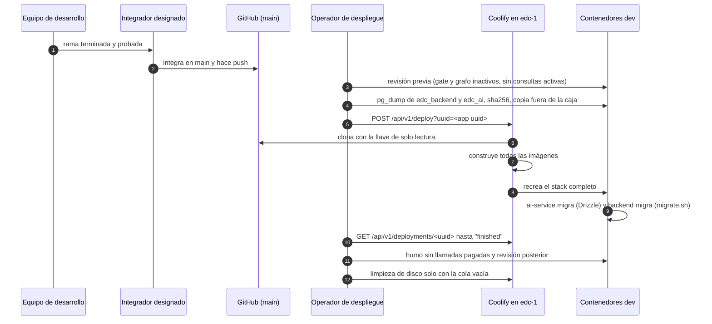

# Despliegue y runbook

- **Versión:** 1.3
- **Fecha:** 2026-11-11
- **Estado:** vigente
- **Fuentes:** `infra/fleet/edc-1.md` (§3, §4, §4b a §4zzzzzzzz, §6, §7, §8, §9), `infra/fleet/runbook.md` (§3, §4, §5, §6, §7, §8), `infra/fleet/env-manifests.md`, `infra/docker-compose.yml`, `apps/backend/scripts/migrate.sh`, `apps/backend/Dockerfile`, `services/ai-service/Dockerfile`, `services/ai-service/.github/workflows/ci.yml`, `TESTING.md`, `package.json` (raíz), `.git/hooks/reference-transaction`, `apps/backend/scripts/hold-for-consent.ts`, `apps/backend/scripts/reextract-published-graph.ts`, `apps/backend/src/lib/consentHold.ts`. Código de `main` en `687ff21e` (2026-11-11).

## Para quién es y qué responde

Este documento es para quien despliega u opera Ecosistemas de Conocimiento (EDC) en el servidor `edc-1`. Responde: cómo se lleva un cambio desde una rama hasta dev, qué se revisa antes y después, cómo se cambia una variable sin reconstruir, qué integración continua existe, cómo se actualiza el stack de IA, y qué hacer en cada procedimiento operativo frecuente, desde un redespliegue hasta reiniciar el DGX Spark. Cierra con las trampas conocidas de Coolify y Payload y con los riesgos operativos. La topología y las variables están en [Infraestructura y entornos](infraestructura-y-entornos.md); los respaldos, en [Respaldos y recuperación](respaldos-y-recuperacion.md).

Los comandos son genéricos. `<app uuid>` es el identificador de la aplicación de Coolify (uno para `edc-dev`, otro para `edc-staging`, ambos en `edc-1.md` §2). Ningún comando contiene secretos: donde hace falta uno se escribe su nombre entre ángulos, y el valor se lee del archivo local de secretos o de Coolify.

## 1. Pipeline de despliegue

### 1.1 Vista general



### 1.2 Paso a paso

**1. Integrar en `main`.** Política de integración: solo el integrador designado escribe en `main`. Nadie más escribe directo en la rama `main` local. Un hook de git (`.git/hooks/reference-transaction`) bloquea cualquier otra actualización de `main`. A diferencia de un hook `pre-commit`, este no se salta con `--no-verify` (leído en el hook). El trabajo se hace en una rama aparte y el integrador designado la integra. Después se hace `git push origin main`.

Desde el 2026-11-10 hay dos líneas: `main` solo recibe correcciones, y la funcionalidad nueva va a la rama `etapa-2` (decisión del 2026-11-10). Dev despliega `main`.

**Estado de dev al 2026-11-11.** Dev corre `c4f53632`, desplegado el 2026-11-10 a las 23:03 UTC, con la migración `20261110_181621_consent_held_reviews_keep` aplicada (citado del reporte de ese despliegue; no verificado en este documento, y su entrada aún no está en `edc-1.md`). El despliegue anterior registrado es `367c2698`, del 2026-11-10 a las 18:27 UTC (citado, `edc-1.md` §4zzzzzzzz). `main` está en `687ff21e`, 26 commits después de `c4f53632` y sin migraciones nuevas (medido con `git log --no-merges c4f53632..687ff21e` y `git diff --name-only`). En estos documentos, lo que está en `main` y no en `c4f53632` se marca **Implementado (pendiente de desplegar en dev)**.

**2. Revisión previa.** Es práctica registrada desde `edc-1.md` §4zzz (2026-10-29):

- Ningún documento con `graph_status` en extracción ni con `anonymisation_status` pendiente. La cola de extracción del grafo vive en memoria del backend: un redespliegue la tira (citado, `edc-1.md` §4zn).
- Ninguna consulta activa en `edc_backend` ni en `edc_ai`.
- Avisar a las demás personas que usan dev.

**3. Respaldo.** Antes de todo despliegue con migración. El procedimiento completo está en [Respaldos y recuperación](respaldos-y-recuperacion.md) §2. En corto: `umask 077`, `pg_dump -Fc` de cada base dentro del contenedor de postgres, `sha256sum` hacia `SHA256SUMS`, `pg_restore -l` para comprobar que el archivo se lee, copia fuera de la caja con `scp` (también con `umask 077`) y poda a los 7 volcados más recientes por entorno, en los dos lados. No siempre se ha hecho: un despliegue del 2026-10-29 registra "No backup taken by this run" (citado, `edc-1.md` §4zzz).

**4. Desplegar.** Por la API o por el panel:

```sh
curl -s -X POST -H "Authorization: Bearer <EDC_COOLIFY_API_TOKEN>" \
  "https://coolify.ecosistemasdeconocimiento.com/api/v1/deploy?uuid=<app uuid>"
```

Coolify clona el repositorio con la llave de despliegue, construye las imágenes en `edc-1` y **recrea todo el stack**: no puede desplegar un solo servicio (citado, `edc-1.md` §4c).

**5. Migraciones dentro del arranque del contenedor.** No se usa el "release command" de Coolify: `runbook.md` §3 documenta que ese campo puede no ejecutarse y reportarlo como éxito.

- ai-service: el `CMD` corre `npm run db:migrate:prod` y luego arranca el servidor (`services/ai-service/Dockerfile:149`). Su "schema gate" adopta una base vacía o existente y la marca con las migraciones aplicadas.
- backend: el `CMD` corre `sh scripts/migrate.sh` y luego `next start` (`apps/backend/Dockerfile:127`). `migrate.sh` reintenta hasta 3 veces y exige ver la línea `Done.`, porque `payload migrate` llegó a salir con código 0 sin migrar nada (medido en `edc-1` el 2026-10-26: 2 de 12 corridas en paralelo salieron en silencio; citado de `apps/backend/scripts/migrate.sh:4-12`).
- Consecuencia: si una migración falla, el contenedor no arranca y se queda caído en cada reinicio. Ver §6.13.

**6. Vigilar.**

```sh
curl -s -H "Authorization: Bearer <EDC_COOLIFY_API_TOKEN>" \
  "https://coolify.ecosistemasdeconocimiento.com/api/v1/deployments/<deployment uuid>"
```

Se repite hasta que `status` diga `finished`. Duraciones registradas: un build en frío del stack completo tardó unos 5 minutos (medido el 2026-10-17); los despliegues de ese día, unos 11 minutos (medido el 2026-10-17); los recientes, de 4 a 6 minutos (medido el 2026-10-29, `edc-1.md` §4zzz: 05:37 a 05:43 UTC; §4zzzz: 06:45 a 06:50 UTC) y unos 6 minutos el 2026-11-10 (§4zzzzzzz: 05:41 a 05:47 UTC; §4zzzzzzzz: 18:27 a 18:33 UTC).

**7. Humo, sin llamadas pagadas.** Desde fuera del servidor:

- `GET /` en web responde 303 hacia `/sign-in`.
- `GET /api/health` responde 200 en `dev.` y en `api.dev.`.
- Inicio de sesión con un usuario demo: `POST /api/auth/login` en web, con cabecera `Origin` (SvelteKit rechaza envíos de formulario entre sitios sin ella).
- Páginas clave por su `__data.json` (por ejemplo `/documentos/__data.json`), que responden 200.

El humo completo, que sí gasta en modelos, está en `edc-1.md` §7: sesión, subida de un PDF pequeño, espera a `ingestStatus=ready`, una pregunta que solo ese PDF responde, respuesta con una entrada en `provenance.chunks[]` y borrado de la sesión.

**8. Revisión posterior.**

- La etiqueta de imagen de `web`, `backend` y `ai-service` es el commit desplegado.
- Cero líneas de error en los logs de todos los contenedores.
- `payload_migrations` tiene las filas nuevas. No basta con confiar en el arranque (lección de `edc-1.md` §4zn: una migración quedó pendiente y se aplicó a mano).
- Si cambió el compose, ninguna variable de Coolify contiene texto de error de `${VAR:?…}` (ver §7, trampa 1).

**9. Limpieza de disco.** Cada despliegue suma de 7 a 16 GB de caché de build por entorno (medido el 2026-10-17, `edc-1.md` §8). Reglas, aprendidas en el incidente del 2026-10-21 (§6.12):

- Limpiar **solo** si `GET /api/v1/deployments` está vacío y no hay ningún `docker compose … build` corriendo.
- Borrar imágenes viejas **por nombre**, solo de commits conocidos y anteriores, nunca con un patrón tipo "todo lo que no sea la etiqueta actual".
- Después, `docker builder prune -af`.
- Con dos entornos, limpiar la caché **entre** el despliegue de uno y el del otro, no solo al final (lección del 2026-10-17, `edc-1.md` §4c).

### 1.3 Primera vez: el paso del presupuesto

Una base `edc_ai` nueva no tiene filas de presupuesto, y **todo chat responde 402** hasta que cada ecosistema tenga la suya (citado, `edc-1.md` §6). El gasto de cada ecosistema se carga a la organización de ai-service `edc-eco-<id del ecosistema>`. Los ecosistemas que se crean después reciben su fila del backend al crearse (`apps/backend/src/lib/provisionEcosystem.ts`, monto `AI_ECOSYSTEM_BUDGET_USD`, 5 USD por defecto). Pero después de crear o vaciar `edc_ai`, hay que correr dentro del contenedor de ai-service, una vez por ecosistema:

```sh
C=$(docker ps --format '{{.Names}}' | grep '^ai-service-<app uuid>')
docker exec "$C" curl -s -X PUT \
  -H "Authorization: Bearer <AI_SERVICE_ADMIN_API_KEY del entorno>" \
  -H 'X-AI-Org: eco-<id>' \
  -H 'Content-Type: application/json' \
  http://127.0.0.1:3000/v1/budget/edc-eco-<id> -d '{"limitUsd":5}'
```

Sin la cabecera `X-AI-Org` responde 403 (medido el 2026-10-21, `edc-1.md` §4p). El saldo se lee con `GET` sobre la misma ruta.

### 1.4 Cambiar una variable sin reconstruir

Coolify genera en cada despliegue el archivo `/data/coolify/applications/<app uuid>/.env`. Para aplicar un cambio sin esperar un build completo (citado, `edc-1.md` §4d y §4f):

1. Cambiar la variable en Coolify (panel o API, marcada como literal). Coolify crea él mismo las copias "preview".
2. Respaldar el `.env` generado y editar la misma línea en él.
3. Recrear solo el servicio afectado:

```sh
cd /data/coolify/applications/<app uuid>
docker compose -p <app uuid> -f docker-compose.yaml up -d --no-deps --no-build <servicio>
```

4. Verificar con `docker exec <contenedor> printenv <VARIABLE>` (o por hash, si es secreta).

Advertencias:

- `docker restart` **no** aplica variables nuevas (citado, `runbook.md` §3). Hay que recrear.
- Todas las variables llegan a `backend`, `web` y `ai-service`. Si se recrea solo uno, los otros conservan el valor viejo en su entorno hasta el siguiente despliegue (citado, `edc-1.md` §4f).
- El siguiente despliegue de Coolify regenera el `.env` desde su base de datos, así que el paso 1 es obligatorio.

## 2. Integración continua

| Elemento | Estado | Procedencia |
|---|---|---|
| GitHub Actions en la raíz | **No existe.** No hay carpeta `.github/` en la raíz del repositorio | leído el 2026-10-30 (`ls .github`: no existe) |
| Workflows de ai-service | `services/ai-service/.github/workflows/ci.yml` y `test.yml` son los workflows de CI de ai-service, inactivos en esa ruta: GitHub solo lee workflows en la raíz. Para activarlos hay que copiarlos a la raíz. Correrían lint, typecheck, pruebas, build e imagen Docker de ai-service, más un carril de integración | leído en `ci.yml:1-6` |
| CI efectivo | **Local y manual.** Desde la raíz: `pnpm test` (unitarias, en paralelo), `pnpm typecheck` y `pnpm build`. Las pruebas de extremo a extremo son aparte y necesitan el stack levantado | leído en `package.json` raíz y `TESTING.md:31-34` |
| Lint | `apps/backend`, `apps/web` y `services/ai-service` tienen script `lint` (`eslint .`); en los tres, la regla `edc/no-raw-error-log` está en `error`, y ai-service no excluye ningún archivo. `apps/web` usa además `check` (svelte-check). Quien toca el código de ai-service debe correr también eslint, porque el CI de ai-service se puso en rojo el 2026-10-17 por omitirlo | leído en los `package.json`; el incidente del 2026-10-17 no está verificado en esta versión |
| Trampa de copias nuevas | Una copia de trabajo nueva del repositorio debe construir `@edc/ai-client`, `@edc/identity-client` y `@edc/chat-engine` antes de probar, porque su `dist/` está en `.gitignore` y las apps importan `dist`. Un build viejo produce fallas de prueba falsas | citado, `TESTING.md:20-29` |

Los conteos de pruebas medidos están en [Estrategia de pruebas](../07-calidad/estrategia-de-pruebas.md).

Mientras no haya CI, nada impide que llegue a `main` un commit que no compila. La única barrera es la disciplina del equipo de desarrollo y del integrador designado (inferido de lo anterior).

## 3. Despliegue a staging

Staging ("montaje") tiene el auto-deploy apagado. Se despliega a mano el commit que se decida, con el mismo procedimiento de §1.2. Reglas propias (citado, `edc-1.md` §3 y §4):

- `EDC_ENV` debe ser exactamente `stage`. Con otro nombre el seed se niega en silencio.
- Staging no tiene seed: su organización `Montaje` y su usuario de humo se crearon a mano el 2026-10-17. El registro público está cerrado, así que un reemplazo lo crea el admin de plataforma en `/admin`.
- Desplegar dev y staging **uno después del otro**, nunca a la vez, y limpiar caché entre ambos.
- Staging sigue en una versión anterior desde el 2026-10-17 y por ahora está fuera de alcance (decisión del 2026-11-10). El próximo despliegue lo llevará a través de todas las migraciones acumuladas de golpe; conviene respaldar antes y revisar `payload_migrations` después (inferido de la distancia entre versiones).

## 4. Cambiar el stack de IA

El stack de IA (`services/ai-service`, `packages/ai-client`, `packages/chat-engine`, `packages/identity-client`) es parte del monorepo: un servicio y paquetes internos, agnósticos del dominio ([ADR-0017](../03-arquitectura/adr/ADR-0017-plataforma-de-ia-agnostica-del-dominio.md)). `services/audio-service` es un servicio aparte, en Python.

Al cambiar el stack de IA:

1. Correr eslint en `services/ai-service`, además de typecheck y pruebas. El CI de ai-service se puso en rojo el 2026-10-17 por omitirlo (citado del registro del proyecto; no verificado en esta versión).
2. Reconstruir `packages/*` antes de probar las apps, porque las apps importan `dist` (ver §2).
3. No cambiar la configuración `spanish` de Postgres en la búsqueda por palabras clave.
4. Desplegar con el procedimiento de §1.2.

Mejoras pendientes del stack de IA: una cerca contra inyección de instrucciones en el prompt, `HEALTHCHECK` en la imagen, reintentos, clientes compatibles con PgBouncer con `DATABASE_URL_DIRECT`, gasto de embeddings cargado al presupuesto, y `ai-client` 0.32 con verificación estricta de capacidades, que es un **cambio incompatible**.

## 5. Runbook: tabla de procedimientos

| # | Procedimiento | Cuándo | Fuente |
|---|---|---|---|
| 6.1 | Redesplegar | cada cambio en `main` | `edc-1.md` §7 |
| 6.2 | Cambiar una variable | ajuste de configuración o rotación | `edc-1.md` §4d |
| 6.3 | Respaldar las bases | antes de cada despliegue con migración | `edc-1.md` §4b, §4zzzz |
| 6.4 | Restaurar una base | migración fallida o datos dañados | `edc-1.md` §4b |
| 6.5 | Vaciar y resembrar un entorno | reiniciar los datos de dev | `edc-1.md` §4p |
| 6.6 | Sembrar el corpus en Coolify | después de vaciar | `edc-1.md` §4p |
| 6.7 | Asignar presupuesto por ecosistema | `edc_ai` nueva o vaciada | `edc-1.md` §6 |
| 6.8 | Mover datos a una organización de ai-service por ecosistema | migración de datos viejos | `edc-1.md` §4c |
| 6.9 | Separar ecosistemas | dividir un ecosistema en varios | `edc-1.md` §4x |
| 6.10 | Limpiar o reconstruir el grafo | ruido o cambio de reglas del grafo | `edc-1.md` §4w, §4x, §4p |
| 6.11 | Volver a pasar documentos por el gate o repararlos | cambio en el gate o filas inconsistentes | `apps/backend/scripts/` |
| 6.12 | Liberar disco | disco por debajo de lo necesario para un build | `edc-1.md` §4x, §8 |
| 6.13 | Atender una migración fallida | contenedor que no arranca tras desplegar | `runbook.md` §3 |
| 6.14 | Revertir (rollback) | despliegue defectuoso | `runbook.md` §4 |
| 6.15 | Rotar llaves | exposición o rotación periódica | `edc-1.md` §4f; `runbook.md` §8.3 |
| 6.16 | Ver logs | diagnóstico | práctica en `edc-1.md` §4za |
| 6.17 | Reiniciar el Spark | Spark reiniciado o servicios caídos | procedimiento de operación, no verificado en esta versión |
| 6.18 | Revertir del Spark a servicios hospedados | Spark no disponible por tiempo largo | `edc-1.md` §4za |
| 6.19 | Activar o quitar la redirección del apex | cambio de dominio principal | `edc-1.md` §9 |
| 6.20 | Retener documentos por consentimiento | material cuyos autores no han dado su consentimiento | `apps/backend/scripts/hold-for-consent.ts` |
| 6.21 | Re-extraer el grafo de los publicados | cambio de las reglas del grafo | `apps/backend/scripts/reextract-published-graph.ts` |

## 6. Procedimientos detallados

### 6.1 Redesplegar

1. Confirmar que el commit está en `origin/main` (dev) o elegir el commit (staging).
2. Revisión previa y respaldo (§1.2, pasos 2 y 3).
3. `POST /api/v1/deploy?uuid=<app uuid>`.
4. Vigilar hasta `finished`.
5. Humo y revisión posterior (§1.2, pasos 7 y 8).
6. Limpieza de disco con las reglas de §1.2, paso 9.

### 6.2 Cambiar una variable

Con rebuild: cambiar en Coolify y redesplegar. Sin rebuild: §1.4. Si el compose cambió en el mismo despliegue, listar las variables y buscar valores que parezcan mensajes de error:

```sh
curl -s -H "Authorization: Bearer <EDC_COOLIFY_API_TOKEN>" \
  "https://coolify.ecosistemasdeconocimiento.com/api/v1/applications/<app uuid>/envs"
```

### 6.3 Respaldar

Ver [Respaldos y recuperación](respaldos-y-recuperacion.md) §2. Forma mínima, en el servidor:

```sh
umask 077  # volcados 600, carpetas 700: contienen texto crudo
STAMP=$(date -u +%Y%m%dT%H%MZ); mkdir -p /root/backups/$STAMP
C=$(docker ps --format '{{.Names}}' | grep '^postgres-<app uuid>')
for DB in edc_backend edc_ai; do
  docker exec "$C" pg_dump -U edc -Fc "$DB" > /root/backups/$STAMP/$DB.dump
  docker exec -i "$C" pg_restore -l < /root/backups/$STAMP/$DB.dump > /dev/null
done
cd /root/backups/$STAMP && sha256sum *.dump > SHA256SUMS
```

Luego, copia fuera del servidor, en equipo del equipo de desarrollo: `umask 077` también en ese equipo, `scp` de la carpeta y `sha256sum -c SHA256SUMS`.

Al final, la retención: se quedan los 7 volcados más recientes de cada entorno, en el servidor y en la copia, y se borran los anteriores. Un sello con los dos entornos cuenta en cada uno. Decisión del 2026-11-10; primera purga el mismo día (citado, `edc-1.md` §7 paso 7; ver [Respaldos y recuperación](respaldos-y-recuperacion.md) §2.2).

### 6.4 Restaurar una base

1. Detener los servicios que escriben en esa base: para `edc_ai`, ai-service (y conviene también backend y web); para `edc_backend`, backend y web.
2. Restaurar:

```sh
docker exec -i "$C" pg_restore -U edc -d <base> --clean --if-exists < <archivo>.dump
```

3. Redesplegar el commit que corresponde a ese esquema (normalmente el anterior).
4. Revisar `payload_migrations` y `__drizzle_migrations` contra lo que espera la imagen.

La imagen diaria de Hetzner también sirve, pero restaura **los dos entornos a la vez** (citado, `edc-1.md` §4b).

### 6.5 Vaciar y resembrar un entorno

Solo en dev, donde los datos son desechables por decisión del responsable (citado, `edc-1.md` §4p):

1. Respaldar ambas bases (§6.3).
2. `docker stop` de web, backend y ai-service del entorno.
3. En el postgres del entorno, para `edc_backend` y `edc_ai`:

```sql
DROP DATABASE "<base>" WITH (FORCE);
CREATE DATABASE "<base>" OWNER "edc";
```

4. `docker start` de ai-service **primero**: su schema gate adopta la base vacía y aplica sus migraciones, que crean las extensiones `vector` y `pg_trgm`. Después backend (`payload migrate`), y al final web.
5. Asignar presupuesto (§6.7) y sembrar (§6.6).

El vaciado no borra los archivos en RustFS: quedan huérfanos (citado, `edc-1.md` §4p). Un vaciado también reinicia `usage_logs`, así que el gasto registrado antes se pierde de esa tabla.

### 6.6 Sembrar el corpus en Coolify

El corpus sintético vive en un repositorio hermano que no está en el checkout de Coolify. Se copia al contenedor y se siembra con el binario de Payload, **nunca con `pnpm`** dentro de la imagen: en el primer intento `pnpm seed:demo` corrió su instalación previa, falló y vació `node_modules` del backend (citado, `edc-1.md` §4p).

```sh
docker cp corpus.tgz <backend>:/tmp/
docker exec <backend> sh -c 'cd /tmp && tar -xzf corpus.tgz'
docker exec -d -w /repo/apps/backend <backend> sh -c \
  'CORPUS_DIR=/tmp/corpus-generativo SEED_CORPUS_INGEST=1 node_modules/.bin/payload run src/seed/demo.cli.ts > /tmp/seed.log 2>&1'
```

`docker exec -d` es necesario: un proceso lanzado con `nohup … &` por SSH murió al cerrar la sesión. Esperar a que el proceso termine y a que no quede ningún documento con `anonymisation_status` pendiente. Los documentos retenidos conservan `ingest_status = pending` para siempre, así que "nada pendiente" no llega nunca por ese campo. La siembra de 252 documentos tardó unos 72 minutos con el detector a ritmo controlado (medido el 2026-10-21, `edc-1.md` §4p).

Si el backend queda dañado, se recrea desde su imagen:

```sh
docker compose -p <app uuid> -f /data/coolify/applications/<app uuid>/docker-compose.yaml \
  up -d --no-deps --force-recreate backend
```

### 6.7 Presupuesto por ecosistema

Ver §1.3.

### 6.8 Mover datos a una organización de ai-service por ecosistema

Se usó una vez, el 2026-10-17, para pasar del esquema de una sola organización al de una por ecosistema (citado, `edc-1.md` §4c):

1. Desplegar la aplicación completa.
2. `docker stop` de backend y web para que nada escriba en `edc_ai`.
3. Respaldar `edc_ai` y comprobar con `pg_restore -l`.
4. Correr el script en seco y luego en firme:

```sh
docker exec -i "$C" psql -U edc -d edc_ai -v ON_ERROR_STOP=1 -v from_org=demo \
  < scripts/ai-org-per-ecosystem.sql
docker exec -i "$C" psql -U edc -d edc_ai -v ON_ERROR_STOP=1 -v from_org=demo -v apply=1 \
  < scripts/ai-org-per-ecosystem.sql
```

5. `docker start` de backend y web. Verificar que `corpora.org` dice `edc-eco-*`, que hay una fila de `budget_state` por ecosistema y que un chat nuevo registra su gasto en `edc-eco-<id>`.

### 6.9 Separar ecosistemas

`scripts/demo-ecosistemas.sh` y `scripts/demo-ecosistemas-4.sh` dividen un ecosistema en varios y mueven documentos, grafo y corpus de ai-service (citado, `edc-1.md` §4p y §4x). Se leen antes de correrlos, se corren en el servidor con `PG_CONTAINER=<contenedor de postgres>`, primero en seco y luego con `--apply`. La corrida en seco consume ids de la secuencia, así que los ids finales no coinciden con los que muestra (medido el 2026-10-21). Después se asigna presupuesto a cada ecosistema nuevo (§1.3).

### 6.10 Limpiar o reconstruir el grafo

- Ruido del grafo: `apps/backend/scripts/purge-graph-noise.ts`. Filas con texto sin limpiar: `apps/backend/scripts/purge-unscrubbed-graph-rows.ts`.
- Reconstrucción o relleno: `payload run src/lib/graph/backfill.cli.ts` y `src/lib/graph/policy.cli.ts`, con los argumentos `GRAPH_BACKFILL_*` y `GRAPH_POLICY_*` solo en la línea de comando, nunca en Coolify (citado, `env-manifests.md` §2f).
- El relleno corre dentro del contenedor del backend: un redespliegue lo mata. A ritmo de una extracción por minuto, un relleno de 200 documentos tarda de 3 a 4 horas (inferido en `edc-1.md` §4p a partir de 14 extracciones en 16 minutos).
- El relleno solo extrae documentos publicados y nunca los retenidos por consentimiento (`feae7e18`, `ccce6281`; Implementado). Un trabajo del grafo se detiene si la fila quedó retenida mientras corría (`17a5d985`, `c12a0ab5`; Implementado, pendiente de desplegar en dev).
- Entidades huérfanas: una tarea diaria del backend borra las entidades que ya no menciona ningún documento (`apps/backend/src/lib/graph/orphanJanitor.ts`, `GRAPH_ORPHAN_JANITOR_*`; Implementado). Ya no hace falta correr el relleno a mano para eso.
- Re-extracción completa: ver §6.21.

### 6.11 Volver a pasar documentos por el gate o repararlos

Scripts en `apps/backend/scripts/` (leído el 2026-10-30), todos de un solo uso y para correr con `node_modules/.bin/payload run` dentro del contenedor del backend:

| Script | Uso (leído en el encabezado de cada archivo) |
|---|---|
| `regate-documents-by-id.ts` | Retira de los corpus una lista de documentos por id, reinicia sus columnas del gate y los vuelve a pasar por el gate y la ingesta |
| `regate-member-documentos.ts` | Retira los `documento` publicados por participantes que nunca pasaron el gate, los marca `anonymise = true` y los vuelve a pasar |
| `regate-place-holds.ts` | Repasa las retenciones cuyos hallazgos eran solo lugares. En seco por defecto |
| `repair-held-published.ts` | Retira del corpus los documentos retenidos que quedaron publicados y los devuelve a borrador retenido, visibles en Revisión |
| `repair-pending-published.ts` | Pone `ingestStatus: 'ready'` en documentos publicados atorados en `pending`, solo si ai-service confirma que están en el corpus. En seco por defecto |
| `reset-infra-holds.ts` | Devuelve a estado reintentable las retenciones causadas solo porque el detector no respondió. Nunca toca retenciones por contenido. En seco por defecto |
| `auto-publish-participant-drafts.ts`, `backfill-testimonio-titles.ts`, `backfill-lengua.ts`, `reextract-wikilink-notes.ts` | Rellenos de datos tras cambios de reglas |
| `refresh-ai-titles.ts` | Reescribe en ai-service el título de documentos con compuerta y testimonios publicados, sin volver a calcular vectores. En seco por defecto (`--apply` o `TITLES_APPLY=1`). Implementado |
| `backfill-provenance-titles.ts` | Reescribe el título de las citas guardadas en `messages.provenance` de documentos con compuerta. En seco por defecto (`PROVENANCE_APPLY=1`). Implementado |
| `check-turn-corpus.ts` | Revisa turnos de chat en ai-service sin fila en `messages`. Solo lectura por defecto |

Los scripts de re-gate (`regate-documents-by-id.ts`, `regate-member-documentos.ts`) rechazan o saltan las filas retenidas por consentimiento (`28d84f03`; Implementado). Los rellenos de títulos y de lengua, `regate-place-holds.ts` y la semilla del corpus también las saltan (`17a5d985`; Implementado, pendiente de desplegar en dev).

El uso exacto de cada uno está en el encabezado del archivo y en las secciones de `edc-1.md` desde §4q. Desde el 2026-10-29 el gate rechaza reintentar sobre el mismo texto retenido (hash `heldTextHash`), así que un repaso solo cambia el resultado si cambió el texto o la regla.

### 6.12 Liberar disco

1. `df -h /` y `docker system df` para ver cuánto ocupa la caché de build y cuánto las imágenes.
2. Confirmar que `GET /api/v1/deployments` está vacío y que no hay builds en curso.
3. `docker rmi` de las imágenes de commits anteriores, por nombre.
4. `docker builder prune -af`.

Incidente que fundó la regla 2 (citado, `edc-1.md` §4x, 2026-10-21 de 23:10 a 23:25 UTC): una limpieza borró todas las imágenes de dev que no tuvieran la etiqueta recién desplegada mientras otro despliegue estaba construyendo. Borró las imágenes recién construidas de ese despliegue, que falló al no encontrarlas; dev quedó caído unos 8 minutos hasta redesplegar. Antes, el 2026-10-17, el disco se llenó durante el build de staging y la base de Coolify se reinició 8 veces (citado, `edc-1.md` §4c).

### 6.13 Atender una migración fallida

Tomado de `runbook.md` §3, vigente:

1. **No redesplegar.** La misma migración fallará igual y puede dejar más estado parcial.
2. Leer primero los logs del contenedor. Distinguir si falló **antes** de aplicar nada (seguro: corregir y reintentar) o **a la mitad** (la base quedó en un estado que no espera ni la imagen vieja ni la nueva).
3. Si falló antes: revertir la imagen (§6.14) y corregir en una rama.
4. Si falló a la mitad: restaurar el respaldo previo (§6.4) y redesplegar la versión anterior.
5. Reproducir en staging antes de reintentar en dev, una vez que staging esté al día.

Caso distinto, registrado en `edc-1.md` §4zn: la migración no corrió y el backend arrancó igual. Se detecta leyendo `payload_migrations` y se aplica a mano: `cd /repo/apps/backend && node_modules/.bin/payload migrate` dentro del contenedor. `migrate.sh` existe desde entonces para impedirlo.

### 6.14 Revertir (rollback)

- El botón "Rollback" de Coolify **no es fiable** (citado, `runbook.md` §4: puede reportar éxito sin revertir nada). Además, Coolify conserva pocas imágenes por aplicación y las imágenes viejas se borran en cada limpieza de disco.
- Procedimiento práctico: revertir en git y desplegar de nuevo, o desplegar un commit anterior por la API. Cuesta un build completo (de 4 a 6 minutos en los despliegues recientes, medido el 2026-10-29).
- Un rollback de código no revierte el esquema. Si la versión nueva aplicó una migración que la vieja no tolera, hace falta restaurar el respaldo (§6.4). Por eso conviene escribir migraciones compatibles hacia atrás por una versión: agregar columnas, no renombrarlas (citado, `runbook.md` §4).

### 6.15 Rotar llaves

- **Llave de un proveedor** (por ejemplo `RERANK_API_KEY` u `OPENROUTER_API_KEY`): emitir la nueva en el proveedor, cambiarla en Coolify (copias normal y preview) y en el archivo local de secretos, aplicar con §1.4 o redesplegando, verificar por hash dentro del contenedor, y revocar la vieja. Así se cambió el rerank a una llave propia de EDC el 2026-10-17 (citado, `edc-1.md` §4f).
- **Llaves de RustFS** (`S3_ACCESS_KEY_ID`, `S3_SECRET_ACCESS_KEY`): la llave raíz se puede rotar por variable de entorno sobre el mismo volumen; al reiniciar, la nueva funciona y la vieja deja de hacerlo (medido localmente, citado de `runbook.md` §8.3). El backend vuelve a aprovisionar bucket y usuario en cada arranque (`pnpm --filter @edc/backend provision:storage` lo hace a mano en local).
- **Secretos internos** (`CALLBACK_SECRET`, `AI_SERVICE_API_KEY`, `SERVICE_TOKENS`, `PAYLOAD_SECRET`): generar con `openssl rand -hex 32`, por entorno, y redesplegar el stack completo para que todos los servicios queden de acuerdo. Cambiar `PAYLOAD_SECRET` cierra todas las sesiones (inferido del uso de ese secreto en Payload).
- **Llaves de firma** (`AUTH_PRIVATE_KEY`, `AUTH_PUBLIC_KEY`, `AUTH_KEY_ID`): generar con `pnpm --filter @edc/backend keygen`, subir el `AUTH_KEY_ID` y redesplegar. Los tokens entre servicios duran 15 minutos como máximo; la cookie de sesión web, 7 días (citado, inventario de privacidad). No está documentado un procedimiento de rotación sin cortar sesiones (no verificado).
- **Llave de despliegue de GitHub**: si se pierde la caja, se revoca en GitHub (citado, `edc-1.md` §2).

### 6.16 Ver logs

```sh
docker ps --format '{{.Names}}' | grep '<app uuid>'      # nombres <servicio>-<app uuid>
docker logs --since 30m <servicio>-<app uuid>
docker logs --since 30m <servicio>-<app uuid> 2>&1 | grep -iE 'error|fatal'
```

Cada contenedor guarda como máximo 3 archivos de 10 MB (`infra/docker-compose.yml:224-230`): un problema de hace días puede ya no estar. El log del proxy del Spark está en el Spark, con horas en CST (UTC−6) (citado, `edc-1.md` §4za).

### 6.17 Reiniciar el Spark

Los servicios del Spark corren en `tmux` y no arrancan solos (procedimiento de operación; no verificado en esta versión):

1. Entrar por SSH al Spark por Tailscale.
2. Correr `start.sh` en la carpeta `edc-whisper/` (proxy y transcripción) y `start.sh` en `edc-llm/` (modelos de lenguaje, embeddings y rerank), ambas en la cuenta de operación del Spark.
3. Desde `edc-1`, probar el proxy con el token: una petición a `/v1/embeddings` debe responder 200 (en la prueba del 2026-10-22 respondió en 0.58 s, medido, `edc-1.md` §4za).
4. Revisar documentos retenidos por "detector unreachable" y repasarlos (§6.11, `reset-infra-holds.ts`).

### 6.18 Revertir del Spark a servicios hospedados

Para embeddings (citado, `edc-1.md` §4za y §4zzzzzz): el respaldo de dev ya es DeepInfra (`EMBEDDINGS_FALLBACK_URL` y `EMBEDDINGS_FALLBACK_API_KEY`, desde el 2026-11-06). Para una caída larga, apuntar `EMBEDDINGS_URL` a DeepInfra con su llave y recrear ai-service (§1.4). No borrar las variables `EMBEDDINGS_*` sin más: ai-service volvería a OpenRouter, y la decisión del 2026-11-06 es no mandar embeddings ahí. Para el detector: si el respaldo efectivo es `hosted`, ya cae solo a hospedado, por OpenRouter con ZDR; con `none` los documentos se retienen hasta que vuelva el Spark. El ajuste de plataforma `detectorFallback` tiene prioridad sobre `ANONYMISE_DETECT_FALLBACK` (`apps/backend/src/lib/platformSettings.ts:58-62`). Transcripción: no hay respaldo hospedado; el audio espera o se pierde (ver [Respaldos y recuperación](respaldos-y-recuperacion.md) §6.3).

### 6.19 Redirección del apex

Crear o borrar `/data/coolify/proxy/dynamic/edc-apex-redirect.yaml` en el servidor. Traefik vigila ese directorio y aplica el cambio en segundos, sin reiniciar. Al borrarlo, el apex vuelve a la página 503 por defecto. No se debe poner esa regla en `coolify.yaml` ni en `default_redirect_503.yaml`, porque Coolify los regenera. Para cubrir `www`, primero hay que crear su registro DNS (citado, `edc-1.md` §9).

### 6.20 Retener documentos por consentimiento

Implementado: el código (`512dcc1f`, `7987c171`) y la migración `20261110_181621_consent_held_reviews_keep`, que crea `documents.consent_held`, están en dev desde el despliegue de `c4f53632` (citado del reporte de ese despliegue). Que la revisión de una fila retenida también quede retenida es de `b29c72ba` (Implementado, pendiente de desplegar en dev).

Un documento retenido por consentimiento (`consentHeld`) no se vuelve a extraer, ingerir, pasar por la compuerta, graficar ni publicar. No se borra nada: la fila y lo que ya exista quedan como están. Ninguna API escribe la columna; solo el script. No hay camino de liberación en el código: levantar una retención es decisión del responsable y un `UPDATE` a mano (`apps/backend/src/lib/consentHold.ts`).

Uso, dentro del contenedor del backend, con el binario de Payload:

```sh
# 1. en seco (por omisión): lista los ids y el conteo, no escribe
docker exec -w /repo/apps/backend -e CONSENT_ORG=8 -e CONSENT_IDS_FILE=/tmp/consent-ids.txt <backend> \
  node_modules/.bin/payload run scripts/hold-for-consent.ts
# 2. aplicar: lo mismo con CONSENT_APPLY=1
```

- `CONSENT_ORG` es obligatorio. El script rechaza ids de otro ecosistema y una selección sin filtro.
- `CONSENT_IDS_FILE`: archivo separado por tabuladores (`id<TAB>origen<TAB>nota`, comentarios con `#`). Las líneas marcadas `EXTRA-NO-TALLER` se omiten. Se lee tal cual; los ids no se copian a mano. Hay que copiarlo al contenedor antes (`docker cp`).
- En lugar del archivo: `CONSENT_IDS` (lista separada por comas) o filtros (`CONSENT_STATUS`, `CONSENT_UPLOADED_BY`, `CONSENT_HAS_FILE=1`, `CONSENT_ID_FROM` y `CONSENT_ID_TO`).
- No despublica. Las filas que siguen compartidas aparecen en la salida como `notDraft`; se despublican después. Una fila retenida solo se retira, sin volver a calcular vectores.
- Con la lista del taller de Semiosis del 2026-11-10 da 184 ids, sin 823, 824 ni 1425 (medido por la prueba de `7987c171`). Ver [Corpus y datos de prueba](../04-datos/corpus-y-datos-de-prueba.md) §4.4.

Orden en dev: respaldar como siempre, correr en seco, revisar el conteo, aplicar.

### 6.21 Re-extraer el grafo de los publicados

Preparado y **sin correr** en dev (`feae7e18`, `apps/backend/scripts/reextract-published-graph.ts`; Implementado).

- En seco por omisión: lista cada documento que enviaría, con su ecosistema, el largo del texto y un costo estimado. No llama a ningún modelo ni escribe. Aplica con `GRAPH_REEXTRACT_APPLY=1`. `GRAPH_REEXTRACT_ORG` y `GRAPH_REEXTRACT_LIMIT` acotan la corrida.
- Nunca toca un borrador, una fila retenida por consentimiento ni una fila con compuerta sin texto aprobado.
- Al aplicar, cada documento hace hasta 8 llamadas `generate.sync` a ai-service, cargadas al presupuesto de su ecosistema, que van a OpenRouter con ZDR.
- Se corre igual que §6.6: `docker exec -w /repo/apps/backend <backend> node_modules/.bin/payload run scripts/reextract-published-graph.ts`. Un redespliegue lo interrumpe.

## 7. Trampas conocidas de Coolify y Payload

| # | Trampa | Efecto | Qué hacer |
|---|---|---|---|
| 1 | Coolify guarda como **valor** el texto de error de un `${VAR:?mensaje}` del compose si la variable no existía al cargar el compose | La aplicación arranca con el mensaje de error como secreto | Tras cambiar el compose, listar variables y revisar (citado, `edc-1.md` §4) |
| 2 | Coolify no detecta las variables que viven dentro del JSON de `API_KEYS` | `AI_SERVICE_API_KEY` y `CALLBACK_SECRET` no aparecen solas | Crearlas a mano (citado, `edc-1.md` §4) |
| 3 | Coolify 4.4.6 quitaba el puerto del dominio al guardarlo por la API | Traefik enruta al puerto equivocado | Revisar que el dominio conserve `:3000` o `:3002` después de editarlo (citado, `edc-1.md` §3) |
| 4 | El botón de rollback no es fiable | Reporta éxito sin revertir | Redesplegar un commit anterior (§6.14) |
| 5 | Auto-deploy encendido sin webhook de GitHub | Parece automático y no lo es | Desplegar siempre a mano (citado, `edc-1.md` §3) |
| 6 | Coolify no despliega un solo servicio | Cada despliegue recrea todo, incluido el backend con su cola del grafo en memoria | Revisión previa (§1.2, paso 2) |
| 7 | El "release command" de Coolify puede no ejecutarse | Migraciones que nunca corren | Mantenerlas en el `CMD` (citado, `runbook.md` §3) |
| 8 | `docker restart` no aplica variables nuevas | El cambio parece no tener efecto | Recrear con `docker compose up -d --no-deps` (§1.4) |
| 9 | El APP_KEY de Coolify es lo único que descifra sus variables | Un respaldo de Coolify sin esa llave no sirve | Guardar copia fuera de la caja (pendiente; ver [Respaldos y recuperación](respaldos-y-recuperacion.md)) |
| 10 | `payload migrate` puede salir con código 0 sin migrar | El backend arranca contra un esquema viejo | `migrate.sh` exige `Done.`; además, revisar `payload_migrations` tras desplegar |
| 11 | Payload elige migraciones por coincidencia exacta del nombre y las ordena por nombre de archivo | Renombrar una migración ya aplicada la vuelve a correr | No renombrar migraciones desplegadas (citado, `runbook.md` §3; `edc-1.md` §4zq registra un nombre de migración renombrada antes de desplegarse) |
| 12 | `PAYLOAD_ALLOW_PUSH=1` hace que Payload sincronice el esquema por su cuenta | Borra en silencio índices únicos escritos a mano | No definirla en ningún entorno (citado, `env-manifests.md` §2c) |
| 13 | Correr `pnpm` dentro de la imagen del backend | Puede vaciar `node_modules` | Usar `node_modules/.bin/payload` directo (§6.6) |
| 14 | El directorio de trabajo del migrador de ai-service es relativo | Correrlo a mano desde otra carpeta no encuentra migraciones | `cd /repo/services/ai-service` antes (citado, `runbook.md` §3) |

## 8. Riesgos operativos

1. **Una sola caja.** Coolify, los builds, dev y staging comparten `edc-1`. Una falla del servidor tumba todo, y restaurar la imagen de Hetzner revierte ambos entornos a la vez.
2. **Disco.** Es la falla que más se ha repetido (2026-10-17 y 2026-10-21). No hay alerta de disco.
3. **Despliegue manual y dependiente de una persona.** El procedimiento vive en `edc-1.md` y en la práctica de quien opera el despliegue. No hay CI que impida integrar código roto.
4. **Respaldos manuales y no siempre tomados** (§1.2, paso 3). Sin simulacro de restauración. La retención de 7 por entorno también es manual.
5. **Spark prestado sin arranque automático ni supervisión.** Si se reinicia de noche, dev pierde audio y micrófono en vivo, y el detector cae a hospedado sin que nadie se entere.
6. **Staging desactualizado** desde el 2026-10-17: ya no sirve para reproducir problemas de dev ni para ensayar migraciones.
7. **Rollback lento**: el botón de Coolify no es fiable. Desde el 2026-11-10 se conservan las imágenes del despliegue anterior (`3f14306b`) para revertir (citado, `edc-1.md` §4zzzzzzzz), pero la limpieza de disco las borra; sin ellas, cada reversión cuesta un build.
8. **Cambio incompatible pendiente en el stack de IA**: `ai-client` 0.32 trae verificación estricta de capacidades (§4).
9. **Documentación desactualizada**: varios documentos de `infra/fleet/` describen una flota de cuatro cajas que no existe. El procedimiento del Spark está en `edc-1.md` §4y.

El registro completo con dueños y mitigaciones está en [Registro de riesgos](../01-proyecto/registro-de-riesgos.md).

## Referencias

- `infra/fleet/edc-1.md`: §3 aplicaciones, §4 variables y bitácora de despliegues, §6 presupuesto, §7 redespliegue y humo, §8 capacidad, §9 redirección del apex.
- `infra/fleet/runbook.md`: §3 migraciones, §4 rollback, §6 contrato de health, §7 trampas de Coolify, §8 RustFS (vigentes; el resto es diseño superado).
- `infra/fleet/env-manifests.md`.
- `apps/backend/scripts/migrate.sh`, `apps/backend/scripts/`, `scripts/ai-org-per-ecosystem.sql`, `scripts/demo-ecosistemas.sh`, `scripts/demo-ecosistemas-4.sh`.
- `TESTING.md`, `package.json` (raíz), `services/ai-service/.github/workflows/`.
- [Infraestructura y entornos](infraestructura-y-entornos.md)
- [Respaldos y recuperación](respaldos-y-recuperacion.md)
- [Estrategia de pruebas](../07-calidad/estrategia-de-pruebas.md)
- [Guía del desarrollador](../08-manuales/guia-del-desarrollador.md)
- [Pila de IA](../03-arquitectura/pila-de-ia.md)
- [Registro de riesgos](../01-proyecto/registro-de-riesgos.md)
