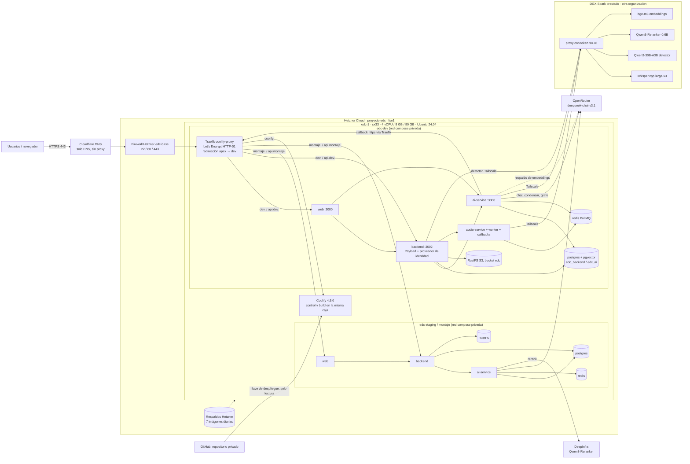
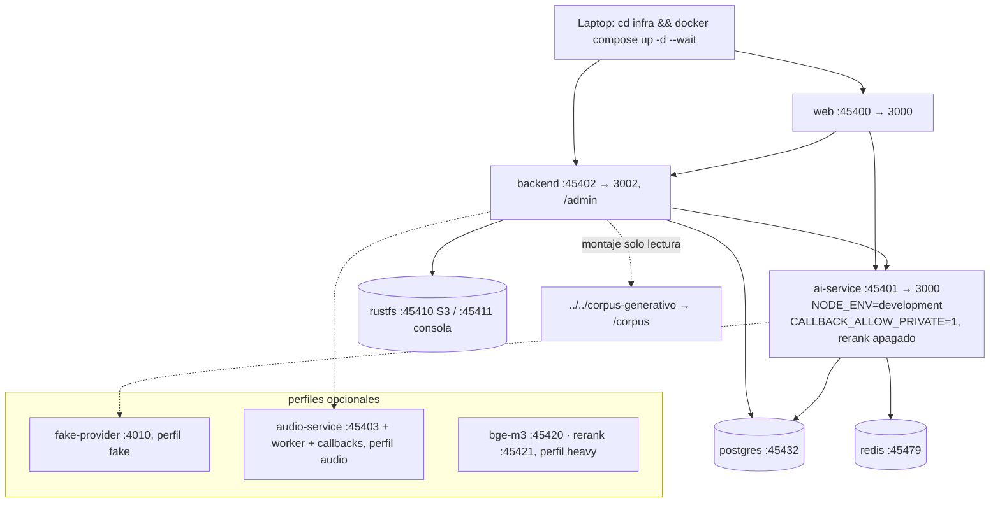

# Infraestructura y entornos

- **Versión:** 1.1
- **Fecha:** 2026-11-03
- **Estado:** vigente
- **Fuentes:** `infra/fleet/edc-1.md` (bitácora del servidor, hasta §4zzzz, 2026-10-29), `infra/fleet/env-manifests.md`, `infra/docker-compose.yml`, `infra/docker-compose.override.yml`, `infra/docker-compose.audio.yml`, `infra/fleet/backups.md`, `infra/fleet/runbook.md`, `infra/fleet/topology.md`, `plan/spark-ai-adopcion.md`, `plan/servidor-desarrollo.md`, `plan/servidor-desarrollo-build.csv`, `plan/justificacion.md`, notas de contexto del equipo, `TESTING.md`.

## Para quién es y qué responde

Este documento es para quien opera la plataforma, para quien la va a heredar y para quien revisa el proyecto desde la institución. Responde cinco preguntas: dónde corre Ecosistemas de Conocimiento (EDC), qué entornos existen y en qué se distinguen, qué contenedores y variables tiene cada uno, qué se observa y qué no, y cuánto cuesta. Al final describe el servidor de desarrollo propuesto, que no se ha comprado. Los procedimientos de despliegue están en [Despliegue y runbook](despliegue-y-runbook.md). Los respaldos están en [Respaldos y recuperación](respaldos-y-recuperacion.md).

Convención de procedencia en todo el documento: **medido** significa que alguien lo midió y lo dejó registrado con fecha (casi siempre quien opera el despliegue, en `infra/fleet/edc-1.md`); **citado** significa que viene de un documento que registra el estado de su fecha; **inferido** significa que es una deducción y se dice de qué.

## 1. Advertencia previa: qué documentos de `infra/fleet/` describen lo real

La carpeta `infra/fleet/` mezcla documentos que describen lo que está construido con documentos de diseño que nunca se construyeron. Quien lea esa carpeta debe saber cuál es cuál.

| Documento | Qué es | Evidencia |
|---|---|---|
| `infra/fleet/edc-1.md` | **Describe lo real.** Bitácora del servidor `edc-1`, en línea desde 2026-10-17, con cada despliegue registrado | Su encabezado dice "live since 2026-10-17" (citado, línea 3) |
| `infra/fleet/env-manifests.md` | **Describe lo real**, aplicado en `edc-1`. Su encabezado aún dice que algunos cambios están "not yet applied", pero `edc-1.md` §4a registra que se aplicaron el 2026-10-17 | `env-manifests.md:3-5` y `edc-1.md` §4a (citado) |
| `infra/fleet/topology.md` | **Diseño no construido.** Propone cuatro cajas (`control`, `prod`, `nonprod`, `data`) | `topology.md:3,7`: "Nothing here has been built" (citado) |
| `infra/fleet/runbook.md` | **Diseño, con partes vigentes.** El propio documento marca su forma como superada el 2026-10-14. Siguen siendo válidas sus secciones §3 (migraciones), §4 (rollback), §5 (trampas de build), §6 (contrato de health) y §8 (RustFS) | `runbook.md:3-17` (citado) |
| `infra/fleet/backups.md` | **Diseño no construido.** "Nothing here has been built, run, or restore-tested" | `backups.md:3` (citado) |
| `plan/deploy-and-local-demo.md` | Guía anterior al primer despliegue. Dice "Casi nada de esto se ha probado" y usa puertos viejos | `deploy-and-local-demo.md:5-6` (citado) |

Regla práctica: lo que diga `edc-1.md` gana. `topology.md`, `backups.md` y las secciones §0 a §2 de `runbook.md` se citan aquí solo como diseño objetivo.

## 2. Topología real

### 2.1 Proveedor y servidor

EDC corre en **un solo servidor virtual** en Hetzner Cloud. El proyecto de Hetzner se llama `edc` y está separado de cualquier otra infraestructura.

| Elemento | Valor | Procedencia |
|---|---|---|
| Proveedor | Hetzner Cloud, proyecto `edc` | citado, `edc-1.md` §1 |
| Servidor | `edc-1`, tipo `cx33`: 4 vCPU, 8 GB de RAM, 80 GB de disco | citado, `edc-1.md` §1 |
| Región | `fsn1` (Falkenstein, Alemania) | citado, `edc-1.md` §1 |
| Sistema operativo | Ubuntu 24.04 | citado, `edc-1.md` §1 |
| Swap | 2 GB en `/swapfile`, `vm.swappiness=10` | citado, `edc-1.md` §1 |
| Actualizaciones de seguridad | `unattended-upgrades` activado por cloud-init | citado, `edc-1.md` §1 |
| Respaldos de Hetzner | activados, ventana 06:00 a 10:00 UTC, 7 imágenes diarias rotativas | citado, `edc-1.md` §1 |
| Firewall | Firewall de Hetzner `edc-base`: solo entra TCP 22, 80 y 443; todo lo demás se descarta antes de llegar al servidor | citado, `edc-1.md` §1 |
| Acceso | SSH con llave, como `root` | citado, `edc-1.md` §1 |

Las direcciones IP públicas del servidor están en `edc-1.md` §1. No se reproducen aquí.

### 2.2 DNS y certificados

- **Cloudflare** administra el DNS del dominio `ecosistemasdeconocimiento.com` en modo **solo DNS**: el proxy de Cloudflare está apagado. Debe seguir apagado porque Traefik, en el servidor, obtiene los certificados de Let's Encrypt por el reto HTTP-01, y ese reto necesita llegar directo al servidor (citado, `edc-1.md` §1).
- Registros A: el apex, `dev`, `*.dev`, `montaje`, `*.montaje` y `coolify`. `www` no tiene registro (citado, `edc-1.md` §1 y §9).
- **Traefik** (contenedor `coolify-proxy`, el proxy inverso que instala Coolify) termina TLS para todos los dominios.
- El **apex** responde 308 hacia `https://dev.ecosistemasdeconocimiento.com/` y conserva ruta y parámetros. Lo hace un archivo de Traefik escrito a mano, `/data/coolify/proxy/dynamic/edc-apex-redirect.yaml`, que Coolify no genera ni sobrescribe (citado, `edc-1.md` §9, verificado el 2026-10-28).
- Vencimientos de certificados: el del apex vence el 2027-01-27 y el del panel de Coolify el 2027-01-15 (medido, `edc-1.md` §2 y §9). Traefik los renueva solo; no hay alerta si la renovación falla (inferido: no hay monitoreo, ver §7).

### 2.3 Coolify

Coolify (una plataforma de despliegue autoalojada, parecida a un Heroku propio) gestiona los dos entornos.

- Versión **4.5.0** (medido el 2026-10-26 con `docker ps`; se instaló como 4.4.6, citado de `edc-1.md` §2).
- Corre **en la misma caja** que las aplicaciones. El servidor de Coolify se llama `localhost`. No hay servidor de build separado: `edc-1` construye las imágenes y también las sirve.
- Panel: `https://coolify.ecosistemasdeconocimiento.com`, con certificado de Let's Encrypt. El registro público de cuentas está desactivado. Si el dominio no resuelve, se llega por un túnel SSH al puerto 8000 local del servidor.
- API REST activa, con un token de capacidad `root` guardado fuera del repositorio (`edc-1.md` §5).
- Objetos: proyecto `edc`; ambientes `dev` y `staging`; aplicaciones `edc-dev` y `edc-staging`; una llave de despliegue de GitHub **de solo lectura** sobre el repositorio privado del proyecto.
- Coolify guarda las variables de cada aplicación cifradas en su propia base de datos. La llave que las descifra (`APP_KEY`) vive en `/data/coolify/source/.env` dentro del servidor. No hay copia confirmada fuera de la caja (ver [Respaldos y recuperación](respaldos-y-recuperacion.md)).

### 2.4 Diagrama de infraestructura (dev y staging)

Notas del diagrama:

- ai-service llama de vuelta al backend por su URL **pública https**, aunque los dos estén en la misma caja. La petición sale a Traefik y vuelve a entrar ("hairpin"). Es intencional: en producción ai-service rechaza direcciones privadas para los callbacks (citado, `env-manifests.md` §2a, variable `PUBLIC_BACKEND_URL`).
- El rerank de dev aparece en el diagrama hacia el Spark. Eso es **inferido**: `edc-1.md` §4za registra que el token del proxy del Spark comparte prefijo sha256 con `RERANK_API_KEY` de dev, pero ninguna sección lo dice de forma explícita, y §4f todavía dice "DeepInfra en ambos entornos". Falta verificarlo en las variables de Coolify. Ver [Pila de IA](../03-arquitectura/pila-de-ia.md).
- Staging no usa el Spark ni tiene audio (citado, `edc-1.md` §3 y §4zzzz).

### 2.5 Vista local con Docker Compose

En una laptop, el mismo `infra/docker-compose.yml` corre con `infra/docker-compose.override.yml`, que Docker Compose carga solo. El override fija el nombre de proyecto `edc`, la red `edc`, los puertos del bloque 454xx en la máquina anfitriona y el montaje de solo lectura del corpus sintético. Coolify **no** carga el override.

El bloque 454xx es una frontera de seguridad: evita que herramientas de otros proyectos locales se conecten por error a la base de EDC (citado, comentario en `infra/docker-compose.override.yml:22-27`). Hallazgo abierto de la auditoría del 2026-10-28: el override publica esos puertos sin limitarlos a `127.0.0.1`, así que quedan expuestos en la red local de la laptop (citado, `plan/auditoria-codigo-2026-10-28.md`, revisión de infraestructura; sin corrección integrada).

## 3. Contenedores por entorno

Cada entorno es **un solo recurso Docker Compose** de Coolify con estos ajustes: directorio base `/infra`, archivo `/docker-compose.yml`, rama `main` y la opción "Connect to predefined network" **apagada**. Con esa opción apagada cada entorno tiene su propia red privada, y los nombres `backend` o `postgres` no pueden resolver al contenedor del otro entorno (citado, `env-manifests.md` §0 y `edc-1.md` §3).

| Servicio | Imagen o build | Puerto interno | Healthcheck | dev | staging |
|---|---|---|---|---|---|
| `postgres` | `infra/postgres/Dockerfile`: `pgvector/pgvector:pg16` más un script de inicio que crea las dos bases. Etiqueta `edc-postgres:pg16-${EDC_ENV}` | 5432 | `pg_isready` | sí | sí |
| `redis` | `redis:7-alpine`, AOF activo, sin RDB | 6379 | `redis-cli ping` | sí | sí |
| `rustfs` | `rustfs/rustfs:1.0.0-rc.1`, almacén compatible con S3, sin dominio público | 9000 | `curl /health` (solo vivacidad; ver nota) | sí | sí |
| `ai-service` | `services/ai-service/Dockerfile` (Node 26). Aplica migraciones Drizzle al arrancar | 3000 | `/health` | sí | sí |
| `backend` | `apps/backend/Dockerfile` (Next.js con Payload CMS; también proveedor de identidad). Arranca con `scripts/migrate.sh` y luego `next start` | 3002 | `/api/health` | sí | sí |
| `web` | `apps/web/Dockerfile` (SvelteKit, Node 22 alpine) | 3000 | `/api/health` | sí | sí |
| `audio-service`, `audio-service-worker`, `audio-service-callbacks` | Una imagen `edc-audio-service:${EDC_ENV}`, perfil compose `audio`. Python con FastAPI y arq | 8080 (solo la API) | `/health` en la API; los workers no tienen | sí, vía `COMPOSE_PROFILES=audio` | no |
| `bge-m3-service`, `rerank-service` | Perfil `heavy` | 8000 | `/ready` | no | no |

Datos de esta tabla:

- **dev tiene 9 contenedores y staging 6** (medido al desplegar el 2026-10-29, `edc-1.md` §4zzzz: "0 error lines in all 9 dev containers").
- La etiqueta de la imagen de postgres ya lleva el entorno (`infra/docker-compose.yml:255`). Eso corrige la trampa 3 de `edc-1.md` §4, que avisaba del choque de etiquetas entre dev y staging.
- El healthcheck de RustFS solo confirma que el proceso responde. `runbook.md` §8.1 advierte que "miente": puede responder bien con el almacenamiento roto. La señal fiable es la readiness del backend.
- Volúmenes por entorno (`infra/docker-compose.yml:1012-1055`): `pg_data` (las dos bases), `redis_data` (estado de colas), `backend_media` (respaldo en disco local si se quitan las variables `S3_*`), `rustfs_data` (los archivos subidos y el almacén de credenciales de RustFS, con llaves en texto claro) y `audio_work` (temporal del audio).
- Logs: driver `json-file` con `max-size 10m` y `max-file 3` por contenedor (`infra/docker-compose.yml:224-230`).

### Dominios

| Entorno | web | backend (admin de Payload y proveedor de identidad) |
|---|---|---|
| dev | `https://dev.ecosistemasdeconocimiento.com` → `web:3000` | `https://api.dev.ecosistemasdeconocimiento.com` → `backend:3002` |
| staging ("montaje") | `https://montaje.ecosistemasdeconocimiento.com` → `web:3000` | `https://api.montaje.ecosistemasdeconocimiento.com` → `backend:3002` |

El dominio configurado en Coolify **debe llevar el puerto del contenedor** (por ejemplo `https://dev.ecosistemasdeconocimiento.com:3000`). El puerto le dice a Traefik a qué puerto interno enviar; el público sigue entrando por 443. Coolify 4.4.6 quitaba ese puerto al guardar el dominio por la API (citado, `edc-1.md` §3).

## 4. El DGX Spark prestado

Desde el 2026-10-22, el entorno dev usa un NVIDIA DGX Spark para los modelos que conviene no mandar a proveedores hospedados (citado, `edc-1.md` §4za). El Spark es un equipo compacto con un chip GB10, 128 GB de memoria unificada y arquitectura ARM64 (citado, `plan/spark-ai-adopcion.md` §0, de la ficha de NVIDIA).

| Aspecto | Estado | Procedencia |
|---|---|---|
| Dueño | **Otra organización.** EDC no tiene permisos de administrador (sudo) ni Docker en él | no verificado en esta versión |
| Ubicación física | No confirmada. `spark-ai-adopcion.md` la marca "ASSUMED" (pregunta abierta en ese documento) | citado |
| Conexión | Tailscale (una VPN sobre WireGuard) entre `edc-1` y el Spark. Acceso SSH con usuario personal | no verificado en esta versión |
| Puerta de entrada | Un solo proxy con token en el puerto 8178 (`proxy.py`, en la carpeta `edc-whisper/` de la cuenta de operación del Spark). Todos los servicios del Spark se consumen a través de él | `edc-1.md` §4zs confirma "openai-compat at <Spark>:8178"; el resto no verificado en esta versión |
| Qué corre | whisper.cpp con Whisper large-v3 (transcripción); Qwen3-30B-A3B-Instruct-2507 (detector de datos personales del gate de anonimización); Qwen3-Reranker-0.6B (reordenamiento); bge-m3 (embeddings) | citado, `edc-1.md` §4za y §4zs |
| Arranque | Los servidores corren en sesiones `tmux`. **No hay arranque automático**: un reinicio del Spark los deja caídos hasta que alguien corre los `start.sh` de `edc-whisper/` y `edc-llm/` | no verificado en esta versión |
| Supervisión | Ninguna. Nadie recibe aviso si el Spark cae (inferido: no hay sondas configuradas, ver §7) | inferido |

Variables de `edc-dev` que apuntan al Spark (solo nombres): `EMBEDDINGS_URL`, `EMBEDDINGS_API_KEY`, `EMBEDDINGS_FALLBACK_URL`, `EMBEDDINGS_FALLBACK_COOLDOWN_S`, `EMBEDDINGS_PRIMARY_TIMEOUT_MS`; `WHISPER_BACKEND`, `WHISPER_REMOTE_URL`, `WHISPER_REMOTE_TOKEN`; `ANONYMISE_DETECT_URL`, `ANONYMISE_DETECT_MODEL`, `ANONYMISE_DETECT_API_KEY`, `ANONYMISE_DETECT_FALLBACK` (citado, `edc-1.md` §4za y §4z).

Qué pasa cuando el Spark no responde:

| Función | Respuesta ante falla | Procedencia |
|---|---|---|
| Embeddings | Cambia a bge-m3 en OpenRouter. Se activa por error de red, timeout de 5 s, 5xx o 429, y deja un enfriamiento de 60 s. Los vectores son equivalentes (similitud coseno de al menos 0.99997) | medido el 2026-10-22, `edc-1.md` §4za; la cifra del coseno no está verificada en esta versión |
| Detector de anonimización | Con `ANONYMISE_DETECT_FALLBACK=hosted` (valor actual) el texto **sin anonimizar** va a un modelo hospedado vía ai-service. Con `none` el documento queda retenido | citado, `apps/backend/src/lib/anonymise/fallbackGenerator.ts:1-9` |
| Rerank | Falla abierto: devuelve el orden sin reordenar | no verificado en esta versión |
| Audio y micrófono en vivo | Los trabajos se reintentan y luego van a una cola de descarte. El micrófono en vivo responde 503 | citado, [Pila de IA](../03-arquitectura/pila-de-ia.md) |

Costo medido de una caída: si el Spark se cuelga (no responde, pero tampoco rechaza), el primer turno de chat tardó 11.7 s contra 4.7 s normales, porque las llamadas ya en vuelo esperan cada una su timeout (medido el 2026-10-22, `edc-1.md` §4za).

**Documentación de operación.** Las variables, la reversión y el arranque del Spark están en `infra/fleet/edc-1.md` §4y. La dirección del gateway no se versiona: el repositorio la escribe como `<spark-url>`.

**Advertencia de privacidad.** El valor `hosted` del detector es aceptable solo mientras los datos sean sintéticos. Antes del primer testimonio real hay que cambiarlo a `none` y obtener la autorización del responsable para procesar datos en un equipo que EDC no controla (decisión pendiente del responsable técnico; ver [Protección de datos](../06-privacidad-y-seguridad/proteccion-de-datos.md)).

## 5. Entornos

| | **dev** | **staging ("montaje")** | **local** |
|---|---|---|---|
| URL | `dev.ecosistemasdeconocimiento.com` y `api.dev.…` | `montaje.ecosistemasdeconocimiento.com` y `api.montaje.…` | `localhost:45400` (web) y `localhost:45402` (backend) |
| `EDC_ENV` | `dev` | `stage` (exacto: `montaje` haría que el seed se niegue en silencio) | `local` (valor por defecto) |
| Bases de datos | `edc_backend` y `edc_ai` en su propio postgres | igual, en una instancia separada | igual, puerto 45432, usuario `edc` |
| Bucket | RustFS `edc`, instancia propia | RustFS `edc`, instancia propia | RustFS `edc` |
| IA | OpenRouter para chat, condensación, expansión y grafo. Spark para embeddings, detector, transcripción y (inferido) rerank, con respaldo hospedado | OpenRouter, más DeepInfra para rerank. Sin Spark ni audio | OpenRouter con llave local, o el proveedor falso `fake-provider` (perfil `fake`). Rerank apagado |
| Ecosistemas | ids 1, 3, 6, 7 y 8 (citado, `edc-1.md` §4x y §4zp) | organización `Montaje` (id 1), creada a mano el 2026-10-17 | los del seed de `corpus-generativo` |
| Usuarios demo (solo roles) | admin de plataforma; participante (rol `member`); `investigador`; dos `estudiante`; investigador de Semiosis; investigador de Dengue (citado, `edc-1.md` §4w y §4zq) | admin de plataforma; usuario de humo con rol `owner` de `Montaje` (citado, `edc-1.md` §3) | admin creado por el seed |
| Versión desplegada | Desplegada el 2026-10-29 a las 06:50 UTC (medido, `edc-1.md` §4zzzz). Lo posterior en `main` solo agrega documentación (medido con `git log` el 2026-10-30) | una versión anterior, desplegada el 2026-10-17 a las 23:03 UTC; seguía así el 2026-10-29 ("Up 11 days", medido, `edc-1.md` §4zzzz) | lo que haya en el árbol de trabajo |
| Propósito | Iteración y demostración. Los datos son desechables por decisión del responsable | Copia congelada para pruebas de aceptación | Desarrollo individual |
| Quién despliega | Quien opera el despliegue, por la API o el panel de Coolify. "Auto-deploy" está encendido en Coolify, pero no existe webhook de GitHub, así que en la práctica es manual (citado, `edc-1.md` §3) | Igual; auto-deploy apagado | Cada desarrollador con `docker compose` |

Consecuencia que conviene tener presente: staging lleva 12 días sin desplegarse (inferido de las dos fechas anteriores). Ya no refleja lo que corre en dev, así que hoy no sirve para reproducir un problema de dev ni para probar una migración antes de dev.

Credenciales de los usuarios demo: viven fuera del repositorio, en el archivo local de secretos y en un archivo aparte de cuentas demo (modo 0600), ambos en equipo del equipo de desarrollo. Ver [Guía del desarrollador](../08-manuales/guia-del-desarrollador.md).

## 6. Variables de entorno

Esta sección lista **solo nombres**. Ningún valor aparece en el repositorio: los valores viven cifrados en Coolify y, como copia, en el archivo local de secretos (fuera del repositorio, en equipo del equipo de desarrollo).

Regla de diseño importante: **cada variable de Coolify llega a `backend`, `web` y `ai-service`**, porque el compose les pasa el mismo `.env` con `env_file`. No hay aislamiento de secretos entre esos tres servicios. Se aceptó para dev y staging y debe revisarse antes de cualquier producción (citado, `env-manifests.md` §1.5).

### 6.1 Obligatorias: el compose no se genera sin ellas

| Variable | Propósito | Secreto |
|---|---|---|
| `EDC_ENV` | Nombre del entorno. Controla si el backend siembra datos demo | no |
| `WEB_ORIGIN` | Se convierte en `ORIGIN` de web. Un valor equivocado hace que toda subida de archivo responda 403 | no |
| `AUTH_ISSUER` | Claim `iss` de los tokens: la URL pública del backend | no |
| `ALLOWED_ORIGINS` | Orígenes permitidos por CORS en el backend | no |
| `POSTGRES_PASSWORD` | Contraseña del usuario `edc` de postgres | sí |
| `AI_SERVICE_API_KEY` | Llave de rol `app` de ai-service; el compose la mete en `API_KEYS` | sí |
| `AI_SERVICE_ADMIN_API_KEY` | Llave de rol `admin` de ai-service; sin valor por defecto desde 2026-10-17 | sí |
| `CALLBACK_SECRET` | Firma HMAC de los callbacks de ai-service al backend; al menos 32 caracteres | sí |
| `PUBLIC_BACKEND_URL` | Origen https público al que ai-service llama de vuelta | no |

### 6.2 Backend y web (identidad, almacenamiento, proveedores)

| Variable | Servicio que la usa | Propósito | Secreto |
|---|---|---|---|
| `PAYLOAD_SECRET` | backend | Secreto de Payload para firmar sesiones | sí |
| `AUTH_PRIVATE_KEY` | backend | Llave privada que firma los JWT del proveedor de identidad | sí |
| `AUTH_PUBLIC_KEY` | backend | Llave pública, publicada en `/.well-known/jwks.json` | no |
| `AUTH_KEY_ID` | backend | Identificador `kid` de la llave | no |
| `SEED_ADMIN_EMAIL` | backend | Cuenta del admin de plataforma que crea el seed | no (dato personal; no se publica) |
| `SEED_ADMIN_PASSWORD` | backend | Contraseña de esa cuenta | sí |
| `SERVICE_TOKENS` | backend, web | JSON con el token de servicio de web | sí |
| `ORG_KEY` | backend | Clave de organización por defecto | no |
| `OPENROUTER_API_KEY` | ai-service | Llave del proveedor de modelos | sí |
| `S3_ENDPOINT`, `S3_REGION`, `S3_BUCKET` | backend, rustfs | Ubicación del almacén de archivos | no |
| `S3_ACCESS_KEY_ID`, `S3_SECRET_ACCESS_KEY` | backend, rustfs | Credencial del backend; también es la llave raíz de RustFS | sí |
| `IDENTITY_TRUSTED_PROXY_HOPS` | backend | Saltos de proxy confiables (uno: Traefik). Un valor mayor permite saltarse los límites por IP | no |
| `AI_CAPABILITY_MODE` | backend | Cómo reacciona el backend si ai-service no anuncia una capacidad | no |
| `LLM_REQUEST_TIMEOUT_MS` | ai-service | Tiempo máximo de una generación (600 000 ms en ambos entornos, citado de `env-manifests.md` §2b) | no |
| `AI_ECOSYSTEM_BUDGET_USD` | backend | Tope mensual inicial de gasto de IA para cada ecosistema nuevo (5 USD por defecto; decisión del responsable, no una necesidad medida) | no |

### 6.3 Rerank y embeddings (ai-service)

| Variable | Propósito | Secreto |
|---|---|---|
| `RERANK_API_KEY` | Llave del servicio de rerank. Su presencia **enciende** el rerank | sí |
| `RERANK_ENABLED` | Solo para apagarlo de emergencia; no se define en operación normal | no |
| `RERANK_PROVIDER`, `RERANK_URL`, `RERANK_MODEL`, `RERANK_TIMEOUT_MS` | Proveedor y parámetros del rerank (valores por defecto del compose) | no |
| `SPARSE_ENABLED` | Embeddings dispersos; apagado | no |
| `EMBEDDINGS_URL`, `EMBEDDINGS_FALLBACK_URL`, `EMBEDDINGS_FALLBACK_COOLDOWN_S`, `EMBEDDINGS_PRIMARY_TIMEOUT_MS` | Embeddings en el Spark y su respaldo hospedado (solo dev) | no |
| `EMBEDDINGS_API_KEY` | Token del proxy del Spark (solo dev) | sí |
| `EMBEDDINGS_FALLBACK_API_KEY` | Llave del respaldo; sin asignar, así que se usa `OPENROUTER_API_KEY` | sí |

### 6.4 Gate de anonimización (backend)

| Variable | Propósito | Secreto |
|---|---|---|
| `ANONYMISE_CHUNK_WORDS` | Palabras por llamada al detector | no |
| `ANONYMISE_DETECT_CONCURRENCY` | Llamadas simultáneas por etapa | no |
| `ANONYMISE_DETECT_TIMEOUT_MS` | Tiempo máximo por llamada (debe quedar debajo de `LLM_REQUEST_TIMEOUT_MS`) | no |
| `ANONYMISE_VERIFY_ROUNDS` | Pasadas de verificación | no |
| `ANONYMISE_DETECT_MIN_GAP_MS` | Pausa mínima entre llamadas, para no agotar el límite de tasa | no |
| `ANONYMISE_DETECT_URL`, `ANONYMISE_DETECT_MODEL` | Detector en el Spark | no |
| `ANONYMISE_DETECT_FALLBACK`, `ANONYMISE_DETECT_FALLBACK_COOLDOWN_S` | `hosted` o `none`, y enfriamiento del respaldo | no |
| `ANONYMISE_DETECT_API_KEY` | Token del proxy del Spark | sí |

### 6.5 Grafo y chat (configuración, ninguna es secreta)

- Backend: `GRAPH_EXTRACT`, `GRAPH_EXTRACT_TIMEOUT_MS` (debe quedar **arriba** de `LLM_REQUEST_TIMEOUT_MS`), `GRAPH_EXTRACT_EFFORT`, `GRAPH_EXTRACT_WINDOW_CHARS`, `GRAPH_EXTRACT_MAX_WINDOWS`, `GRAPH_EXTRACT_MAX_CONCURRENCY`, `GRAPH_MIN_ENTITY_DOCS`, `GRAPH_MIN_EDGE_DOCS`, `GRAPH_MIN_COMENTION_DOCS`, `GRAPH_COMENTION_TOP_K`, `GRAPH_RATELIMIT_VIEW_USER_MAX`, `GRAPH_RATELIMIT_RETRIEVE_USER_MAX`, `GRAPH_RATELIMIT_ORG_MAX`.
- Web: `CHAT_RERANK`, `QUERY_EXPANSION`, `CHAT_RETRIEVAL_MODE`, `CHAT_CITE_VARIANT`, `CHAT_FALLBACK_MIN_RERANK`, `CHAT_ORIENT_SCOPE`, `PROMPT_SOURCE`.
- `GRAPH_MIN_SUPPORT` **ya no la lee el grafo** desde el 2026-10-21; la reemplazan las tres `GRAPH_MIN_*_DOCS` (citado, `env-manifests.md` §2f). Solo la sigue leyendo el arnés de evaluación del backend (`apps/backend/src/eval/env.ts:61`, leído el 2026-10-30). No debe definirse en Coolify.

### 6.6 Audio (solo dev)

| Variable | Propósito | Secreto |
|---|---|---|
| `AUDIO_SERVICE_URL` | Dirección interna de audio-service para el backend | no |
| `AUDIO_SERVICE_API_KEY`, `AUDIO_SERVICE_ADMIN_API_KEY` | Llaves `app` y `admin` de audio-service | sí |
| `WHISPER_MODEL`, `WHISPER_BAKE`, `WHISPER_BACKEND`, `WHISPER_REMOTE_URL`, `WHISPER_REMOTE_TIMEOUT_S`, `WHISPER_COMPUTE_TYPE`, `WHISPER_LANGUAGE` | Modelo y backend de transcripción (remoto, en el Spark) | no |
| `WHISPER_REMOTE_TOKEN` | Token del proxy del Spark | sí |
| `AUDIO_LOG_LEVEL`, `AUDIO_CPUS`, `AUDIO_MEMORY`, `COMPOSE_PROFILES`, `PUBLIC_AUDIO_UPLOAD_ENABLED`, `BODY_SIZE_LIMIT` | Recursos, perfil compose y tamaño máximo de cuerpo en web (201 MB, citado de `edc-1.md` §4zl) | no |

Hallazgo abierto: `infra/docker-compose.yml:905` todavía da a `AUDIO_SERVICE_ADMIN_API_KEY` el valor por defecto público `dev-audio-key-admin`. Si dev no define la variable, cualquiera que conozca el repositorio tiene la llave admin de audio, que lee transcripciones crudas. No se ha verificado si dev la define (auditoría de código del 2026-10-28, hallazgo 11; ver [Seguridad](../06-privacidad-y-seguridad/seguridad.md)).

### 6.7 Fijas, prohibidas y opcionales

- **Fijas en el compose** (no se ponen en Coolify): `NODE_ENV`, `PORT`, `HOST`, `DATABASE_URI`, `DATABASE_URL`, `REDIS_URL`, `API_KEYS`, `AI_SERVICE_URL`, `BACKEND_URL`.
- **Deben quedar sin asignar**: `MOCK_LLM`, `MOCK_EMBEDDINGS`, `MOCK_LLM_STREAM` (ai-service no arranca si alguna vale "on"); `CALLBACK_ALLOW_PRIVATE` (prohibida en producción); `PAYLOAD_ALLOW_PUSH` (borraría en silencio índices únicos escritos a mano); `CORPUS_DIR`; las `*_HOST_PORT`.
- **Observabilidad opcional**: `OTEL_EXPORTER_OTLP_ENDPOINT` y `OTEL_SERVICE_NAME` (ai-service), `METRICS_TOKEN` (protege `GET /metrics`). Sin endpoint, OpenTelemetry no arranca. No consta que estén configuradas en `edc-1` (citado, `env-manifests.md` §2e: "No collector on edc-1").

### 6.8 Archivo local de secretos (fuera del repositorio)

El responsable guarda copias en el archivo local de secretos, fuera del repositorio y del servidor. Contiene, por nombre: el token de Hetzner, la llave de OpenRouter, la llave de rerank, las credenciales y el token de la API de Coolify, la llave de despliegue de GitHub en base64, y por entorno (prefijos `EDC_DEV_` y `EDC_STAGE_`) las variables secretas de §6.1 y §6.2. Las cuentas demo de los perfiles nuevos están en un archivo aparte de cuentas demo (citado, `edc-1.md` §5). El archivo contiene llaves PEM y caracteres especiales: no se carga con `source`, se lee una clave a la vez.

## 7. Observabilidad

### Lo que existe

| Señal | Qué hay | Procedencia |
|---|---|---|
| Vivacidad (liveness: "el proceso responde") | `/api/health` en web y backend; `/health` en ai-service y audio-service. Los usan los healthchecks de Docker | leído en `infra/docker-compose.yml` |
| Preparación (readiness: "puede atender de verdad") | `apps/backend/src/app/api/health/ready/route.ts` y `apps/web/src/routes/api/health/ready/+server.ts`. Responden 200 con `{"status":"ok","checks":…}` o 503 con `down`. Web delega en la readiness del backend. Siguen el contrato de `runbook.md` §6 | leído en el código |
| Humo de despliegue | Revisa `/api/health` en `dev.` y `api.dev.`, no `/ready` | citado, `edc-1.md` §4zzzz |
| Logs | `json-file` con rotación de 10 MB por 3 archivos por contenedor. Se leen con `docker logs` en el servidor. Sin agregación central | leído en `infra/docker-compose.yml:224-230` |
| Trazas | ai-service carga OpenTelemetry al arrancar, pero sin endpoint OTLP configurado no envía nada | citado, `env-manifests.md` §2e |
| Costo de IA | Tabla `usage_logs` en `edc_ai`; panel de uso en `/admin` y panel de evaluaciones en `/admin/evals` | citado, [Pila de IA](../03-arquitectura/pila-de-ia.md) |

### Lo que falta

Ninguna de estas piezas está construida. Las propuestas están en `backups.md` §5.

1. Monitoreo de disponibilidad externo (por ejemplo UptimeRobot) contra la ruta de readiness, validando el cuerpo de la respuesta.
2. Seguimiento de errores (por ejemplo Sentry), con los datos personales filtrados antes de enviar.
3. Alertas de swap, memoria y reinicios de contenedor.
4. **Alerta de disco.** El disco es la falla que más se ha repetido en `edc-1` (incidentes del 2026-10-17 y 2026-10-21; ver [Despliegue y runbook](despliegue-y-runbook.md)).
5. Sondas al Spark sobre Tailscale.
6. Alerta de documentos retenidos con motivo "detector unreachable" (propuesta en `spark-ai-adopcion.md` §5).

Consecuencia: si dev o staging se caen, nadie recibe aviso; la caída se descubre cuando alguien entra (inferido de lo anterior).

Dato sin explicar: `edc-1.md` §9 registra que `curl -sI` (una petición HEAD) a `dev` y a `montaje` responde 401, mientras que el humo con GET a `/` responde 303 hacia `/sign-in`. No está verificado por qué difieren.

## 8. Capacidad y costo

### Capacidad medida

| Medición | Valor | Procedencia |
|---|---|---|
| RAM en reposo, ambos entornos | 2.6 GB de 7.6 GB; swap 0.36 GB | medido el 2026-10-17, 30 min después del arranque, `edc-1.md` §8 |
| Contenedores más grandes en RAM | backend unos 200 MB cada uno; ai-service de 70 a 120 MB; Coolify unos 140 MB | medido el 2026-10-17, `edc-1.md` §8 |
| Caché de build por despliegue | de 7 a 16 GB por entorno | medido el 2026-10-17, `edc-1.md` §8 |
| Disco libre tras limpieza | entre 58 y 61 GB de 75 GB útiles en las limpiezas registradas | medido entre 2026-10-17 y 2026-10-21, `edc-1.md` §4e, §4p, §4x |

### Costo mensual

| Concepto | Monto | Procedencia |
|---|---|---|
| Servidor `edc-1` (`cx33`) | unos 9.99 EUR al mes, bruto | citado de la lista de precios de la API de Hetzner, 2026-10-17 (`edc-1.md` §1) |
| Respaldos de Hetzner (20 % del servidor) | unos 2.00 EUR al mes | citado, misma fuente |
| **Subtotal de infraestructura Hetzner** | **unos 11.99 EUR al mes** | inferido, suma de las dos filas |
| Modelos en OpenRouter (dev) | 1.86 USD acumulados en `usage_logs` al 2026-10-25 | medido al operar dev, `edc-1.md` §4zj. Advertencia: un vaciado de bases reinicia esa tabla (§4p), así que el gasto histórico total es mayor que esa cifra (inferido) |
| Tope de gasto de IA | 5 USD al mes por ecosistema | decisión del responsable, `edc-1.md` §6 |
| Rerank en DeepInfra | sin dato | no medido: ai-service no registra costo de rerank (citado, [Pila de IA](../03-arquitectura/pila-de-ia.md)) |
| DGX Spark | sin costo para EDC | inferido: es prestado |
| Cloudflare DNS, GitHub, dominio | sin dato en el repositorio | no verificado |

## 9. Servidor de desarrollo propuesto

### Estado

**No se ha comprado** (citado, `plan/spark-ai-adopcion.md` §7, pregunta 4: "Is the RTX 5070 dev server still planned? Both hosts, or only the Spark?"). La recomendación final de GPU sigue pendiente: hay que decidir si conviven el servidor propio y el Spark, o si basta con uno.

### Propósito

Según `plan/servidor-desarrollo.md` y `plan/justificacion.md`:

- Construir y publicar las versiones de prueba y demostración, con sus bases de datos, archivos, respaldos, pruebas automáticas, logs y acceso remoto.
- Correr en la GPU modelos pequeños, en particular los de anonimización y filtrado de consultas, para que los datos personales no salgan a proveedores externos. En la primera fase, el resto de la IA queda en un proveedor externo.
- Motivo presupuestal: el proyecto tenía recursos de renta de servidores que se pierden si no se ejercen en el periodo; convertirlos en equipo deja un activo en el CIDE que mantiene vivo el proyecto sin rentas.
- Motivo de privacidad: los datos personales quedan en instalaciones de la institución.

### Lista de piezas

Precios en MXN con IVA, citados de `plan/servidor-desarrollo-build.csv` con la fecha de consulta de cada fila. Pueden haber cambiado.

| Pieza | Modelo | Tienda | MXN | Fecha de consulta |
|---|---|---|---:|---|
| Procesador | AMD Ryzen 9 9900X (12 núcleos) | CyberPuerta | 7,879 | 2026-09-28 |
| Tarjeta madre | ASRock B850 Pro RS | Amazon MX | 3,146 | 2026-09-28 |
| Memoria | Kingston FURY Beast DDR5 5200, 32 GB (2 × 16 GB) | CyberPuerta | 10,179 | 2026-09-28 |
| Almacenamiento | SSD NVMe XPG GAMMIX S70 Blade, 2 TB | CyberPuerta | 6,639 | 2026-09-29 |
| Tarjeta de video | Gigabyte GeForce RTX 5070 Eagle OC Ice, 12 GB | Amazon MX | 16,700 | 2026-10-01 |
| Fuente de poder | Corsair RM750e 80+ Gold, 750 W | CyberPuerta | 1,549 | 2026-09-28 |
| Gabinete | Fractal Design Pop Air | Amazon MX | 2,711 | 2026-09-28 |
| Disipador | Thermalright Peerless Assassin 120 SE V3 | Amazon MX | 741 | 2026-09-28 |
| **Total** | | | **49,544** | |

El total coincide con la suma de las filas (verificado el 2026-10-30). Las filas de memoria y almacenamiento no tienen URL en el CSV.

### Comparación con el Spark

La RTX 5070 tiene 12 GB de GDDR7 a 672 GB/s (citado de Guru3D en `spark-ai-adopcion.md` §0). El autor de ese plan infiere que decodifica modelos pequeños más rápido que el Spark, pero solo le caben modelos chicos; el detector actual (Qwen3-30B-A3B en Q8) no cabría en 12 GB (inferido del tamaño del modelo). A favor: es x86_64 y evita las trampas de compatibilidad de ARM64 que tiene el Spark.

## 10. Riesgos de infraestructura

El registro completo está en [Registro de riesgos](../01-proyecto/registro-de-riesgos.md). Los que dependen de esta topología:

1. **Una sola caja para todo.** Coolify, los builds, dev y staging comparten `edc-1`. Una caída tumba ambos entornos y el panel.
2. **El disco se llena con los builds** si no se limpia entre despliegues.
3. **El Spark es prestado**, sin arranque automático, sin supervisión y con ubicación sin confirmar.
4. **Secretos sin aislamiento entre servicios** por el `env_file` compartido.
5. **Sin alertas ni monitoreo externo.**
6. **Staging desactualizado** respecto a dev desde el 2026-10-17.

## Referencias

- `infra/fleet/edc-1.md`: bitácora del servidor (§1 caja, §2 Coolify, §3 aplicaciones, §4 variables y despliegues, §5 secretos, §8 capacidad, §9 redirección del apex).
- `infra/fleet/env-manifests.md`: significado de cada variable.
- `infra/docker-compose.yml`, `infra/docker-compose.override.yml`, `infra/docker-compose.audio.yml`.
- `infra/fleet/topology.md`, `infra/fleet/backups.md`, `infra/fleet/runbook.md`: diseño objetivo, no construido salvo lo indicado.
- `plan/spark-ai-adopcion.md`, `plan/servidor-desarrollo.md`, `plan/servidor-desarrollo-build.csv`, `plan/justificacion.md`.
- [Despliegue y runbook](despliegue-y-runbook.md)
- [Respaldos y recuperación](respaldos-y-recuperacion.md)
- [Arquitectura del sistema](../03-arquitectura/arquitectura-del-sistema.md)
- [Pila de IA](../03-arquitectura/pila-de-ia.md)
- [Seguridad](../06-privacidad-y-seguridad/seguridad.md)
- [Registro de riesgos](../01-proyecto/registro-de-riesgos.md)
