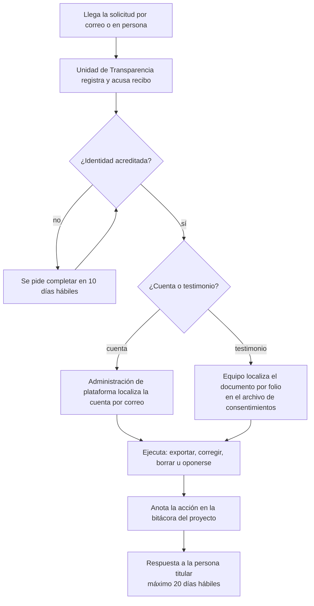

# Aviso de privacidad y consentimiento

- **Versión:** 1.2
- **Fecha:** 2026-11-07
- **Estado:** plantillas en borrador, sin validación jurídica y aún no publicadas en la interfaz
- **Fuentes:** `apps/web/src/lib/consent.ts`, `apps/web/src/lib/estudiante.ts`, `apps/backend/src/lib/student/testimonioConsent.ts`, `apps/backend/src/collections/Documents.ts`, `apps/backend/src/lib/conversationIngest.ts`, `apps/backend/src/lib/conversationTurnErasure.ts`, brief v1 del proyecto («Repositorio de Voces y Resonancias», documento externo al repo), `plan/anonimizacion-y-voces.md`, `infra/fleet/edc-1.md`, [corpus y datos de prueba](../04-datos/corpus-y-datos-de-prueba.md)

> **Aviso.** El sistema aún no recibe testimonios reales de participantes en producción: no existe entorno de producción, y en desarrollo (dev) sí hay documentos reales del proyecto, con nombres reales en sus textos originales, incluidos materiales de participantes del taller de Semiosis, en borrador hasta tener el consentimiento de sus autores (ver [corpus y datos de prueba](../04-datos/corpus-y-datos-de-prueba.md)).

**Para quién es y qué responde.** Este documento reúne los textos que Ecosistemas de Conocimiento (EDC) propone presentar a las personas titulares de datos. Salvo los consentimientos del estudiante, hoy no se presenta ninguno. Incluye el aviso de privacidad integral, el aviso simplificado de la interfaz, el consentimiento de quien aporta un testimonio, los consentimientos del estudiante y el procedimiento para ejercer derechos y retirar una contribución. Abre con una nota de marco legal para el área jurídica. Es para la unidad de transparencia y el área jurídica del CIDE, para las personas facilitadoras que levantan testimonios y para quien mantenga la interfaz. Los textos entre corchetes, como `[domicilio]`, los llena el área jurídica. Las notas que empiezan con "Antes de publicar" son para quien prepare la versión final y no forman parte del texto para el público.

## Estado de los controles

Definiciones. **Implementado:** funciona hoy, con evidencia en código. **Planeado:** existe un diseño o un mecanismo sin activar. **Pendiente:** no existe todavía, y puede no tener plan. Código leído el 2026-11-03. **Sin desplegar** marca lo construido en la rama `feat/anonymise-controls` (decisión del 2026-11-07, [ADR-0020](../03-arquitectura/adr/ADR-0020-anonimizar-todo-y-conservar-nombres-por-documento.md)) que todavía no corre en dev ni en staging.

| Control o procedimiento | Estado | Evidencia o nota |
|---|---|---|
| El aviso declara a quien sube documentos o testimonios que por omisión se quitan todos los nombres, qué nombres puede elegir conservar y quién más puede elegirlo (cláusulas 2 y 4; los interruptores están **Implementados**, sin desplegar; el aviso sigue sin publicarse) | **Planeado** | `apps/backend/src/lib/anonymise/authorRestore.ts`; `apps/backend/src/lib/publicFigures.ts`; rama `feat/anonymise-controls` |
| Quien sube un documento o un testimonio ve y cambia qué nombres se conservan en él, en la pantalla de anonimización del documento | **Implementado**, sin desplegar | `PATCH /api/documents/:id/anonimizacion`; rama `feat/anonymise-controls` |
| Tres consentimientos del estudiante, apagados por defecto | **Implementado** | `apps/web/src/lib/estudiante.ts`; `apps/web/src/lib/consent.ts` |
| Fecha y versión del consentimiento de testimonios; rechazo de una versión distinta | **Implementado** | `lib/student/testimonioConsent.ts`; `StudentProfiles.ts` |
| Retiro automático del consentimiento 3 al apagar `studentTestimonios` | **Implementado** | `clearTestimonioConsentWhenOff` en `Organizations.ts` |
| Borrar documentos, testimonios propios y conversaciones desde la plataforma | **Implementado** | `Documents.ts`; `lib/conversationTurnErasure.ts`. Borrar un documento también borra su registro de revisiones |
| Anonimización antes de compartir, con revisión humana de lo dudoso | **Implementado** | `lib/anonymise/gate.ts`; `lib/holdReview.ts` |
| Grabación de testimonio no compartida | **Implementado** | `collections/Media.ts` |
| Cookies técnicas `chat_auth` y `eco_selected`, sin cookies publicitarias en el código | **Implementado** | `apps/web/src/lib/server/auth.ts`; `apps/web/src/lib/server/ecosystem.ts` |
| Aviso de privacidad integral | **Planeado** | Plantilla en la sección b; sin publicar en `apps/web/src` |
| Aviso simplificado y aviso de que las conversaciones alimentan el acervo | **Planeado** | Plantilla en la sección c; sin publicar |
| Consentimiento para quien aporta un testimonio | **Planeado** | Plantilla en la sección d; sin validar ni usar |
| Respaldo del detector en `none`, condición para decir que el texto con nombres no sale a Estados Unidos | **Planeado** | Interruptor en `lib/platformSettings.ts`; el valor por defecto es `hosted` y staging siempre usa OpenRouter |
| Conserje de sesiones a 90 días | **Planeado** | `lib/sessionJanitor.ts`, apagado |
| Retención cero donde esté disponible y migración a inferencia albergada de forma independiente | **Planeado** | Sin configuración en el código ni contratos documentados |
| Comprobante ético con folio, PDF y archivo de consentimientos | **Pendiente** | Sin código ni procedimiento; no hay biblioteca para generar PDF en `apps/*/package.json` |
| Formatos accesibles del aviso y del consentimiento | **Pendiente** | No existen |
| Correo institucional y canal ARCO | **Pendiente** | No existen |
| Exportación de datos de una cuenta | **Pendiente** | No existe |
| Cancelación de cuenta | **Pendiente** | Sin ruta; la base rechaza borrar un usuario con conversación o membresía (`Ratings.deletePaths.pg.test.ts`) |
| Oposición a orientar respuestas | **Pendiente** | Sin mecanismo técnico más que borrar las conversaciones |
| Retiro de un testimonio por folio | **Pendiente** | Depende del comprobante |
| Fecha y versión de los consentimientos 1 y 2 del estudiante | **Pendiente** | Solo `shareTestimonios` guarda fecha y versión |
| Política de retención y destrucción de originales al cierre | **Pendiente** | Sin aprobar; sin plan de destino final |
| Política sobre menores: tutor y asentimiento | **Pendiente** | No existe; el sistema no registra edad |
| Bitácora del proyecto para acciones ARCO | **Pendiente** | No existe |
| Validación jurídica de estos textos | **Pendiente** | Sin validar |

## a. Nota de marco legal

> **Advertencia.** Esta sección es conocimiento general de la redacción, no un dictamen. La reforma de 2025 cambió leyes, autoridades y numeración de artículos. El área jurídica del CIDE debe validarla antes de publicar el aviso.

**Qué ley aplica.** En marzo de 2025 se publicaron una nueva Ley Federal de Protección de Datos Personales en Posesión de los Particulares (LFPDPPP) y una nueva Ley General de Protección de Datos Personales en Posesión de Sujetos Obligados (LGPDPPSO). El INAI se extinguió y sus funciones pasaron a otras autoridades.

- El CIDE es un centro público de investigación. Como entidad de la administración pública, probablemente es **sujeto obligado de la LGPDPPSO** y no de la LFPDPPP.
- Si el responsable formal del tratamiento fuera un particular (por ejemplo, un contratista), aplicaría la LFPDPPP.
- La ley aplicable define quién es el responsable, quién es encargado y ante qué autoridad se presenta una queja.

**Qué exige, en general.**

- Un **aviso de privacidad** en dos versiones, integral y simplificada, que nombre al responsable, las finalidades primarias y secundarias, los datos sensibles, las transferencias, los medios para ejercer los derechos de acceso, rectificación, cancelación y oposición (derechos ARCO) y la forma de revocar el consentimiento.
- **Consentimiento expreso y por escrito** para datos sensibles (salud, discapacidad, origen étnico o lengua, opiniones), con firma autógrafa o electrónica.
- **Medidas de seguridad** administrativas, técnicas y físicas, y un documento de seguridad.
- Una **evaluación de impacto** para tratamientos intensivos o relevantes; EDC califica por los datos sensibles, el uso de IA y los encargados en el extranjero. Ver [la evaluación de impacto](evaluacion-de-impacto-privacidad.md).
- **Plazos ARCO** típicos: 20 días hábiles para responder y 15 para hacer efectiva la respuesta.

**Ética en investigación.**

- El proyecto adopta los diez **Principios de Chapultepec**, presentados por SECIHTI y la ATDT el 2026-01-29, con una matriz de correspondencia en el registro del proyecto del 2026-10-21.
- La investigación con personas exige consentimiento informado, resguardo de los datos, destino final al cerrar el proyecto y protocolos reforzados para poblaciones en situación de vulnerabilidad: personas con discapacidad y menores de edad.
- Por la Ley General para la Inclusión de las Personas con Discapacidad, el aviso y el consentimiento se ofrecen en formatos accesibles.

## b. Aviso de privacidad integral

> **Plantilla en borrador, sin validación jurídica y aún no publicada en la interfaz.**

**Aviso de privacidad integral de la plataforma Ecosistemas de Conocimiento**

Versión 1 · Fecha de última actualización: `[fecha de publicación]`

**1. Responsable.** El Centro de Investigación y Docencia Económicas (CIDE), con domicilio en `[domicilio institucional del CIDE]`, es responsable del tratamiento de los datos personales que se recaban en la plataforma Ecosistemas de Conocimiento, parte del proyecto de investigación humanística IH-2025-I-445 financiado por la Secretaría de Ciencia, Humanidades, Tecnología e Innovación (SECIHTI). El responsable técnico del proyecto es [Responsable Técnico] (DEM-CIDE).

**2. Qué datos personales recabamos.**

- De las personas usuarias con cuenta: correo electrónico, nombre que eliges mostrar, imagen de perfil si la subes, idioma de la interfaz, contraseña (guardada solo como hash, es decir, una huella que no permite recuperarla), los ecosistemas a los que perteneces, tu rol en cada uno y el nombre con el que figuras en cada uno, que define quien administra los miembros de ese ecosistema.
- Lo que aportas: documentos, testimonios en texto o audio, notas, valoraciones de las respuestas con comentario opcional y tus conversaciones con el asistente.
- De estudiantes, además: tus elecciones de privacidad, con fecha y versión del texto que aceptaste, y el reporte de tu actividad (documentos, temas, número de conversaciones).
- De las personas que dan un testimonio sin cuenta: su relato o su voz. No recabamos su nombre en la plataforma. Su consentimiento queda en el comprobante ético con un folio que no está ligado al texto. *Antes de publicar: el comprobante es Pendiente.*

**3. Datos personales sensibles.** Por la naturaleza de la investigación, los testimonios y conversaciones pueden contener datos sensibles: estado de salud, discapacidad, lengua u origen étnico, opiniones y creencias. La grabación de tu voz también puede identificarte. Tratamos estos datos solo con tu consentimiento expreso y por escrito.

**4. Finalidades primarias** (necesarias para el servicio):

1. Crear y administrar tu cuenta y tu pertenencia a ecosistemas.
2. Recibir, transcribir y guardar tus documentos y testimonios.
3. Anonimizar los documentos que lo piden, los testimonios y las conversaciones antes de compartirlos dentro del ecosistema: sustituimos nombres de personas, domicilios y otros datos que identifican por seudónimos como "[Persona A]". **Por omisión quitamos todos los nombres, también el tuyo.** En un documento o un testimonio que subas se pueden encender dos excepciones. Con la primera conservamos visible, en ese texto y en el acervo del ecosistema, tu nombre completo tal como figuras en ese ecosistema; quien administra los miembros del ecosistema puede definir ese nombre. Nunca conservamos una parte suelta de tu nombre, y si no tienes una membresía activa o no hay un nombre registrado, no conservamos ninguno. Con la segunda conservamos los nombres de autores citados como en un libro o artículo, por ejemplo "López (2020)", y los de una lista de referencias, solo si el programa que quita nombres los reconoce como públicos. Las elige el ecosistema por omisión, y en cada documento las puedes cambiar tú, el equipo de revisión del ecosistema y la administración de la plataforma. Ves lo que se conservó en la pantalla de anonimización de tu documento. En un testimonio, esa pantalla te avisa mientras una excepción está encendida. Si apagas una excepción en tu documento, este vuelve a revisarse y los nombres que se habían conservado salen del acervo. Cada cambio queda registrado con quién lo hizo y cuándo. Si el ecosistema apaga una excepción, sus documentos vuelven a revisarse y esos nombres salen del acervo. Si el ecosistema enciende una excepción, los documentos ya revisados no cambian. Nunca conservamos nombres en conversaciones. La comparación es de texto: si tu documento menciona a otra persona que se llama exactamente igual que tú, o a alguien escrito con forma de cita, su nombre también queda visible.
4. Responder tus preguntas con el asistente, citando el acervo del ecosistema.
5. **Agregar tus conversaciones, ya anonimizadas, al acervo del ecosistema.** Sirven para orientar las respuestas a otras personas del mismo ecosistema. Nunca se citan y nunca se muestran con tu nombre.
6. Mostrar el grafo de temas del ecosistema, construido solo con texto anonimizado y publicado.
7. Proteger la seguridad de la plataforma y atender tus solicitudes.

**5. Finalidades secundarias** (puedes negarte sin perder el servicio):

1. Analizar el acervo anonimizado para la investigación del proyecto: patrones, resonancias entre experiencias y publicaciones académicas.
2. Evaluar la calidad de las respuestas del asistente con conjuntos de prueba.
3. Si eres estudiante y lo eliges: compartir tu actividad y tus testimonios anonimizados con el equipo del ecosistema, y mostrar tu nombre y temas a otros estudiantes.

Para negarte a las finalidades secundarias, escribe a `[correo institucional de datos personales]`. En el caso del numeral 3, basta con apagar el interruptor correspondiente en tu vista de estudiante.

**6. Encargados y transferencias.** Para operar la plataforma, remitimos datos a encargados que los tratan por cuenta del CIDE y solo para estas finalidades:

| Encargado | País | Qué recibe | Para qué |
|---|---|---|---|
| Hetzner Online | Alemania | Todos los datos guardados en la plataforma | Hospedaje del servidor |
| Servidor de cómputo con GPU de otra organización, por red privada | `[país y organización]` | Texto de testimonios y conversaciones antes de anonimizar; audio para transcripción | Anonimización y transcripción |
| OpenRouter, con el modelo DeepSeek | Estados Unidos | Tus preguntas sin anonimizar, fragmentos anonimizados del acervo, documentos de referencia sin anonimizar y, en los casos descritos abajo, texto de testimonios y conversaciones antes de anonimizar | Generar las respuestas del asistente y el grafo; detectar nombres |
| DeepInfra | Estados Unidos | Tu pregunta y fragmentos del acervo | Ordenar los resultados de búsqueda |

**El texto sin anonimizar puede enviarse a Estados Unidos.** Antes de quitar los nombres, un programa debe leer tu texto. Lo hace primero en el servidor de cómputo. Si ese servidor falla, el texto con nombres puede ir a OpenRouter. En el entorno de pruebas siempre va a OpenRouter. También van a OpenRouter tus preguntas, tal como las escribes, y los documentos de referencia que no pasan por anonimización. Una regla automática quita correos, teléfonos y domicilios antes de enviarlos, pero no quita nombres.

Por ahora usamos proveedores hospedados, cuya retención de datos depende de sus condiciones; está planeado activar retención cero donde esté disponible y migrar a inferencia albergada de forma independiente.

*Antes de publicar: esta redacción describe el estado actual. Solo se puede sustituir por "el texto sin anonimizar no sale a Estados Unidos" cuando el respaldo del detector esté en `none` y el servidor de cómputo sea el único detector. Faltan contratos documentados con todos los encargados, y `[país y organización]` del servidor de cómputo no está confirmado.*

No vendemos ni cedemos tus datos. No realizamos transferencias que requieran tu consentimiento distintas de estas remisiones a encargados, salvo las que exija una autoridad competente conforme a la ley.

**7. Cuánto tiempo guardamos tus datos.** Tu cuenta, mientras exista. Tus conversaciones, hasta que las borres `[plazo por inactividad: pendiente de aprobar]`. El original de un testimonio, mientras exista en la plataforma `[plazo y destino final al cierre del proyecto: pendientes de decidir]`. *Antes de publicar: no hay política de retención aprobada. El conserje de sesiones a 90 días está apagado.*

**8. Tus derechos ARCO.** Tienes derecho a **acceder** a tus datos, **rectificarlos** si son inexactos, **cancelarlos** cuando ya no sean necesarios y **oponerte** a su tratamiento para fines específicos. Puedes, en cualquier momento:

- borrar tus documentos, testimonios y conversaciones desde la plataforma; el borrado alcanza las copias en el acervo;
- escribir a `[correo institucional de datos personales]` o acudir a la Unidad de Transparencia del CIDE en `[domicilio]`, con el formato y los requisitos de la sección f de este documento.

Respondemos en un plazo máximo de `[plazo legal que valide jurídica]`. *Antes de publicar: el correo, el canal, la exportación y la cancelación de cuenta son Pendientes.*

**9. Cómo revocar tu consentimiento.** Puedes revocar tu consentimiento por los mismos medios del punto 8. Si eres estudiante, apaga el interruptor correspondiente. La revocación no afecta los tratamientos ya realizados. Si diste un testimonio, puedes retirarlo con el folio de tu comprobante (*antes de publicar: el folio es Pendiente*); si ya se usó de forma anonimizada en análisis publicados, esos análisis no se pueden deshacer.

**10. Uso de cookies.** La plataforma usa dos cookies técnicas: `chat_auth`, para mantenerte dentro de tu cuenta, con vigencia de 7 días, y `eco_selected`, para recordar el ecosistema que elegiste. No usamos cookies de publicidad ni de rastreo.

**11. Cambios a este aviso.** Cualquier cambio se publica en la plataforma con su fecha y número de versión. Si el cambio afecta finalidades o datos sensibles, te pedimos de nuevo tu consentimiento. *Antes de publicar: hoy la plataforma solo guarda la versión aceptada del consentimiento de testimonios del estudiante, no la de este aviso.*

**12. Autoridad.** Si consideras que tu derecho a la protección de datos fue vulnerado, puedes acudir a `[autoridad garante competente según la ley aplicable]`.

## c. Aviso simplificado para la interfaz

> **Plantilla en borrador, sin validación jurídica y aún no publicada en la interfaz.**

Texto para mostrar al crear una cuenta, en el pie de la aplicación y al abrir la primera conversación. Lenguaje claro, frases cortas.

> **Tu privacidad en Ecosistemas de Conocimiento**
>
> El CIDE es responsable de tus datos. Los usamos para tu cuenta, para responder tus preguntas y para la investigación del proyecto.
>
> Tus conversaciones, sin tu nombre y sin datos que te identifiquen, ayudan a orientar las respuestas a otras personas de este ecosistema. Nunca se citan.
>
> Los testimonios se anonimizan antes de compartirse. Una persona revisa los casos dudosos.
>
> Si subes un documento que se anonimiza o un testimonio, quitamos todos los nombres, también el tuyo. Puedes elegir conservar tu nombre o los autores que citas. El equipo de revisión del ecosistema también puede elegirlo.
>
> Usamos servidores en Alemania, un servidor de cómputo de otra organización y servicios de IA en Estados Unidos. A Estados Unidos van tus preguntas y documentos de referencia. Si falla el servidor de cómputo, también puede ir texto con nombres. Las condiciones de esos servicios deciden cuánto guardan esos datos.
>
> Puedes borrar lo que aportes cuando quieras. Para más derechos, escribe a `[correo institucional de datos personales]`.
>
> [Lee el aviso completo]

Texto corto junto al cuadro de conversación (una línea):

> Tus conversaciones, anonimizadas, orientan las respuestas de este ecosistema. [Más información]

## d. Consentimiento informado para quien aporta un testimonio

> **Plantilla en borrador, sin validación jurídica y aún no publicada en la interfaz.** El comprobante con folio es **Pendiente**: no existe en código ni como procedimiento.

Este texto formaría parte del **comprobante ético** que el brief del proyecto exige al cerrar cada contribución: aviso de privacidad, consentimiento informado y folio único, descargable en PDF (brief v1 del proyecto, documento externo al repo). La persona facilitadora lo leería en voz alta o lo entregaría en el formato que la persona prefiera. El comprobante llevaría:

- **Folio**: un código único, por ejemplo `EDC-2026-000123` (formato propuesto), que no contiene datos de la persona.
- **Versión del texto**: el número de versión del consentimiento. Si el texto cambia, sube la versión, igual que el consentimiento del estudiante.
- **Ecosistema** al que se aporta.
- **Fecha.**
- **Firma** o marca de la persona, o grabación de su aceptación oral.

El folio y la firma se guardarían fuera de la plataforma, en un archivo de consentimientos que aún no existe. La plataforma no guarda quién habló: el folio sería lo único que permite retirar el testimonio después.

**Formatos accesibles: Pendiente.** Se propone ofrecer el consentimiento en letra grande, en lectura en voz alta, en lectura fácil y, cuando la persona lo pida, con interpretación en lengua de señas mexicana o en su lengua. La persona facilitadora confirmaría que la persona entendió antes de firmar.

---

> **Consentimiento para compartir tu testimonio**
>
> Proyecto: Ecosistemas de Conocimiento (CIDE, IH-2025-I-445) · Versión 1 · Folio: `__________` · Ecosistema: `__________` · Fecha: `__________`
>
> **¿Qué te pedimos?** Que nos cuentes tu experiencia, por escrito o con tu voz, para una investigación del CIDE.
>
> **¿Para qué?** Para entender, junto con otras personas, cómo se vive este tema. Tu relato se suma a un acervo que consultan las personas del ecosistema y el equipo de investigación.
>
> **¿Qué hacemos con tu nombre?** Lo quitamos. Antes de compartir tu relato, un programa cambia los nombres de personas y lugares por marcas como "[Persona A]". Si el programa tiene dudas, una persona del equipo revisa el texto. La plataforma no tiene un campo para tu nombre. Si en tu relato citas a autores de libros o artículos, por ejemplo "López (2020)", el equipo puede dejar visibles esos nombres. También puede dejar visible el nombre de la persona que sube tu relato, si aparece en él. Si dijiste nombres en tu relato, siguen en el relato original, que se guarda aparte.
>
> **¿Quién lee tu relato original?** Solo quien lo subió y la administración de la plataforma, para corregirlo si hace falta. Las demás personas solo leen la versión sin nombres. Tu grabación nunca se comparte.
>
> **¿Hay algún riesgo?** Aunque quitemos tu nombre, alguien que te conoce podría reconocerte por lo que cuentas. Puedes pedir que quitemos detalles. Puedes no contar lo que no quieras.
>
> **¿Tu relato sale del país?** Sí. Tu relato con nombres se procesa en un servidor de cómputo de otra organización, en `[país]`. Si ese servidor falla, tu relato con nombres puede ir a un servicio de IA en Estados Unidos. La versión sin nombres se usa con servicios de IA en Estados Unidos. Esos servicios deciden, según sus condiciones, cuánto tiempo guardan los datos.
>
> **¿Es obligatorio?** No. Puedes decir que no, parar en cualquier momento o retirar tu testimonio después. Para retirarlo, escribe a `[correo institucional de datos personales]` con tu folio. No recibirás ningún pago y no perderás ningún apoyo por decir que no.
>
> **¿Cuánto tiempo lo guardamos?** `[plazo y destino final: pendientes de decidir]`.
>
> **¿A quién preguntar?** Al equipo del proyecto en `[correo del proyecto]`.
>
> Marca lo que aceptas:
>
> - [ ] Acepto que mi testimonio, sin mi nombre, forme parte del acervo del ecosistema.
> - [ ] Acepto que mi testimonio, sin mi nombre, se use en análisis y publicaciones del proyecto.
> - [ ] Mi testimonio contiene datos sobre mi salud, discapacidad, lengua u opiniones, y acepto que se traten con estas protecciones.
>
> Firma o marca: `__________` · Persona facilitadora: `__________`
>
> Recibirás una copia de este comprobante con tu folio.

---

**Menores de edad: Pendiente.** No existe política y el sistema no registra edad. Se propone que, si la persona es menor de edad, firme el consentimiento su madre, padre o tutor, que la persona menor dé su asentimiento con un texto adaptado a su edad y que una persona facilitadora adulta esté presente. Mientras no exista esa política, no se deben aceptar contribuciones de menores.

## e. Consentimiento del estudiante

**Implementado.** A diferencia de las secciones b, c y d, esto sí está en la interfaz, aunque sin validación jurídica. La vista de estudiante (`/estudiante`) presenta tres consentimientos como interruptores, apagados por defecto. Los textos son exactamente los que la persona ve hoy.

| # | Interruptor | Texto exacto | Dónde está el texto | Versión |
|---|---|---|---|---|
| 1 | Compañeros (`shareWithPeers`) | "Mostrar mi nombre, mis temas y mis trabajos publicados a otros estudiantes" | `apps/web/src/lib/estudiante.ts` (`PEERS_CONSENT`) | No se guarda fecha ni versión (**Pendiente**) |
| 2 | Actividad (`shareActivity`) | "Compartir mi actividad con el equipo del ecosistema" | `apps/web/src/lib/consent.ts` (`CONSENT_ACTIVITY`) | No se guarda fecha ni versión (**Pendiente**) |
| 3 | Actividad con testimonios (`shareTestimonios`), visible solo si el ecosistema activa `studentTestimonios` | "Compartir mi actividad con el equipo del ecosistema. El equipo del ecosistema (docentes, investigadores y responsables) y la administración de la plataforma también verán mis testimonios publicados, solo en versión anonimizada." | `apps/web/src/lib/consent.ts` (`CONSENT_ACTIVITY_WITH_TESTIMONIOS`) | **Versión 2**, del 2026-10-28; fecha en `shareTestimoniosAt` y versión en `shareTestimoniosVersion` |

**Historia de versiones del consentimiento 3.**

| Versión | Fecha | Cambio |
|---|---|---|
| 1 | Antes del 2026-10-28 | Decía que "docentes e investigadores" verían los testimonios. Nunca se guardó su versión; esos consentimientos ya no cuentan y se vuelven a pedir |
| 2 | 2026-10-28 | Nombra a todos los lectores: el equipo del ecosistema (docentes, investigadores y responsables) y la administración de la plataforma |

**Reglas** (decisión del responsable de desarrollo del 2026-10-28, código en `apps/backend/src/lib/student/testimonioConsent.ts`):

- Un consentimiento cubre solo el texto que la persona vio. La página envía la versión mostrada; el servidor rechaza cualquier otra.
- Si el texto cambió, la persona ve: "El texto del consentimiento cambió. Recarga la página y léelo de nuevo."
- Si el ecosistema apaga `studentTestimonios`, el consentimiento 3 se retira solo.
- Cambiar el texto obliga a subir la versión en el backend y en la web; una prueba falla si no coinciden.
- Apagar cualquier interruptor tiene efecto inmediato en lo que ven los demás.

## f. Procedimiento ARCO y de retiro de una contribución

> **Pendiente.** Este procedimiento es una propuesta en borrador. Hoy no existen el canal, la exportación, la cancelación de cuenta, el folio ni la bitácora que describe. Solo funciona lo marcado como Implementado en f.1 y f.4.

### f.1 Canales

- Correo (**Pendiente**): `[correo institucional de datos personales]`, atendido por la Unidad de Transparencia del CIDE con apoyo del equipo de desarrollo del proyecto.
- En persona (**Pendiente**): Unidad de Transparencia del CIDE, `[domicilio]`.
- Dentro de la plataforma, sin solicitud (**Implementado**): borrar documentos, testimonios propios y conversaciones; apagar consentimientos de estudiante.

### f.2 Requisitos de la solicitud

1. Nombre de la persona titular y medio para recibir la respuesta.
2. Documento que acredite la identidad (o la representación, si actúa otra persona).
3. Qué derecho ejerce: acceso, rectificación, cancelación u oposición, o revocación del consentimiento.
4. Qué datos: correo de la cuenta, o **folio del comprobante** si se trata de un testimonio.

### f.3 Pasos

### f.4 Qué hace el equipo en cada derecho

| Derecho | Acción propuesta en la plataforma | Estado |
|---|---|---|
| **Acceso** | La administración de plataforma exportaría los datos de la cuenta: perfil, membresías, documentos, conversaciones, valoraciones y consentimientos, en un archivo legible | **Pendiente**: la exportación no existe |
| **Rectificación** | Corregir el perfil. Si la persona corrige un testimonio, la edición vuelve a pasar por la compuerta de anonimización | **Implementado** en la plataforma; **Pendiente** el canal para pedirlo |
| **Cancelación de cuenta** | Borrar conversaciones (sus turnos salen del acervo), documentos propios (salen del acervo y del almacenamiento), valoraciones, perfil de estudiante, membresías y la cuenta. Las sugerencias del estudiante quedarían sin autor | **Pendiente**: no hay ruta y la base rechaza borrar un usuario con conversación o membresía |
| **Oposición** | Excluir las contribuciones de la persona de las finalidades secundarias; si se opone a que sus conversaciones orienten respuestas, borrarlas | **Pendiente**: el único mecanismo técnico es borrar las conversaciones |
| **Revocación** | Apagar los consentimientos de estudiante (**Implementado**); retirar testimonios por folio (**Pendiente**) | Mixto |

### f.5 Retiro de un testimonio por folio

**Pendiente**: el folio no existe. El borrado del paso 3 sí funciona (**Implementado**) y hoy también elimina el registro de revisiones del documento.

1. La persona escribe con su folio.
2. El equipo localiza en el archivo de consentimientos el ecosistema y la fecha del folio, y con la persona facilitadora identifica el documento.
3. La administración de plataforma borra el documento. El borrado elimina su texto original, su versión anonimizada, sus fragmentos y vectores en el acervo, su grabación y sus entidades en el grafo.
4. El equipo marca el folio como retirado y responde a la persona.

**Límite que se informa a la persona.** Si el testimonio ya se usó, anonimizado, en análisis o publicaciones del proyecto, esos productos no se pueden deshacer. Si la persona no conserva su folio, la plataforma no puede encontrar su testimonio, porque por diseño no sabe quién habló. Esta anonimización es la protección principal de la persona y es también la razón de ese límite.

## Referencias

- `apps/web/src/lib/consent.ts`, `apps/web/src/lib/estudiante.ts`, `apps/web/src/routes/estudiante/+page.svelte`
- `apps/backend/src/lib/student/testimonioConsent.ts`, `apps/backend/src/collections/StudentProfiles.ts`
- `apps/backend/src/collections/Documents.ts`, `apps/backend/src/lib/conversationIngest.ts`, `apps/backend/src/lib/conversationTurnErasure.ts`
- Brief v1 del proyecto, «Repositorio de Voces y Resonancias» (documento externo al repo)
- `plan/anonimizacion-y-voces.md`
- [Corpus y datos de prueba](../04-datos/corpus-y-datos-de-prueba.md)
- `infra/fleet/edc-1.md`
- [Protección de datos](proteccion-de-datos.md)
- [Evaluación de impacto en la privacidad](evaluacion-de-impacto-privacidad.md)
- [Seguridad](seguridad.md)
- [Manual de usuario](../08-manuales/manual-de-usuario.md)

## Siguientes pasos

Sin fechas: ninguna está acordada. Primero lo Planeado, después lo Pendiente.

1. **Planeado.** Validar y publicar el aviso integral y el aviso simplificado en la interfaz, incluida la frase de que las conversaciones alimentan el acervo.
2. **Planeado.** Validar el consentimiento para quien aporta un testimonio.
3. **Planeado.** Fijar el respaldo del detector en `none` y ajustar la redacción de las plantillas cuando sea cierto.
4. **Planeado.** Activar el conserje de sesiones, tras aprobar el plazo, y reflejarlo en la cláusula 7.
5. **Planeado.** Activar retención cero donde esté disponible y migrar a inferencia albergada de forma independiente.
6. **Pendiente.** Llenar los corchetes: domicilio, correos, autoridad garante, plazos, país y organización del servidor de cómputo.
7. **Pendiente.** Validar la ley aplicable y el responsable con el área jurídica.
8. **Pendiente.** Crear el comprobante ético con folio, su versión en PDF y el archivo de consentimientos.
9. **Pendiente.** Preparar los formatos accesibles.
10. **Pendiente.** Abrir el correo institucional y el canal ARCO, con su bitácora.
11. **Pendiente.** Crear la exportación de datos, la cancelación de cuenta y un mecanismo de oposición.
12. **Pendiente.** Guardar fecha y versión de los consentimientos 1 y 2 del estudiante.
13. **Pendiente.** Aprobar la política de retención y el destino final de los originales.
14. **Pendiente.** Definir la política sobre menores.
