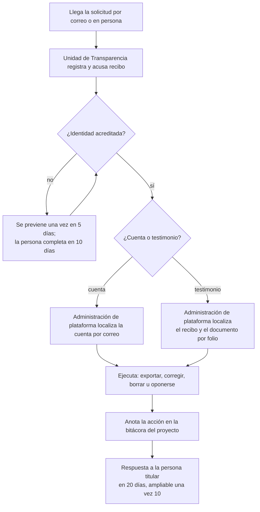

# Aviso de privacidad y consentimiento

- **Versión:** 1.5
- **Fecha:** 2026-11-12
- **Estado:** el aviso está publicado en `/privacidad` como «Borrador sin validación jurídica»; la casilla de consentimiento por recurso y la constancia con folio están implementadas; las plantillas de este documento siguen en borrador
- **Fuentes:** `apps/web/src/lib/privacyNotice.ts`, `apps/web/src/lib/uploadConsent.ts`, `apps/web/src/routes/documentos/[id]/constancia/`, `apps/web/src/lib/consent.ts`, `apps/web/src/lib/estudiante.ts`, `apps/backend/src/lib/student/testimonioConsent.ts`, `apps/backend/src/collections/Documents.ts`, `apps/backend/src/lib/conversationIngest.ts`, `apps/backend/src/lib/conversationTurnErasure.ts`, brief v1 del proyecto («Repositorio de Voces y Resonancias», documento externo al repo), `plan/anonimizacion-y-voces.md`, `infra/fleet/edc-1.md`, [corpus y datos de prueba](../04-datos/corpus-y-datos-de-prueba.md)

> **Aviso.** El sistema aún no recibe testimonios reales de participantes en producción: no existe entorno de producción, y en desarrollo (dev) sí hay documentos reales del proyecto, con nombres reales en sus textos originales, incluidos materiales de participantes del taller de Semiosis, en borrador hasta tener el consentimiento de sus autores (ver [corpus y datos de prueba](../04-datos/corpus-y-datos-de-prueba.md)).

**Para quién es y qué responde.** Este documento reúne los textos que Ecosistemas de Conocimiento (EDC) propone presentar a las personas titulares de datos. Hoy se presentan el aviso en `/privacidad`, la casilla de consentimiento al subir, su constancia y los consentimientos del estudiante. Incluye el aviso de privacidad integral, el aviso simplificado de la interfaz, el consentimiento de quien aporta un testimonio, los consentimientos del estudiante y el procedimiento para ejercer derechos y retirar una contribución. Abre con una nota de marco legal para el área jurídica. Es para la unidad de transparencia y el área jurídica del CIDE, para las personas facilitadoras que levantan testimonios y para quien mantenga la interfaz. Los textos entre corchetes, como `[domicilio]`, los llena el área jurídica. Las notas que empiezan con "Antes de publicar" son para quien prepare la versión final y no forman parte del texto para el público.

## Estado de los controles

Definiciones. **Implementado:** está en `main` `db9a4456` o antes, la versión que corre en dev desde el despliegue terminado el 2026-11-13 a las 03:21 UTC (2026-11-12 21:21 en la Ciudad de México; measured con `docker ps` por el agente de despliegue; `infra/fleet/edc-1.md` §4zzzzzzzzzzzzzz), con evidencia en código. **Planeado:** existe un diseño o un mecanismo sin activar. **Pendiente:** no existe todavía, y puede no tener plan. Código leído en `main` `f971d54c` el 2026-11-12; el consentimiento por recurso, la constancia con folio y `/privacidad`, en `db9a4456` (integrado el 2026-11-12 a las 21:07 -0600, migración `20261113_015634_consent_receipts`). Staging sigue en su imagen del 2026-10-17, y por ahora está fuera de alcance: ningún control posterior a esa fecha corre allí. Los interruptores de nombres siguen [ADR-0020](../03-arquitectura/adr/ADR-0020-anonimizar-todo-y-conservar-nombres-por-documento.md). Lo diferido está en [Etapa 2](#etapa-2).

| Control o procedimiento | Estado | Evidencia o nota |
|---|---|---|
| El aviso declara a quien sube documentos o testimonios que por omisión se quitan todos los nombres, qué nombres puede elegir conservar y quién más puede elegirlo (finalidad 3 del aviso en `/privacidad`; los interruptores corren en dev desde el 2026-11-10) | **Implementado** | `apps/web/src/lib/privacyNotice.ts`; `apps/backend/src/lib/anonymise/authorRestore.ts`; `apps/backend/src/lib/publicFigures.ts` |
| Quien sube un documento o un testimonio ve y cambia qué nombres se conservan en él, en la pantalla de anonimización del documento | **Implementado** | `PATCH /api/documents/:id/anonimizacion` |
| Los valores por omisión del ecosistema los cambian solo el responsable y la administración de plataforma; quien revisa cambia un documento solo si está retenido o publicado | **Implementado** | `lib/permissions.ts`; `lib/anonymisationControls.ts`; commit `50bde2ae` |
| Un material cuyos autores no han dado su consentimiento queda retenido: no se vuelve a anonimizar, ingerir, extraer al grafo ni publicar | **Implementado** | `lib/consentHold.ts`; `scripts/hold-for-consent.ts`. En dev, 184 filas del taller quedaron retenidas el 2026-11-12 (measured por el agente de despliegue, `infra/fleet/edc-1.md` §4zzzzzzzzz). Una revisión de un material retenido también queda retenida, y publicar sus cambios responde 409 (commits `17a5d985`, `b29c72ba`, `c12a0ab5`). Dos casos límite conocidos, que hoy no ocurren, están en [protección de datos](proteccion-de-datos.md#limitaciones-conocidas) |
| Tres consentimientos del estudiante, apagados por defecto | **Implementado** | `apps/web/src/lib/estudiante.ts`; `apps/web/src/lib/consent.ts` |
| Fecha y versión del consentimiento de testimonios; rechazo de una versión distinta | **Implementado** | `lib/student/testimonioConsent.ts`; `StudentProfiles.ts` |
| Retiro automático del consentimiento 3 al apagar `studentTestimonios` | **Implementado** | `clearTestimonioConsentWhenOff` en `Organizations.ts` |
| Borrar documentos, testimonios propios y conversaciones desde la plataforma | **Implementado** | `Documents.ts`; `lib/conversationTurnErasure.ts`. Borrar un documento conserva su registro de revisiones, salvo las filas de quien borra |
| Anonimización antes de compartir, con revisión humana de lo dudoso | **Implementado** | `lib/anonymise/gate.ts`; `lib/holdReview.ts` |
| Grabación de testimonio no compartida | **Implementado** | `collections/Media.ts` |
| Cookies técnicas `chat_auth` y `eco_selected`, sin cookies publicitarias en el código | **Implementado** | `apps/web/src/lib/server/auth.ts`; `apps/web/src/lib/server/ecosystem.ts` |
| Aviso de privacidad integral (art. 21) y simplificado (art. 22), con la finalidad 5: las conversaciones, anonimizadas, alimentan el acervo | **Implementado** | `/privacidad`, pública, con el encabezado «Borrador sin validación jurídica» (`apps/web/src/lib/privacyNotice.ts:15`) y 27 huecos `[POR DEFINIR]` visibles, 24 distintos (measured con `pendingItems()` sobre `db9a4456`, 2026-11-13). Integral con secciones I a XI, simplificado y «Tus derechos». Pública sin sesión (`apps/web/src/hooks.server.ts:15`); enlazada desde el inicio de sesión y el pie de la barra lateral (`Sidebar.svelte:299`) |
| Casilla de consentimiento por recurso al subir: quien sube declara que leyó el aviso y, en un testimonio, que la persona que lo da dio su consentimiento informado | **Implementado** | Obligatoria y desmarcada cada vez (`UploadConsentCheck.svelte`): subir en `/documentos` (`UploadSheet.svelte:257`; «Subir» deshabilitado sin casilla), «Subir» y «Nota» del chat (`DocsPanel.svelte:545`), micrófono antes de abrirlo (`MicButton.svelte:219`, con el texto de testimonio) y nota nueva (`NoteSheet.svelte:151`). Cubre documento, nota y audio, y la subida del capturador (`voces:upload`), que con «Testimonio» muestra el texto de testimonio. Texto y versión (1) en `apps/web/src/lib/uploadConsent.ts`. Registra la declaración de quien sube, nunca de quién son las palabras ([ADR-0019](../03-arquitectura/adr/ADR-0019-voces-sin-sujeto-ni-consentimiento.md), enmienda del 2026-11-12) |
| Formato para recabar el consentimiento de la persona que da un testimonio, fuera de la plataforma | **Planeado** | Plantilla en la sección d; sin validar |
| Respaldo del detector por OpenRouter con retención cero (`hosted`), por decisión del responsable técnico del 2026-11-09, confirmada el 2026-11-10 | **Implementado** | Interruptor en `lib/platformSettings.ts`; dev usa `hosted` desde el 2026-11-10 y staging siempre usa OpenRouter. `none`, condición para decir que el texto con nombres no sale a Estados Unidos, sigue disponible |
| Conserje de sesiones a 90 días | **Planeado** | `lib/sessionJanitor.ts`, apagado |
| Retención cero (ZDR) en toda llamada a OpenRouter, que falla cerrada sin ella | **Implementado** | `services/ai-service/src/services/ai/router/adapters/openrouter.ts`; en dev desde el 2026-11-10. Staging no lo tiene (inferido de su imagen del 2026-10-17) |
| Retención cero con DeepInfra | **Pendiente** | Sin parámetro de retención ni contrato documentado (P-06); etapa 2 |
| Migración a inferencia albergada de forma independiente | **Planeado** | Sin contratos documentados |
| Comprobante ético con folio | **Implementado** | Recibo en la colección `consent-receipts` (`apps/backend/src/collections/ConsentReceipts.ts`; migración `20261113_015634_consent_receipts`); constancia en `/documentos/<id>/constancia`, enlazada desde cada fila propia de `/documentos`, con folio `EDC-AAAA-NNNNNN`. «Descargar» abre la impresión del navegador, que la guarda como PDF. La leen solo quien subió y la administración de plataforma; revisión (`holds:review`) no (`ConsentReceipts.ts:44`) |
| Cómo recibe su folio la persona que da un testimonio | **Pendiente** | Por definir: la constancia solo la ven quien subió y la administración de plataforma |
| Archivo de los formatos firmados fuera de la plataforma | **Pendiente** | No existe |
| Formatos accesibles del aviso y del consentimiento; revisión de accesibilidad de `/privacidad` | **Pendiente** | No existen; `/privacidad` no se ha revisado |
| Canal ARCO | **Implementado** | La Unidad de Transparencia del CIDE (`unidad.enlace@cide.edu`, Plataforma Nacional de Transparencia o por escrito), descrita en «Tus derechos» de `/privacidad`. Sin formulario propio |
| Exportación de datos de una cuenta | **Pendiente** | No existe |
| Cancelación de cuenta | **Pendiente** | Sin ruta; la base rechaza borrar un usuario con conversación o membresía (`Ratings.deletePaths.pg.test.ts`) |
| Oposición a orientar respuestas | **Pendiente** | Sin mecanismo técnico más que borrar las conversaciones |
| Retiro o cancelación por folio en la plataforma | **Pendiente** | No existe (el recibo solo tiene `kind` `upload`). A mano: con el folio, la administración de plataforma localiza el recibo y el documento y lo borra (sección f.5) |
| Fecha y versión de los consentimientos 1 y 2 del estudiante | **Pendiente** | Solo `shareTestimonios` guarda fecha y versión |
| Política de retención y destrucción de originales al cierre | **Pendiente** | Sin aprobar; sin plan de destino final |
| Política sobre menores: tutor y asentimiento | **Pendiente** | No existe; el sistema no registra edad |
| Bitácora del proyecto para acciones ARCO | **Pendiente** | No existe |
| Validación jurídica de estos textos | **Pendiente** | Sin validar |

## a. Nota de marco legal

> **Advertencia.** Esta sección es conocimiento general de la redacción, no un dictamen. La reforma de 2025 cambió leyes, autoridades y numeración de artículos. El área jurídica del CIDE debe validarla antes de publicar el aviso.

**Qué ley aplica.** La Ley General de Protección de Datos Personales en Posesión de Sujetos Obligados (LGPDPPSO; DOF 20-03-2025, última reforma DOF 14-11-2025, citado de `privacyNotice.ts`:73, en `db9a4456`). El INAI se extinguió y sus funciones pasaron a otras autoridades.

- El CIDE es un centro público de investigación y **sujeto obligado de la LGPDPPSO**; el aviso de `/privacidad` se funda en ella.
- **Autoridad:** el recurso de revisión se interpone ante la Secretaría Anticorrupción y Buen Gobierno (SABG) o ante la Unidad de Transparencia del CIDE, dentro de 15 días desde la notificación de la respuesta (arts. 50 y 86; `privacyNotice.ts`:206 y :374, en `db9a4456`).

**Qué exige, en general.**

- Un **aviso de privacidad** en dos versiones, integral y simplificada, que nombre al responsable, las finalidades primarias y secundarias, los datos sensibles, las transferencias, los medios para ejercer los derechos de acceso, rectificación, cancelación y oposición (derechos ARCO) y la forma de revocar el consentimiento.
- **Consentimiento expreso y por escrito** para datos sensibles (salud, discapacidad, origen étnico o lengua, opiniones), con firma autógrafa o electrónica.
- **Medidas de seguridad** administrativas, técnicas y físicas, y un documento de seguridad.
- Una **evaluación de impacto** para tratamientos intensivos o relevantes; EDC califica por los datos sensibles, el uso de IA y los encargados en el extranjero. Ver [la evaluación de impacto](evaluacion-de-impacto-privacidad.md).
- **Plazos ARCO**, en días, como los cuenta la ley (citado de `privacyNotice.ts`:342-352, en `db9a4456`):

| Paso | Plazo | Art. |
|---|---|---|
| Prevención por un requisito faltante, una sola vez | 5 días desde la presentación | 46 |
| La persona completa la información | 10 días desde la notificación | 46 |
| Aviso de un trámite específico | 5 días | 48 |
| Respuesta | 20 días desde el día siguiente a la recepción | 45 |
| Ampliación | Una sola vez, hasta 10 días, justificada y notificada dentro de los 20 | 45 |
| Hacer efectivo el derecho | 15 días desde el día siguiente a la notificación de la respuesta | 45 |
| Improcedencia | Dentro de los 20 días | 49 |

**Ética en investigación.**

- El proyecto adopta los diez **Principios de Chapultepec**, presentados por SECIHTI y la ATDT el 2026-01-29, con una matriz de correspondencia en el registro del proyecto del 2026-10-21.
- La investigación con personas exige consentimiento informado, resguardo de los datos, destino final al cerrar el proyecto y protocolos reforzados para poblaciones en situación de vulnerabilidad: personas con discapacidad y menores de edad.
- Por la Ley General para la Inclusión de las Personas con Discapacidad, el aviso y el consentimiento se ofrecen en formatos accesibles.

## b. Aviso de privacidad integral

> **Plantilla de origen.** La versión en la interfaz es `/privacidad` (`apps/web/src/lib/privacyNotice.ts`), «Borrador sin validación jurídica». Si difieren, manda la de la interfaz.

**Aviso de privacidad integral de la plataforma Ecosistemas de Conocimiento**

Versión 1 · Fecha de última actualización: `[fecha de publicación]`

**1. Responsable.** El Centro de Investigación y Docencia Económicas (CIDE), con domicilio en `[domicilio institucional del CIDE]`, es responsable del tratamiento de los datos personales que se recaban en la plataforma Ecosistemas de Conocimiento, parte del proyecto de investigación humanística IH-2025-I-445 financiado por la Secretaría de Ciencia, Humanidades, Tecnología e Innovación (SECIHTI). El responsable técnico del proyecto es `[nombre del responsable técnico]` (DEM-CIDE).

**2. Qué datos personales recabamos.**

- De las personas usuarias con cuenta: correo electrónico, nombre que eliges mostrar, imagen de perfil si la subes, idioma de la interfaz, contraseña (guardada solo como hash, es decir, una huella que no permite recuperarla), los ecosistemas a los que perteneces, tu rol en cada uno y el nombre con el que figuras en cada uno, que define quien administra los miembros de ese ecosistema.
- Lo que aportas: documentos, testimonios en texto o audio, notas, valoraciones de las respuestas con comentario opcional y tus conversaciones con el asistente.
- De estudiantes, además: tus elecciones de privacidad, con fecha y versión del texto que aceptaste, y el reporte de tu actividad (documentos, temas, número de conversaciones).
- De las personas que dan un testimonio sin cuenta: su relato o su voz. No recabamos su nombre en la plataforma. Quien sube su relato declara que la persona dio su consentimiento informado; la constancia de esa declaración lleva un folio que no contiene datos de la persona.

**3. Datos personales sensibles.** Por la naturaleza de la investigación, los testimonios y conversaciones pueden contener datos sensibles: estado de salud, discapacidad, lengua u origen étnico, opiniones y creencias. La grabación de tu voz también puede identificarte. Tratamos estos datos solo con tu consentimiento expreso y por escrito.

**4. Finalidades primarias** (necesarias para el servicio):

1. Crear y administrar tu cuenta y tu pertenencia a ecosistemas.
2. Recibir, transcribir y guardar tus documentos y testimonios.
3. Anonimizar los documentos que lo piden, los testimonios y las conversaciones antes de compartirlos dentro del ecosistema: sustituimos nombres de personas, domicilios y otros datos que identifican por seudónimos como "[Persona A]". **Por omisión quitamos todos los nombres, también el tuyo.** En un documento o un testimonio que subas se pueden encender dos excepciones. Con la primera conservamos visible, en ese texto y en el acervo del ecosistema, tu nombre completo tal como figuras en ese ecosistema; quien administra los miembros del ecosistema puede definir ese nombre. Nunca conservamos una parte suelta de tu nombre, y si no tienes una membresía activa o no hay un nombre registrado, no conservamos ninguno. Con la segunda conservamos los nombres de autores citados como en un libro o artículo, por ejemplo "López (2020)", y los de una lista de referencias, solo si el programa que quita nombres los reconoce como públicos. Las elige por omisión quien es responsable del ecosistema, y en cada documento las puedes cambiar tú, la administración de la plataforma y, si el documento está retenido o publicado, el equipo de revisión del ecosistema. Ves lo que se conservó en la pantalla de anonimización de tu documento. En un testimonio, esa pantalla te avisa mientras una excepción está encendida. Si apagas una excepción en tu documento, este vuelve a revisarse y los nombres que se habían conservado salen del acervo. Cada cambio queda registrado con quién lo hizo y cuándo. Si el ecosistema apaga una excepción, sus documentos vuelven a revisarse y esos nombres salen del acervo. Si el ecosistema enciende una excepción, los documentos ya revisados no cambian. Nunca conservamos nombres en conversaciones. La comparación es de texto: si tu documento menciona a otra persona que se llama exactamente igual que tú, o a alguien escrito con forma de cita, su nombre también queda visible.
4. Responder tus preguntas con el asistente, citando el acervo del ecosistema.
5. **Agregar tus conversaciones, ya anonimizadas, al acervo del ecosistema.** Sirven para orientar las respuestas a otras personas del mismo ecosistema. Nunca se citan y nunca se muestran con tu nombre.
6. Mostrar el grafo de temas del ecosistema, construido solo con texto anonimizado y publicado.
7. Proteger la seguridad de la plataforma y atender tus solicitudes.

**5. Finalidades secundarias** (puedes negarte sin perder el servicio):

1. Analizar el acervo anonimizado para la investigación del proyecto: patrones, resonancias entre experiencias y publicaciones académicas.
2. Evaluar la calidad de las respuestas del asistente con conjuntos de prueba.
3. Si eres estudiante y lo eliges: compartir tu actividad y tus testimonios anonimizados con el equipo del ecosistema, y mostrar tu nombre y temas a otros estudiantes.

Para negarte a las finalidades secundarias, escribe a `[correo institucional de datos personales]`. En el caso del numeral 3, basta con apagar el interruptor correspondiente en tu vista de estudiante.

**6. Encargados y transferencias.** Para operar la plataforma, remitimos datos a encargados que los tratan por cuenta del CIDE y solo para estas finalidades:

| Encargado | País | Qué recibe | Para qué |
|---|---|---|---|
| Hetzner Online | Alemania | Todos los datos guardados en la plataforma | Hospedaje del servidor |
| Servidor de cómputo con GPU de otra organización, por red privada | `[país y organización]` | Texto de testimonios y conversaciones antes de anonimizar; audio para transcripción | Anonimización y transcripción |
| OpenRouter, con el modelo DeepSeek | Estados Unidos | Tus preguntas sin anonimizar, fragmentos anonimizados del acervo, documentos de referencia sin anonimizar y, en los casos descritos abajo, texto de testimonios y conversaciones antes de anonimizar | Generar las respuestas del asistente y el grafo; detectar nombres |
| DeepInfra | Estados Unidos | Tu pregunta y fragmentos del acervo | Ordenar los resultados de búsqueda; convertir texto en vectores de búsqueda si falla el servidor de cómputo |

**El texto sin anonimizar puede enviarse a Estados Unidos.** Antes de quitar los nombres, un programa debe leer tu texto. Lo hace primero en el servidor de cómputo. Si ese servidor falla, el texto con nombres puede ir a OpenRouter. En el entorno de pruebas siempre va a OpenRouter. También van a OpenRouter tus preguntas, tal como las escribes, y los documentos de referencia que no pasan por anonimización. Una regla automática quita correos, teléfonos y domicilios antes de enviarlos, pero no quita nombres.

Pedimos a OpenRouter que no conserve los datos (retención cero) y, si no lo puede garantizar para un modelo, no enviamos la solicitud. DeepInfra no ofrece esa opción: sus condiciones deciden cuánto guarda. Está planeado migrar a inferencia albergada de forma independiente.

*Antes de publicar: esta redacción describe el estado actual de dev. Staging no pide retención cero (inferido de su imagen del 2026-10-17). Solo se puede sustituir por "el texto sin anonimizar no sale a Estados Unidos" cuando el respaldo del detector esté en `none` y el servidor de cómputo sea el único detector. Faltan contratos documentados con todos los encargados, y `[país y organización]` del servidor de cómputo no está confirmado.*

No vendemos ni cedemos tus datos. No realizamos transferencias que requieran tu consentimiento distintas de estas remisiones a encargados, salvo las que exija una autoridad competente conforme a la ley.

**7. Cuánto tiempo guardamos tus datos.** Tu cuenta, mientras exista. Tus conversaciones, hasta que las borres `[plazo por inactividad: pendiente de aprobar]`. El original de un testimonio, mientras exista en la plataforma `[plazo y destino final al cierre del proyecto: pendientes de decidir]`. *Antes de publicar: no hay política de retención aprobada. El conserje de sesiones a 90 días está apagado.*

**8. Tus derechos ARCO.** Tienes derecho a **acceder** a tus datos, **rectificarlos** si son inexactos, **cancelarlos** cuando ya no sean necesarios y **oponerte** a su tratamiento para fines específicos. Puedes, en cualquier momento:

- borrar tus documentos, testimonios y conversaciones desde la plataforma; el borrado alcanza las copias en el acervo;
- escribir a `[correo institucional de datos personales]` o acudir a la Unidad de Transparencia del CIDE en `[domicilio]`, con el formato y los requisitos de la sección f de este documento.

Respondemos en un plazo máximo de 20 días, desde el día siguiente a la recepción (art. 45). *Antes de publicar: la exportación y la cancelación de cuenta son Pendientes. En `/privacidad`, el canal es la Unidad de Transparencia del CIDE y la respuesta llega en 20 días (art. 45).*

**9. Cómo revocar tu consentimiento.** Puedes revocar tu consentimiento por los mismos medios del punto 8. Si eres estudiante, apaga el interruptor correspondiente. La revocación no afecta los tratamientos ya realizados. Si diste un testimonio, puedes retirarlo con el folio de su constancia (*antes de publicar: cómo recibe su folio la persona está por definir, y el aviso de `/privacidad` lo deja `[POR DEFINIR]`*); si ya se usó de forma anonimizada en análisis publicados, esos análisis no se pueden deshacer.

**10. Uso de cookies.** La plataforma usa dos cookies técnicas: `chat_auth`, para mantenerte dentro de tu cuenta, con vigencia de 7 días, y `eco_selected`, para recordar el ecosistema que elegiste. No usamos cookies de publicidad ni de rastreo.

**11. Cambios a este aviso.** Cualquier cambio se publica en la plataforma con su fecha y número de versión. Si el cambio afecta finalidades o datos sensibles, te pedimos de nuevo tu consentimiento. *Antes de publicar: hoy la plataforma guarda la versión aceptada del consentimiento de testimonios del estudiante y la del texto de la casilla de subida (`consentVersion`), no la de este aviso.*

**12. Autoridad.** Si consideras que tu derecho a la protección de datos fue vulnerado, puedes interponer un recurso de revisión ante la Secretaría Anticorrupción y Buen Gobierno (SABG) o ante la Unidad de Transparencia del CIDE (arts. 50 y 86).

## c. Aviso simplificado para la interfaz

> **Plantilla de origen.** La versión en la interfaz es el aviso simplificado de `/privacidad` (art. 22), «Borrador sin validación jurídica». Si difieren, manda la de la interfaz.

Texto para mostrar al crear una cuenta, en el pie de la aplicación y al abrir la primera conversación. Lenguaje claro, frases cortas.

> **Tu privacidad en Ecosistemas de Conocimiento**
>
> El CIDE es responsable de tus datos. Los usamos para tu cuenta, para responder tus preguntas y para la investigación del proyecto.
>
> Tus conversaciones, sin tu nombre y sin datos que te identifiquen, ayudan a orientar las respuestas a otras personas de este ecosistema. Nunca se citan.
>
> Los testimonios se anonimizan antes de compartirse. Una persona revisa los casos dudosos.
>
> Si subes un documento que se anonimiza o un testimonio, quitamos todos los nombres, también el tuyo. Puedes elegir conservar tu nombre o los autores que citas. El equipo de revisión del ecosistema también puede elegirlo.
>
> Usamos servidores en Alemania, un servidor de cómputo de otra organización y servicios de IA en Estados Unidos. A Estados Unidos van tus preguntas y documentos de referencia. Si falla el servidor de cómputo, también puede ir texto con nombres. Pedimos a esos servicios que no guarden los datos; donde no se puede, sus condiciones deciden cuánto los guardan.
>
> Puedes borrar lo que aportes cuando quieras. Para más derechos, escribe a `[correo institucional de datos personales]`.
>
> [Lee el aviso completo]

Texto corto junto al cuadro de conversación (una línea):

> Tus conversaciones, anonimizadas, orientan las respuestas de este ecosistema. [Más información]

## d. Consentimiento informado para quien aporta un testimonio

> **Implementado en la plataforma:** la casilla por recurso y su constancia. **Plantilla en borrador, sin validación jurídica:** el formato de abajo, que recaba fuera de la plataforma el consentimiento de la persona que habla.

El **comprobante ético** que el brief del proyecto exige al cerrar cada contribución (aviso de privacidad, consentimiento informado y folio único, descargable en PDF; brief v1 del proyecto, documento externo al repo) es la constancia de la subida:

- **Casilla al subir.** En un testimonio dice: «Leí el aviso de privacidad y la persona que da este testimonio dio su consentimiento informado.»; en lo demás: «Leí el aviso de privacidad y acepto que este material se trate como ahí se describe.» (`apps/web/src/lib/uploadConsent.ts`, versión 1). Si el texto cambia, sube la versión.
- **Recibo** en `consent-receipts`: documento, organización, quien sube, versión del texto, tipo de material y fecha, en la misma transacción que el documento; sin columnas de texto (10 columnas, 0 de texto; measured en dev el 2026-11-13 por el agente de despliegue). Registra la declaración de quien sube, nunca de quién son las palabras ([ADR-0019](../03-arquitectura/adr/ADR-0019-voces-sin-sujeto-ni-consentimiento.md), enmienda del 2026-11-12).
- **Constancia** en `/documentos/<id>/constancia`: folio `EDC-AAAA-NNNNNN` (año en la Ciudad de México e id del recibo a 6 cifras; el primero en dev fue `EDC-2026-000001`, measured), fecha, versión, ecosistema, tipo, número de documento, título («Testimonio» si quien la ve no puede leer el original) y el texto aceptado. En un testimonio añade: «Lo declara quien subió el material; no sustituye el consentimiento escrito de la persona que habla.» Sin recibo dice «Sin registro de consentimiento». Se imprime o se guarda como PDF desde el navegador. Los documentos anteriores al 2026-11-13 no tienen recibo, a propósito.

La persona facilitadora lee el formato de abajo en voz alta o lo entrega en el formato que la persona prefiera. La firma o marca de la persona, o la grabación de su aceptación oral, queda fuera de la plataforma, junto al folio. Cómo recibe la persona su folio está por definir (**Pendiente**). La plataforma no guarda quién habló: el folio es lo único que permite retirar el testimonio después.

**Formatos accesibles: Pendiente.** Se propone ofrecer el consentimiento en letra grande, en lectura en voz alta, en lectura fácil y, cuando la persona lo pida, con interpretación en lengua de señas mexicana o en su lengua. La persona facilitadora confirmaría que la persona entendió antes de firmar.

---

> **Consentimiento para compartir tu testimonio**
>
> Proyecto: Ecosistemas de Conocimiento (CIDE, IH-2025-I-445) · Versión 1 · Folio: `__________` · Ecosistema: `__________` · Fecha: `__________`
>
> **¿Qué te pedimos?** Que nos cuentes tu experiencia, por escrito o con tu voz, para una investigación del CIDE.
>
> **¿Para qué?** Para entender, junto con otras personas, cómo se vive este tema. Tu relato se suma a un acervo que consultan las personas del ecosistema y el equipo de investigación.
>
> **¿Qué hacemos con tu nombre?** Lo quitamos. Antes de compartir tu relato, un programa cambia los nombres de personas y lugares por marcas como "[Persona A]". Si el programa tiene dudas, una persona del equipo revisa el texto. La plataforma no tiene un campo para tu nombre. Si en tu relato citas a autores de libros o artículos, por ejemplo "López (2020)", el equipo puede dejar visibles esos nombres. También puede dejar visible el nombre de la persona que sube tu relato, si aparece en él. Si dijiste nombres en tu relato, siguen en el relato original, que se guarda aparte.
>
> **¿Quién lee tu relato original?** Solo quien lo subió y la administración de la plataforma, para corregirlo si hace falta. Las demás personas solo leen la versión sin nombres. Tu grabación nunca se comparte.
>
> **¿Hay algún riesgo?** Aunque quitemos tu nombre, alguien que te conoce podría reconocerte por lo que cuentas. Puedes pedir que quitemos detalles. Puedes no contar lo que no quieras.
>
> **¿Tu relato sale del país?** Sí. Tu relato con nombres se procesa en un servidor de cómputo de otra organización, en `[país]`. Si ese servidor falla, tu relato con nombres puede ir a un servicio de IA en Estados Unidos. La versión sin nombres se usa con servicios de IA en Estados Unidos. Pedimos a esos servicios que no guarden tus datos; donde no se puede, sus condiciones deciden cuánto tiempo los guardan.
>
> **¿Es obligatorio?** No. Puedes decir que no, parar en cualquier momento o retirar tu testimonio después. Para retirarlo, escribe a `[correo institucional de datos personales]` con tu folio. No recibirás ningún pago y no perderás ningún apoyo por decir que no.
>
> **¿Cuánto tiempo lo guardamos?** `[plazo y destino final: pendientes de decidir]`.
>
> **¿A quién preguntar?** Al equipo del proyecto en `[correo del proyecto]`.
>
> Marca lo que aceptas:
>
> - [ ] Acepto que mi testimonio, sin mi nombre, forme parte del acervo del ecosistema.
> - [ ] Acepto que mi testimonio, sin mi nombre, se use en análisis y publicaciones del proyecto.
> - [ ] Mi testimonio contiene datos sobre mi salud, discapacidad, lengua u opiniones, y acepto que se traten con estas protecciones.
>
> Firma o marca: `__________` · Persona facilitadora: `__________`
>
> Recibirás una copia de este comprobante con tu folio.

---

**Menores de edad: Pendiente.** No existe política y el sistema no registra edad. Se propone que, si la persona es menor de edad, firme el consentimiento su madre, padre o tutor, que la persona menor dé su asentimiento con un texto adaptado a su edad y que una persona facilitadora adulta esté presente. Mientras no exista esa política, no se deben aceptar contribuciones de menores.

## e. Consentimiento del estudiante

**Implementado**, sin validación jurídica. La vista de estudiante (`/estudiante`) presenta tres consentimientos como interruptores, apagados por defecto. Los textos son exactamente los que la persona ve hoy.

| # | Interruptor | Texto exacto | Dónde está el texto | Versión |
|---|---|---|---|---|
| 1 | Compañeros (`shareWithPeers`) | "Mostrar mi nombre, mis temas y mis trabajos publicados a otros estudiantes" | `apps/web/src/lib/estudiante.ts` (`PEERS_CONSENT`) | No se guarda fecha ni versión (**Pendiente**) |
| 2 | Actividad (`shareActivity`) | "Compartir mi actividad con el equipo del ecosistema" | `apps/web/src/lib/consent.ts` (`CONSENT_ACTIVITY`) | No se guarda fecha ni versión (**Pendiente**) |
| 3 | Actividad con testimonios (`shareTestimonios`), visible solo si el ecosistema activa `studentTestimonios` | "Compartir mi actividad con el equipo del ecosistema. El equipo del ecosistema (docentes, investigadores y responsables) y la administración de la plataforma también verán mis testimonios publicados, solo en versión anonimizada." | `apps/web/src/lib/consent.ts` (`CONSENT_ACTIVITY_WITH_TESTIMONIOS`) | **Versión 2**, del 2026-10-28; fecha en `shareTestimoniosAt` y versión en `shareTestimoniosVersion` |

**Historia de versiones del consentimiento 3.**

| Versión | Fecha | Cambio |
|---|---|---|
| 1 | Antes del 2026-10-28 | Decía que "docentes e investigadores" verían los testimonios. Nunca se guardó su versión; esos consentimientos ya no cuentan y se vuelven a pedir |
| 2 | 2026-10-28 | Nombra a todos los lectores: el equipo del ecosistema (docentes, investigadores y responsables) y la administración de la plataforma |

**Reglas** (decisión del responsable de desarrollo del 2026-10-28, código en `apps/backend/src/lib/student/testimonioConsent.ts`):

- Un consentimiento cubre solo el texto que la persona vio. La página envía la versión mostrada; el servidor rechaza cualquier otra.
- Si el texto cambió, la persona ve: "El texto del consentimiento cambió. Recarga la página y léelo de nuevo."
- Si el ecosistema apaga `studentTestimonios`, el consentimiento 3 se retira solo.
- Cambiar el texto obliga a subir la versión en el backend y en la web; una prueba falla si no coinciden.
- Apagar cualquier interruptor tiene efecto inmediato en lo que ven los demás.

## f. Procedimiento ARCO y de retiro de una contribución

> El canal es la Unidad de Transparencia del CIDE, como lo describe «Tus derechos» en `/privacidad` (**Implementado**). Siguen **Pendientes** la exportación, la cancelación de cuenta y la bitácora del proyecto.

### f.1 Canales

- Correo (**Implementado**): `unidad.enlace@cide.edu`, de la Unidad de Transparencia del CIDE, con apoyo del equipo de desarrollo del proyecto; también la Plataforma Nacional de Transparencia (`privacyNotice.ts`, «Dónde», arts. 46 y 79).
- En persona o por escrito (**Implementado**): Unidad de Transparencia del CIDE, con el domicilio de `/privacidad`.
- Dentro de la plataforma, sin solicitud (**Implementado**): borrar documentos, testimonios propios y conversaciones; apagar consentimientos de estudiante.

### f.2 Requisitos de la solicitud

1. Nombre de la persona titular y medio para recibir la respuesta.
2. Documento que acredite la identidad (o la representación, si actúa otra persona).
3. Qué derecho ejerce: acceso, rectificación, cancelación u oposición, o revocación del consentimiento.
4. Qué datos: correo de la cuenta, o **folio de la constancia** (`EDC-AAAA-NNNNNN`) si se trata de un testimonio.

### f.3 Pasos

### f.4 Qué hace el equipo en cada derecho

| Derecho | Acción propuesta en la plataforma | Estado |
|---|---|---|
| **Acceso** | La administración de plataforma exportaría los datos de la cuenta: perfil, membresías, documentos, conversaciones, valoraciones y consentimientos, en un archivo legible | **Pendiente**: la exportación no existe |
| **Rectificación** | Corregir el perfil. Si la persona corrige un testimonio, la edición vuelve a pasar por la compuerta de anonimización | **Implementado** |
| **Cancelación de cuenta** | Borrar conversaciones (sus turnos salen del acervo), documentos propios (salen del acervo y del almacenamiento), valoraciones, perfil de estudiante, membresías y la cuenta. Las sugerencias del estudiante quedarían sin autor | **Pendiente**: no hay ruta y la base rechaza borrar un usuario con conversación o membresía |
| **Oposición** | Excluir las contribuciones de la persona de las finalidades secundarias; si se opone a que sus conversaciones orienten respuestas, borrarlas | **Pendiente**: el único mecanismo técnico es borrar las conversaciones |
| **Revocación** | Apagar los consentimientos de estudiante (**Implementado**); retirar testimonios por folio, a mano (f.5; en la plataforma, **Pendiente**) | Mixto |

### f.5 Retiro de un testimonio por folio

**Pendiente** en la plataforma: no hay retiro ni cancelación por folio, y el procedimiento es manual. El borrado del paso 3 sí funciona (**Implementado**) y conserva el registro de revisiones del documento, salvo las filas de quien borra.

1. La persona escribe con su folio.
2. La administración de plataforma localiza por el folio el recibo en `consent-receipts` y, con él, el documento.
3. La administración de plataforma borra el documento. El borrado elimina su texto original, su versión anonimizada, sus fragmentos y vectores en el acervo, su grabación y sus entidades en el grafo.
4. El equipo responde a la persona. Marcar el folio como retirado: **Pendiente**.

**Límite que se informa a la persona.** Si el testimonio ya se usó, anonimizado, en análisis o publicaciones del proyecto, esos productos no se pueden deshacer. Si la persona no conserva su folio, la plataforma no puede encontrar su testimonio, porque por diseño no sabe quién habló. Esta anonimización es la protección principal de la persona y es también la razón de ese límite.

## Referencias

- `apps/web/src/lib/privacyNotice.ts`, `apps/web/src/routes/privacidad/+page.svelte`
- `apps/web/src/lib/uploadConsent.ts`, `apps/web/src/lib/components/UploadConsentCheck.svelte`, `apps/web/src/routes/documentos/[id]/constancia/`
- `apps/backend/src/lib/uploadConsent.ts`, `apps/backend/src/collections/ConsentReceipts.ts`, `apps/backend/src/migrations/20261113_015634_consent_receipts.ts`
- `apps/web/src/lib/consent.ts`, `apps/web/src/lib/estudiante.ts`, `apps/web/src/routes/estudiante/+page.svelte`
- `apps/backend/src/lib/student/testimonioConsent.ts`, `apps/backend/src/collections/StudentProfiles.ts`
- `apps/backend/src/collections/Documents.ts`, `apps/backend/src/lib/conversationIngest.ts`, `apps/backend/src/lib/conversationTurnErasure.ts`
- Brief v1 del proyecto, «Repositorio de Voces y Resonancias» (documento externo al repo)
- `plan/anonimizacion-y-voces.md`
- [Corpus y datos de prueba](../04-datos/corpus-y-datos-de-prueba.md)
- `infra/fleet/edc-1.md`
- [Protección de datos](proteccion-de-datos.md)
- [Evaluación de impacto en la privacidad](evaluacion-de-impacto-privacidad.md)
- [Seguridad](seguridad.md)
- [Manual de usuario](../08-manuales/manual-de-usuario.md)

## Siguientes pasos

Sin fechas: ninguna está acordada. Primero lo Planeado, después lo Pendiente.

1. **Planeado.** Activar el conserje de sesiones, tras aprobar el plazo, y reflejarlo en la cláusula 7.
2. **Planeado.** Migrar a inferencia albergada de forma independiente.
3. **Pendiente.** Validar con el área jurídica el aviso de `/privacidad`, el texto de la casilla y el formato de la sección d, y llenar los `[POR DEFINIR]` del aviso.
4. **Pendiente.** Preparar los formatos accesibles y revisar la accesibilidad de `/privacidad`.
5. **Pendiente.** Definir cómo recibe su folio la persona que da un testimonio, y el retiro por folio en la plataforma.
6. **Pendiente.** Crear la bitácora del proyecto para las acciones ARCO y el archivo de los formatos firmados.
7. **Pendiente.** Crear la exportación de datos, la cancelación de cuenta y un mecanismo de oposición.
8. **Pendiente.** Guardar fecha y versión de los consentimientos 1 y 2 del estudiante.
9. **Pendiente.** Aprobar la política de retención y el destino final de los originales.
10. **Pendiente.** Definir la política sobre menores.

## Etapa 2

Diferido a la etapa 2 (rama `etapa-2`; `main` solo lleva correcciones):

- Retención cero o contrato con DeepInfra (P-06). Cuando exista, la cláusula 6 puede decir que ningún encargado de IA conserva los datos.
- Trazas del servicio de IA sin la salida del detector, y su purga (P-14). Hasta entonces, la cláusula 7 no puede prometer un plazo para esos registros.
