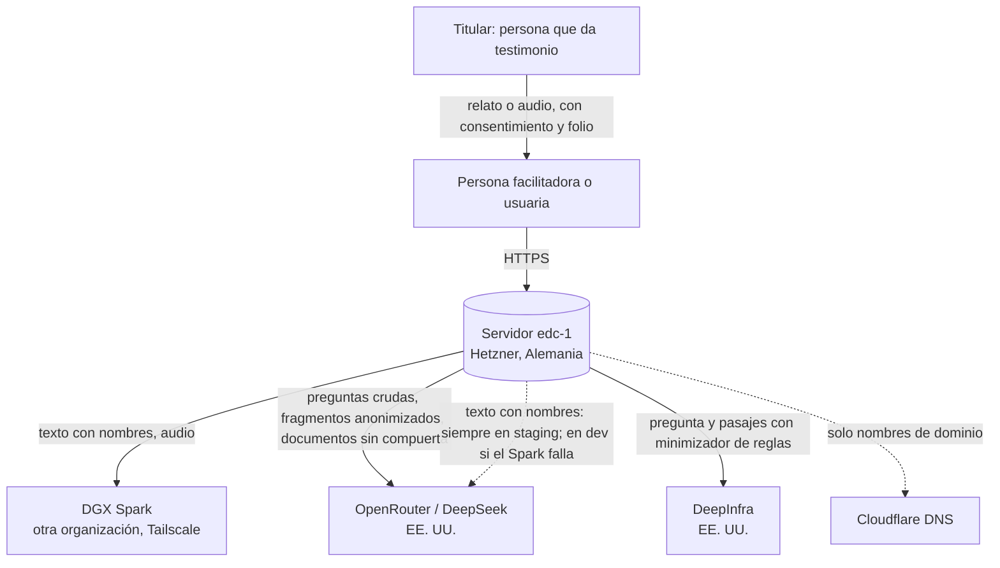
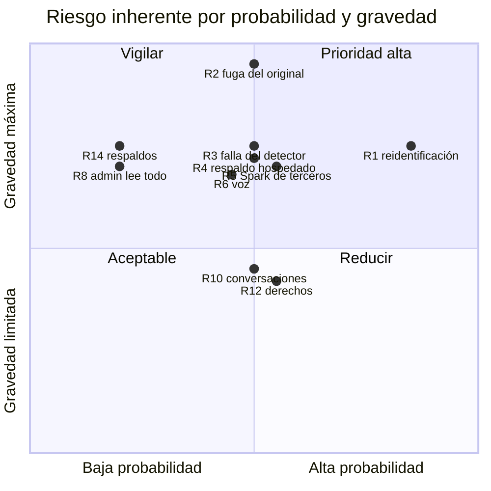

# Evaluación de impacto en la privacidad (EIPD)

- **Versión:** 1.1
- **Fecha:** 2026-11-03
- **Estado:** borrador. No presentada al Comité de Ética en Investigación (CEI). Sin validación jurídica
- **Fuentes:** `apps/backend/src/lib/anonymise/`, `apps/backend/src/collections/Documents.ts`, `apps/backend/src/collections/AnonymisationReviews.ts`, `apps/backend/src/lib/graph/queries.ts`, `services/ai-service/src/services/ai/pii-egress.ts`, `plan/anonimizacion-y-voces.md`, `plan/auditoria-ia-2026-10-17.md`, `infra/fleet/edc-1.md`, `infra/fleet/backups.md`, [corpus y datos de prueba](../04-datos/corpus-y-datos-de-prueba.md), auditoría de código del 2026-10-28, plan de adopción del Spark, propuesta de servidor de desarrollo, brief v1 del proyecto («Repositorio de Voces y Resonancias», documento externo al repo)

> **Aviso.** El sistema aún no recibe testimonios reales de participantes en producción: no existe entorno de producción, y en desarrollo (dev) sí hay documentos reales del proyecto, con nombres reales en sus textos originales, incluidos 115 archivos de participantes retenidos por la compuerta (citado de [corpus y datos de prueba](../04-datos/corpus-y-datos-de-prueba.md), medición del 2026-10-29).

**Para quién es y qué responde.** Este documento es para el área jurídica y la unidad de transparencia del CIDE, para el Comité de Ética en Investigación (CEI) y para el equipo del proyecto. Sigue la forma de una evaluación de impacto en la protección de datos personales (EIPD, en inglés PIA): describe el tratamiento, justifica su necesidad, identifica la base de licitud, los datos sensibles, los titulares y los encargados, evalúa los riesgos para las personas con probabilidad y gravedad, y termina con los siguientes pasos que deben cumplirse antes de recibir el primer testimonio real. Es un borrador: no se ha presentado al CEI y no afirma que el protocolo CEI-0003-2026 cubra estos testimonios. El marco legal es conocimiento general, a validar por el área jurídica. El detalle técnico de cada control está en [protección de datos](proteccion-de-datos.md) y en [seguridad](seguridad.md).

## Estado de los controles

Definiciones. **Implementado:** funciona hoy, con evidencia en código. **Planeado:** existe un diseño o un mecanismo sin activar. **Pendiente:** no existe todavía, y puede no tener plan. Código leído el 2026-11-03.

| Control o procedimiento | Estado | Evidencia o nota |
|---|---|---|
| Compuerta de anonimización, cerrada ante la falla del modelo | **Implementado** | `apps/backend/src/lib/anonymise/gate.ts` |
| Huella contra reintentos y edición trivial que no libera | **Implementado** | `lib/gatedTextHash.ts`; `gateResetForTextEdit` en `Documents.ts` |
| Lectura del original limitada a quien subió y a la administración de plataforma | **Implementado** | `mayReadGatedOriginal` en `Documents.ts` |
| Se conserva el nombre completo de quien subió un `documento`, nunca una parte; un administrador de ecosistema puede definir ese nombre (riesgo R19) | **Implementado** | `apps/backend/src/lib/anonymise/authorRestore.ts`; `apps/backend/src/lib/publicFigures.ts` |
| Grabación de testimonio no compartida; dictado en vivo sin almacenamiento | **Implementado** | `collections/Media.ts`; `services/audio-service/app/live.py` |
| Borrado de documentos y conversaciones, incluidas las copias del servicio de IA | **Implementado** | `Documents.ts`; `lib/conversationTurnErasure.ts` |
| Grafo solo con texto anonimizado y sin personas de testimonio | **Implementado** | `lib/graph/types.ts`; `lib/graph/queries.ts` |
| Consentimientos del estudiante, apagados por defecto; el de testimonios versionado | **Implementado** | `lib/student/testimonioConsent.ts`; `apps/web/src/lib/consent.ts` |
| Registro cerrado, bloqueo por intentos y revocación que corta chat y micrófono | **Implementado** | `collections/Users.ts`; `access/index.ts` |
| Minimizador de reglas antes de salir a un proveedor; no quita nombres | **Implementado** | `services/ai-service/src/services/ai/pii-egress.ts` |
| Plazos técnicos de transcripciones y de registro de avisos con huella | **Implementado** | `services/audio-service/app/config.py`; `callback/route.ts` |
| Interruptor del respaldo del detector | **Implementado** | `lib/platformSettings.ts`; ver la fila siguiente |
| Respaldo del detector en `none` | **Planeado** | El valor por defecto es `hosted` (`fallbackGenerator.ts`); no consta `none` en dev; staging siempre usa OpenRouter |
| Conserje de sesiones a 90 días | **Planeado** | `lib/sessionJanitor.ts`, apagado |
| Respaldos cifrados, copia en otro proveedor y prueba de restauración | **Planeado** | Diseño en `infra/fleet/backups.md`. Hoy: volcados manuales sin cifrar, copia en un equipo de desarrollo |
| Aviso integral y aviso simplificado en la interfaz | **Planeado** | Plantillas en [aviso de privacidad y consentimiento](aviso-de-privacidad-y-consentimiento.md); sin publicar |
| Consentimiento de quien aporta un testimonio | **Planeado** | Plantilla en borrador; sin validación ni uso |
| Servidor propio con tarjeta de video para el detector | **Planeado** | Propuesta de servidor de desarrollo del proyecto; sin compra confirmada en este repositorio |
| Retención cero donde esté disponible y migración a inferencia albergada de forma independiente | **Planeado** | Sin configuración en el código |
| Contratos, acuerdos de tratamiento de datos y términos aceptados con cada encargado | **Pendiente** | Ninguno documentado. Que existan términos aceptados es inferido de que hay cuentas pagadas; no verificado |
| Acuerdo de uso del Spark y autorización para alojar datos en un equipo ajeno | **Pendiente** | No existe. Ubicación física sin confirmar; no verificado que el equipo no conserve datos |
| Comprobante ético con folio y archivo de consentimientos | **Pendiente** | Sin código ni procedimiento |
| Canal ARCO, exportación de datos y cancelación de cuenta | **Pendiente** | Sin correo, sin ruta; la base rechaza el borrado de un usuario con conversación o membresía |
| Política de acceso al original y bitácora de lecturas | **Pendiente** | Sin plan técnico |
| Conservar el registro de revisiones al borrar un documento | **Pendiente** | Hoy se borra en cascada (`AnonymisationReviews.ts`); sin plan técnico |
| Depuración de trazas del servicio de IA | **Pendiente** | Sin purga en el código |
| Política de retención aprobada y destino final de los originales | **Pendiente** | Decisión abierta; sin plan de destino final |
| Política sobre menores: consentimiento de tutor y asentimiento | **Pendiente** | No existe; el sistema no registra edad |
| Impedir que una persona revisora apruebe su propia subida | **Pendiente** | `decideOnHold` en `lib/holdReview.ts` lo permite; decisión abierta |
| Presentación de esta evaluación y del consentimiento al CEI | **Pendiente** | No consta |
| Revisión del aviso y del consentimiento por aliados de campo | **Pendiente** | No consta |

## 1. Descripción del tratamiento

### 1.1 Qué es el sistema

Ecosistemas de Conocimiento (EDC) es la plataforma del proyecto SECIHTI IH-2025-I-445 del CIDE, cuyo componente de software se llama Repositorio de Voces y Resonancias. Reúne, por temas llamados ecosistemas (por ejemplo, prevención del dengue o discapacidad), documentos de referencia y testimonios de personas sobre su experiencia. Ofrece un asistente conversacional que responde citando ese acervo, una vista de grafo de los temas y una vista para estudiantes.

### 1.2 Ciclo del dato

1. **Captura.** Una persona usuaria con cuenta sube un documento o un testimonio (texto o audio), o conversa con el asistente. Una persona facilitadora puede subir el testimonio de alguien que no tiene cuenta.
2. **Transcripción.** El audio se transcribe a texto con Whisper large-v3 en un servidor con GPU.
3. **Anonimización.** Testimonios, turnos de conversación y documentos marcados se someten a la compuerta de anonimización: reglas fijas, un modelo de lenguaje que detecta nombres y una verificación. Lo dudoso queda retenido para revisión humana. En un documento marcado se conserva el nombre completo de quien lo subió. Los documentos sin marca entran sin anonimizar.
4. **Acervo.** La versión anonimizada se divide en fragmentos, se convierte en vectores de búsqueda y se agrega al acervo del ecosistema.
5. **Uso.** Miembros del ecosistema consultan al asistente, que responde con fragmentos del acervo. Las conversaciones anonimizadas de otros orientan las respuestas sin citarse. El grafo muestra temas y relaciones.
6. **Retiro.** Quien sube un contenido puede borrarlo; el borrado alcanza las copias en el servicio de IA y también elimina el registro de revisiones de ese documento.

### 1.3 Ámbito y volumen

Al 2026-10-30, EDC opera dos entornos, desarrollo (dev) y pruebas (staging, llamado "montaje"), en un servidor Hetzner. No hay entorno de producción. No hay usuarios reales ni testimonios reales de participantes en esos entornos (citado de la declaración del responsable de desarrollo del 2026-10-20).

Dev sí tiene datos reales. Desde el 2026-10-27 contiene documentos reales del proyecto, con nombres reales en sus textos originales, incluidos 115 archivos de participantes retenidos por la compuerta (registros de clase, ensayos y emergentes del ecosistema Semiosis práctica). Esos archivos no son testimonios, pero son datos personales. Varios lotes de documentos reales no llevan la marca de anonimización (citado de [corpus y datos de prueba](../04-datos/corpus-y-datos-de-prueba.md) §4). Esta evaluación se hace antes de recibir testimonios reales, y ya aplica a esos documentos.

## 2. Necesidad y proporcionalidad

| Pregunta | Respuesta |
|---|---|
| ¿Por qué se tratan datos personales? | El objeto de la investigación son las voces de personas sobre su experiencia (dengue, discapacidad, traducción en contextos institucionales). Sin testimonios no hay investigación. |
| ¿Se puede lograr el fin con menos datos? | Sí en parte, y el diseño lo hace: el testimonio se anonimiza antes de compartirse; el sistema no registra quién habla; la cuenta solo pide correo y nombre visible. |
| ¿Por qué se guarda el original? | Quien subió el testimonio necesita corregirlo cuando la compuerta lo retiene. El original solo lo leen esa persona y la administración de plataforma. La destrucción al cierre del proyecto es **Pendiente**: no hay plan de destino final. |
| ¿Por qué las conversaciones alimentan el acervo? | El proyecto estudia cómo resuenan las experiencias entre participantes. Los turnos de otras personas sirven de orientación, nunca se citan, y solo dentro del mismo ecosistema. |
| ¿Por qué se usan proveedores externos de IA? | El proyecto no tiene, en la Etapa 1, cómputo propio suficiente para modelos de lenguaje. Por ahora se usan proveedores hospedados, cuya retención de datos depende de sus condiciones; está planeado activar retención cero donde esté disponible y migrar a inferencia albergada de forma independiente. El paso que ve texto con nombres corre en un servidor de otra organización en dev, y en un proveedor hospedado en staging o si ese servidor falla (sección 6). Hay una propuesta de servidor propio para el detector (**Planeado**). |
| ¿Es proporcional? | Aún no se puede afirmar. Lo sería con las medidas de la sección 7 una vez cumplidos los siguientes pasos. El beneficio es la investigación humanística con participación de comunidades; el riesgo principal, la reidentificación, se reduce con anonimización y revisión humana, sin eliminarse. |

## 3. Base de licitud

- **Consentimiento informado.** Es la base prevista para todos los titulares, con plantillas en borrador (**Planeado**). Para datos sensibles, el consentimiento debe ser expreso y por escrito, con firma autógrafa o electrónica. El comprobante ético con folio y el aviso en la interfaz no existen: **Pendiente** y **Planeado**. Hoy solo funcionan los tres consentimientos del estudiante, y solo el de testimonios guarda fecha y versión.
- **Investigación humanística.** El tratamiento se hace dentro de un proyecto de investigación financiado por SECIHTI. El protocolo CEI-0003-2026 corresponde a la línea de razonamiento judicial; no consta que cubra los testimonios de EDC, y esta evaluación no lo afirma. Los Principios de Chapultepec (presentados por SECIHTI y la ATDT el 2026-01-29, con matriz de correspondencia en el registro del proyecto del 2026-10-21) son el marco ético adoptado.
- **Marco legal.** El CIDE es un centro público de investigación y, como tal, probablemente es sujeto obligado de la Ley General de Protección de Datos Personales en Posesión de Sujetos Obligados (LGPDPPSO). La nota de marco legal está en [aviso de privacidad y consentimiento](aviso-de-privacidad-y-consentimiento.md#a-nota-de-marco-legal). Esa nota es conocimiento general y debe validarla el área jurídica.

## 4. Datos sensibles

El sistema recibe, por diseño, datos personales sensibles. La tabla indica dónde aparecen y cómo se tratan.

| Tipo | Dónde aparece | Tratamiento |
|---|---|---|
| **Salud** | Testimonios del ecosistema de dengue (síntomas, atención médica, familiares enfermos) | Anonimización (**Implementado**); original restringido (**Implementado**); consentimiento expreso (**Planeado**) |
| **Discapacidad** | Testimonios del ecosistema de discapacidad; el corpus sintético de prueba ya contiene este tipo de relatos (`corpus-generativo/v2/discapacidad/`) | Igual; aviso y consentimiento en formatos accesibles (**Pendiente**) |
| **Lengua u origen étnico** | El sistema detecta la lengua de un testimonio y la guarda como metadato (`lengua`) | Solo como metadato del texto, nunca ligado a una persona identificada |
| **Opiniones y creencias** | Conversaciones y testimonios | Anonimización de turnos; orientación sin cita |
| **Voz** | Grabaciones de audio | La grabación de un testimonio no se comparte (**Implementado**). Se transcribe en un servidor de otra organización |
| **Datos de menores** | Posible, porque el proyecto trabaja con una escuela primaria (citado de las notas de contexto del equipo) | **Pendiente.** No existe política: el sistema no registra edad y no puede impedir la contribución de un menor. Se propone consentimiento de madre, padre o tutor y asentimiento del menor |

## 5. Categorías de titulares

| Titular | Relación con el sistema | Qué datos suyos hay | Cómo se le informa |
|---|---|---|---|
| **Personas usuarias** (participantes, facilitadoras, investigadoras, responsables de ecosistema) | Tienen cuenta | Cuenta, membresías, conversaciones, documentos, valoraciones | Hoy no se les informa en la interfaz. Aviso integral y simplificado: **Planeado** |
| **Personas que dan un testimonio** | Pueden no tener cuenta; su relato lo sube una facilitadora | Su relato, su voz si es audio | Comprobante ético con folio: **Pendiente**. Plantilla de consentimiento: **Planeado** |
| **Terceros nombrados** en un testimonio o documento (familiares, personal de salud, vecinos) | No tienen relación con el sistema | Su nombre y detalles dentro del relato | No se les puede informar individualmente; su protección es la anonimización, que sustituye su nombre por un seudónimo. En documentos sin marca de anonimización esa protección no aplica |
| **Estudiantes** | Tienen cuenta con rol `estudiante` | Lo de una persona usuaria, más su reporte de actividad | Tres consentimientos específicos en su vista (**Implementado**). Aviso integral: **Planeado** |
| **Personas que suben un documento marcado** | Tienen cuenta y membresía | El nombre completo de su membresía (`personName`), visible en ese documento y en el acervo | Lo dirá el aviso integral (**Planeado**). No conserva partes del nombre, ni aplica a testimonios o conversaciones. No hay forma de negarse dentro de la plataforma |
| **Figuras públicas** citadas en documentos | Ninguna | Nombre en contexto público | Solo se conservan en documentos de referencia si un administrador de plataforma lo activa; nunca en testimonios |

## 6. Flujos y encargados

**Corrección: el texto sin anonimizar sí sale a Estados Unidos.** Hoy salen a OpenRouter el texto con nombres que ve el detector, siempre en staging y en dev cuando el Spark falla (respaldo `hosted` por defecto), la pregunta cruda de la persona y los documentos sin compuerta. Solo pasan antes un minimizador de reglas que no quita nombres.

Por ahora se usan proveedores hospedados, cuya retención de datos depende de sus condiciones; está planeado activar retención cero donde esté disponible y migrar a inferencia albergada de forma independiente. Hoy no hay retención cero configurada en el código ni contratos documentados con ningún encargado.

| Encargado | Ubicación | Qué recibe | Para qué | Contrato y estado (todo **Pendiente** de documentar) |
|---|---|---|---|---|
| **Hetzner Online** (hospedaje del servidor `edc-1`) | Unión Europea: Falkenstein, Alemania (`fsn1`, citado de `infra/fleet/edc-1.md`) | Todo lo que guarda EDC: bases de datos, archivos, respaldos de imagen de disco | Infraestructura | Sin contrato ni acuerdo de tratamiento documentado en el repositorio. Términos aceptados: inferido de que hay cuenta pagada; no verificado |
| **DGX Spark** (servidor con GPU de otra organización, por Tailscale) | Ubicación física sin confirmar | Texto de testimonios y turnos con nombres (detector), audio (transcripción), texto anonimizado y documentos sin compuerta (embeddings; rerank en dev, inferido) | Anonimización, transcripción, búsqueda | No existe acuerdo de uso. No verificado que el equipo no conserve datos. Falta la autorización del responsable técnico para alojar datos en un equipo ajeno |
| **OpenRouter** (enrutador de modelos) y **DeepSeek** como modelo de fondo | Estados Unidos; el modelo se sirve por proveedores que elige OpenRouter | Preguntas crudas, fragmentos anonimizados, documentos de referencia sin compuerta; en staging, siempre el detector con texto con nombres; en dev, el detector si el Spark falla | Generación de respuestas, grafo, consultas, detector | Sin contrato documentado. La retención depende de las condiciones del proveedor. Aviso de remisión internacional: **Planeado** |
| **DeepInfra** | Estados Unidos | La pregunta y pasajes candidatos, solo con el minimizador de reglas | Reordenar resultados de búsqueda (staging) | Sin contrato documentado; llave propia del proyecto desde el 2026-10-17. Aviso de remisión internacional: **Planeado** |
| **Cloudflare** (DNS del dominio `ecosistemasdeconocimiento.com`) | Global | Solo consultas de nombre de dominio; no ve contenido porque el registro es solo DNS, sin proxy, y el tráfico va directo al servidor con HTTPS (`infra/fleet/edc-1.md`) | Resolución de nombres | Sin contrato documentado; no trata datos personales del contenido |
| **Let's Encrypt** (certificados) | Estados Unidos | Solo el nombre de dominio | Cifrado en tránsito | No trata datos personales |

## 7. Riesgos para los titulares

Escala: **Probabilidad** baja, media, alta. **Gravedad** limitada, significativa, grave, máxima. El riesgo inherente es antes de las medidas. El residual es **el de hoy**, solo con las medidas Implementadas; subiría o bajaría al completar lo Planeado y lo Pendiente. Es una lectura cualitativa de la redacción, no una medición, y debe revisarla el responsable técnico.

| # | Riesgo | Titular afectado | Prob. | Gravedad | Medidas y estado | Riesgo residual hoy |
|---|---|---|---|---|---|---|
| R1 | **Reidentificación por contexto.** Aunque se quite el nombre, el lugar, el oficio y los hechos pueden señalar a alguien en un ecosistema pequeño | Persona que da testimonio, terceros nombrados | Alta | Grave | **Implementado:** generalización de fechas; sustitución de domicilios y localidades; revisión humana de lo dudoso; aislamiento por ecosistema; grabación no compartida; orientación sin cita. **Planeado:** informar el riesgo en el consentimiento | Medio. No hay solución técnica completa (`plan/anonimizacion-y-voces.md` §5) |
| R2 | **Fuga del original.** El texto sin anonimizar llega a quien no debe leerlo | Persona que da testimonio, terceros | Media | Máxima | **Implementado:** `mayReadGatedOriginal`; consulta por nombre acotada; revisión ve `heldText`; grabación no compartida; fuga de la auditoría 2026-10-17 cerrada. **Pendiente:** cifrado en reposo | Medio |
| R3 | **Falla del detector.** El modelo no encuentra un nombre y el texto llega al acervo | Terceros nombrados | Media | Grave | **Implementado:** etapas deterministas antes del modelo; verificación de segunda pasada; retención si el modelo falla o el tramo no se ubica; huella anti reintento; edición trivial no libera | Bajo a medio. Medido: 6 de 6 corridas con nombres sembrados quedaron retenidas (2026-10-21, `gate.ts`); una muestra pequeña con textos de prueba |
| R4 | **Respaldo hospedado del detector.** El texto con nombres va a un proveedor en Estados Unidos: siempre en staging; en dev, si el Spark falla | Persona que da testimonio, terceros | Media | Grave | **Implementado:** interruptor; si la lectura del ajuste falla, el código usa `none`; los títulos de registros retenidos nunca van al hospedado. **Planeado:** fijar `none` antes del primer testimonio real. Hoy el valor por defecto es `hosted` | Alto hasta fijar `none` |
| R5 | **Tercero sin control directo en el Spark.** El servidor pertenece a otra organización | Persona que da testimonio | Media | Grave | **Implementado:** acceso por token. **Pendiente:** acuerdo de uso; verificar que el equipo no conserve datos; confirmar ubicación. **Planeado:** servidor propio. El cifrado de la red privada no se verificó en esta versión | Alto |
| R6 | **Voz como dato biométrico.** La grabación puede identificar a la persona | Persona que da testimonio | Media | Grave | **Implementado:** grabación de testimonio no compartida; dictado en vivo sin almacenamiento; borrado del archivo al borrar el documento. La transcripción corre en el Spark (ver R5) | Medio |
| R7 | **Trazas con nombres.** Registros técnicos del servicio de IA probablemente guardan la salida del detector, que es la lista de nombres (inferido) | Terceros nombrados | Media | Significativa | **Implementado:** minimizador de reglas, que no quita nombres. **Pendiente:** depuración de trazas y plazo | Medio |
| R8 | **La administración de plataforma lee todo.** Incluido el original de cualquier testimonio | Persona que da testimonio | Baja | Grave | **Pendiente:** política de acceso y bitácora de lecturas, sin plan técnico | Medio |
| R9 | **Pérdida de la auditoría en cascada.** Borrar un documento borra su registro de revisiones | Todas | Media | Significativa | **Pendiente:** conservar o exportar el registro, sin plan técnico. Hoy se pierde (`AnonymisationReviews.ts`) | Medio |
| R10 | **Conversaciones al acervo sin que la persona lo sepa** | Personas usuarias | Media | Significativa | **Implementado:** anonimización de cada turno; orientación sin cita; alcance de ecosistema; borrado real al borrar la conversación. **Planeado:** aviso integral y simplificado. Hoy la interfaz no lo dice | Medio |
| R11 | **Retención excesiva** del original, conversaciones, trazas y transcripciones | Todas | Media | Significativa | **Implementado:** transcripciones a 1 h tras entrega; registro de avisos solo con huella. **Planeado:** conserje de sesiones a 90 días. **Pendiente:** política de retención | Medio |
| R12 | **Imposibilidad de ejercer derechos** (acceso, cancelación) | Personas usuarias; persona que da testimonio | Media | Significativa | **Implementado:** borrar lo propio desde la plataforma. **Pendiente:** canal ARCO, exportación, cancelación de cuenta, retiro por folio | Alto |
| R13 | **Acceso indebido a la cuenta** | Personas usuarias | Baja | Significativa | **Implementado:** registro cerrado; bloqueo tras 5 intentos; cookie `httpOnly` y `secure`; revocación corta el chat y el micrófono. **Pendiente:** límite de tasa en login; contraseña de ssh sin verificar | Bajo a medio |
| R14 | **Pérdida o robo de respaldos** | Todas | Baja | Grave | **Planeado:** respaldos cifrados, copia en otro proveedor, prueba de restauración. Hoy: sin cifrar, con copia en un equipo de desarrollo (citado de [respaldos y recuperación](../05-infraestructura/respaldos-y-recuperacion.md)) | Medio |
| R15 | **Turnos que citan un documento retirado** siguen como orientación | Autor del documento | Baja | Limitada | **Implementado:** turnos anonimizados; borrar la conversación los borra. **Pendiente:** retirarlos al retirar el documento | Bajo |
| R16 | **Menores de edad** entre participantes | Menores | Baja | Grave | **Pendiente:** política, consentimiento de madre, padre o tutor y asentimiento. El sistema no registra edad | Alto si se aceptan contribuciones de menores |
| R17 | **Un revisor aprueba su propio texto** | Persona que da testimonio | Baja | Significativa | **Pendiente.** El código lo permite (`decideOnHold` en `lib/holdReview.ts`); decisión abierta del responsable técnico | Medio |
| R18 | **Grafo que revela personas** por relaciones con poco soporte | Terceros | Baja | Significativa | **Implementado:** sin personas de testimonio ni conversación (tres capas); solo texto anonimizado y publicado; umbral de soporte configurable por entorno | Bajo |
| R19 | **Nombre visible de quien sube un documento.** Por defecto queda visible en el acervo, y un administrador de ecosistema puede definir ese `personName`, incluso con el nombre de otra persona. **Homónimos:** otra persona con el nombre exacto de quien subió también queda visible, porque la comparación es de texto | Quien sube documentos; la persona cuyo nombre se asigne; quien se llame igual | Baja | Significativa | **Implementado:** solo el nombre completo tal como está en `personName`, nunca una parte; solo `documento`; solo tras `ready`; sin membresía activa, vacío o lectura fallida no se conserva nada; registro en `documents.authors_kept`; el nombre no se conserva pegado a otro nombre o seudónimo fuera de una línea de autoría; lo que el modelo extraiga con ese nombre, con el nombre completo dentro de una frase, solo con palabras suyas o terminado en su apellido, no se vuelve nodo del grafo. **Sin control:** homónimos; una parte del nombre dentro de una frase más larga que no termine en el apellido, como `Seminario Ana López sobre semiosis`, sí puede volverse nodo, y un fragmento con solo una parte del nombre se conserva. **Planeado:** declararlo en el aviso integral publicado. **Pendiente:** bitácora de cambios de membresía; forma de negarse | Bajo a medio |

Las posiciones del cuadrante son una lectura cualitativa del equipo, no una medición.

## 8. Consulta a interesados

- **Comité de Ética en Investigación del CIDE: Pendiente.** Esta evaluación, el aviso y el consentimiento no se han presentado al CEI. El CEI aprobó el 2026-04-17 el protocolo CEI-0003-2026, de la línea de razonamiento judicial, vigente hasta abril de 2028 (citado de `Proyecto/Estado del Proyecto IH-2025-i-445`, carpeta de textos del proyecto). No consta que ese protocolo cubra los ecosistemas de dengue, discapacidad o traducción, ni estos testimonios.
- **Equipo del proyecto.** El responsable técnico del proyecto, [Responsable Técnico], y el coordinador de desarrollo, [responsable de desarrollo], decidieron las reglas de anonimización registradas en el código (por ejemplo, el versionado del consentimiento de testimonios, decidido el 2026-10-28, y que una edición trivial no libere un texto retenido).
- **Comunidades y aliados de campo: Pendiente.** Se propone que los aliados (instituciones de discapacidad de la Ciudad de México, PILARES, INSP para el taller de dengue, una escuela primaria de Cuernavaca) revisen el aviso simplificado y el consentimiento en lenguaje claro antes de cada taller. No consta que haya ocurrido.
- **Área jurídica y unidad de transparencia del CIDE: Pendiente.** Deben validar la ley aplicable, la figura de responsable, los encargados y las transferencias.

## 9. Conclusión y plan de acción

**Conclusión del borrador.** El tratamiento es necesario para el fin de investigación. El diseño reduce riesgos principales: la compuerta es cerrada ante la falla del modelo y está medida, el original está restringido, la grabación no se comparte y el borrado alcanza al servicio de IA. Hoy el tratamiento **no** es aceptable para iniciar la captura de testimonios reales: faltan consentimiento, aviso, canal ARCO, acuerdo con los encargados, validación jurídica y revisión del CEI, y el texto con nombres aún puede ir a un proveedor en Estados Unidos. Los riesgos residuales más altos hoy son R4, R5 y R12, además de la reidentificación por contexto (R1). Los documentos reales ya cargados en dev requieren una decisión aparte.

Las acciones están en [Siguientes pasos](#siguientes-pasos). No llevan fecha porque ninguna está acordada.

## Referencias

- `apps/backend/src/lib/anonymise/gate.ts`, `fallbackGenerator.ts`
- `apps/backend/src/collections/Documents.ts`, `AnonymisationReviews.ts`
- `apps/backend/src/lib/graph/queries.ts`, `apps/backend/src/lib/graph/types.ts`
- `services/ai-service/src/services/ai/pii-egress.ts`
- `plan/anonimizacion-y-voces.md`, `plan/auditoria-ia-2026-10-17.md`
- Auditoría de código del 2026-10-28; plan de adopción del Spark; propuesta de servidor de desarrollo
- `infra/fleet/edc-1.md`, `infra/fleet/backups.md`
- Brief v1 del proyecto, «Repositorio de Voces y Resonancias» (documento externo al repo)
- [Corpus y datos de prueba](../04-datos/corpus-y-datos-de-prueba.md)
- [Respaldos y recuperación](../05-infraestructura/respaldos-y-recuperacion.md)
- [Protección de datos](proteccion-de-datos.md)
- [Aviso de privacidad y consentimiento](aviso-de-privacidad-y-consentimiento.md)
- [Seguridad](seguridad.md)
- [Registro de riesgos](../01-proyecto/registro-de-riesgos.md)
- [Infraestructura y entornos](../05-infraestructura/infraestructura-y-entornos.md)

## Siguientes pasos

Sin fechas: ninguna está acordada. Deben cumplirse antes del primer testimonio real, salvo el 1, que aplica ya a dev. El responsable es una sugerencia.

1. **Pendiente.** Decidir el tratamiento de los documentos reales ya cargados en dev. Atiende R2 y R4. Responsable técnico.
2. **Pendiente.** Validar la ley aplicable, la figura de responsable y el texto del aviso integral. Atiende R10 y R12. Área jurídica del CIDE.
3. **Pendiente.** Presentar al CEI esta evaluación, el aviso y el consentimiento, y aclarar qué protocolo los cubre. Atiende R1 y R16. Responsable técnico.
4. **Planeado.** Fijar el respaldo del detector en `none` en todo entorno que reciba datos reales y verificarlo; resolver que staging no tiene detector propio. Atiende R4. Coordinación de desarrollo.
5. **Pendiente.** Formalizar el acuerdo de uso del Spark, confirmar su ubicación y qué conserva. Atiende R5. Responsable técnico.
6. **Planeado.** Mover el detector a un servidor propio, según la propuesta de servidor de desarrollo. Atiende R5. Responsable técnico.
7. **Pendiente.** Documentar contratos y condiciones de retención de cada encargado. Atiende R4 y R5. Responsable técnico y área jurídica.
8. **Planeado.** Activar retención cero donde esté disponible y migrar a inferencia albergada de forma independiente. Atiende R4. Coordinación de desarrollo.
9. **Planeado.** Publicar el aviso simplificado en la interfaz, incluida la frase de que las conversaciones alimentan el acervo. Atiende R10. Coordinación de desarrollo.
10. **Pendiente.** Crear el comprobante ético con folio para cada testimonio. Atiende R1 y R12. Coordinación de desarrollo y facilitación.
11. **Pendiente.** Abrir el correo institucional de datos personales, publicar el procedimiento ARCO y crear exportación y cancelación de cuenta. Atiende R12. Unidad de transparencia y coordinación de desarrollo.
12. **Planeado.** Activar el conserje de sesiones. Atiende R11. Coordinación de desarrollo.
13. **Pendiente.** Aprobar la política de retención con destino final, y crear la depuración de trazas. Atiende R7 y R11. Responsable técnico y coordinación de desarrollo.
14. **Planeado.** Programar respaldos cifrados con copia fuera del servidor y hacer una prueba de restauración. Atiende R14. Coordinación de desarrollo.
15. **Pendiente.** Definir la política de acceso al original y su bitácora, y conservar el registro de revisiones al borrar un documento. Atiende R8 y R9. Responsable técnico.
16. **Pendiente.** Definir la política sobre menores. Atiende R16. Responsable técnico y CEI.
17. **Pendiente.** Decidir si una persona revisora puede aprobar su propia subida y aplicarlo. Atiende R17. Responsable técnico.
18. **Pendiente.** Obtener la revisión de aliados de campo. Atiende R1 y R10. Facilitación.
19. **Pendiente.** Revisar esta evaluación al cambiar un encargado, al abrir un entorno de producción o a los 12 meses. Todos los riesgos. Responsable técnico.
