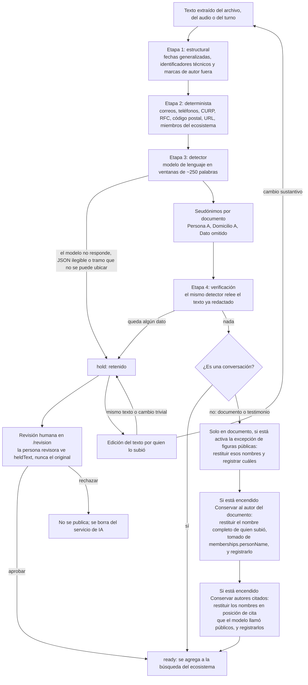
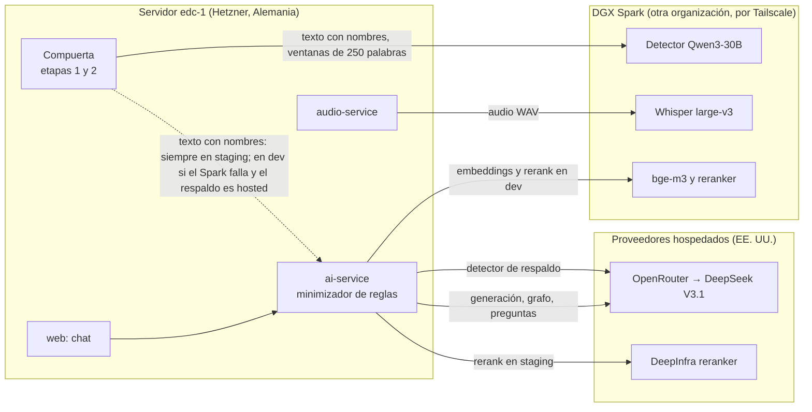

# Protección de datos personales

- **Versión:** 1.2
- **Fecha:** 2026-11-07
- **Estado:** descripción del estado actual; cada control está marcado como Implementado, Planeado o Pendiente. Sin validación jurídica
- **Fuentes:** `apps/backend/src/lib/anonymise/` (en especial `gate.ts`, `pseudonyms.ts`, `fallbackGenerator.ts`, `detector.ts`), `apps/backend/src/collections/Documents.ts`, `apps/backend/src/collections/AnonymisationReviews.ts`, `apps/backend/src/collections/StudentProfiles.ts`, `apps/backend/src/lib/conversationIngest.ts`, `apps/backend/src/lib/conversationTurnErasure.ts`, `apps/backend/src/lib/graph/queries.ts`, `apps/backend/src/lib/graph/types.ts`, `apps/backend/src/lib/student/testimonioConsent.ts`, `apps/web/src/lib/consent.ts`, `apps/web/src/lib/estudiante.ts`, `apps/web/src/lib/server/engine/orientation.ts`, `plan/anonimizacion-y-voces.md`, `infra/fleet/edc-1.md`, `infra/fleet/backups.md`, [corpus y datos de prueba](../04-datos/corpus-y-datos-de-prueba.md), auditoría de código del 2026-10-28, [ADR-0020](../03-arquitectura/adr/ADR-0020-anonimizar-todo-y-conservar-nombres-por-documento.md) (decisión del 2026-11-07)

> **Aviso.** El sistema aún no recibe testimonios reales de participantes en producción: no existe entorno de producción, y en desarrollo (dev) sí hay documentos reales del proyecto, con nombres reales en sus textos originales, incluidos materiales de participantes del taller de Semiosis, en borrador hasta tener el consentimiento de sus autores (ver [corpus y datos de prueba](../04-datos/corpus-y-datos-de-prueba.md)).

**Para quién es y qué responde.** Este documento es para el equipo del proyecto, para quien revise el tratamiento de datos desde el CIDE, y para quien mantenga el código. Responde qué datos personales recibe Ecosistemas de Conocimiento (EDC), dónde quedan, quién los lee, cuánto tiempo se guardan, qué texto sale a proveedores externos y en qué paso, y cómo funciona la compuerta de anonimización que decide qué entra al acervo compartido. Los riesgos y su evaluación están en [la evaluación de impacto](evaluacion-de-impacto-privacidad.md); los textos para las personas titulares están en [el aviso de privacidad y los consentimientos](aviso-de-privacidad-y-consentimiento.md); los controles técnicos de seguridad están en [seguridad](seguridad.md).

## Estado de los controles

Definiciones. **Implementado:** funciona hoy, con evidencia en código. **Planeado:** existe un diseño o un mecanismo sin activar. **Pendiente:** no existe todavía, y puede no tener plan. Código leído el 2026-11-03 salvo donde se indique otra cosa; lo de la rama `feat/anonymise-controls`, leído el 2026-11-07 en su commit `98619590`. **Sin desplegar** marca lo construido en la rama `feat/anonymise-controls` (decisión del 2026-11-07) que todavía no corre en dev ni en staging.

| Control | Estado | Evidencia o nota |
|---|---|---|
| Compuerta de anonimización con dos salidas, `ready` o `hold` | **Implementado** | `apps/backend/src/lib/anonymise/gate.ts`; `apps/backend/src/lib/anonymiseDocument.ts` |
| Seudónimos por documento, sin tabla de correspondencias | **Implementado** | `apps/backend/src/lib/anonymise/pseudonyms.ts` |
| Por omisión se sustituyen todos los nombres, también el de quien subió (sección 3.5) | **Implementado**, sin desplegar | Rama `feat/anonymise-controls`; [ADR-0020](../03-arquitectura/adr/ADR-0020-anonimizar-todo-y-conservar-nombres-por-documento.md). Hasta el despliegue, un `documento` con compuerta conserva por omisión el nombre de quien lo subió |
| Interruptor "Conservar al autor del documento": solo el nombre completo de quien subió, nunca una parte; un administrador de ecosistema puede definir ese nombre | **Implementado**, sin desplegar | `apps/backend/src/lib/anonymise/authorRestore.ts`; `apps/backend/src/lib/publicFigures.ts`; interruptor en la rama `feat/anonymise-controls` |
| Interruptor "Conservar autores citados": reglas fijas encuentran la cita y el modelo decide; solo sobre un resultado listo | **Implementado**, sin desplegar | `lib/anonymise/citedAuthorRestore.ts` |
| Cambio de interruptor comprobado en el servidor, que vuelve a pasar por la compuerta un documento listo, retenido o aprobado solo si el cambio afecta su resultado; aprobar una retención con ajustes viejos responde 409 | **Implementado**, sin desplegar | `PATCH /api/documents/:id/anonimizacion`; `lib/anonymisationControls.ts`; `lib/holdReview.ts` |
| Al volver a pasar por la compuerta, borrar antes las copias anteriores en el servicio de IA y las filas del grafo del documento | **Implementado**, sin desplegar | `lib/anonymisationControls.ts`; `lib/graph/documentGraph.ts` |
| Fila de auditoría por cada cambio de interruptor, por documento y por ecosistema, y del respaldo del detector, sin texto | **Implementado**, sin desplegar | `collections/AnonymisationSettingChanges.ts` |
| Advertencia visible en un testimonio con un interruptor encendido | **Implementado**, sin desplegar | `apps/web/src/routes/documentos/[id]/anonimizacion/` |
| Volver a pasar por la compuerta los documentos que heredan un valor del ecosistema cuando pasa de encendido a apagado y conservaron un nombre bajo él | **Implementado**, sin desplegar | `regateInheritors` en `lib/anonymisationControls.ts`; hasta 3 intentos; lo que siga fallando queda en `pendingRegate` y se reintenta desde el documento o desde Ajustes. Sin cola persistente. De apagado a encendido no se procesa nada, por decisión (sección 3.5) |
| Volver a pasar de forma automática los documentos procesados con la regla del 2026-10-28 (caso A3) | **Pendiente** | Se vuelven a pasar solo si alguien apaga su interruptor, si un ecosistema pasa de encendido a apagado o si alguien pulsa Reintentar |
| Reintento automático de una copia publicada retirada cuyo borrado falló | **Pendiente** | El cambio de ecosistema la intenta hasta 3 veces; después queda oculta con la fila en publicada hasta que alguien pulse Reintentar (sección 3.5) |
| Pantalla de anonimización por documento, sin la lista de nombres sustituidos ni correspondencias | **Implementado**, sin desplegar | Rama `feat/anonymise-controls` |
| Verificación de una sola ronda que retiene ante cualquier resto | **Implementado** | `DEFAULT_VERIFY_ROUNDS = 1` en `gate.ts` |
| Huella contra reintentos sobre el mismo texto y edición trivial que no libera | **Implementado** | `apps/backend/src/lib/gatedTextHash.ts`; `gateResetForTextEdit` en `Documents.ts` |
| Columnas de la compuerta no escribibles por API | **Implementado** | `gateWritesOnly` en `Documents.ts` |
| Lectura del original limitada a quien subió y a la administración de plataforma | **Implementado** | `mayReadGatedOriginal` en `Documents.ts` |
| Grabación de testimonio no compartida | **Implementado** | `apps/backend/src/collections/Media.ts` |
| Revisión humana sobre `heldText` con el permiso `holds:review` | **Implementado** | `apps/backend/src/lib/holdReview.ts`; `lib/permissions.ts` |
| Registro de revisiones de solo anexar desde la API | **Implementado** | `AnonymisationReviews.ts`; no sobrevive al borrado del documento (ver abajo) |
| Aislamiento por ecosistema en el servicio de IA | **Implementado** | `apps/backend/src/lib/aiClient.ts` (`X-AI-Org`) |
| Orientación sin cita y con alcance de ecosistema | **Implementado** | `apps/web/src/lib/server/engine/orientation.ts`; `prompt.ts` |
| Borrado de un documento y de sus copias, incluida la ingesta tardía | **Implementado** | `retireDeletedDocumentHook` en `Documents.ts`; `lib/documentLateErasure.ts` |
| Borrado de una conversación y de sus turnos en el acervo | **Implementado** | `lib/conversationTurnErasure.ts` |
| Grafo sin personas de testimonio ni de conversación | **Implementado** | `personaAllowed` en `lib/graph/types.ts` |
| Tres consentimientos de estudiante; el de testimonios con fecha y versión | **Implementado** | `lib/student/testimonioConsent.ts`; `StudentProfiles.ts` |
| Interruptor del respaldo del detector (`hosted` o `none`); lectura fallida usa `none` | **Implementado** | `lib/platformSettings.ts`; el mecanismo existe, su valor seguro no está activado |
| Títulos de un registro retenido nunca van al modelo hospedado | **Implementado** | `lib/testimonioTitle.ts` |
| Título de un `documento` con compuerta redactado por la compuerta; sin él, "Documento" y nunca el nombre del archivo | **Implementado** | `redactTitle` en `gate.ts`; `documentTitleFor` en `lib/contentKind.ts`; `Documents.ts` y `publishDocument.ts` pasan el nombre a la compuerta (2026-11-10). Usan el título redactado o "Documento": la ingesta y la publicación en el servicio de IA y las citas del chat, el grafo, la Biblioteca, el módulo de estudiante (salvo a quien subió la nota), el reintento de lengua y la API REST (`name` neutro y sin filtro ni orden por `name` para quien no lo subió). Quien lo subió ve su nombre, también en la pantalla de anonimización; la administración de plataforma también. Lo ingerido antes del 2026-11-10 guarda su título anterior en el servicio de IA hasta re-ingerirlo |
| Minimizador de reglas antes de salir a un proveedor (correo, teléfono, CURP, RFC, domicilio; no quita nombres) | **Implementado** | `services/ai-service/src/services/ai/pii-egress.ts` |
| Plazos técnicos: transcripciones en Redis, trabajos en cola, rotación de registros | **Implementado** | `services/audio-service/app/config.py`; `queue/queues.ts`; `infra/docker-compose.yml` |
| Registro de avisos de servicio solo con huella y longitud para filas nuevas | **Implementado** | `apps/backend/src/app/api/ai-service/callback/route.ts` |
| Respaldo del detector fijado en `none` en todo entorno con datos reales | **Planeado** | Interruptor listo; el valor por defecto del código es `hosted` (`fallbackGenerator.ts`) y no consta `none` en dev; staging no usa el Spark |
| Conserje de sesiones a 90 días de inactividad | **Planeado** | Código en `lib/sessionJanitor.ts`, apagado por defecto (`SESSION_JANITOR_ENABLED`) |
| Respaldos cifrados con copia en otro proveedor y prueba de restauración | **Planeado** | Diseño en `infra/fleet/backups.md`; nada construido |
| Aviso en la interfaz de que las conversaciones alimentan el acervo | **Planeado** | Plantilla en [aviso simplificado](aviso-de-privacidad-y-consentimiento.md#c-aviso-simplificado-para-la-interfaz); ningún texto en `apps/web/src` |
| Consentimiento informado para quien aporta un testimonio | **Planeado** | Plantilla en borrador en [consentimientos](aviso-de-privacidad-y-consentimiento.md#d-consentimiento-informado-para-quien-aporta-un-testimonio); sin uso real |
| Retención cero donde esté disponible y migración a inferencia albergada de forma independiente | **Planeado** | Sin configuración en el código ni contratos documentados |
| Comprobante ético con folio y archivo de consentimientos | **Pendiente** | Sin código ni procedimiento escrito |
| Fecha y versión de `shareWithPeers` y `shareActivity` | **Pendiente** | `StudentProfiles.ts` solo guarda fecha y versión de testimonios |
| Cancelación de cuenta | **Pendiente** | Sin ruta; la base rechaza borrar un usuario con conversación o membresía (`Ratings.deletePaths.pg.test.ts`) |
| Canal para derechos de acceso, rectificación, cancelación y oposición (ARCO) | **Pendiente** | Sin correo ni procedimiento activo |
| Política de retención aprobada, con destino final de los originales | **Pendiente** | Plazos sin decidir; sin plan de destino final |
| Depuración de trazas del servicio de IA | **Pendiente** | Sin purga en `services/ai-service/src` |
| Depuración de filas viejas del registro de avisos | **Pendiente** | `callback/route.ts` indica que esas filas no se borran |
| Conservar el registro de revisiones al borrar un documento | **Pendiente** | La llave foránea es `ON DELETE cascade` (`AnonymisationReviews.ts`); sin plan técnico |
| Bitácora de lecturas del original por la administración de plataforma | **Pendiente** | Sin política ni plan técnico |
| Bitácora de cambios de rol, membresía y de los demás ajustes | **Pendiente** | Sin plan técnico |
| Impedir que una persona revisora apruebe su propia subida | **Pendiente** | `decideOnHold` en `holdReview.ts` lo permite; decisión abierta del responsable técnico |
| Purgar trabajos en cola del servicio de IA al borrar un documento | **Pendiente** | Hallazgo abierto de la auditoría de código del 2026-10-28 |
| Retirar del acervo los turnos que citan un documento retirado | **Pendiente** | Tarea diferida en el encabezado de `conversationIngest.ts` |

**Sobre la inferencia.** Por ahora se usan proveedores hospedados, cuya retención de datos depende de sus condiciones; está planeado activar retención cero donde esté disponible y migrar a inferencia albergada de forma independiente.

## 1. Principios

El tratamiento de datos en EDC sigue seis principios. Los seis tienen mecanismo en el código y están **Implementados**, con los límites que señala cada celda.

| Principio | Qué significa en EDC | Dónde vive |
|---|---|---|
| **Minimización** | Solo se pide lo necesario para operar la cuenta: correo, nombre visible, idioma. No se registra quién habla en un testimonio, ni su edad, ni su domicilio. | `apps/backend/src/collections/Users.ts`; ausencia deliberada de campos de sujeto en `Documents.ts` |
| **Anonimizar antes de compartir** | Ningún testimonio ni turno de conversación entra al acervo compartido de un ecosistema sin pasar por la compuerta de anonimización. Un documento de referencia solo pasa si está marcado "Anonimizar"; sin esa marca entra crudo. | `apps/backend/src/lib/anonymiseDocument.ts` (único punto de paso) |
| **Cerrado ante la falla** (fail-closed) | Ante cualquier duda, la compuerta retiene el texto y no lo agrega a la búsqueda. Solo hay dos respuestas: `ready` o `hold`. | `apps/backend/src/lib/anonymise/gate.ts` |
| **Sin mapa de reidentificación** | No se guarda la correspondencia entre seudónimo y nombre real. El reporte de la compuerta guarda conteos y etiquetas, nunca el texto encontrado. La pantalla de anonimización de un documento muestra solo nombres que ya están visibles en el texto, más conteos (sección 3.5). | `apps/backend/src/lib/anonymise/pseudonyms.ts`; encabezado de `gate.ts` |
| **Aislamiento por ecosistema** | Cada ecosistema tiene su propio acervo en el servicio de IA. Lo que aporta una persona en un ecosistema no aparece en otro. | `apps/backend/src/lib/aiClient.ts` (cabecera `X-AI-Org`) |
| **El usuario borra lo suyo** | Quien sube un documento o tiene una conversación puede borrarlos, y el borrado alcanza las copias en el servicio de IA. Hoy se pierde con ello el registro de revisiones (sección 8). | `retireDeletedDocumentHook` en `Documents.ts`; `lib/conversationTurnErasure.ts` |

Glosario breve para este documento:

- **Testimonio** (o "Voz"): relato de una persona sobre su experiencia, subido como texto o audio. En el código, `contentKind = testimonio`.
- **Documento**: material de referencia (un PDF, una tabla, un artículo). En el código, `contentKind = documento`.
- **Conversación**: el diálogo de una persona usuaria con el asistente. Cada turno se guarda y, anonimizado, alimenta el acervo. En el código, `contentKind = conversacion`.
- **Acervo** (o corpus): el conjunto de textos que el asistente puede consultar para responder, por ecosistema.
- **Retención** (hold): el estado en que la compuerta deja un texto que no pudo garantizar como anónimo. El texto no se agrega a la búsqueda hasta que una persona revisora decide.

## 2. Inventario de datos personales

La tabla resume cada categoría de dato personal que EDC recibe o produce. La columna "Sale a terceros" se detalla en la sección 9. Las referencias de código se leyeron el 2026-10-30 y las que sustentan un control dudoso se revisaron el 2026-11-03.

| # | Categoría | Dónde se guarda | Quién lo lee | Retención | Sale a terceros | Forma |
|---|---|---|---|---|---|---|
| 1 | **Cuenta de usuario**: correo (llave entre servicios), `displayName`, `avatarUrl`, `locale`, hash de contraseña, `isPlatformAdmin`, `isActive` | Postgres, base `edc_backend`, tabla `users` | La propia persona y la administración de plataforma (`Users.ts`) | Mientras la cuenta exista. La cancelación es **Pendiente**: no hay ruta y la base rechaza el borrado si hay conversación o membresía | El correo viaja como identificador dentro del token firmado entre servicios propios. No va a proveedores de IA | Crudo |
| 2 | **Membresías y rol** por ecosistema (estudiante, member, admin, investigador, owner) | Tabla `memberships` | Personas con permiso de gestionar miembros en ese ecosistema (`lib/permissions.ts`) | Mientras la persona pertenezca al ecosistema | No | Crudo |
| 3 | **Testimonios**: texto original (`extractedText`, `bodyMarkdown`), nombre de archivo, salida retenida (`heldText`), posiciones de lo que sobrevivió (`anonymisationSurvivors`), metadatos de audio y texto anonimizado (`redactedText`) | Tabla `documents` | Original: solo quien lo subió y la administración de plataforma (`mayReadGatedOriginal` en `Documents.ts`). Anonimizado: todo miembro del ecosistema cuando está publicado | Mientras exista el documento; sin plazo de destrucción (sección 11) | El texto con nombres va al detector (sección 9, paso 1). El anonimizado va a embeddings y generación | Original crudo y versión anonimizada |
| 4 | **Audio**: grabaciones subidas | Almacenamiento de objetos (RustFS en el mismo servidor), prefijo por ecosistema y usuario (`Media.ts`). La llave y `media.filename` son un id aleatorio y la extensión, nunca el nombre del archivo (`neutralUploadName`): **Implementado**, sin desplegar. Los objetos anteriores conservan el nombre original: **Pendiente** | Quien lo subió. La grabación de un testimonio nunca se comparte, aunque el texto esté publicado | Hasta que se borra el documento (`scheduleMediaCleanupHook`) | Fragmentos de audio al servicio de transcripción (sección 9, paso 8) | Crudo; la voz es un rasgo que puede identificar a la persona |
| 5 | **Transcripciones en tránsito** | Redis del servicio de audio | Solo el servicio | 24 h, que bajan a 1 h tras entregarse; 7 días si no se pudo entregar. Archivos de audio de trabajo: barrido a las 6 h (`AUDIO_RETENTION_SECONDS`, `services/audio-service/app/config.py`) | Vienen del servidor de transcripción | Crudo |
| 6 | **Registro de avisos de servicio** (`aiServiceCallbacks`) | Tabla en `edc_backend` | Solo la administración de plataforma | La fila se queda: es la llave que evita procesar dos veces un aviso. El cuerpo (`rawBody`) se vacía a los 30 días, en una tarea diaria (`lib/callbackRetention.ts`, `CALLBACK_RETENTION_DAYS`): **Implementado**, sin desplegar. Desde el 2026-10-28 el texto de la transcripción se sustituye por su longitud y una huella SHA-256, y desde el 2026-11-10 el título y el nombre de archivo se guardan vacíos (`callback/route.ts`). Las filas anteriores al 2026-11-10 conservan título y nombre de archivo hasta que cumplen 30 días | No | Huella |
| 7 | **Dictado en vivo** (texto parcial mientras la persona habla) | Ninguno. Solo la respuesta HTTP, marcada `no-store`. El texto parcial se muestra mientras se graba y se descarta al parar: no pasa al cuadro de mensaje (`Composer.svelte`, desde el 2026-11-10). La sesión vive en memoria del servicio de audio y expira tras 120 s sin actividad (`services/audio-service/app/live.py`) | Solo quien graba | Efímero | Audio al servicio de transcripción | Crudo, efímero |
| 8 | **Conversaciones**: preguntas, respuestas, procedencia de las citas | Tablas `sessions` y `messages` | Solo la persona dueña de la conversación (`Sessions.ts`, `Messages.ts`) | Hasta que la persona la borra. El plazo de 90 días de inactividad es **Planeado**: el conserje está apagado (sección 11) | La pregunta va a generación. Cada turno, anonimizado, va al acervo | Crudo en la aplicación; anonimizado en el acervo |
| 9 | **Turnos en el acervo** (`msg-<id>`), con metadatos de usuario y sesión | Esquema `edc_ai` del servicio de IA | Cualquier miembro del ecosistema, solo como orientación (sección 5) | Hasta que se borra la conversación; entonces se borran de verdad | Embeddings | Anonimizado |
| 10 | **Valoraciones**: estrellas y comentario libre | Tabla `ratings` | Estrellas: el ecosistema. Comentario: de admin hacia arriba (`ratings:read-comments`) | Se borran en cascada con el mensaje, la sesión o el usuario (migración `20261020_193707`) | No | Crudo |
| 11 | **Actividad del estudiante**: consentimientos, reporte de actividad, sugerencias | Tablas `student_profiles` y `suggestions` | El estudiante; el equipo del ecosistema y la administración de plataforma, solo con su consentimiento (`lib/student/logic.ts`) | Cascada al borrar la cuenta o el ecosistema; la sugerencia queda sin autor | Los títulos de documentos van al modelo que propone "Preguntas para investigar"; solo de tipo `documento` y con su título con compuerta, nunca el nombre del archivo (`apps/web/src/lib/server/preguntas.ts`, desde el 2026-11-10) | Crudo y anonimizado |
| 12 | **Auditoría de revisiones**: quién aprobó o rechazó, nota libre, copia del reporte de la compuerta | Colección `anonymisation-reviews` | Quien tiene `holds:review` en ese ecosistema y la administración de plataforma | Mientras exista el documento: hoy se borra en cascada con él (`AnonymisationReviews.ts`). Conservarlo es **Pendiente** (sección 12) | No | Conteos y etiquetas, sin texto del testimonio |
| 13 | **Trazas del servicio de IA**: entrada y salida de cada llamada, registros de uso | Esquema `edc_ai` y Redis | Operación técnica | Sin plazo: no hay purga ni política aprobada (sección 11) | No | Limpiadas por reglas (correo, teléfono, CURP, RFC, domicilio). Las reglas no quitan nombres, así que la salida del detector, que es una lista de nombres, probablemente queda en la traza (inferido de `trace-writer.ts` y `pii-egress.ts`) |
| 14 | **Trabajos en cola del servicio de IA** | Redis (BullMQ) | Solo el servicio | 1 h si terminan bien, 24 h si fallan (leído en `services/ai-service/src/queue/queues.ts`). Borrar un documento no purga sus trabajos en cola: **Pendiente** | No | Crudo para documentos; anonimizado para contenido con compuerta |
| 15 | **Registros de contenedor** (logs) | Docker en el servidor `edc-1` | Operación técnica | Rotación de 10 MB por 3 archivos (citado de la auditoría 2026-10-17 §2.5) | No | La compuerta y la ingesta de conversación registran identificadores, conteos y etapas, no texto |
| 16 | **Grafo**: entidades, menciones, relaciones | Tablas `graph_*` en `edc_backend` | Miembros del ecosistema | Cascada con el documento | La extracción va al modelo hospedado, sobre texto anonimizado | Anonimizado; sin personas de testimonio |

**Sensibilidad.** Los ecosistemas de EDC tratan temas como discapacidad y prevención del dengue (ecosistemas 6 y 7 en dev, citado del registro del proyecto del 2026-10-27). Por diseño, EDC recibe datos sensibles: salud, discapacidad, lengua u origen y opiniones. Esto se trata en [la evaluación de impacto](evaluacion-de-impacto-privacidad.md#4-datos-sensibles).

## 3. La compuerta de anonimización, paso a paso

La compuerta (gate) es el único camino por el que un testimonio, un turno de conversación o un documento marcado "Anonimizar" llega al acervo compartido. Vive en `apps/backend/src/lib/anonymise/gate.ts` y la invoca `apps/backend/src/lib/anonymiseDocument.ts`.

Su regla central es que solo hay dos respuestas: `ready` (listo para compartir) o `hold` (retenido). No existe "agregar de todos modos", ni un nivel de confianza que alguien pueda ignorar. La razón está escrita en el encabezado de `gate.ts`: lo que entra al acervo con un nombre es, en la práctica, permanente, porque un vector de búsqueda puede seguir existiendo aunque el documento se retire. Por eso cualquier incertidumbre termina en `hold`.

### 3.1 Etapa 1: estructural

Generaliza las fechas (por ejemplo, un día exacto pasa a mes y año; también `03.05.1990`, `3 de mayo del 90`, `primero de mayo` y el primer día de un rango como `1-7 junio`), quita la CURP aunque vaya pegada a otro texto (`curp_GOMA…`), quita identificadores técnicos (uuid) y sustituye los nombres de las marcas de autoría que el formato del archivo pudiera traer. El nombre de quien subió se restituye al final solo si su interruptor está encendido (sección 3.5). Vive en `apps/backend/src/lib/anonymise/structural.ts`.

### 3.2 Etapa 2: determinista

Aplica reglas fijas, sin modelo, sobre patrones que se reconocen con certeza: correos, teléfonos, CURP, RFC, códigos postales, URL y los nombres de las personas que son miembros del ecosistema (la lista de miembros). Vive en `apps/backend/src/lib/anonymise/deterministic.ts`. Va antes del modelo por dos razones: el texto que ve el modelo ya es más pequeño, y lo que estas reglas quitan nunca depende de la precisión del modelo.

**Límite (sin resolver).** Esta etapa solo reconoce dígitos ASCII (`deterministic.ts`, reglas `TELEFONO` y `NUMERO_LARGO`). Un número escrito con otros caracteres no lo detiene: `Mi teléfono es ٥٥١٢٣٤٥٦٧٨.` queda visible en el cuerpo si el modelo de la etapa 3 no lo detecta. Lo mismo vale para `①②③` y para los dígitos de ancho completo. Nada fuera del modelo cubre este caso. En una línea de autoría sí hay regla propia: una pieza con un número que no es ASCII se sustituye siempre (`structural.ts`).

### 3.3 Etapa 3: detector

Un modelo de lenguaje lee el texto en ventanas de unas 250 palabras (valor por defecto de `ANONYMISE_CHUNK_WORDS`, `detector.ts`) y devuelve, en JSON, los nombres de personas, domicilios y otros datos que identifican. El código de la compuerta, no el modelo, hace el reemplazo. Cada llamada tiene un límite de 90 s (`detector.ts`, `openaiCompatGenerator.ts`).

Si el modelo no responde, si su respuesta no se puede leer, o si señala un tramo que el código no logra ubicar en el texto, el resultado es `hold`. La regla de "tramo que no se puede ubicar" se agregó el 2026-10-28 (`gate.ts`, `detector.ts`) después de que la auditoría de código encontró que un nombre con espacios distintos podía pasar.

En dónde corre el detector y qué pasa si falla se explica en la sección 10.

### 3.4 Seudónimos

Cada persona o lugar detectado se sustituye por un seudónimo estable dentro del mismo documento: `[Persona A]`, `[Persona B]`, `[Domicilio A]`, o `[Dato omitido]` cuando no aplica una etiqueta. La etapa 2 y la etapa 3 comparten el mismo asignador de seudónimos, para que la misma persona reciba la misma letra aunque la encuentren reglas distintas. El mapa entre seudónimo y nombre vive solo en memoria mientras se procesa ese documento y se descarta al terminar (`pseudonyms.ts`). No existe una tabla de correspondencias.

### 3.5 Nombres que se conservan

**Por omisión no se conserva ningún nombre (Implementado, sin desplegar).** La compuerta sustituye todos, también el de quien subió el documento. Así lo decidió el responsable de desarrollo el 2026-11-07 ([ADR-0020](../03-arquitectura/adr/ADR-0020-anonimizar-todo-y-conservar-nombres-por-documento.md)). Antes, desde el 2026-10-28, un `documento` con compuerta conservaba por omisión el nombre de quien lo subió; esa regla sigue en dev y staging hasta el despliegue. Ver **Caso A3** más abajo.

Hay tres excepciones. Dos son interruptores por documento: **Conservar al autor del documento** (`keepDocumentAuthor`) y **Conservar autores citados** (`keepCitedAuthors`). Aplican a un `documento` con compuerta y a un testimonio, nunca a una conversación. La tercera es la de figuras públicas, solo para `documento`. La comparación es de texto, no de identidad (ver **Homónimos**). Las tres se aplican al final, sobre un resultado `ready`: un texto retenido muestra todos los nombres con seudónimo.

**Quien subió el documento (Implementado; el interruptor, sin desplegar).** Solo si `keepDocumentAuthor` está encendido. El nombre sale de `memberships.personName`, de la membresía activa de quien subió en ese ecosistema (`lib/publicFigures.ts`). Se conserva solo como nombre completo, tal como está escrito en `personName` (`lib/anonymise/authorRestore.ts`). Con "Ana María López", un "María" o un "López" sueltos se sustituyen, igual que "López, Ana María", "Dra. Ana María López" o "ANA MARÍA LÓPEZ". Sin membresía activa, con `personName` vacío o si la lectura falla, no se conserva nada. Tampoco se conserva si `personName` tiene menos de dos partes, un número de cualquier escritura o una `@`. Una línea "Autora: …" escrita en el archivo no hace visible a nadie, y `users.displayName` no cuenta. Cada nombre conservado queda registrado en `documents.authors_kept`.

**Riesgo en un testimonio.** Quien sube un testimonio casi nunca es quien habla. El interruptor conserva solo el nombre de quien subió, si aparece en el relato. El nombre de quien habla se sustituye igual. En cambio, una persona facilitadora mencionada en el relato de otra queda visible.

**Autores citados (Implementado, sin desplegar).** Solo si `keepCitedAuthors` está encendido, y solo sobre un resultado `ready` (`lib/anonymise/citedAuthorRestore.ts`). Un seudónimo vuelve a ser el texto que reemplazó solo si se cumplen tres condiciones: está en una posición de cita que encuentran reglas fijas; el modelo dijo de forma explícita que ese texto exacto es público; y ningún hallazgo privado ni nombre de la lista de miembros comparte una parte del nombre con él. Las reglas solo restringen: nunca restituyen contra el modelo. La posición de cita admite un solo apellido con mayúscula (puede llevar guion, como `García-Márquez`), iniciales opcionales, un año de 1500 a 2099 con una letra opcional o «s. f.», y una página opcional; también `et al.` y dos coautores. Ejemplos: `López (2020)`, `López, A. (2020)`, `(López, 2020)`, `según López (2020)`, `López y Pérez (2020)`. En una sección de referencias o bibliografía, la entrada necesita iniciales (`López, A. (2020)`). Un apellido compuesto separado por espacio, como `García Márquez (1967)`, y un nombre de pila, como `Ana López (2020)`, quedan con seudónimo. Si el mismo seudónimo aparece también fuera de una cita, no se restituye ninguna de sus menciones: hacerlo diría quién es esa persona en el resto del texto. Cada nombre conservado queda registrado en `documents.cited_authors_kept`, con modelo y fecha. **Falsos positivos:** un nombre privado escrito con forma de cita, como "según López (2020)" para un vecino, queda visible solo si el modelo lo llamó público.

**Homónimos (sin resolver).** La compuerta no distingue personas. Con "Conservar al autor del documento" encendido, otra persona con el nombre exacto de quien subió también queda visible, porque su nombre es el mismo texto. Por ejemplo, si Ana María López sube un documento que habla de otra Ana María López, las dos menciones se conservan. Con "Conservar autores citados" encendido pasa lo mismo con cualquier mención que tenga la forma de una cita.

**Nombre pegado a otro.** Fuera de una línea de autoría, el nombre no se conserva si le sigue o le precede otro nombre o un seudónimo, también a través de un salto de línea, una coma o un punto y coma ("Ana María López⏎Ruiz", "Hernández, María Guadalupe"). Una línea en blanco sí separa, de modo que un apellido suelto en el párrafo siguiente no impide conservar el nombre. El error va hacia sustituir de más: "Además, Ana María López" o una firma con el cargo en la línea siguiente pueden quedar con seudónimo. En una línea de autoría, los coautores no impiden conservar el nombre, salvo una sola palabra junto a él tras una coma ("Autores: Hernández, María Guadalupe"), que puede ser su apellido. La línea siguiente a una línea de autoría no se revisa: en "Autora: Ana María López⏎Ruiz" el nombre queda visible y "Ruiz" se sustituye si se detecta.

**Límite.** Un administrador de ecosistema (quien tiene `members:manage`) puede definir el `personName` de una membresía, incluida la suya (`Memberships.ts`). Así puede hacer visible en los documentos de esa persona un nombre que no sea el suyo. Nada lo verifica, y esos cambios no quedan en bitácora (sección 12).

**Quién enciende cada interruptor.** El ecosistema define el valor por omisión en Ajustes (`organizations.features`, los dos apagados). Lo cambia quien cambia las funciones ordinarias en `/api/funciones`: el responsable (`owner`, con `organization:manage`) y la administración de plataforma; desde el 2026-11-10 el investigador ya no guarda Ajustes. Cada documento puede fijar su propio valor; vacío significa heredar el del ecosistema. Lo cambian quien subió el documento, quien tiene `holds:review` en ese ecosistema (admin, investigador y owner) si el documento está retenido o publicado, y la administración de plataforma, con `PATCH /api/documents/:id/anonimizacion`. `keepPublicFigures` de un documento solo lo cambia la administración de plataforma. El servidor comprueba ese permiso; los campos de la compuerta siguen sin escribirse por API.

**Qué pasa al cambiar un interruptor (Implementado, sin desplegar).** Cada paso por la compuerta guarda en su reporte los interruptores con que corrió (`anonymisation_report.settings`). Al cambiar un interruptor de un documento, este vuelve a pasar por la compuerta si está `ready`, `held` o `approved` y el cambio afecta su resultado: se enciende un interruptor que estaba apagado, o se apaga uno bajo el que conservó un nombre (una retención o una aprobación siempre cuenta). Si se apaga uno bajo el que no conservó a nadie, solo se actualizan los interruptores guardados: no se retira ni se despublica. Un documento `rejected`, uno que no pasa por la compuerta o uno en `n/a` solo guarda el ajuste. Uno en `pending`, `publishing` o `unpublishing` rechaza el cambio (409), y una conversación no tiene interruptores (400). El orden es: fila de auditoría; retiro del corpus compartido y después del borrador; borrado de las dos copias anteriores en el servicio de IA y de sus filas del grafo; y solo entonces reinicio a borrador, que limpia las columnas de la compuerta y los tres registros de nombres conservados, y compuerta e ingesta en segundo plano. Si un retiro o un borrado falla, responde 502 y no se reinicia, pero el ajuste sí se guarda y la falla queda marcada: la pantalla del documento ofrece Reintentar. El borrado va antes del reinicio porque una fila de audio reiniciada (en extracción y sin `ingestId`) la vuelve a procesar `recoverAbandonedClaims` a los 10 minutos (`DEFAULT_EXTRACTING_RECOVER_MIN` en `lib/ingestRecovery.ts`, citado del código). Así, apagar un interruptor quita del acervo los nombres ya ingeridos. Un documento publicado termina como borrador: lo de un participante se vuelve a publicar solo si queda listo, y el equipo publica lo suyo a mano; su pantalla avisa que quedó en borrador. Si el nuevo paso termina en `held`, no se publica. Aprobar una retención (`POST /api/holds/:id`) responde 409 si los interruptores guardados en ella difieren de los de hoy; eso también cubre un cambio en el ecosistema. El nuevo paso reconstruye sus filas del grafo con el texto nuevo (`lib/graph/documentGraph.ts`).

**Cambio en el ecosistema.** Cuando un valor del ecosistema pasa de encendido a apagado, cada documento que lo hereda (sin valor propio), en `ready`, `held` o `approved` y que conservó un nombre bajo ese valor, vuelve a pasar por la compuerta en segundo plano, con el mismo flujo. Uno que no conservó a nadie solo actualiza sus interruptores guardados y no se despublica. Uno con la compuerta en curso se espera y luego se evalúa igual. Corren como máximo 2 compuertas a la vez (`ANONYMISE_REGATE_CONCURRENCY`) y cada documento se intenta hasta 3 veces (Implementado, sin desplegar; `regateInheritors` en `lib/anonymisationControls.ts`). La fila de auditoría del ecosistema es el registro. Lo que siga fallando queda en `pendingRegate`: su pantalla lo dice y ofrece Reintentar, y Ajustes muestra cuántos documentos quedan por volver a anonimizar y permite reintentarlos. El trabajo corre en el proceso: un reinicio lo corta, y lo pendiente sigue visible. De apagado a encendido no se vuelve a procesar nada: es una decisión deliberada (2026-11-07). Las retenciones también quedan protegidas porque su aprobación se rechaza con ajustes viejos.

**Residual: copia publicada retirada y sin borrar.** Si el retiro funcionó y el borrado falló, la copia publicada queda oculta mientras la fila sigue diciendo publicada. Fuera de los 3 intentos del cambio de ecosistema, nada lo reintenta solo: queda así hasta que alguien pulse Reintentar en la pantalla del documento o en Ajustes.

**Caso A3: documentos procesados antes.** Un resultado sin interruptores guardados y con `authorsKept` o `citedAuthorsKept` no vacío cuenta como hecho con el interruptor encendido. Por eso apagar el interruptor en el documento lo vuelve a pasar, y con el valor del ecosistema apagado su pantalla lo muestra como `pendingRegate` (Implementado, sin desplegar). **Pendiente:** no se vuelven a pasar de forma automática, salvo que alguien cambie su interruptor, que un ecosistema pase de encendido a apagado o que alguien pulse Reintentar.

**Auditoría (Implementado, sin desplegar).** Cada cambio escribe una fila por clave cambiada en la colección `anonymisation-setting-changes` (tabla `anonymisation_setting_changes`): ecosistema (vacío en un cambio de plataforma), documento (vacío en un cambio de ecosistema o de plataforma), quién (vacío si fue un script), alcance (`documento`, `ecosistema` o `plataforma`), clave (`keepDocumentAuthor`, `keepCitedAuthors`, `keepPublicFigures` o `detectorFallback`), valor anterior y nuevo (verdadero, falso o vacío; vacío significa heredar o sin fijar) y fecha. Nunca texto. Es de solo anexar. La leen quien tiene `holds:review` en ese ecosistema y la administración de plataforma. En un documento, la fila se escribe antes del cambio. En el ecosistema la escribe el gancho `afterChange` de `Organizations` en la misma transacción, así que cubre `/api/funciones` y la API directa; si la fila no se escribe, el cambio falla. Un cambio de `detectorFallback` escribe su fila de la misma forma, con alcance `plataforma`.

**Pantalla de anonimización del documento.** Quien puede cambiar los interruptores ve el estado (no aplica, pendiente, retenido, listo, aprobado o rechazado), los nombres conservados (`authors_kept`, `public_figures_kept`, `cited_authors_kept`), el conteo por etapa de lo anonimizado, tomado del reporte de la compuerta, y los interruptores con su valor efectivo y su origen (ecosistema o documento). La usan una cuenta activa con membresía activa en ese ecosistema que sea quien subió el documento o tenga `holds:review` (esta, solo si el documento está retenido o publicado), y la administración de plataforma, a la que basta una cuenta activa. Otro ecosistema o una cuenta inactiva reciben 404; una persona del mismo ecosistema sin permiso, o con `holds:review` ante un borrador ajeno no retenido, 403. El servidor comprueba el permiso y lee la fila; el acceso a los campos no se amplía. Quien no puede leer el nombre del archivo (`mayReadGatedOriginal` con `identity`) ve un título neutro, "Testimonio", en lugar del nombre de un testimonio. Un `documento` con compuerta se titula con su título redactado, o "Documento", para quien no puede leer su nombre; quien lo subió y la administración de plataforma ven el nombre, igual que por REST. Los nombres conservados solo se muestran a quien tiene permiso, y solo si aparecen en el `redactedText` actual con estado `ready` o `approved`. En un testimonio, la pantalla muestra una advertencia visible mientras un interruptor está encendido. Se abre desde Mis documentos, la página del documento en la Biblioteca y Revisión. **Nunca muestra ni guarda la lista de nombres detectados y sustituidos, ni la correspondencia entre nombre y seudónimo:** sería un mapa de reidentificación ([ADR-0019](../03-arquitectura/adr/ADR-0019-voces-sin-sujeto-ni-consentimiento.md)). Solo muestra lo que ya está visible en el texto, más conteos.

**Figuras públicas.** Un administrador de plataforma puede activar `keepPublicFigures` en un ecosistema para que los nombres de figuras públicas (por ejemplo, una funcionaria citada en una nota de prensa) se conserven. La excepción solo aplica a material de tipo `documento` que pasa por la compuerta, nunca a testimonios ni a conversaciones (`apps/backend/src/lib/features.ts`). Cada nombre conservado queda registrado en `documents.public_figures_kept`.

### 3.6 Etapa 4: verificación

El mismo detector relee el texto ya redactado. Por defecto hace una sola ronda que solo juzga (`DEFAULT_VERIFY_ROUNDS = 1` en `gate.ts`): si encuentra cualquier dato que sobrevivió, el texto se retiene. El valor de una ronda se eligió por medición: con hasta 3 rondas de corrección automática, 2 de 18 corridas llegaron a `ready` con un nombre completo dentro (medido el 2026-10-17 en el equipo `torre`, con el modelo real; filas en `apps/backend/scripts/measurements/anonymise-gate-2026-10-17-rounds-batch{1,2,3}.jsonl`). Con una ronda, 6 de 6 corridas con nombres sembrados quedaron retenidas y ninguna llegó a `ready` (medido el 2026-10-21, mismo equipo; `apps/backend/scripts/measurements/anonymise-gate-2026-10-21-1round.jsonl`).

### 3.7 Retención y revisión humana

Un texto retenido no se agrega a la búsqueda. Aparece en la pantalla de Revisión (`/revision`) del ecosistema, que solo ven las personas con el permiso `holds:review` (roles admin, investigador y owner, `lib/permissions.ts`; el servidor lo comprueba en `apps/web/src/routes/revision/+page.server.ts`). Para cualquier otra persona, la consulta de retenidos responde 404, igual que si no existiera.

La persona revisora ve la salida retenida (`heldText`) con los datos dudosos resaltados, nunca el texto original (`lib/holdReview.ts`). Puede aprobar o rechazar. Una retención de la etapa del modelo, o de una verificación que no pudo terminar, no se aprueba tal cual: hay que corregir las palabras del texto (un cambio de espacios, puntuación o mayúsculas no cuenta). Si el modelo nunca corrió, no se guarda ni se muestra texto, y solo se puede rechazar. Cada decisión se escribe antes de liberar el texto en la colección `anonymisation-reviews`, con la persona revisora, la nota y una copia del reporte de la compuerta tal como estaba en ese momento. Esa colección es de solo anexar: nadie, ni la administración de plataforma, puede editar o borrar una fila desde la API (`AnonymisationReviews.ts`). Sus filas sí desaparecen en cascada cuando se borra el documento.

**Corrección: el código permite que una persona revisora apruebe su propia subida.** `decideOnHold` (`lib/holdReview.ts`) no compara a quien revisa con quien subió. Impedirlo es **Pendiente**, con decisión abierta del responsable técnico.

Los turnos de conversación retenidos no van a Revisión. Simplemente no entran al acervo (`conversationIngest.ts`). La razón: una conversación es privada y un revisor no debe leerla.

### 3.8 Reintentos y ediciones

Volver a pasar por la compuerta el mismo texto retenido no sirve para obtener un `ready` por azar. El sistema guarda una huella del texto retenido (`heldTextHash`, `lib/gatedTextHash.ts`, migración `20261029_042255`) y rechaza un nuevo intento si el texto no cambió.

Una edición trivial tampoco libera la retención. Cambiar espacios, vaciar el texto o agregar caracteres invisibles no cuenta como cambio (2026-10-28 y 2026-10-29). Una edición sustantiva limpia el estado de la compuerta y el texto vuelve a recorrer las cuatro etapas desde el principio (`gateResetForTextEdit` en `Documents.ts`). Esto también aplica a un testimonio ya aprobado: editarlo anula la aprobación anterior.

### 3.9 Lo que la compuerta no escribe

Las columnas que registran el resultado de la compuerta no se pueden escribir desde la API (`gateWritesOnly` en `Documents.ts`). Solo el servidor las escribe. Así nadie puede marcar un texto como `ready` desde fuera.

## 4. Testimonios: anónimos por omisión

Un testimonio en EDC es anónimo por omisión. Desde el 2026-11-07 puede conservar, por documento, el nombre de quien lo subió y los autores citados (sección 3.5; [ADR-0020](../03-arquitectura/adr/ADR-0020-anonimizar-todo-y-conservar-nombres-por-documento.md)). Los dos interruptores arrancan apagados, y la pantalla del documento muestra una advertencia mientras uno está encendido; sin desplegar. El sistema no tiene campo para registrar quién habla, a nombre de quién se sube, ni un nivel de consentimiento por testimonio. El campo `uploadedBy` dice quién hizo la subida, que puede ser una persona facilitadora y no la persona que dio el testimonio.

La razón está en `Documents.ts` y en `plan/anonimizacion-y-voces.md` §7: un campo que guarde a la persona que habla es, en sí mismo, un mapa de reidentificación. Una sola regla no deja un valor por defecto que una subida masiva pueda equivocar. Por eso las dos excepciones arrancan apagadas.

Consecuencias de esta decisión:

- El texto original solo lo leen quien lo subió y la administración de plataforma.
- La grabación de un testimonio nunca se comparte con el ecosistema, aunque su texto anonimizado esté publicado (`Media.ts`).
- El grafo nunca crea nodos de persona a partir de un testimonio (sección 6).
- El consentimiento de quien da el testimonio se registraría fuera del sistema, con un folio no ligado al texto. La plantilla es **Planeado** y el comprobante con folio es **Pendiente** (ver [consentimientos](aviso-de-privacidad-y-consentimiento.md#d-consentimiento-informado-para-quien-aporta-un-testimonio)).
- La persona que dio el testimonio no puede localizarlo por su nombre, porque el sistema no lo sabe. Sin folio ni canal ARCO, ambos **Pendientes**, hoy no tiene forma de ejercer sus derechos (ver el [procedimiento ARCO](aviso-de-privacidad-y-consentimiento.md#f-procedimiento-arco-y-de-retiro-de-una-contribución)).

## 5. Conversaciones y acervo

Cada turno de una conversación, pregunta y respuesta, pasa por la compuerta de anonimización y, si queda `ready`, se agrega al acervo del ecosistema como un documento `msg-<id>` (`apps/backend/src/lib/conversationIngest.ts`). La ingesta es incremental: solo se agrega el turno nuevo, nunca se reingiere la conversación completa. Cada fragmento marca si lo escribió el asistente o la persona (`authoredBy`).

Reglas de uso:

- **Solo orientación.** Los turnos de otras personas entran a la respuesta del asistente en un bloque de orientación aparte. Nunca se citan como fuente (`apps/web/src/lib/server/engine/prompt.ts`).
- **Alcance de ecosistema.** La orientación se toma solo del ecosistema donde ocurrió la conversación (`CHAT_ORIENT_SCOPE=ecosistema` por defecto, `orientation.ts`).
- **Aviso al usuario: Planeado.** Hoy la interfaz no informa que las conversaciones, anonimizadas, alimentan el acervo del ecosistema. La plantilla está en el [aviso simplificado](aviso-de-privacidad-y-consentimiento.md#c-aviso-simplificado-para-la-interfaz).
- **Turnos retenidos.** Un turno que la compuerta retiene no entra al acervo y no pasa a Revisión.
- **Borrado.** Borrar la conversación borra sus turnos del acervo, no solo los oculta (`lib/conversationTurnErasure.ts`). Si la ingesta de un turno termina después del borrado, ese turno tardío también se borra.

## 6. Grafo del corpus

El grafo muestra temas, lugares, eventos, organizaciones y personas mencionados en el acervo, y sus relaciones. Se extrae con un modelo de lenguaje y se guarda en tablas `graph_*` de `edc_backend`. Tiene cinco controles de privacidad:

1. **Solo texto anonimizado.** La extracción usa `corpusTextFor`, que entrega el texto redactado de todo contenido con compuerta, y exige que el documento esté en `ready` o `approved` (`lib/graph/backfill.ts`). Nunca lee `extractedText`. La re-extracción por lotes solo lee documentos publicados: nunca un borrador (`lib/graph/backfill.ts`; `scripts/reextract-published-graph.ts`, desde el 2026-11-10).
2. **Sin personas de testimonio ni de conversación.** El tipo `persona` solo se admite si viene de un `documento` y se trata de una figura pública (`personaAllowed` en `lib/graph/types.ts`). La regla se aplica en tres capas: el esquema de la extracción, la función de filtro y un filtro SQL en cada consulta de lectura, con pruebas (`gateSites.testutil.ts`). Por eso un nombre citado que un testimonio conserva tampoco se vuelve nodo `persona`.
3. **Solo publicado y del mismo ecosistema.** Las consultas del grafo filtran por documentos publicados y por organización.
4. **El nombre conservado de quien subió no es un nodo.** Aunque ese nombre esté visible en el texto, se descarta lo que el modelo extraiga, de cualquier tipo, si contiene el nombre completo, si todas sus palabras son del nombre o si termina en su apellido de tres letras o más (`documents.authors_kept`, `authorBlocker` en `lib/graph/wikilinks.ts`). La misma regla se aplica a los enlaces `[[…]]` y a las relaciones que los usan. Un nodo que queda pierde el fragmento que contenga el nombre completo. **Sin cubrir:** una parte del nombre dentro de una frase más larga que no termine en el apellido, como `Seminario Ana López sobre semiosis` para la autora `Ana María López`, sí puede volverse nodo, y un fragmento con solo una parte del nombre se conserva. En sentido contrario, un tema ajeno que termine en el apellido o use solo palabras del nombre, como `Colonia Ruiz` para `Ana María López Ruiz`, también se descarta en ese documento.
5. **Soporte mínimo.** Una entidad o relación aparece solo si la sostienen al menos N documentos. El valor por defecto es 1 (`GRAPH_MIN_ENTITY_DOCS_DEFAULT` en `lib/graph/queries.ts`), por decisión del responsable del 2026-10-21: los nombres llegan ya anonimizados, así que el umbral es una medida general de privacidad y no el control principal. El valor se puede subir por entorno con `GRAPH_MIN_ENTITY_DOCS`, `GRAPH_MIN_EDGE_DOCS` y `GRAPH_MIN_COMENTION_DOCS`.

## 7. Consentimientos del estudiante

Las personas con rol `estudiante` tienen una vista propia (`/estudiante`) con tres consentimientos. Los tres están apagados por defecto y la persona los enciende o apaga cuando quiere.

| Consentimiento | Texto que ve la persona | Qué habilita | Registro |
|---|---|---|---|
| Compañeros (`shareWithPeers`) | "Mostrar mi nombre, mis temas y mis trabajos publicados a otros estudiantes" (`apps/web/src/lib/estudiante.ts`) | Otros estudiantes del ecosistema ven su nombre, temas y trabajos publicados | Interruptor en `student_profiles`. Sin fecha ni versión: guardarlas es **Pendiente** |
| Actividad (`shareActivity`) | "Compartir mi actividad con el equipo del ecosistema" (`apps/web/src/lib/consent.ts`) | El equipo del ecosistema ve su reporte de actividad: documentos, temas y número de conversaciones | Igual que el anterior |
| Actividad con testimonios (`shareTestimonios`) | "Compartir mi actividad con el equipo del ecosistema. El equipo del ecosistema (docentes, investigadores y responsables) y la administración de la plataforma también verán mis testimonios publicados, solo en versión anonimizada." (`consent.ts`) | Además, el reporte lista sus testimonios publicados, en versión anonimizada | Fecha (`shareTestimoniosAt`) y versión (`shareTestimoniosVersion`) en la base de datos |

El consentimiento de testimonios está versionado. La versión vigente es la 2, del 2026-10-28, que nombra a todos los lectores (`TESTIMONIO_CONSENT_VERSION = 2` en `lib/student/testimonioConsent.ts` y en `consent.ts`). La decisión del responsable de desarrollo del 2026-10-28 es que un consentimiento cubre solo el texto que la persona vio:

- La página envía la versión que mostró; el servidor rechaza cualquier otra con el aviso "El texto del consentimiento cambió. Recarga la página y léelo de nuevo."
- Un consentimiento dado sobre una versión anterior deja de contar y se vuelve a pedir.
- Si el ecosistema apaga la opción de testimonios en el reporte (`studentTestimonios`), el consentimiento se retira solo (`clearTestimonioConsentWhenOff` en `Organizations.ts`).
- Cambiar el texto obliga a subir la versión en los dos archivos; una prueba falla si los números no coinciden (`testimonioConsent.test.ts`).

## 8. Retiro y borrado

| Acción | Qué se borra | Qué queda |
|---|---|---|
| **Borrar un documento o testimonio** | La fila, sus fragmentos y vectores en el acervo compartido y en el borrador del servicio de IA (`retireDeletedDocumentHook`), su archivo en el almacenamiento después de confirmar la transacción, sus entidades del grafo y **sus filas del registro de revisiones**, en cascada. Si la ingesta termina después del borrado, lo que llegue tarde también se borra (`documentLateErasure.ts`) | Los turnos de conversación que lo citaron conservan su texto anonimizado como orientación; retirarlos es **Pendiente** (`conversationIngest.ts`). Los trabajos en cola del servicio de IA no se purgan; expiran en 1 h o 24 h |
| **Despublicar** | El documento sale primero del acervo compartido; vuelve a ser borrador de quien lo subió | El borrador privado |
| **Rechazo en Revisión o nueva pasada de compuerta** | Las copias del texto en el servicio de IA se borran, no solo se ocultan (`eraseWithdrawnCopies` en `lib/publishDocument.ts`) | La fila del documento, en estado rechazado, visible solo para quien lo subió |
| **Borrar una conversación** | Sus mensajes, sus valoraciones en cascada, y sus turnos en el acervo (`conversationTurnErasure.ts`). Los documentos retenidos que se subieron dentro de la conversación se borran con ella | Los testimonios aprobados o rechazados que se subieron dentro de la conversación siguen vivos, porque ya tienen registro de revisión |
| **Cancelar una cuenta: Pendiente** | Nada. No hay ruta, y en la base el borrado de un usuario con conversación o membresía falla (`Ratings.deletePaths.pg.test.ts`). Hoy solo se puede borrar a mano lo que tiene dueño: conversaciones y documentos | La cuenta. Una vez exista el borrado, las sugerencias del estudiante quedarían sin autor (`StudentProfiles.deletePaths.pg.test.ts`) |

## 9. Flujos a terceros

**Corrección: el texto sin anonimizar sí puede salir a Estados Unidos.** Versiones anteriores de este documento decían lo contrario. Hoy salen a OpenRouter (Estados Unidos): (a) el texto con nombres que ve el detector, siempre en staging y, en dev, cuando el Spark falla, porque el valor por defecto del respaldo es `hosted` (`fallbackGenerator.ts`); (b) la pregunta cruda de la persona; (c) los documentos sin compuerta, tal cual, solo con el minimizador de reglas. No consta si en dev ya se usó el respaldo sobre documentos reales, y no se puede descartar.

**Inferencia.** Por ahora se usan proveedores hospedados, cuya retención de datos depende de sus condiciones; está planeado activar retención cero donde esté disponible y migrar a inferencia albergada de forma independiente. En el código no hay configuración de retención cero y no hay contratos documentados.

EDC envía texto a tres destinos fuera de su servidor: el servidor de cómputo DGX Spark (un equipo con GPU prestado por otra organización, al que se llega por una red privada cifrada Tailscale), OpenRouter (un enrutador hacia proveedores de modelos, en Estados Unidos) y DeepInfra (proveedor de modelos, en Estados Unidos). El modelo de generación que se usa por OpenRouter es `deepseek/deepseek-chat-v3.1` (citado de `infra/fleet/edc-1.md`). Todo pasa por el servicio de IA (`ai-service`), salvo la llamada directa al Spark.

Antes de salir a un proveedor hospedado, el servicio de IA aplica un minimizador de reglas (`minimiseEgress` en `services/ai-service/src/services/ai/pii-egress.ts`) que vuelve a quitar correos, teléfonos, CURP, RFC y domicilios. Ese minimizador no quita nombres de personas: esa tarea es de la compuerta.

| Paso | Qué texto sale | Destino en dev | Destino en staging | Anonimizado |
|---|---|---|---|---|
| 1. Detector y verificación (etapas 3 y 4 de la compuerta) | Testimonio, documento marcado "Anonimizar" o turno de conversación, después de las etapas 1 y 2: sin correos ni teléfonos, pero con nombres de terceros, lugares y detalles. En ventanas de unas 250 palabras. La verificación envía el texto ya redactado | Spark (Qwen3-30B-A3B), directo; OpenRouter si el Spark falla y el respaldo es `hosted` | OpenRouter (DeepSeek V3.1) vía ai-service, siempre | No, por necesidad: es el paso que encuentra los nombres |
| 2. Títulos de testimonio | Solo el texto redactado o retenido. Un registro retenido nunca va a un modelo hospedado (`lib/testimonioTitle.ts`) | Spark | Hospedado | Sí |
| 3. Embeddings al ingerir | El texto del acervo: anonimizado si tuvo compuerta; crudo si es un documento normal | Spark, con respaldo a OpenRouter | OpenRouter | Sí para testimonios y conversaciones; no para documentos sin compuerta |
| 4. Embeddings al buscar | La pregunta de la persona | Spark, con respaldo a OpenRouter | OpenRouter | No; pasa el minimizador |
| 5. Reordenamiento (rerank) | La pregunta y hasta unos 40 pasajes candidatos (`rerank-client.ts`) | Spark (inferido, ver [pila de IA](../03-arquitectura/pila-de-ia.md)) | DeepInfra | Pasajes anonimizados si tuvieron compuerta; pasa el minimizador |
| 6. Generación de la respuesta | Instrucciones del sistema, historial con las preguntas de la persona, fragmentos recuperados, documentos fijados y documentos mencionados con `@` (solo los de esta conversación o publicados en su ecosistema, desde el 2026-11-10), bloque de orientación con turnos anonimizados de otros miembros, contexto del grafo | OpenRouter (DeepSeek V3.1) | OpenRouter | Mixto: la pregunta va cruda y los documentos sin compuerta también; todo pasa el minimizador, que no quita nombres |
| 7. Extracción del grafo | Texto del acervo vía `corpusTextFor`, nunca el original | OpenRouter | OpenRouter | Sí para contenido con compuerta; no para documentos sin compuerta |
| 8. Transcripción | El audio completo en fragmentos WAV de 16 kHz y los fragmentos del dictado en vivo | Spark (Whisper large-v3) | No desplegado | No: es voz |
| 9. "Preguntas para investigar" | Títulos y datos de documentos de tipo `documento` | OpenRouter | OpenRouter | No aplica: solo documentos de referencia |

La evaluación de estos encargados, su ubicación y el estado de sus contratos, ninguno documentado, está en [la evaluación de impacto](evaluacion-de-impacto-privacidad.md#6-flujos-y-encargados).

## 10. El detector en el Spark y su respaldo

El detector de la etapa 3 y la verificación de la etapa 4 corren primero en el Spark, con el modelo `qwen3-30b-a3b-instruct-2507` (citado de `infra/fleet/edc-1.md`). El backend lo llama directo por `ANONYMISE_DETECT_URL`, con un token propio.

Si el Spark falla por red, por tiempo agotado, por error 5xx o por límite de tasa (429), el detector puede caer a un respaldo hospedado: ai-service y de ahí OpenRouter (`apps/backend/src/lib/anonymise/fallbackGenerator.ts`). Tras una falla, todas las llamadas van al respaldo durante 60 s y luego se vuelve a probar el Spark (`ANONYMISE_DETECT_FALLBACK_COOLDOWN_S`, valor por defecto en el código). Cualquier otro error, como 401 o 404, no cae al respaldo: se registra y el texto se retiene.

El respaldo tiene dos modos:

- `hosted`: si el Spark falla, el texto sin anonimizar va al modelo hospedado.
- `none`: si el Spark falla o no está configurado, el texto se retiene (cerrado ante la falla).

**Planeado: `none` antes de la primera Voz real.** Hoy el valor por defecto del código es `hosted`, por decisión del responsable de desarrollo del 2026-10-21, y no consta que `none` esté puesto en dev. Staging no tiene las variables `ANONYMISE_DETECT_*`, así que con `hosted` su detector siempre usa el modelo hospedado. Con `none` no lo usa: retiene todo texto, así que hace falta además un detector propio. El proyecto planea fijar `none` antes del primer testimonio real. Solo desde ese momento, y con el Spark como único detector, sería cierto que ningún testimonio sin anonimizar sale a un proveedor hospedado. Dev ya contiene documentos reales con nombres reales (ver [corpus y datos de prueba](../04-datos/corpus-y-datos-de-prueba.md)).

El modo se controla en dos lugares. El ajuste de plataforma `platform-settings.detectorFallback`, que solo lee y escribe la administración de plataforma (`apps/backend/src/globals/PlatformSettings.ts`), tiene prioridad. Si está vacío, cuenta la variable `ANONYMISE_DETECT_FALLBACK`. Si la lectura del ajuste falla, el código usa `none` (`lib/platformSettings.ts`). El ajuste se relee cada 30 s (TTL en `platformSettings.ts`).

Los títulos de testimonio usan el mismo backend que el detector, pero con una regla más estricta: un registro retenido nunca va al modelo hospedado, aunque el respaldo sea `hosted` (`lib/testimonioTitle.ts`).

## 11. Retención

**No hay política de retención aprobada: es Pendiente.** Los plazos técnicos que existen vienen del código. Los demás son propuestas.

| Dato | Plazo hoy | Mecanismo | Estado |
|---|---|---|---|
| Cuenta y membresías | Mientras exista la cuenta | Cancelación sin ruta | **Pendiente** |
| Testimonio original | Mientras exista el documento. Sin plazo ni plan de destino final | Borrado por documento (**Implementado**); destrucción al cierre sin plan | **Pendiente** |
| Versión anonimizada | Mientras exista el documento | Acervo del ecosistema | **Pendiente** (sin plazo final) |
| Audio | Mientras exista el documento | Limpieza del archivo al borrar el documento | **Implementado** |
| Conversaciones | Hasta que la persona las borre | Conserje de sesiones (`lib/sessionJanitor.ts`, `SESSION_TTL_DAYS`, valor por defecto 90), apagado | **Planeado** |
| Turnos en el acervo | Mientras exista la conversación | Borrado explícito (`conversationTurnErasure.ts`) | **Implementado** |
| Transcripciones en tránsito | 1 h tras entregarse; 24 h en curso; 7 días si no se entregaron | TTL en Redis (`services/audio-service/app/config.py`) | **Implementado** |
| Registro de avisos de servicio | Indefinido; filas nuevas solo con huella y longitud | `callback/route.ts`; depurar filas viejas no existe | **Implementado** (huella); **Pendiente** (depuración) |
| Trazas del servicio de IA | Indefinido | Sin depuración. Una versión anterior proponía 30 días, sin fuente | **Pendiente** |
| Trabajos en cola | 1 h si terminan, 24 h si fallan | Configuración de BullMQ | **Implementado** |
| Registros de contenedor | 10 MB por 3 archivos | Rotación de Docker | **Implementado** |
| Respaldos | Imágenes de Hetzner: 7 diarias. Volcados de base: manuales y sin cifrar; se quedan los 7 más recientes por entorno, en el servidor y en la copia (regla del 2026-11-10; primera poda **Pendiente**) | Diseño cifrado en `infra/fleet/backups.md`; ver [respaldos y recuperación](../05-infraestructura/respaldos-y-recuperacion.md) | **Planeado** |

## 12. Registro de auditoría

Estos registros permiten responder "quién decidió que este texto era seguro". Hoy no permiten responder "quién leyó qué".

| Evento | Dónde queda | Quién lo lee | Estado |
|---|---|---|---|
| Aprobación o rechazo de una retención, con nota y copia del reporte de la compuerta | `anonymisation-reviews`, de solo anexar desde la API | `holds:review` del ecosistema y la administración de plataforma | **Implementado** |
| Conservación de ese registro tras borrar el documento | No existe: la llave foránea es `ON DELETE cascade` (`AnonymisationReviews.ts`) y el registro se pierde | No aplica | **Pendiente**, sin plan técnico |
| Nombres de figuras públicas conservados | `documents.public_figures_kept` | Administración de plataforma | **Implementado** |
| Nombre conservado de quien subió un documento, con modelo y fecha | `documents.authors_kept`; no se escribe por API y se limpia en cada retención | Quien subió y la administración de plataforma | **Implementado** |
| Nombres de autores citados conservados, con modelo y fecha | `documents.cited_authors_kept`; no se escribe por API y se limpia como `authors_kept`: en una retención, un rechazo, un retiro, al promover una nota y al volver a pasar por la compuerta | Igual que `authors_kept` | **Implementado**, sin desplegar |
| Avisos de servicio recibidos (callbacks firmados) | `aiServiceCallbacks`, solo con huella del texto | Administración de plataforma | **Implementado** |
| Consentimientos de testimonios del estudiante, con fecha y versión | `student_profiles` | El estudiante; el sistema | **Implementado** |
| Lecturas del texto original de un testimonio por la administración de plataforma | No existe | No aplica | **Pendiente**, sin plan técnico |
| Cambios de los interruptores de anonimización, por documento y por ecosistema, y del respaldo del detector (`detectorFallback`, alcance `plataforma`): quién, cuándo, id, alcance, clave, valor anterior y nuevo, sin texto | `anonymisation-setting-changes`, de solo anexar; sobrevive al borrado del documento (la llave al documento es `set null`) y se borra con el ecosistema (`cascade`), migraciones `20261108_001902_documents_anonymise_switches` y `20261110_070204_anonymisation_setting_changes_keys` | `holds:review` del ecosistema y la administración de plataforma | **Implementado**, sin desplegar |
| Cambios de rol y membresía, y de los demás ajustes de ecosistema y de plataforma | No existe | No aplica | **Pendiente**, sin plan técnico |

El reporte de la compuerta que se guarda en cada revisión contiene solo conteos y etiquetas de regla. Nunca contiene el texto encontrado, un seudónimo con su nombre, ni una cita. Guardar esos datos recrearía el mapa de reidentificación que el diseño evita (encabezado de `gate.ts`).

Los registros de contenedor de la compuerta y de la ingesta de conversación registran identificadores, conteos y etapas, no texto (`conversationIngest.ts`, `openaiCompatGenerator.ts`).

## 13. Roles y lectura del original

| Rol | Qué puede leer | Qué no puede leer |
|---|---|---|
| Visitante sin cuenta | Nada. El registro público está cerrado; las cuentas se crean por invitación (`Users.ts`) | Todo |
| `estudiante` y `member` | Documentos publicados de su ecosistema, versiones anonimizadas de testimonios publicados, sus propias conversaciones y borradores | El original de testimonios ajenos, conversaciones ajenas, la cola de Revisión, comentarios de valoraciones |
| `admin`, `investigador`, `owner` del ecosistema | Lo anterior, más la cola de Revisión (solo `heldText`), comentarios de valoraciones y, con consentimiento, el reporte de estudiantes | El original de un testimonio que no subieron; conversaciones ajenas |
| Quien subió un testimonio | Su original, su versión anonimizada y su grabación | Nada adicional |
| Administración de plataforma | Todo, incluido el original de cualquier testimonio | Ninguna restricción técnica. La política de acceso y la bitácora de lecturas son **Pendientes**: hoy sus lecturas no dejan registro |

El original de un testimonio lo protege `mayReadGatedOriginal` en `Documents.ts`, que permite la lectura solo a quien lo subió y a la administración de plataforma, y que falla cerrado ante un tipo de contenido desconocido. Una consulta que filtre por nombre de archivo se acota para que no sirva como oráculo. El sistema conserva el original junto a la versión anonimizada porque quien lo subió necesita corregirlo cuando la compuerta lo retiene. Ese par original y anonimizado equivale a un mapa implícito, y por eso su lectura se restringe. Registrar esa lectura es **Pendiente**.

## Referencias

- `apps/backend/src/lib/anonymise/gate.ts`, `pseudonyms.ts`, `detector.ts`, `fallbackGenerator.ts`, `deterministic.ts`, `structural.ts`
- `apps/backend/src/lib/anonymiseDocument.ts`, `apps/backend/src/lib/conversationIngest.ts`, `apps/backend/src/lib/conversationTurnErasure.ts`, `apps/backend/src/lib/holdReview.ts`
- `apps/backend/src/collections/Documents.ts`, `AnonymisationReviews.ts`, `Media.ts`, `StudentProfiles.ts`, `Users.ts`
- `apps/backend/src/lib/graph/queries.ts`, `apps/backend/src/lib/graph/types.ts`
- `apps/backend/src/lib/student/testimonioConsent.ts`, `apps/web/src/lib/consent.ts`, `apps/web/src/lib/estudiante.ts`
- `services/ai-service/src/services/ai/pii-egress.ts`
- `plan/anonimizacion-y-voces.md`, `infra/fleet/edc-1.md`, `infra/fleet/backups.md`
- Auditoría de código del 2026-10-28
- [Corpus y datos de prueba](../04-datos/corpus-y-datos-de-prueba.md)
- [Evaluación de impacto en la privacidad](evaluacion-de-impacto-privacidad.md)
- [Aviso de privacidad y consentimiento](aviso-de-privacidad-y-consentimiento.md)
- [Seguridad](seguridad.md)
- [Pila de IA](../03-arquitectura/pila-de-ia.md)
- [Modelo de datos](../04-datos/modelo-de-datos.md)
- [Matriz de roles y permisos](../02-requisitos/matriz-roles-y-permisos.md)
- [Respaldos y recuperación](../05-infraestructura/respaldos-y-recuperacion.md)

## Siguientes pasos

Sin fechas: ninguna está acordada. Primero lo Planeado, después lo Pendiente.

1. **Planeado.** Fijar el respaldo del detector en `none` en todo entorno con datos reales y dar a staging un detector propio o dejarlo sin datos reales.
2. **Planeado.** Activar el conserje de sesiones, tras aprobar el plazo.
3. **Planeado.** Construir los respaldos cifrados de `infra/fleet/backups.md` y probar una restauración.
4. **Planeado.** Validar y publicar el aviso simplificado y el consentimiento de testimonio.
5. **Planeado.** Activar retención cero donde esté disponible y migrar a inferencia albergada de forma independiente.
6. **Pendiente.** Decidir qué tratamiento reciben los documentos reales que ya están en dev.
7. **Pendiente.** Crear el comprobante ético con folio y el archivo de consentimientos.
8. **Pendiente.** Abrir el canal ARCO y crear la cancelación de cuenta y la exportación de datos.
9. **Pendiente.** Aprobar la política de retención, con destino final de los originales y plazo de trazas.
10. **Pendiente.** Crear la depuración de trazas y de filas viejas del registro de avisos.
11. **Pendiente.** Conservar el registro de revisiones cuando se borra un documento.
12. **Pendiente.** Decidir si una persona revisora puede aprobar su propia subida, y aplicarlo en `decideOnHold`.
13. **Pendiente.** Definir la política de acceso al original y las bitácoras de lecturas y de cambios de rol y ajustes.
14. **Pendiente.** Guardar fecha y versión de `shareWithPeers` y `shareActivity`.
15. **Pendiente.** Purgar los trabajos en cola al borrar un documento y retirar los turnos que citan un documento retirado.
