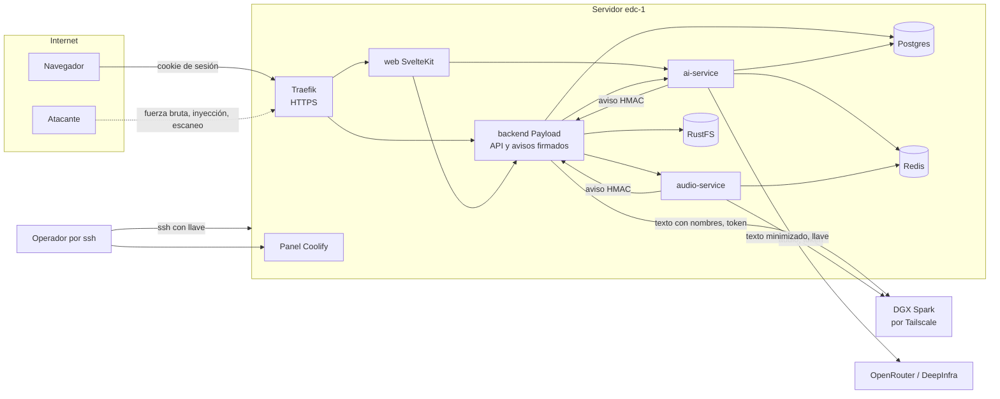
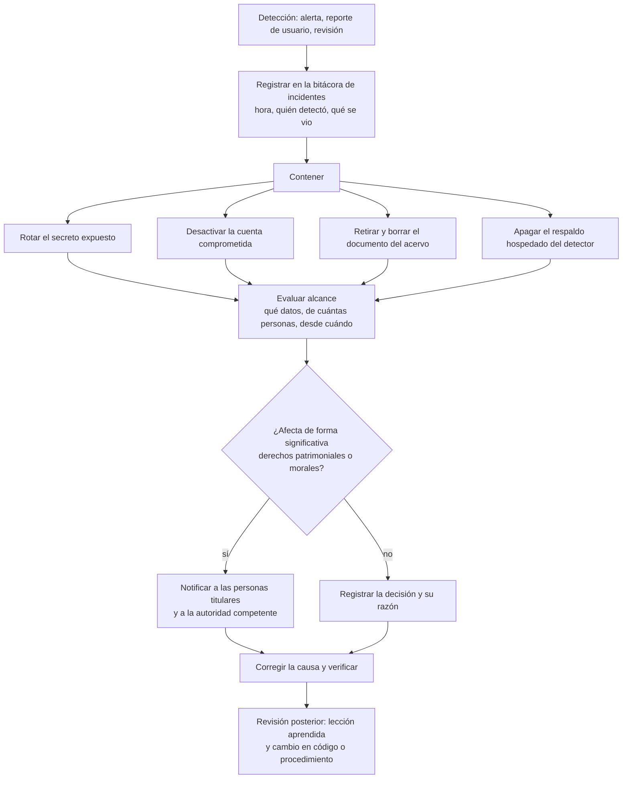

# Seguridad

- **Versión:** 1.3
- **Fecha:** 2026-11-10
- **Estado:** descripción del estado actual; cada control está marcado como Implementado, Implementado (pendiente de desplegar en dev), Planeado o Pendiente
- **Fuentes:** `apps/web/src/lib/server/auth.ts`, `apps/web/src/hooks.server.ts`, `apps/web/src/lib/markdown.ts`, `apps/backend/src/collections/Users.ts`, `apps/backend/src/access/index.ts`, `apps/backend/src/lib/permissions.ts`, `apps/backend/src/lib/hmac.ts`, `apps/backend/src/lib/jwt/sign.ts`, `apps/backend/src/lib/rateLimit.ts`, `apps/backend/src/lib/loginRateLimit.ts`, `apps/backend/src/lib/bodyCap.ts`, `apps/backend/src/lib/uploadSlots.ts`, `apps/backend/eslint/noRawErrorLog.js`, `apps/backend/src/endpoints/serviceAuth.ts`, `apps/backend/src/lib/aiClient.ts`, `packages/identity-client/src/verify.ts`, `services/ai-service/src/server.ts`, `services/ai-service/src/plugins/auth.ts`, `services/ai-service/src/server-limits.ts`, `services/audio-service/requirements.txt`, `infra/docker-compose.yml`, `infra/fleet/edc-1.md`, `infra/fleet/env-manifests.md`, `infra/fleet/backups.md`, `plan/auditoria-ia-2026-10-17.md`, `pnpm-lock.yaml`, [respaldos y recuperación](../05-infraestructura/respaldos-y-recuperacion.md), auditoría de código del 2026-10-28

> **Aviso.** El sistema aún no recibe testimonios reales de participantes en producción: no existe entorno de producción, y en desarrollo (dev) sí hay documentos reales del proyecto, con nombres reales en sus textos originales, incluidos materiales de participantes del taller de Semiosis, en borrador hasta tener el consentimiento de sus autores (ver [corpus y datos de prueba](../04-datos/corpus-y-datos-de-prueba.md)).

**Para quién es y qué responde.** Este documento es para quien opere o desarrolle Ecosistemas de Conocimiento (EDC) y para quien revise su seguridad desde el CIDE. Responde contra qué amenazas se quiere proteger el sistema, qué control hay hoy en cada capa y cuál falta, dónde viven los secretos y cómo se rotan, cómo se gestionan las vulnerabilidades, qué encontraron las auditorías del 2026-10-17 y del 2026-10-28, cómo se responde a un incidente y qué se verifica antes de recibir datos reales. La protección de datos personales en sí (anonimización, retención, consentimiento) está en [protección de datos](proteccion-de-datos.md).

## Estado de los controles

Definiciones. **Implementado:** funciona hoy en dev, con evidencia en código. **Implementado (pendiente de desplegar en dev):** está en `main` (`b7dc944f`) pero no en lo desplegado en dev (`367c2698`, despliegue del 2026-11-10 a las 18:27 UTC, citado de `infra/fleet/edc-1.md` §4zzzzzzzz). **Planeado:** existe un diseño o un mecanismo sin activar. **Pendiente:** no existe todavía, y puede no tener plan. Código leído en `main` el 2026-11-10. Staging sigue en su imagen del 2026-10-17: ningún control posterior a esa fecha corre allí. La sección 2 da el detalle de cada control; lo diferido está en [Etapa 2](#etapa-2).

| Estado | Controles | Cuántos |
|---|---|---|
| **Implementado** | Autenticación por cookie y JWT; Tokens entre servicios EdDSA; Registro cerrado; Bloqueo por intentos; Correo fijo para la cuenta; Control de acceso en servidor; Aislamiento por ecosistema; Columnas protegidas; Archivos propios; Avisos firmados con HMAC; Llaves de API con SHA-256 en tiempo constante; Token de servicio; Límite de tasa en login; Límites de tasa existentes; Límites de cuerpo y de archivo; Tiempos máximos existentes; Markdown seguro; Secretos fuera del repo; Cifrado en tránsito público; Versiones fijadas; Firewall de Hetzner; Retención cero en OpenRouter; Herramientas de contención (retiro de documento, interruptor, desactivar cuenta) | 23 |
| **Implementado (pendiente de desplegar en dev)** | Subidas simultáneas por cuenta y cuerpos lentos; Registros sin texto de errores (la parte de la regla de eslint); Borrar lo publicado pide membresía; Ajustes solo para el responsable; Filtros y orden sobre documentos | 5 |
| **Planeado** | Respaldos cifrados; Copia del `APP_KEY` de Coolify fuera de la caja; Alertas de caída y de disco; Conserje de sesiones; Respaldo del detector en `none`; Inferencia independiente | 6 |
| **Pendiente** | Límite de tasa en login por correo (etapa 2); Verificación del correo (etapa 2); Cambio obligado de la contraseña temporal (etapa 2); Retención cero con DeepInfra (etapa 2); Protección CSRF de las rutas JSON de la web; Separación entre quien sube y quien revisa; Llaves sin valor por defecto; Límite de turnos de chat y contador por ecosistema; Tiempo máximo en `fetchMe`; CSP y cabeceras; Secretos por servicio; Mínimo privilegio en base de datos; Cifrado hacia el Spark y dentro del servidor; Cifrado en reposo de volúmenes; Escaneo de dependencias; Endurecimiento de ssh; Puertos del servidor; Puertos de desarrollo local; Depuración de trazas de ai-service; Rotación de secretos con bitácora; Procedimiento de actualización ante avisos; Respuesta a incidentes y bitácora; Notificación de vulneraciones | 23 |

Las secciones 2 a 7 marcan cada control o procedimiento. Lo más urgente:

- **Corrección: sí hay una llave con valor por defecto.** `AUDIO_SERVICE_ADMIN_API_KEY` trae `dev-audio-key-admin` en `infra/docker-compose.yml`.
- **Corrección: no solo 80 y 443 están abiertos.** El firewall de Hetzner admite 22, 80 y 443. Coolify publica además otros puertos en todas las interfaces, filtrados solo por ese firewall.
- **Corrección: una persona revisora sí puede aprobar su propia subida.** `decideOnHold` lo permite (`lib/holdReview.ts`).
- **Corrección: el texto sin anonimizar sí puede salir a Estados Unidos.** Ver [protección de datos](proteccion-de-datos.md#9-flujos-a-terceros).

**Sobre la inferencia.** Por ahora se usan proveedores hospedados. En dev, toda llamada a OpenRouter pide retención cero (ZDR) y falla cerrada si no la consigue; DeepInfra no recibe ese parámetro. No hay contratos documentados. Está planeado migrar a inferencia albergada de forma independiente.

## 1. Modelo de amenazas

### 1.1 Activos

| Activo | Por qué importa |
|---|---|
| Texto original de testimonios | Contiene nombres, salud, discapacidad y detalles que identifican. Es el activo más sensible |
| Grabaciones de audio | La voz identifica a la persona |
| Conversaciones | Privadas de cada persona usuaria; contienen preguntas en crudo |
| Acervo anonimizado y vectores | Si se contamina con un nombre, el daño es permanente en la práctica |
| Cuentas y roles | Un rol alto lee la cola de Revisión y gestiona miembros |
| Secretos | Llaves de proveedores, firma de tokens, contraseña de base de datos, secreto de avisos firmados |
| Disponibilidad del servidor `edc-1` | Una sola caja aloja dev, staging y el panel de despliegue |

### 1.2 Actores

| Actor | Capacidad | Motivación típica |
|---|---|---|
| Atacante externo anónimo | Ve la web pública y la API; prueba contraseñas; escanea puertos | Robo de cuentas, datos, abuso de cómputo |
| Persona usuaria curiosa o maliciosa | Tiene cuenta y un rol en un ecosistema | Leer originales o conversaciones ajenas; escalar rol |
| Miembro de otro ecosistema | Cuenta válida en otro ecosistema | Cruzar el aislamiento |
| Proveedor de IA | Recibe el texto que se le envía | Retención o uso secundario del texto |
| Organización dueña del Spark | Acceso físico y de sistema al servidor con GPU | Acceso al texto con nombres y al audio |
| Operador con acceso al servidor | Acceso de sistema a `edc-1` y al panel | Error humano; abuso de privilegio |

### 1.3 Superficies

| Superficie | Exposición | Amenazas principales |
|---|---|---|
| Web pública (`apps/web`) | Internet, HTTPS | Robo de sesión, XSS, CSRF, fuerza bruta de login |
| API del backend (`apps/backend`) | Internet, HTTPS, mismo dominio de API | Lectura de datos ajenos, escalada de rol, escritura de columnas protegidas |
| Avisos firmados (callbacks) de ai-service y audio-service | Ruta pública del backend | Avisos falsos o repetidos que marquen un documento como listo |
| ai-service y audio-service | Red interna de Docker; llaves de API | Uso de la llave de un ecosistema para actuar sobre otro |
| Spark por Tailscale | Red privada cifrada; proxy con token | Acceso de terceros al texto con nombres y al audio |
| Proveedores de IA | Internet, HTTPS, llave del proyecto | Retención del texto enviado |
| Operador | ssh y panel Coolify | Credenciales robadas, error en despliegue |

## 2. Controles por capa

| Capa | Control | Detalle | Dónde | Estado |
|---|---|---|---|---|
| Identidad | **Autenticación por cookie y JWT** | La sesión web es la cookie `chat_auth` con `httpOnly`, `SameSite=Lax` y `secure`, que lleva el JWT de Payload (2 h, valor por defecto de Payload); la cookie vive 7 días | `apps/web/src/lib/server/auth.ts` | **Implementado** |
| Identidad | **Tokens entre servicios EdDSA** | Firmados con llave privada Ed25519, vigencia máxima 15 min; solo se acepta `alg=EdDSA` | `apps/backend/src/lib/jwt/sign.ts`; `packages/identity-client/src/verify.ts` | **Implementado** |
| Identidad | **Registro cerrado** | No hay registro público; crea cuentas la administración de plataforma, o quien gestiona miembros, al agregarlos por `/miembros` | `apps/backend/src/collections/Users.ts`; `apps/backend/src/endpoints/miembros.ts` | **Implementado** |
| Identidad | **Bloqueo por intentos** | 5 fallos bloquean la cuenta 10 minutos, valor por defecto de Payload 3.88 (citado de `lib/loginRateLimit.ts`); desbloquear es solo de administración | `Users.ts` | **Implementado** |
| Identidad | **Límite de tasa en login** | Por debajo del bloqueo: 4 fallos por hora por (IP, correo), para que una IP no pueda bloquear una cuenta ajena; y 100 fallos por hora por IP, contra el rociado de contraseñas (valores por defecto de `IDENTITY_RATELIMIT_LOGIN_FAIL_IP_EMAIL_MAX` e `IDENTITY_RATELIMIT_LOGIN_FAIL_IP_MAX` en `lib/rateLimit.ts`). El intento se reserva antes de comprobar la contraseña y se devuelve si el login funciona. Responde 429 con `Retry-After`, que la web pasa al navegador. La IP es la del navegador, también tras la web (A-08, A-11) | `apps/backend/src/lib/loginRateLimit.ts`; `lib/rateLimit.ts` | **Implementado** |
| Identidad | **Límite de tasa en login por correo** | No existe un tope por correo entre IPs distintas; por decisión, es funcionalidad nueva | `apps/backend/src/lib/loginRateLimit.ts` | **Pendiente** (etapa 2) |
| Identidad | **Correo fijo para la cuenta** | Solo la administración de plataforma cambia un correo; la cuenta no cambia el suyo. Cierra la toma de una membresía ajena por `/miembros` (A-03) | `Users.ts` (campo `email`, `access.update`) | **Implementado** |
| Identidad | **Verificación del correo** | No existe. Un correo que cambia la administración no se confirma | `Users.ts` | **Pendiente** (etapa 2) |
| Identidad | **Contraseña temporal** | `/miembros` muestra una sola vez la contraseña de una cuenta nueva. Nada obliga a cambiarla, y la web no tiene pantalla para cambiarla (A-04) | `apps/backend/src/endpoints/miembros.ts` | **Pendiente** (etapa 2) |
| Autorización | **Control de acceso en servidor** | Un mapa único de rol a permisos; todo permiso se revisa en el servidor; la cuenta inactiva no inicia sesión, pierde sus sesiones abiertas y no lee, sube, publica ni reintenta; un inicio de sesión o una edición del perfil simultáneos no la reactivan; su subida en curso no se publica sola; publicar, reintentar, editar un documento y editar una nota piden membresía activa con `documents:write`; revocar a alguien corta su chat y su micrófono (A-01, A-02). **Implementado (pendiente de desplegar en dev):** borrar algo que no es un borrador propio pide esa misma membresía (commit `512dcc1f`), y Ajustes del ecosistema es solo del responsable y de la administración de plataforma (commit `50bde2ae`) | `lib/permissions.ts`; `access/index.ts`; `Users.ts`; `Documents.ts` | **Implementado** |
| Autorización | **Aislamiento por ecosistema** | Un acervo por ecosistema en ai-service (`X-AI-Org`); el ecosistema sale de la sesión del servidor, nunca del cliente; borradores por usuario; equipos y proyectos no cruzan ecosistemas | `lib/aiClient.ts`; `collections/Teams.ts`; `collections/Projects.ts` | **Implementado** |
| Autorización | **Columnas protegidas** | Las columnas de la compuerta y del pipeline no se escriben por API | `gateWritesOnly` en `Documents.ts` | **Implementado** |
| Autorización | **Archivos propios** | Un archivo solo se adjunta o lee por su dueño | `collections/Media.ts` | **Implementado** |
| Autorización | **Filtros y orden sobre documentos** | En un `documento` con compuerta, `where` y `sort` solo usan libremente una lista permitida (`GATED_FILTERABLE_PATHS`: id, fechas, ecosistema, tipo, `anonymise` y los estados; `redactedText` solo con `exists`). Cualquier otra ruta, en `and`/`or` anidados y en cualquier capitalización (`whereMentions`, `wherePaths`), queda acotada a las filas que quien consulta puede leer; un orden fuera de la lista se quita. Una ruta que cruza una relación (`session.*`, `uploadedInSession.*`, `uploadedBy.*`, `mediaFile.*`, `revisionOf.*`, y `reviewer.*`/`actor.*` en los registros) se reescribe a los ids que quien consulta puede leer en la colección de destino, con el acceso de esa colección; filtrar por el id de la relación sigue libre. La administración de plataforma conserva todo. `anonymisation-reviews` y `anonymisation-setting-changes` usan la misma regla por `document.*`. **Implementado (pendiente de desplegar en dev):** la lista permitida (commit `b7dc944f`) y las relaciones hacia sesiones y usuarios (commit `45581ae3`) | `constrainGatedQueriesAt`, `narrowGatedQueriesAt`, `resolveRelationCrossings` en `Documents.ts`; `AnonymisationReviews.ts`; `AnonymisationSettingChanges.ts` | **Implementado (pendiente de desplegar en dev)** |
| Autorización | **Separación entre quien sube y quien revisa** | No existe. `decideOnHold` permite aprobar una retención sobre la propia subida; decisión abierta del responsable técnico | `lib/holdReview.ts` | **Pendiente** |
| Integración | **Avisos firmados con HMAC** | HMAC-SHA256, comparación en tiempo constante (`timingSafeEqual`), ventana de ±900 s, fila única contra repetición, `ingestId` comparado | `apps/backend/src/lib/hmac.ts` | **Implementado** |
| Integración | **Llaves de API con SHA-256 en tiempo constante** | ai-service compara la huella SHA-256 de la llave en tiempo constante; delegación solo a ecosistemas con prefijo `edc-` | `services/ai-service/src/plugins/auth.ts` | **Implementado** |
| Integración | **Llaves sin valor por defecto** | No se cumple: `AUDIO_SERVICE_ADMIN_API_KEY` trae `dev-audio-key-admin` en el archivo de despliegue, salvo que el entorno defina otra. Un valor público en el repositorio es una llave de administración conocida | `infra/docker-compose.yml` | **Pendiente** |
| Integración | **Token de servicio** | Máximo 20 fallos por minuto por IP | `apps/backend/src/endpoints/serviceAuth.ts` | **Implementado** |
| Disponibilidad | **Límites de tasa existentes** | ai-service: 100/min en `/v1` y 30/min en generación, por llave (`server-limits.ts`); backend: token, perfil, resolución y grafo (`lib/rateLimit.ts`); grafo 120/min de vista y 60/min de recuperación por usuario | Varios | **Implementado** |
| Disponibilidad | **Límite de turnos de chat y contador por ecosistema** | No existe límite por persona. El contador de ai-service es uno solo, compartido entre todos los ecosistemas `edc-*`, de 30/min | Auditoría de código del 2026-10-28 | **Pendiente** |
| Disponibilidad | **Límites de cuerpo y de archivo** | Un cuerpo JSON y cada campo de texto de un formulario de subida, hasta 8 MiB (413); un archivo, hasta 20 MB si es documento y 200 MB si es audio, contado mientras llega | `lib/bodyCap.ts`; `payload.config.ts`; `collections/Media.ts` | **Implementado** |
| Disponibilidad | **Subidas simultáneas por cuenta y cuerpos lentos** | 2 subidas en curso por cuenta (`UPLOAD_MAX_CONCURRENT_PER_USER`; la siguiente, 429 con `Retry-After: 5`); un cuerpo se corta tras 30 s sin bytes o 120 s en total (408). Los tres valores son inferidos, no medidos (citado del mensaje del commit `780f614d`) | `lib/uploadSlots.ts`; `lib/bodyCap.ts` | **Implementado (pendiente de desplegar en dev)** |
| Disponibilidad | **Tiempos máximos existentes** | Detector 90 s; generación 600 s; grafo 660 s; embeddings primarios 5 s | `detector.ts`; `env-manifests.md` | **Implementado** |
| Disponibilidad | **Tiempo máximo en `fetchMe`** | No existe: un backend atascado detiene cada petición | `apps/web/src/lib/server/auth.ts` | **Pendiente** |
| Contenido | **Markdown seguro** | Las imágenes del asistente se muestran como texto escapado; DOMPurify bloquea `img` e `iframe`; citas sobre el DOM, no con expresiones regulares sobre HTML | `apps/web/src/lib/markdown.ts`; `apps/web/src/lib/citationLinks.ts` | **Implementado** |
| Contenido | **Protección CSRF de las rutas JSON de la web** | El backend acepta escrituras con cookie solo desde `ALLOWED_ORIGINS` (`csrf` en `payload.config.ts`). En la web, SvelteKit solo revisa `Origin` en formularios: un POST sin `Content-Type` desde un subdominio hermano lleva la cookie `SameSite=Lax` y puede, por ejemplo, publicar borradores de la víctima (A-09, plausible; no reproducido en este carril) | `apps/web/src/hooks.server.ts`; `apps/web/src/lib/server/auth.ts` | **Pendiente** |
| Contenido | **CSP y cabeceras** | No existen: política de seguridad de contenido (CSP), HSTS, `X-Frame-Options`, `nosniff` y retirar `x-powered-by` (no medido en esta versión) | Sin rastro en `apps/web/src/hooks.server.ts` ni en la configuración de `apps/web` y `apps/backend` | **Pendiente** |
| Secretos | **Secretos fuera del repo** | `.env` excluido por `.gitignore`; valores en Coolify; la auditoría del 2026-10-17 no halló secretos en el repo; pendiente: confirmar y rotar una credencial que podría seguir en el historial. Excepción: el valor por defecto `dev-audio-key-admin` | `.gitignore`; `plan/auditoria-ia-2026-10-17.md` | **Implementado** |
| Secretos | **Secretos por servicio** | No se cumple: un `env_file` compartido entrega todas las variables a backend, web y ai-service | `infra/docker-compose.yml`; `infra/fleet/env-manifests.md` | **Pendiente** |
| Datos | **Registros sin parámetros de consulta ni texto de errores** | **Implementado:** un error de base de datos no lleva los parámetros de la consulta, y el registrador de Payload serializa `err` con `safeErrSerializer` (P-07). **Implementado (pendiente de desplegar en dev):** ninguna línea interpola el texto de un error; la regla de eslint `edc/no-raw-error-log` lo hace cumplir | `payload.config.ts`; `lib/errorSummary.ts`; `apps/backend/eslint/noRawErrorLog.js` | **Implementado** en parte |
| Datos | **Mínimo privilegio en base de datos** | No se cumple: backend y ai-service entran como superusuario de Postgres | `infra/docker-compose.yml`; `infra/postgres/init/10-create-databases.sh` | **Pendiente** |
| Transporte | **Cifrado en tránsito público** | HTTPS con certificados Let's Encrypt vía Traefik | `infra/fleet/edc-1.md` | **Implementado** |
| Transporte | **Cifrado hacia el Spark y dentro del servidor** | Spark por Tailscale, una VPN sobre WireGuard; su configuración no se verificó en esta versión. Postgres, Redis y RustFS van sin TLS por la red Docker interna (inferido) | [infraestructura y entornos](../05-infraestructura/infraestructura-y-entornos.md) | **Pendiente** |
| Almacenamiento | **Respaldos cifrados** | Hoy: imagen diaria de Hetzner y volcados manuales sin cifrar, con `umask 077`, copia en un equipo de desarrollo y los 7 más recientes por entorno (regla y primera purga del 2026-11-10, citado de `infra/fleet/edc-1.md` §7). Nada programado ni probado; el diseño propone cifrado, copia en otro proveedor y prueba de restauración | `infra/fleet/backups.md`; [respaldos y recuperación](../05-infraestructura/respaldos-y-recuperacion.md) | **Planeado** |
| Almacenamiento | **Cifrado en reposo de volúmenes** | No existe, y `backups.md` solo cubre respaldos | Sin plan | **Pendiente** |
| Almacenamiento | **Copia del `APP_KEY` de Coolify fuera de la caja** | No consta; diseño y pendiente registrados | `infra/fleet/backups.md`; [respaldos y recuperación](../05-infraestructura/respaldos-y-recuperacion.md) | **Planeado** |
| Cadena de suministro | **Versiones fijadas** | Versiones fijadas en `pnpm-lock.yaml` y `requirements.txt` | Sección 4 | **Implementado** |
| Cadena de suministro | **Escaneo de dependencias** | No hay configuración de `pnpm audit`, Dependabot, Renovate ni integración continua en este repositorio. `pnpm audit` no se corrió para esta versión | Sección 4 | **Pendiente** |
| Servidor | **Firewall de Hetzner** | Entrada TCP solo por 22, 80 y 443 | `infra/fleet/edc-1.md` | **Implementado** |
| Servidor | **Endurecimiento de ssh** | Según la auditoría del 2026-10-17, ssh aceptaba contraseña y no había fail2ban. Estado actual sin verificar | [registro de riesgos](../01-proyecto/registro-de-riesgos.md), R-14 | **Pendiente** |
| Servidor | **Puertos del servidor** | No es cierto que solo estén abiertos 80 y 443: también 22, y Coolify publica 6001, 6002, 8000 y 8080 en todas las interfaces, filtrados solo por el firewall de Hetzner (citado de la revisión de infraestructura; no medido en esta versión). Falta cerrarlos en el propio servidor | `infra/fleet/edc-1.md` | **Pendiente** |
| Servidor | **Puertos de desarrollo local** | `docker-compose.override.yml` publica Postgres, Redis, RustFS y otros en todas las interfaces de la laptop; Coolify no carga ese archivo. Falta prefijar `127.0.0.1` | `infra/docker-compose.override.yml` | **Pendiente** |
| Servidor | **Alertas de caída y de disco** | No existen; el diseño las considera parte de los respaldos | `infra/fleet/backups.md` | **Planeado** |
| Datos | **Conserje de sesiones** | Código listo, apagado por defecto | `apps/backend/src/lib/sessionJanitor.ts` | **Planeado** |
| Datos | **Depuración de trazas de ai-service** | No existe | Sin purga en `services/ai-service/src` | **Pendiente** |
| Proveedores | **Respaldo del detector en `none`** | Interruptor listo; valor por defecto `hosted`; dev usa `hosted` desde el 2026-11-10 (citado de `infra/fleet/edc-1.md` §4zzzzzzz); staging siempre usa OpenRouter | `lib/platformSettings.ts`; `fallbackGenerator.ts` | **Planeado** |
| Proveedores | **Retención cero en OpenRouter** | Toda llamada lleva `provider.zdr: true`; sin un proveedor con ZDR, falla cerrada y no se reintenta. En dev desde el 2026-11-10; staging no (inferido de su imagen del 2026-10-17) | `services/ai-service/src/services/ai/router/adapters/openrouter.ts`; `resilience.ts` | **Implementado** |
| Proveedores | **Retención cero con DeepInfra** | DeepInfra no recibe ningún parámetro de retención (P-06) | `rerank-client.ts` | **Pendiente** (etapa 2) |
| Proveedores | **Inferencia independiente** | Sin contratos documentados | Sin evidencia en código | **Planeado** |

## 3. Gestión de secretos

### 3.1 Dónde viven

| Lugar | Qué contiene | Acceso |
|---|---|---|
| Variables de Coolify, por aplicación y entorno | Todos los secretos de ejecución | Operador con cuenta en el panel |
| Archivo local del responsable de desarrollo, fuera del repo | Copia de los secretos por entorno, token de Hetzner, credenciales del panel, llave de despliegue | Solo el responsable de desarrollo. Sus permisos de archivo no se verificaron |
| `APP_KEY` de Coolify | Llave que descifra las variables guardadas por Coolify | Servidor. La copia fuera de la caja es **Planeado** |
| Volumen de RustFS | Credenciales del almacenamiento de objetos | Servidor |

Ningún secreto de ejecución vive en el repositorio, con la excepción del valor por defecto `dev-audio-key-admin` de `infra/docker-compose.yml`, una llave de administración de audio-service que aplica si el entorno no define la suya.

### 3.2 Inventario por nombre

Nombres tomados de `infra/fleet/env-manifests.md` y de `infra/fleet/edc-1.md` §5. Nunca se documentan valores.

| Secreto | Para qué | Rotación (propuesta, no política aprobada) |
|---|---|---|
| `POSTGRES_PASSWORD` | Base de datos | Al cambiar de operador o ante incidente |
| `PAYLOAD_SECRET` | Firma de la sesión de Payload | Ante incidente; invalida sesiones |
| `AUTH_PRIVATE_KEY` (con `AUTH_PUBLIC_KEY` y `AUTH_KEY_ID`) | Firma EdDSA de tokens entre servicios | Anual o ante incidente, publicando la nueva llave pública en JWKS antes de retirar la anterior |
| `SERVICE_TOKENS` | Token de la web ante el backend | Ante incidente |
| `AI_SERVICE_API_KEY`, `AI_SERVICE_ADMIN_API_KEY` | Llaves de app y de administración de ai-service | Ante incidente |
| `CALLBACK_SECRET` | Firma de avisos de servicio (mínimo 32 caracteres) | Ante incidente |
| `OPENROUTER_API_KEY` | Proveedor de modelos | Ante incidente o cambio de cuenta |
| `RERANK_API_KEY` | DeepInfra, llave propia de EDC desde el 2026-10-17 | Ante incidente |
| `EMBEDDINGS_API_KEY`, `ANONYMISE_DETECT_API_KEY`, `WHISPER_REMOTE_TOKEN` | Tokens del proxy del Spark | Al terminar el préstamo del Spark o ante incidente |
| `AUDIO_SERVICE_API_KEY`, `AUDIO_SERVICE_ADMIN_API_KEY` | Llaves de audio-service. La de administración trae valor por defecto, `dev-audio-key-admin` (**Pendiente** de quitar) | Ante incidente |
| `S3_ACCESS_KEY_ID`, `S3_SECRET_ACCESS_KEY` | Almacenamiento de objetos | Ante incidente |
| `SEED_ADMIN_PASSWORD` | Primera cuenta de administración | Tras el primer arranque |

### 3.3 Rotación

**Pendiente.** Es un procedimiento propuesto, no probado; la bitácora del paso 6 no existe.

1. Generar el nuevo valor fuera del servidor.
2. Cargarlo en Coolify para el entorno, y en la copia local del responsable.
3. Volver a desplegar el entorno.
4. Verificar con la prueba de humo del despliegue (ver [despliegue y runbook](../05-infraestructura/despliegue-y-runbook.md)).
5. Revocar el valor anterior en el proveedor, cuando aplica.
6. Anotar la fecha de rotación en la bitácora de operación.

Para `CALLBACK_SECRET`, el backend acepta un solo secreto a la vez; la rotación se hace con los servicios detenidos o en una ventana sin ingestas en curso.

## 4. Gestión de vulnerabilidades

### 4.1 Versiones principales

Versiones resueltas en `pnpm-lock.yaml` (leído el 2026-10-30):

| Componente | Versión |
|---|---|
| Payload | 3.88.0 |
| Next.js (dentro de Payload) | 15.4.11 |
| SvelteKit | 2.70.2 |
| Svelte | 5.56.9 |
| Fastify (ai-service) | 5.12.0 |
| Node.js | 22 en backend y web; 26 en ai-service (citado del inventario de privacidad y seguridad, 2026-10-30) |
| Python (audio-service) | 3.11.11, con FastAPI 0.115.6 y python-multipart 0.0.20 (`services/audio-service/requirements.txt`) |

### 4.2 Procedimiento

**Pendiente.** Hoy nada lo ejecuta ni lo registra: no hay configuración de `pnpm audit`, Dependabot, Renovate ni integración continua. Solo la fijación de versiones del punto 4 está **Implementada**.

1. En cada ciclo de despliegue se ejecuta `pnpm audit` en la raíz del monorepo y se revisan los avisos de seguridad de las dependencias de Python de audio-service.
2. Un aviso alto o crítico en una dependencia expuesta a internet se corrige antes del siguiente despliegue.
3. Un aviso en una dependencia del stack de IA se corrige en `services/ai-service` o `packages/*` y se prueba con eslint, typecheck y las pruebas de ai-service antes de desplegar.
4. Las versiones se fijan en los archivos de bloqueo; nunca se despliega con rangos abiertos.

### 4.3 Avisos conocidos

| Componente | Aviso | Severidad | Estado |
|---|---|---|---|
| Starlette 0.41.3 y python-multipart 0.0.20 (audio-service) | Avisos públicos de denegación de servicio al procesar formularios multipart; el formulario se procesa antes de la autenticación | Baja (auditoría 2026-10-28) | **Pendiente:** actualizar FastAPI, Starlette y python-multipart |
| Imagen de ai-service | El contenedor corre como root | Baja (auditoría 2026-10-28) | **Pendiente:** `USER node` en `services/ai-service/Dockerfile` |

## 5. Resultados de las auditorías

### 5.1 Auditoría del stack de IA, 2026-10-17

Cuatro revisiones cubrieron pruebas, calidad de IA, integridad del pipeline, seguridad y operación sobre dev (`plan/auditoria-ia-2026-10-17.md`).

**Confirmado como correcto:** autenticación de `/v1` en ai-service por hook de ruta; comparación de llaves con SHA-256 en tiempo constante; delegación por prefijo; ecosistema tomado de la sesión del servidor; borradores por usuario; HMAC en tiempo constante con ventana y protección contra repetición; CORS que rechaza orígenes ajenos; JWKS que publica solo la parte pública; ningún secreto en el repo, en su historial ni en el paquete del navegador.

**Cerrados:**

| Id | Hallazgo | Cierre |
|---|---|---|
| I-1 | Un testimonio publicado mostraba su texto original y su nombre de archivo a todo el ecosistema | Lectura del original restringida (`mayReadGatedOriginal`); las fugas L1 a L6 de la revisión adversarial posterior, también cerradas |
| G-1 | La recuperación del grafo fallaba con error 500 | Cerrado en la ola de arreglos |
| G-2 | 648 menciones y 386 relaciones del grafo extraídas de texto sin depurar | Purgadas tras aprobación (cifras citadas de la auditoría) |
| s/n | Borrar una conversación solo ocultaba sus turnos | Ahora los borra (`lib/conversationTurnErasure.ts`) |
| s/n | Registro público abierto en dev y staging | Registro cerrado (`Users.ts`) |
| s/n | Transcripciones crudas en el registro de avisos | Se guarda solo longitud y huella (`apps/backend/src/app/api/ai-service/callback/route.ts`) |

**Sin cerrar:**

- **Pendiente:** límite de tasa de login por correo entre IPs (etapa 2); cabeceras de seguridad; secretos por servicio; ssh sin contraseña con fail2ban (estado sin verificar); protección contra borrado del servidor en Hetzner (estado sin verificar).
- **Planeado:** respaldos programados con copia en otro proveedor y prueba de restauración; copia del `APP_KEY` de Coolify fuera de la caja; alertas; conserje de sesiones.

### 5.2 Auditoría de código, 2026-10-28

Once revisiones, sobre el código del 2026-10-28. Totales: 1 crítico, 6 altos, 32 medios y 51 bajos (citados de la auditoría). Salieron limpios: JWT, SQL parametrizado del grafo, aislamiento por organización en ai-service y el arranque de datos semilla por entorno.

**Cerrados:**

| # | Severidad | Hallazgo | Dónde se cerró |
|---|---|---|---|
| 1 | Crítico | Cualquier usuario podía leer el archivo de otro | `collections/Media.ts`; `collections/Documents.ts` |
| 2 | Alto | Se podía repetir la compuerta sobre un texto retenido hasta obtener `ready` | `lib/gatedTextHash.ts` y migración `20261029_042255` |
| 3 | Alto | Un nombre con espacios distintos pasaba la compuerta | `lib/anonymise/gate.ts`; `lib/anonymise/detector.ts` |
| 4 | Alto | Revocar a un usuario no le cortaba el chat ni el micrófono | `access/index.ts` (`isActiveUser`) |
| 5 | Alto | `POST /api/users/unlock` abierto y útil como oráculo de correos | `collections/Users.ts`; `access/payloadInternals.ts` |
| 6 | Alto | Imágenes remotas en el markdown del asistente | `markdown.ts` las muestra como texto escapado |
| 7 | Alto | XSS por la expresión regular de citas sobre HTML | `apps/web/src/lib/markdown.ts`; `apps/web/src/lib/citationLinks.ts` |
| 8 | Medio | Auto publicación de un documento sin compuerta | `lib/autoPublish.ts` |
| 9 | Medio | "Preguntas para investigar" enviaba nombres de testimonios | `apps/web/src/lib/server/preguntas.ts` |
| 10 | Medio | Mensajes `system` inyectados en el historial desde el navegador | `apps/web/src/routes/api/generate/+server.ts` (parte de la web) |
| s/n | Medio | Equipos y proyectos creados en otro ecosistema | `collections/Teams.ts`; `collections/Projects.ts` |
| s/n | Privacidad | Cinco lugares que guardaban texto crudo después de su ciclo de vida | `callback/route.ts`; `lib/publishDocument.ts`; `lib/documentLateErasure.ts`; `apps/web/src/lib/server/uploadDocument.ts`; `services/audio-service/app/config.py` |
| s/n | Privacidad | Una edición trivial liberaba una retención | `gateResetForTextEdit` en `Documents.ts` |

**Sin cerrar, todo Pendiente:**

- Quitar el valor por defecto de la llave de administración de audio-service en `infra/docker-compose.yml` (hallazgo 11).
- Publicar en `127.0.0.1` los puertos del archivo de desarrollo local `docker-compose.override.yml`.
- Verificar el correo nuevo cuando se cambia. Hoy solo la administración de plataforma lo cambia; la verificación es de la etapa 2.
- Límite de tasa en turnos de chat; contador por ecosistema en ai-service en lugar de uno compartido entre todos los ecosistemas `edc-*`.
- Revisión de `Origin` contra CSRF en las rutas JSON de la web (A-09 en la auditoría del 2026-11-10); cabeceras anti marco y `nosniff`.
- Tiempo máximo en `fetchMe` y en el cliente de ai-service después de recibir cabeceras.
- Roles de Postgres sin superusuario.
- Ruptura de reintentos de audio-service ante caídas del Spark de más de unos 2.5 min (citado de la auditoría).
- Purga de trabajos en cola de ai-service al borrar un documento (en el stack de IA).
- Decisión del responsable técnico sobre si un revisor puede aprobar su propia subida. Hoy el código lo permite.

### 5.3 Auditoría de login y permisos, 2026-11-10

Doce hallazgos, de A-01 a A-12 (citados de la auditoría de login y permisos del 2026-11-10).

| Id | Hallazgo | Estado |
|---|---|---|
| A-01 | Una cuenta desactivada seguía iniciando sesión, leyendo, subiendo y publicando | **Implementado**: sin login, sin sesiones abiertas, sin datos y sin subir (commit `ce46db7b`); una escritura vieja no la reactiva (`6841b71a`, `b2d6958d`) |
| A-02 | Quien salía de un ecosistema seguía publicando sus borradores | **Implementado**: publicar, reintentar y editar piden membresía activa (`ce46db7b`, `6841b71a`). Borrar lo publicado, **Implementado (pendiente de desplegar en dev)** (`512dcc1f`) |
| A-03 | Cambiar el correo propio antes de un alta en `/miembros` daba la membresía de otra persona | **Implementado**: solo la administración de plataforma cambia un correo (`ce46db7b`). Verificación del correo: etapa 2 |
| A-04 | La contraseña temporal de `/miembros` no se obliga a cambiar | **Pendiente** (etapa 2) |
| A-07 | Quien revisa veía y cambiaba la anonimización de borradores ajenos | **Implementado (pendiente de desplegar en dev)** (`50bde2ae`) |
| A-08 | Todo el tráfico web compartía un límite por IP en `/me` | **Implementado** (`93ff9aba`) |
| A-11 | Cualquiera bloqueaba una cuenta ajena; el login no tenía límite de tasa | **Implementado**: límites por (IP, correo) y por IP (`a7ca4b48`, `2a4b8a44`, `8a7fb92d`). Límite por correo: etapa 2 |
| A-05 | Cualquier miembro ve qué colega valoró qué conversación (`Ratings.ts`, sin acceso de campo en `user`, `session` y `message`) | **Pendiente** |
| A-06 | `/v1/identity/token` distingue un ecosistema inexistente, uno apagado y uno sin membresía (`endpoints/token.ts`) | **Pendiente** |
| A-09 | CSRF en las rutas JSON de la web desde subdominios hermanos | **Pendiente** |
| A-10 | Los proxies de la web no codifican `params.id` (`apps/web/src/routes/api/documents/[id]/+server.ts`) | **Pendiente** |

A-12 no se verificó en este documento.

## 6. Respuesta a incidentes

**Pendiente.** Esta sección es un procedimiento propuesto: no existen la bitácora de incidentes ni el procedimiento de notificación, y no hay plan técnico. Las alertas del primer paso son **Planeado**. Solo las herramientas de la sección 6.4 existen hoy.

### 6.1 Qué cuenta como incidente

- Acceso no autorizado a un original, una conversación o una grabación.
- Un texto con nombres que llegó al acervo compartido.
- Robo o exposición de un secreto.
- Pérdida de datos o de un respaldo.
- Caída prolongada del servidor.

### 6.2 Procedimiento

### 6.3 Notificación de vulneraciones

**Pendiente.** Lo siguiente es una propuesta, sujeta a la ley aplicable, que el área jurídica debe validar: el marco legal citado es conocimiento general.

- El responsable técnico del proyecto informaría a la Unidad de Transparencia del CIDE en cuanto confirme una vulneración de datos personales.
- La notificación a las personas titulares diría, en lenguaje claro: qué pasó, qué datos se afectaron, qué hizo el proyecto, qué puede hacer la persona y a quién preguntar.
- Para testimonios, la notificación llegaría por la persona facilitadora y por el folio (**Pendiente**), porque la plataforma no sabe quién habló.
- La notificación a la autoridad seguiría la ley aplicable (ver [nota de marco legal](aviso-de-privacidad-y-consentimiento.md#a-nota-de-marco-legal)).

### 6.4 Herramientas que ayudan

**Implementado**, salvo restaurar, que nunca se ha probado completo.

- Retirar y borrar un documento de ai-service: `retireDeletedDocumentHook` en `Documents.ts`.
- Apagar el respaldo hospedado del detector sin desplegar: ajuste `platform-settings.detectorFallback`, que tarda como máximo 30 s en aplicarse (TTL en `lib/platformSettings.ts`). En staging, `none` retiene todo texto, porque allí no hay detector propio.
- Cortar el acceso de una persona: desactivar la cuenta (`isActive`), que impide iniciar sesión, vacía sus sesiones y le quita documentos, archivos, valoraciones, chat y micrófono; o revocar su membresía, que corta el chat, el micrófono, publicar y editar documentos en ese ecosistema.
- Restaurar: procedimiento en [respaldos y recuperación](../05-infraestructura/respaldos-y-recuperacion.md).

## 7. Lista de verificación antes de recibir datos reales

Cada punto se verifica y se anota con fecha y responsable antes de aceptar el primer testimonio real en un entorno. Hoy ningún punto consta como cumplido. Dev ya contiene documentos reales sin haber pasado esta lista.

- [ ] El respaldo del detector está en `none` en el entorno, y una prueba con el Spark apagado deja el texto retenido. Un entorno sin detector propio, como staging hoy, no puede recibir testimonios reales.
- [ ] El acuerdo de uso del Spark está firmado, o el detector corre en un servidor propio.
- [ ] El aviso de privacidad integral y el simplificado están publicados; la interfaz dice que las conversaciones alimentan el acervo.
- [ ] El comprobante ético con folio está listo y probado con una persona facilitadora.
- [ ] El correo institucional para derechos ARCO responde.
- [ ] La llave de administración de audio-service no tiene valor por defecto, y el entorno define la suya.
- [ ] Los respaldos programados y cifrados corren, y una restauración de prueba funcionó.
- [ ] La copia del `APP_KEY` de Coolify está fuera de la caja.
- [ ] ssh solo acepta llaves, fail2ban está activo, y se revisaron los puertos que publica Coolify.
- [ ] Las cabeceras de seguridad y la CSP responden en el dominio del entorno.
- [ ] Cada servicio recibe solo sus secretos; backend y ai-service no usan el superusuario de Postgres.
- [ ] El conserje de sesiones y la depuración de trazas están activos.
- [ ] Hay alertas de caída y de disco.
- [ ] `pnpm audit` y la revisión de dependencias de Python no muestran avisos altos ni críticos sin atender.
- [ ] Las personas con `holds:review` en el ecosistema saben revisar retenciones, y está decidido y aplicado en el código si pueden aprobar sus propias subidas.
- [ ] La [evaluación de impacto](evaluacion-de-impacto-privacidad.md) está revisada y su plan de acción cumplido.

## Referencias

- `apps/web/src/lib/server/auth.ts`, `apps/web/src/hooks.server.ts`, `apps/web/src/lib/markdown.ts`
- `apps/backend/src/collections/Users.ts`, `apps/backend/src/access/index.ts`, `apps/backend/src/lib/permissions.ts`
- `apps/backend/src/lib/hmac.ts`, `apps/backend/src/lib/jwt/sign.ts`, `apps/backend/src/lib/rateLimit.ts`, `apps/backend/src/endpoints/serviceAuth.ts`
- `packages/identity-client/src/verify.ts`
- `services/ai-service/src/server.ts`, `services/ai-service/src/plugins/auth.ts`, `services/ai-service/src/server-limits.ts`
- `services/audio-service/requirements.txt`
- `infra/docker-compose.yml`, `infra/fleet/edc-1.md`, `infra/fleet/env-manifests.md`, `infra/fleet/backups.md`
- `plan/auditoria-ia-2026-10-17.md`; auditoría de código del 2026-10-28
- [Protección de datos](proteccion-de-datos.md)
- [Corpus y datos de prueba](../04-datos/corpus-y-datos-de-prueba.md)
- [Registro de riesgos](../01-proyecto/registro-de-riesgos.md)
- [Evaluación de impacto en la privacidad](evaluacion-de-impacto-privacidad.md)
- [Aviso de privacidad y consentimiento](aviso-de-privacidad-y-consentimiento.md)
- [Infraestructura y entornos](../05-infraestructura/infraestructura-y-entornos.md)
- [Despliegue y runbook](../05-infraestructura/despliegue-y-runbook.md)
- [Respaldos y recuperación](../05-infraestructura/respaldos-y-recuperacion.md)
- [Requisitos no funcionales](../02-requisitos/requisitos-no-funcionales.md)

## Siguientes pasos

Sin fechas: ninguna está acordada. Primero lo Planeado, después lo Pendiente.

1. **Planeado.** Fijar el respaldo del detector en `none` en todo entorno con datos reales.
2. **Planeado.** Construir los respaldos cifrados de `infra/fleet/backups.md`, con copia en otro proveedor y prueba de restauración.
3. **Planeado.** Guardar el `APP_KEY` de Coolify fuera de la caja.
4. **Planeado.** Poner alertas de caída y de disco.
5. **Planeado.** Activar el conserje de sesiones.
6. **Planeado.** Migrar a inferencia albergada de forma independiente.
7. **Pendiente.** Quitar el valor por defecto `dev-audio-key-admin`.
8. **Pendiente.** Verificar ssh, instalar fail2ban si falta, y revisar los puertos de Coolify en el propio servidor.
9. **Pendiente.** Agregar límite de tasa en turnos de chat, con contador por ecosistema en ai-service.
10. **Pendiente.** Agregar CSP, HSTS, cabeceras anti marco y `nosniff`, y proteger contra CSRF las rutas JSON de la web (A-09).
11. **Pendiente.** Entregar a cada servicio solo sus secretos y usar roles de Postgres sin superusuario.
12. **Pendiente.** Agregar tiempos máximos en `fetchMe` y en el cliente de ai-service.
13. **Pendiente.** Decidir si una persona revisora puede aprobar su propia subida y aplicarlo.
14. **Pendiente.** Decidir el cifrado en reposo de los volúmenes y verificar la red hacia el Spark.
15. **Pendiente.** Configurar y correr el escaneo de dependencias; actualizar FastAPI, Starlette y python-multipart; usar `USER node` en la imagen de ai-service.
16. **Pendiente.** Prefijar `127.0.0.1` en `docker-compose.override.yml`.
17. **Pendiente.** Crear la depuración de trazas de ai-service.
18. **Pendiente.** Crear la bitácora de incidentes, la bitácora de operación y el procedimiento de notificación de vulneraciones.
19. **Pendiente.** Aprobar las periodicidades de rotación de secretos.
20. **Pendiente.** Cerrar A-05, A-06 y A-10 de la auditoría del 2026-11-10.
21. **Implementado (pendiente de desplegar en dev).** Desplegar en dev el tope de subidas por cuenta, el corte de cuerpos lentos, la regla `edc/no-raw-error-log`, el permiso para borrar lo publicado y Ajustes solo para el responsable.

## Etapa 2

Diferido a la etapa 2 (rama `etapa-2`; `main` solo lleva correcciones). Ninguno está hecho:

- Límite de tasa en login por correo entre IPs (parte de A-11).
- Verificación del correo cuando la administración lo cambia (parte de A-03).
- Cambio obligado de la contraseña temporal en el primer acceso, con pantalla de cambio de contraseña en la web (A-04).
- Retención cero con DeepInfra, por contrato o sacándolo de la ruta (P-06).
- Trazas de ai-service sin la salida del detector, y su purga (P-14).
