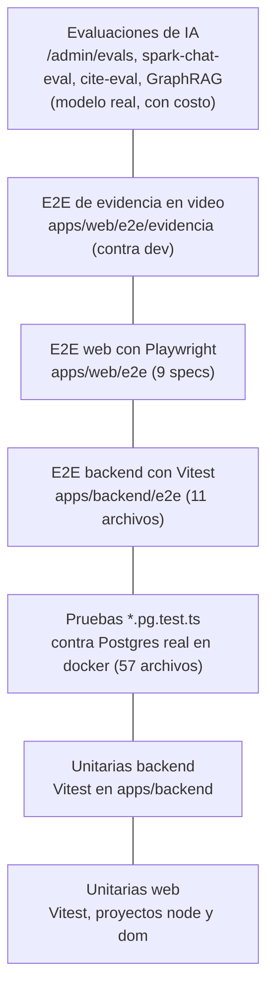

# Estrategia de pruebas

- **Versión:** 1.2
- **Fecha:** 2026-11-10
- **Estado:** vigente
- **Fuentes:** `TESTING.md`, notas de contexto del equipo (Etapa 1), `package.json` (raíz), `apps/web/package.json`, `apps/backend/package.json`, `apps/web/vite.config.ts`, `apps/web/playwright.config.ts`, `apps/web/e2e/`, `apps/web/e2e/evidencia/`, `apps/backend/e2e/`, `apps/backend/src/eval/RESULTS.md`, `services/ai-service/.github/workflows/`, `plan/mapa-historias.md`, `plan/orchestration/auditoria-2026-11-10/revision-ola4.md`. Conteos de archivos medidos con `find` y `ls` sobre `main` en `b7dc944f` el 2026-11-10.

## Para quién es y qué responde

Este documento es para quien escribe código en Ecosistemas de Conocimiento (EDC) y para quien revisa si lo construido en la Etapa 1 está probado. Responde cinco preguntas: qué tipos de prueba existen y qué cubre cada uno, cómo se corren con los comandos exactos, qué reglas siguen las pruebas, qué resultados hay registrados y con qué fecha, y qué huecos quedan. Las evaluaciones de calidad de la IA (citas, recuperación, fuga de datos privados) tienen su propio documento: [Evaluaciones de IA](evaluaciones-de-ia.md).

Las unitarias de backend y web se volvieron a correr para esta versión, el 2026-11-10 (sección 5). Los resultados e2e siguen siendo citas de documentos con su fecha.

## 1. La pirámide de pruebas

EDC usa siete niveles de prueba. Los de abajo son rápidos, baratos y numerosos. Los de arriba son lentos, necesitan el stack completo (todos los contenedores levantados) y en algunos casos cuestan dinero en llamadas a modelos.



| Nivel | Dónde vive | Herramienta | Qué necesita | Qué prueba |
|---|---|---|---|---|
| Unitarias web | `apps/web/src/**/*.test.ts` | Vitest, proyecto `node` | nada | Rutas del BFF (la capa SvelteKit que habla con el backend), lógica pura, render del lado del servidor con `svelte/server` en archivos `*.svelte.test.ts` |
| Unitarias web con DOM | `apps/web/src/**/*.dom.test.ts` | Vitest, proyecto `dom` con jsdom | nada | Componentes montados en un DOM, para lo que solo se pinta en el navegador (por ejemplo `Markdown.svelte`, que necesita `window` para DOMPurify) |
| Unitarias backend | `apps/backend/src/**/*.test.ts` | Vitest | nada | Colecciones Payload, hooks, endpoints, lógica de la compuerta, del grafo y de los permisos |
| Pruebas contra Postgres | `apps/backend/src/**/*.pg.test.ts` | Vitest más un contenedor efímero | docker | SQL real: cascadas de borrado, índices únicos, matriz de roles, consultas del grafo |
| E2E backend | `apps/backend/e2e/*.e2e.ts` | Vitest con `vitest.e2e.config.ts` | stack levantado | La API de punta a punta: subida, compuerta, retenciones, tenencia, identidad, audio |
| E2E web | `apps/web/e2e/*.spec.ts` | Playwright | stack levantado y construido | El navegador real contra la interfaz: recorrido completo, revisión, grafo, micrófono, teléfono |
| E2E de evidencia | `apps/web/e2e/evidencia/` | Playwright en un contenedor | dev desplegado y credenciales | Las historias de usuario por rol, grabadas en video para el demo |
| Evaluaciones de IA | `apps/web/src/lib/server/evals/`, `scripts/`, `apps/backend/src/eval/` | arneses propios | modelo real | Calidad de respuestas, citas, recuperación y compuerta |

### 1.1 Unitarias web

`apps/web/vite.config.ts` define dos proyectos de Vitest (medido, lectura del archivo el 2026-10-30):

- `node`: incluye `src/**/*.{test,spec}.ts` y excluye `*.dom.test.ts`. Aquí corren las rutas `+server.ts`, los `+page.server.ts` y los módulos `.ts` de lógica. También los 17 archivos `*.svelte.test.ts` (medido con `find`, 2026-11-10), que renderizan componentes con `svelte/server` y revisan el HTML resultante.
- `dom`: usa `environment: 'jsdom'` y la condición de resolución `browser`, para que `svelte` resuelva a su versión de cliente y exista `mount`. Hay 5 archivos `*.dom.test.ts`: `src/lib/markdown.dom.test.ts`, `src/lib/components/documentViews.dom.test.ts`, `src/lib/components/Chat.dom.test.ts`, `src/lib/components/Composer.livemic.dom.test.ts` y `src/lib/components/documentos/UploadSheet.dom.test.ts` (medido con `find`, 2026-11-10).

Además, tres pruebas del proyecto `node` construyen un DOM a mano con `happy-dom` (dependencia de desarrollo `happy-dom 20.11.2`): `citationLinks.test.ts`, `citationOrdinals.test.ts` y `Message.svelte.test.ts` (medido con `grep`, 2026-10-30).

> `TESTING.md` y las notas de contexto del equipo dicen que `apps/web` corre "sin DOM" y que no existen pruebas de render. Eso ya no es cierto. La configuración vigente es la descrita arriba.

### 1.2 Unitarias backend y pruebas contra Postgres

`pnpm --filter @edc/backend test` corre `vitest run` sobre todo `apps/backend/src`. Dentro hay 57 archivos `*.pg.test.ts` (medido con `find`, 2026-11-10). Cada uno levanta un Postgres desechable en docker con un puerto efímero (`-p 0:5432`) y lee el puerto asignado con `docker port`. Si docker no está disponible, esas pruebas se saltan y lo dicen. Ejemplos con peso:

- `lib/roles.matrix.pg.test.ts`: la matriz de permisos por rol contra tablas reales.
- `lib/conversationUploads.pg.test.ts` y `collections/Sessions.ownerGuard.pg.test.ts`: el borrado en cascada de una conversación.
- `lib/student/queries.pg.test.ts`, `endpoints/estudiante.companero.pg.test.ts`: la vista de estudiante y sus consentimientos.
- `lib/graph/viewTotal.pg.test.ts`, `lib/graph/wikilinks.pg.test.ts`: consultas del grafo.
- `lib/anonymisationControls.pg.test.ts`: interruptores de anonimización, auditoría y re-gate, con control positivo.
- `lib/consentHold.pg.test.ts`: la retención por consentimiento y la migración `20261110_181621` arriba, abajo y arriba.
- `lib/callbackRetention.pg.test.ts`, `lib/loginRateLimit.pg.test.ts`: la purga de `raw_body` y el límite de inicios de sesión.

### 1.3 E2E backend

Once archivos en `apps/backend/e2e/` (medido con `ls`, 2026-11-10; sin cambios desde el 2026-10-30): `anonymisation`, `audio`, `documents`, `featuresLock`, `holds`, `identity`, `publish`, `ratings`, `storage`, `tenancy` y `testimonyRead`. Corren con Vitest contra un backend y un ai-service vivos. Leen `infra/.env` en tiempo de ejecución para las credenciales del administrador sembrado y de Postgres; nunca las imprimen.

### 1.4 E2E web

Nueve specs en `apps/web/e2e/` (medido con `ls`, 2026-11-10; sin cambios desde el 2026-10-30): `journey`, `revision`, `grafo`, `grafo-touch`, `grafo-zaxis`, `grafo-labels3d`, `live-mic`, `retrieval` y `telefono`.

- No hay bloque `webServer` en `apps/web/playwright.config.ts`, a propósito. Playwright prueba lo que responda en `EDC_WEB_URL`, que por defecto es `http://localhost:45400`, el contenedor web local.
- Límites de espera de la configuración: 15 minutos por prueba y 20 segundos por aserción `expect` (medido, `playwright.config.ts:41-42`).
- `journey.spec.ts` es el recorrido completo de 12 pasos: entrar, elegir ecosistema, conversar, valorar con mouse y con teclado, comprobar que la valoración sobrevive a una recarga, subir un PDF y un audio, publicar, comprobar que el PDF sale citado y salir.

### 1.5 E2E de evidencia en video

`apps/web/e2e/evidencia/` contiene especificaciones por rol (`participante`, `estudiante`, `investigador`, `admin`, `discapacidad`, en versiones v1 y v3), el mapa de historias `historias.ts`, el ayudante `escena.ts`, un `playwright.config.ts` propio y el guion `correr.sh`.

- Cada historia es un `test.step` llamado con `escena(id)`, de modo que el video queda marcado con los identificadores de `plan/mapa-historias.md` (A1.1 a F4.4).
- Por defecto corren contra dev, con `locale es-MX` y zona horaria `America/Mexico_City`. El participante corre en el proyecto `movil` (Pixel 7, 390 px de ancho, micrófono falso); los demás en Chromium a 1440 px.
- Las credenciales salen de archivos `.env` fuera del repo. Cada corrida limpia lo que creó (`limpieza.spec.ts`).
- Las historias marcadas "pantalla" muestran la pantalla pero no dan el último paso. Para esas historias, la evidencia real está en las pruebas unitarias, `*.pg.test.ts` o e2e de backend.

### 1.6 Evaluaciones de IA

No son pruebas de aprobado o reprobado. Miden calidad con modelos reales y cuestan dinero o tiempo del DGX Spark. Están descritas en [Evaluaciones de IA](evaluaciones-de-ia.md). Ninguna corre en un ciclo automático.

## 2. Cómo se corren

### 2.1 Requisitos

- Node 22 o mayor (`package.json` raíz, `engines.node: ">=22"`).
- pnpm 9.15.4 (`packageManager: "pnpm@9.15.4"`). En la máquina de desarrollo `pnpm` no está en el `PATH` por omisión (medido con `which pnpm`, 2026-10-30). Está en la instalación de Node 24.1.0 de nvm (`PATH=~/.nvm/versions/node/v24.1.0/bin:$PATH`, usado el 2026-11-10), o en la copia de corepack:

```bash
node ~/.cache/node/corepack/v1/pnpm/9.15.4/bin/pnpm.cjs <comando>
```

  En el resto de este documento `pnpm` significa ese comando completo.
- docker, para las pruebas `*.pg.test.ts` y para todo lo e2e.

### 2.2 Compilar los paquetes antes de probar

`@edc/ai-client`, `@edc/identity-client` y `@edc/chat-engine` exportan desde `dist/`, que está en `.gitignore`. En un checkout nuevo fallan 27 archivos de prueba del backend y 4 de la web con `Failed to resolve entry for package` o `Cannot find package '@edc/chat-engine/core'` (citado de `TESTING.md`, medido 2026-10-17). Compílalos una vez:

```bash
pnpm install --prefer-offline
pnpm --filter @edc/ai-client build
pnpm --filter @edc/identity-client build
pnpm --filter @edc/chat-engine build
```

Peor que el fallo es el caso contrario: `apps/web` pasa `typecheck` contra un `dist` viejo mientras la función nueva no hace nada (citado de las notas de contexto del equipo). Si cambiaste algo en `packages/`, vuelve a compilar.

### 2.3 Comandos

| Qué | Comando | Notas |
|---|---|---|
| Unitarias de todos los workspaces, en paralelo | `pnpm test` | Solo unitarias. No toca un stack vivo |
| Lo mismo, de uno en uno | `pnpm test:sequential` | Para descartar el planificador de tareas como causa de un fallo |
| Tipos | `pnpm typecheck` | En la web corre `svelte-kit sync` y `svelte-check` |
| Unitarias web | `pnpm --filter @edc/web test` | Corre los proyectos `node` y `dom` |
| Unitarias backend (incluye `*.pg.test.ts`) | `pnpm --filter @edc/backend test` | Con docker disponible |
| E2E backend | `pnpm --filter @edc/backend test:e2e` | Stack levantado |
| E2E web | `pnpm --filter @edc/web test:e2e` | Stack levantado; `test:e2e:headed` abre el navegador |
| Evidencia en video | `apps/web/e2e/evidencia/correr.sh <v1\|v2\|v3> [rol]` | Contra dev, con las credenciales de los archivos `.env` de evidencia |
| Lint del backend | `pnpm --filter @edc/backend lint` | Incluye la regla `edc/no-raw-error-log`: ninguna línea de log lleva el texto crudo de un error (`780f614d`) |
| Lint de ai-service | `pnpm --filter @edc/ai-service lint` | eslint más la revisión de vocabulario de dominio. Obligatorio al tocar ai-service |

### 2.4 E2E contra el stack local

Secuencia citada de `TESTING.md`:

```bash
cd infra && docker compose up -d --wait     # 1. el stack debe estar arriba
./scripts/corpus-fixtures.sh                # 2. construir los archivos de prueba
pnpm --filter @edc/backend test:e2e         # 3a. nivel API
pnpm --filter @edc/web     test:e2e         # 3b. navegador
```

Dos trampas frecuentes:

1. **Playwright prueba la imagen que está corriendo, no tu código.** Un contenedor construido antes de tu commit sirve la interfaz vieja y el fallo parece una aserción mal escrita. Ya costó una sesión: el contenedor seguía en inglés y las aserciones en español "fallaron". Para probar el árbol de trabajo, construye la web y levántala en otro puerto del bloque 454xx (la receta completa está en `TESTING.md`, sección "The browser suite tests the code you are looking at only if you built it").
2. **Desde una copia de trabajo secundaria hay tres cosas que apuntar.** `infra/.env` solo existe en el checkout principal; las suites lo encuentran caminando por `.git`, o con `EDC_E2E_ENV_FILE` (backend) y `EDC_ENV_FILE` (web). `scripts/corpus-fixtures.sh` necesita `CORPUS_DIR` con la ruta absoluta del repo `corpus-generativo`. La caché de voces de Piper en `media/voces/` conviene enlazarla, porque reconstruirla tarda unas 14 veces el tiempo real (citado de `TESTING.md`).

### 2.5 E2E sin costo: stack aislado con proveedor falso

Para no tocar el stack compartido ni gastar en modelos, `TESTING.md` documenta un stack aislado con el proveedor falso (`fake-provider`). Resumen de los cinco pasos:

1. Copiar `infra/docker-compose.override.yml` a un archivo temporal y quitarle `name: edc` y el bloque `networks: default: name: edc`. Para audio, añadir `-f docker-compose.audio.yml`.
2. Cambiar los puertos de host (variables `*_HOST_PORT`) sin salir del bloque 454xx.
3. En `infra/.env`, descomentar el bloque de cuatro líneas del proveedor falso de `.env.example` (`COMPOSE_PROFILES=fake` más las URL de chat y embeddings y la llave falsa). Añadir un par de llaves de firma (`pnpm --filter @edc/backend keygen`), y `AUTH_ISSUER` y `ALLOWED_ORIGINS` con el puerto nuevo del backend. Levantar con `docker compose -p edc-e2e-<x> ... up -d --build --wait`.
4. Exportar `E2E_BACKEND_URL`, `E2E_AI_SERVICE_URL`, `EDC_E2E_COMPOSE_PROJECT` y `EDC_WEB_URL`, y correr las dos suites.
5. Bajar el stack con sus volúmenes y sus imágenes locales (`down -v --rmi local`). El 2026-10-17 el disco de la máquina de desarrollo llegó al 95 % (citado de `TESTING.md`, medido con `df -h /`).

Qué hace el proveedor falso:

- Los embeddings son una bolsa de palabras con hash. Textos que comparten palabras quedan cerca, así que una prueba de recuperación en el stack falso significa algo (citado de `services/ai-service/test-support/fake-provider/README.md` vía `TESTING.md`).
- Las respuestas de chat son texto fijo. Por eso una pregunta de seguimiento nunca encuentra el documento correcto: el motor condensa primero la pregunta y el proveedor falso devuelve su texto fijo. La pregunta de cita del recorrido es el primer mensaje de una conversación nueva por esa razón.
- Sin `SEED_CORPUS_INGEST=1` la siembra no indexa nada y la prueba de cita pasaría contra un corpus vacío. Debe estar encendido.
- Si construyes el `.env` del stack aislado añadiendo líneas a una copia, revisa que la copia termine en salto de línea. El 2026-10-17 `COMPOSE_PROFILES=fake` quedó pegado a `PUBLIC_BACKEND_URL` y cada ingesta respondió 400 `Invalid URL` (citado de `TESTING.md`).

## 3. Archivos de prueba (fixtures)

Todo lo que suben las suites e2e se construye, no se escribe a mano:

```bash
./scripts/corpus-fixtures.sh      # una vez, y otra después de actualizar el corpus
```

El guion lee `../corpus-generativo`, un repo aparte con 250 documentos sintéticos en español de México (citado de `TESTING.md`), y escribe tres archivos más un manifiesto `fixtures.json` en `apps/backend/e2e/fixtures/` y `apps/web/e2e/fixtures/`. Ambas carpetas están en `.gitignore`.

| Archivo | Origen | Qué ejercita |
|---|---|---|
| `.pdf` | un testimonio largo, convertido con `scripts/lib/txt_to_pdf.py` | Extracción con `unpdf` e ingesta en varios fragmentos |
| `.docx` | una carta de presentación del corpus, sin cambios | Extracción con `mammoth` |
| `.m4a` | un testimonio leído por Piper TTS (`scripts/corpus-voices.sh`) | Transcripción y la misma ruta de ingesta que un PDF |

Reglas:

1. **Ningún archivo en `e2e/` puede escribir a mano un nombre de archivo o un marcador.** El corpus se regenera (`gen_corpus.py`, semilla 445) y el orden puede cambiar. Lee `apps/backend/e2e/support/fixtures.ts` o `apps/web/e2e/fixtures.ts`.
2. Cada archivo lleva un **marcador**: el nombre de la persona del documento, único entre los 250. Si ese nombre regresa, el texto viajó desde el archivo hasta la fila.
3. **El marcador del audio no se puede afirmar como texto.** Es la apuesta del transcriptor sobre un nombre propio hablado. El manifiesto lo marca con `markerIsAssertable: false`. Las pruebas de audio comprueban que la transcripción es español real.
4. `fixtures()` se llama dentro de `beforeAll`, nunca al cargar el módulo.
5. La voz es sintética. Una grabación real, con ruido de fondo, sigue siendo el archivo de prueba que falta.
6. `services/ai-service/src/eval/fixtures/` no lleva contenido del corpus, porque ai-service es agnóstico del dominio.

## 4. Convenciones

Estas reglas salen de incidentes reales. Cada una está anclada a su fuente.

1. **`testTimeout` se queda en 5 s.** El trabajo de preparación pesado va en `beforeAll` y su presupuesto en `hookTimeout`. Así se resolvió una falsa intermitencia: dos suites hacían segundos de preparación dentro del cuerpo de una prueba y fallaban al azar en exactamente 5000 ms. Una prueba lenta debe fallar; una preparación lenta, no (citado de `TESTING.md`, evidencia del 2026-08-18: 1811 pruebas, 0 fallos, en tres corridas paralelas y una más con carga promedio de 34).
2. **Puertos efímeros en los contenedores de prueba** (`-p 0:5432`). Un puerto fijo chocaba con el Postgres del stack local en 45432.
3. **El texto de la interfaz en español vive en módulos `.ts` puros** (por ejemplo `apps/web/src/lib/nav.ts`) para poder afirmarlo en pruebas sin montar el componente.
4. **Cada aserción negativa de privacidad lleva una positiva.** Una suite que solo dice "esto no aparece" no distingue "se suprimió bien" de "nunca se produjo". Pasó de verdad: la función de fragmentos pudo estar muerta con la suite en verde (citado de las notas de contexto del equipo). Ejemplo vigente: `revision.spec.ts` comprueba que la tarjeta de la cola no muestra el nombre ni el teléfono, y en otra prueba comprueba que la página de detalle sí resalta exactamente esos identificadores.
5. **Nunca decidir sobre una retención que no creaste.** Aprobar o rechazar un documento retenido por la compuerta es terminal: borra `heldText` y `anonymisationSurvivors`. Una retención no se puede crear por la API, porque esas columnas solo las escribe la compuerta. Por eso las suites siembran su propio documento retenido por SQL directo (`apps/backend/e2e/support/db.ts`, `apps/web/e2e/db.ts`), deciden sobre ese y dejan los demás en paz. `revision.spec.ts` termina con una prueba que lo verifica. Ya pasó una vez que una suite consumió la retención compartida de dev.
6. **Los desplazamientos de los sobrevivientes se verifican recortando el texto.** `anonymisation_survivors` guarda posiciones `{start, end}`. Las suites las calculan con `indexOf` y luego comprueban recortando el texto, nunca confiando en la aritmética. Un error resaltaría la palabra equivocada ante quien revisa.
7. **No iterar contra inferencia real.** Una llamada real tarda del orden de 85 s y cuesta dinero (citado de las notas de contexto del equipo). Mientras desarrollas, falsea `ai-client` en las unitarias o usa el proveedor falso en e2e.
8. **Las pruebas destructivas se saltan en voz alta** cuando la base no está disponible, en lugar de caer sobre una fila ajena.
9. **Una suite de audio sin audio-service se salta con un aviso**, y la de identidad se detiene en `beforeAll` si falta el par de llaves de firma. Así un problema del entorno no se lee como un error del producto.

## 5. Conteos de pruebas

### 5.1 Medición del 2026-11-10

Medido el 2026-11-10 entre las 22:00 y las 22:06 UTC en la estación de trabajo del equipo de desarrollo (16 núcleos), sobre `main` en `b7dc944f`, en una copia de trabajo nueva: `pnpm install --prefer-offline`, los tres paquetes compilados, y luego `pnpm -C apps/backend test` y `pnpm -C apps/web test` (Node 24.1.0, pnpm 9.15.4). La máquina tenía otras sesiones trabajando: carga promedio de 7.2 al arrancar el backend y de 40.5 al terminar.

| Paquete | Archivos | Pruebas | Resultado | Duración |
|---|---:|---:|---|---|
| `apps/web` | 171 | 2 999 | todas pasan | 16.9 s |
| `apps/backend` | 284 (1 saltado) | 5 733 (1 saltada) | 5 728 pasan, 4 fallan; 1 archivo no carga | 185.7 s |

Los fallos del backend no son del código, según lo que se pudo comprobar:

- 4 pruebas fallaron por tiempo agotado (5 s, y 120 s en `endpoints/miembros.pg.test.ts`) con la carga en 40. Repetidos los 4 archivos solos, con carga de 31 a 16, pasaron 3; `lib/studentNotes.pg.test.ts` falló en 2 pruebas distintas de la primera vez, y solo, con carga 16 a 13, pasó entero (29 de 29). Se lee como intermitencia por carga, no como defecto (inferido de que el conjunto que falla cambia de corrida a corrida).
- `src/eval/harness.test.ts` no carga en una copia nueva: necesita `apps/web/.svelte-kit/tsconfig.json`, que solo existe después de `svelte-kit sync` (por ejemplo, `pnpm typecheck` en la web). Es un requisito del entorno.

No se midieron esta vez `packages/*` ni `services/ai-service`.

Medición de una sola corrida en una máquina cargada. Sirve para citar el orden de magnitud y el resultado; las duraciones, solo como referencia.

### 5.2 Mediciones anteriores

| Paquete | `TESTING.md` (medido 2026-10-17 con `vitest run`) | Notas de contexto del equipo, "Baselines" (citado, sin fecha) |
|---|---:|---:|
| `apps/backend` | 1 655 | 1 250 |
| `apps/web` | 1 442 | 1 213 |
| `packages/chat-engine` | 211 | 48 |
| `services/ai-service` | 688 (citado del 2026-08-29, no vuelto a medir) | no aparece |
| `packages/ai-client` | 55 (citado del 2026-08-29) | 68 |
| `packages/identity-client` | 50 (citado del 2026-08-29) | no aparece |

Durante la ola 4, el 2026-11-10, el commit `512dcc1f` registra la suite completa del backend con 5 444 pruebas pasando y 1 saltada, medida en su copia de trabajo (citado del mensaje de commit). La diferencia con las 5 733 de §5.1 son las pruebas que entraron a `main` después.

## 6. Último resultado e2e registrado

Corrida del 2026-10-17 en un stack aislado con el proveedor falso (citado de `TESTING.md`, que a su vez cita `plan/auditoria-ia-2026-10-17.md`, donde está marcado como medido).

| Suite | Resultado |
|---|---|
| `apps/backend/e2e/anonymisation.e2e.ts` | 3/3 |
| `apps/backend/e2e/holds.e2e.ts` | 20/20 |
| `apps/backend/e2e/tenancy.e2e.ts` | 22/22 |
| `apps/backend/e2e/documents.e2e.ts` y `testimonyRead.e2e.ts` | 22/22 |
| `apps/web/e2e/grafo.spec.ts` | 3/3 |
| `apps/backend/e2e/audio.e2e.ts` | 9/9, con `docker-compose.audio.yml` |
| `apps/backend/e2e/identity.e2e.ts` | 15/15, con par de llaves de firma |
| `apps/backend/e2e/ratings.e2e.ts` | 13/13 |
| `apps/web/e2e/retrieval.spec.ts` | 2/2, con embeddings falsos de bolsa de palabras |
| `apps/web/e2e/journey.spec.ts` | 1/1, los 12 pasos, con el paso de cita como aserción dura |
| `publish.e2e.ts`, `storage.e2e.ts`, `revision.spec.ts`, `featuresLock.e2e.ts` y los specs de grafo táctil, eje Z, etiquetas 3D, micrófono y teléfono | sin resultado registrado en esa fecha |

Datos de tiempo de esa corrida (medidos, stack falso, transcripción en CPU con Whisper `small`):

- Ingesta del PDF: 2 s.
- Audio de 55.2 s: `listo` entre 79 y 127 s según la corrida.
- Publicación: 3 s, POST 202.
- Recorrido completo: 2.4 minutos.

Desde el 2026-10-17 cambiaron, entre otras cosas, el umbral del grafo (de 3 a 1 documentos, el 2026-10-21), la vista de estudiante, las notas publicables y el panel de evaluaciones. `grafo.spec.ts` ya documenta el umbral 1 en su cabecera. No hay corrida completa registrada después de esos cambios (inferido de la ausencia de resultados más recientes en `TESTING.md`).

## 7. Huecos de cobertura

### 7.1 Historias sin aserción sobre el resultado

El mapa de historias tiene 70 historias (citado de `plan/mapa-historias.md`). Los specs de evidencia las graban todas salvo cuatro, pero varias solo muestran la pantalla. Leído en el código de los specs (revisión de flujos web del 2026-10-30):

| Historia | Qué falta |
|---|---|
| B1.7 Buscar solo en mis trabajos o en los de mis compañeros | El spec cambia el selector y lo regresa. Nada comprueba que la búsqueda quede acotada, ni en e2e ni en unitarias (inferido por grep) |
| C2.2 Ver los documentos sin conversación | Filtra, no afirma el contenido |
| C2.4 Fijar un documento como contexto | Marca la casilla, no afirma el efecto (sí hay unitaria: `api/generate/pinned.test.ts`) |
| D1.1 Buscar en la biblioteca | Busca, no afirma resultados |
| D1.2 Filtrar por tipo | Filtra, no afirma |
| E1.4 Ver mis autores | Abre la pestaña, sin aserción |
| F4.4 Filtrar todos los documentos | Filtra, sin aserción |
| C1.5 Elegir el tipo de aporte, C1.6 Anonimizar | Sin escena en los specs; solo unitarias y e2e de backend |
| C3.1 Publicar, F1.3 Aprobar o rechazar | Sin escena por rol; sí cubiertas por `journey.spec.ts` y `revision.spec.ts` |
| B1.10 Hoja de cálculo, B4.1 y B4.2 Estilo de respuesta | Llega una respuesta; el contenido o el estilo no se afirman |

### 7.2 Flujos sin e2e

- **Miembros.** No hay e2e de agregar un miembro con contraseña temporal, cambiar su rol o quitarlo. Solo `miembros.pg.test.ts` en el backend y `miembros.test.ts` en la web.
- **Publicación en backend, almacenamiento y bloqueo de funciones.** `publish.e2e.ts`, `storage.e2e.ts` y `featuresLock.e2e.ts` existen pero no tienen resultado registrado.
- **Panel de evaluaciones** (`/admin/evals`). Tiene unitarias (`runner.test.ts`, `score.test.ts`, `store.test.ts`, `estimate.test.ts`) pero ningún spec de navegador.
- **Vista docente** (`/seguimiento`). Solo la recorren los specs de evidencia, sin e2e de privacidad que pruebe que un estudiante sin consentimiento no aparece.

### 7.3 Accesibilidad automática

No hay auditoría automática de accesibilidad: ni axe ni pa11y aparecen en las dependencias ni en los specs (inferido por grep, revisión de flujos web del 2026-10-30). Lo que sí hay son aserciones puntuales escritas a mano: el grupo de estrellas con `role=radiogroup` y teclado (`journey.spec.ts`), el foco que regresa al botón en paneles móviles (`telefono.spec.ts`), y botones de 44 px sin desplazamiento horizontal a 390 px (`grafo-touch.spec.ts`, `grafo-zaxis.spec.ts`).

## 8. Lo que no se puede probar hoy

| Qué | Por qué | Fuente |
|---|---|---|
| Almacenamiento con credencial acotada | RustFS se probó en vivo (subida, GET por rangos, 403 entre ecosistemas) solo con la credencial root. La credencial acotada, que es la que usaría un despliegue real, nunca se probó | `TESTING.md` |
| Recuperación real en e2e | El proveedor falso no clasifica como un modelo. La calidad de recuperación se mide con evaluaciones, no con e2e | `TESTING.md`, `RESULTS.md` |
| Audio con voz humana | Solo hay voz sintética de Piper | `TESTING.md` |
| El marcador hablado del audio | Ningún transcriptor escribe un nombre propio de forma fiable | `TESTING.md` |
| Comportamiento con varias réplicas | Los límites de tasa del grafo, las sesiones del micrófono y el tope de subidas simultáneas por cuenta viven en memoria de un proceso | `infra/.env.example`, revisión de la pila de IA del 2026-10-30, `apps/backend/src/lib/uploadSlots.ts` |
| Respaldo del detector apagado en staging | Staging no tiene Spark. Con el código de `main` (P-05, en dev desde el 2026-11-10), `none` también frena el modelo hospedado sin Spark, así que en staging retendría todo. Pero staging corre el código del 2026-10-17, donde su detector siempre es hospedado, y no se ha probado ahí | `apps/backend/src/lib/anonymise/detector.ts`; versión de staging citada de `infra/fleet/edc-1.md` §4zzzzzzzz |

## 9. Integración continua

No hay integración continua activa.

- No existe `.github/` en la raíz del repo (medido con `ls`, 2026-10-30).
- Existen dos workflows de CI de ai-service en `services/ai-service/.github/workflows/` (`ci.yml` y `test.yml`), inactivos en esa ruta; para activarlos hay que copiarlos a la raíz. Correrían lint, typecheck, pruebas, build e imagen docker de ai-service.
- Lo efectivo es local y a mano: `pnpm test`, `pnpm typecheck` y `pnpm build` antes de dar una rama por terminada, más los e2e cuando el cambio toca un flujo.
- Las ramas se integran a `main` solo por el integrador designado (ver [Guía del desarrollador](../08-manuales/guia-del-desarrollador.md)), pero ese paso no corre pruebas por sí mismo. Desde el 2026-11-10 `main` solo recibe correcciones; la funcionalidad nueva va a la rama `etapa-2`.
- Los cambios de la compuerta se revisan además con el kit diferencial (kit3), fuera del repositorio y a mano ([Evaluaciones de IA](evaluaciones-de-ia.md) §9).

## 10. Recomendaciones

1. **Medir los conteos que faltan y repetir en una máquina sin carga.** Backend y web se midieron el 2026-11-10 (§5.1), con carga alta. Falta `services/ai-service`, que no se mide desde el 2026-08-29, y los `packages/*`. Actualizar `TESTING.md` con fecha, máquina y carga, y anotar que `svelte-kit sync` es requisito de `src/eval/harness.test.ts`.
2. **Correr la suite e2e completa en el stack falso aislado** y registrar resultado por suite, incluidas las cuatro sin resultado (`publish`, `storage`, `featuresLock`, `revision`) y los specs de grafo, micrófono y teléfono.
3. **Activar una integración continua mínima.** Un workflow en la raíz que compile los tres paquetes y corra `pnpm typecheck` y `pnpm test`. Las `*.pg.test.ts` ya funcionan con docker en el runner. Los e2e pueden quedarse manuales al principio.
4. **Actualizar `TESTING.md` y las notas de contexto del equipo.** Ambos dicen que la web no tiene DOM ni pruebas de render. Las notas de contexto además dicen que el umbral del grafo es 3 y que los límites de ai-service son por IP; las dos cosas cambiaron (ver [Guía del desarrollador](../08-manuales/guia-del-desarrollador.md), sección de reglas de privacidad).
5. **Escribir las aserciones que faltan** en las historias de la sección 7.1, empezando por B1.7, porque es un filtro de privacidad entre estudiantes.
6. **Añadir un e2e de Miembros**: agregar con contraseña temporal, entrar con ella, cambiar el rol y quitar.
7. **Añadir axe a los specs de Playwright** en las páginas principales, con la lista de excepciones conocidas escrita y justificada.
8. **Probar el almacenamiento con una credencial acotada** antes de cualquier entorno con datos reales.
9. **Unificar los dos arneses de Postgres para pruebas** (deuda T-13 citada en la revisión de decisiones del 2026-10-30).

## Referencias

- `TESTING.md`
- `package.json`, `apps/web/package.json`, `apps/backend/package.json`
- `apps/web/vite.config.ts`, `apps/web/playwright.config.ts`
- `apps/web/e2e/`, `apps/web/e2e/evidencia/`, `apps/backend/e2e/`
- `scripts/corpus-fixtures.sh`
- `services/ai-service/.github/workflows/ci.yml`
- `plan/mapa-historias.md`
- [Evaluaciones de IA](evaluaciones-de-ia.md)
- [Historias de usuario](../02-requisitos/historias-de-usuario.md)
- [Guía del desarrollador](../08-manuales/guia-del-desarrollador.md)
- [Corpus y datos de prueba](../04-datos/corpus-y-datos-de-prueba.md)
- [Despliegue y runbook](../05-infraestructura/despliegue-y-runbook.md)
