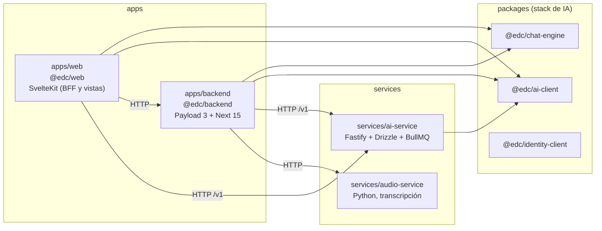

# Guía del desarrollador

- **Versión:** 1.3
- **Fecha:** 2026-11-11
- **Estado:** vigente
- **Fuentes:** leídas en `main` 687ff21e el 2026-11-11: `package.json` (raíz y de cada paquete), `pnpm-lock.yaml`, `pnpm-workspace.yaml`, `apps/backend/eslint.config.js`, `apps/backend/eslint/noRawErrorLog.js`, `apps/web/eslint.config.js`, `services/ai-service/eslint.config.js`, `apps/backend/.gitignore`, `infra/.env.example`, `infra/docker-compose.yml`, `infra/docker-compose.override.yml`, `infra/docker-compose.audio.yml`, `infra/docker-compose.dev.yml`, notas de contexto del equipo (Etapa 1), `TESTING.md`, `apps/backend/src/migrations/README.md`, `apps/backend/src/payload.config.ts`, `apps/backend/src/lib/features.ts`, `apps/web/src/lib/features.ts`, `apps/web/src/lib/design/README.md`, `apps/backend/src/lib/graph/queries.ts`, `apps/backend/src/lib/graph/queries.test.ts`.

## Para quién es y qué responde

Esta guía es para quien va a escribir código en Ecosistemas de Conocimiento (EDC). Responde: cómo está organizado el monorepo, qué necesitas instalado, cómo levantar todo en tu máquina, cómo desarrollar y migrar, qué convenciones y reglas de privacidad no se negocian, qué trampas conocidas existen y dónde está cada cosa. Termina con recetas para añadir una colección, un endpoint web, una función activable y una migración.

Las pruebas tienen su propio documento: [Estrategia de pruebas](../07-calidad/estrategia-de-pruebas.md). La arquitectura completa está en [Arquitectura del sistema](../03-arquitectura/arquitectura-del-sistema.md).

## 1. El monorepo

Un solo repo con pnpm workspaces: `apps/*`, `services/*` y `packages/*` (`pnpm-workspace.yaml`).



| Paquete | Versión | Responsabilidad | Versiones clave |
|---|---|---|---|
| `apps/backend` (`@edc/backend`) | 0.1.0 | El dominio: colecciones, permisos, compuerta de anonimización, grafo, limpiezas programadas y evaluaciones. También es el proveedor de identidad: firma JWT EdDSA y publica JWKS | payload ^3.84.1, next 15.4.11, `@payloadcms/db-postgres`, `@payloadcms/storage-s3`, vitest ^2.1.9 (2.1.9 en el lockfile), eslint ^9.24 |
| `apps/web` (`@edc/web`) | 0.3.0 | BFF (la capa que el navegador llama; nunca habla directo con el backend) y todas las vistas. Sin SSR en toda la app | `@sveltejs/kit` ^2.15.1, svelte ^5.16 (runes), vite ^6, tailwind ^3.4, vitest ^4.1.6 (4.1.10 en el lockfile), playwright ^1.62.1, force-graph 1.52.0, 3d-force-graph 1.80.1. Sin eslint |
| `services/ai-service` | 0.1.0 | Motor de IA y RAG agnóstico del dominio: ingesta, embeddings, recuperación, generación, presupuesto | fastify ^5.2, drizzle-orm ^0.38.3, bullmq ^5.34, zod ^4.5.4, vitest ^5.0.0, eslint ^9.17. `engines.node` ^26 |
| `services/audio-service` | sin versión | Transcripción y nada más | fastapi 0.115.6, arq 0.26.3, faster-whisper 1.1.1 (`requirements.txt`) |
| `packages/ai-client` | 0.34.0 | Cliente tipado de la API `/v1` de ai-service | sin dependencias de producción; vitest ^5.0.0 |
| `packages/chat-engine` | 0.10.0 | El turno RAG (condensar, recuperar, armar el prompt) y componentes Svelte del chat | agnóstico del dominio; vitest ^5.0.0 |
| `packages/identity-client` | 0.4.0 | Sesión y verificación de tokens con `jose` | la web no lo importa (citado de la auditoría del 2026-10-28); vitest ^5.0.0 |

Versiones medidas: leídas de cada `package.json` y de `pnpm-lock.yaml` en `main` 687ff21e, el 2026-11-11. Hay tres versiones de vitest en el repo: 2.1.9 en el backend, 4.1.10 en la web y 5.0.5 en ai-service y los paquetes (lockfile). Sus banderas no son iguales (sección 6). Infraestructura de datos: Postgres 16 con pgvector (imagen propia basada en `pgvector/pgvector:pg16`), Redis 7 y RustFS como almacenamiento compatible con S3. Dos bases en el mismo servidor: `edc_backend` (Payload) y `edc_ai` (ai-service). Están separadas a propósito: Payload y Drizzle guardan su registro de migraciones en el esquema `public` y se pisarían (citado de `infra/.env.example`).

`services/ai-service` y los tres `packages/` forman el stack de IA, agnóstico del dominio. Ver la sección 10.

## 2. Requisitos

| Herramienta | Versión | Notas |
|---|---|---|
| Node | 22 o mayor; 26 para ai-service | `engines.node` en `package.json` raíz (`>=22`) y en `services/ai-service/package.json` (`^26`). La máquina de desarrollo tiene v26.10.0 (medido con `node --version`, 2026-11-10) |
| pnpm | 9.15.4 | `packageManager` en `package.json` raíz |
| docker con compose | reciente | Para el stack local y las pruebas `*.pg.test.ts` |
| Python 3 | cualquiera reciente | Solo para `scripts/` de evaluación y fixtures |

**pnpm no está en el PATH** en la máquina de desarrollo (medido con `which pnpm`, 2026-10-30 y otra vez el 2026-11-10). Usa la copia de corepack:

```bash
node ~/.cache/node/corepack/v1/pnpm/9.15.4/bin/pnpm.cjs <comando>
```

Un alias en tu shell ahorra tiempo. En el resto de la guía, `pnpm` significa ese comando.

## 3. Arranque local, paso a paso

### 3.1 Instalar y compilar los paquetes

```bash
pnpm install --prefer-offline
pnpm --filter @edc/ai-client --filter @edc/identity-client --filter @edc/chat-engine build
```

Los tres paquetes exportan desde `dist/`, que no se versiona. Sin compilar, fallan 27 archivos de prueba del backend y 4 de la web (citado de `TESTING.md`, medido 2026-10-17), y lo peor: `apps/web` puede pasar `typecheck` contra un `dist` viejo mientras tu cambio no hace nada.

### 3.2 Preparar `infra/.env`

```bash
cd infra
cp .env.example .env
```

Lo que tienes que tocar sí o sí:

1. **Par de llaves de firma.** Nada lo genera por ti. Corre `pnpm --filter @edc/backend keygen` y pega la salida en `AUTH_PRIVATE_KEY`, `AUTH_PUBLIC_KEY` y `AUTH_KEY_ID`. Los saltos de línea del PEM van escapados como `\n`.
2. **Proveedor de modelos.** O pones una llave real de OpenRouter, o descomentas el bloque de cuatro líneas del proveedor falso (`COMPOSE_PROFILES=fake` y tres líneas más). El falso cuesta $0 pero sus respuestas no tienen sentido.
3. **Contenido del corpus.** El seed lee `../corpus-generativo`, un repo hermano con 250 documentos sintéticos. Para que el asistente pueda responder, pon `SEED_CORPUS_INGEST=1`; sin eso la biblioteca se llena pero la recuperación no encuentra nada.

Lo que ya trae un valor útil y conviene conocer:

| Variable | Valor local | Por qué importa |
|---|---|---|
| `EDC_ENV` | `local` | El seed de arranque solo corre en `local` y `dev`. Una base vacía sin usuario es la compuerta funcionando, no un error. No es `NODE_ENV` |
| `ORG_KEY` | `demo` | La web busca esa organización; el seed la crea con esa clave |
| `WEB_ORIGIN` | `http://localhost:45400` | Debe coincidir con el puerto de la web o cada POST de formulario responde 403 |
| `ALLOWED_ORIGINS` | web y backend | CORS del backend |
| `CALLBACK_SECRET` | marcador local | Una sola variable para tres consumidores. Si no coincide, los documentos se quedan "procesando" para siempre sin error visible |
| `PUBLIC_BACKEND_URL` | `http://backend:3002` | A dónde llaman de vuelta ai-service y audio-service. Es un contenedor, nunca `localhost` |
| `SEED_ADMIN_EMAIL`, `SEED_ADMIN_PASSWORD` | marcadores | El primer administrador. No hay contraseña por defecto en el código |

Todos los valores de `.env.example` son marcadores locales. Nunca subas un `.env` lleno, y genera secretos nuevos para cualquier entorno alcanzable desde la red.

Variables del backend que no están en `.env.example`, o solo aparecen comentadas, y que conviene conocer. Los valores por omisión salen del código (medido: leídos en `main` 687ff21e, 2026-11-11). "Implementado" quiere decir que está en `c4f53632`, la versión que dev corre desde el 2026-11-10 a las 23:03 UTC (citado del reporte de ese despliegue; no verificado aquí).

| Variable | Por omisión | Qué hace | Dónde | Estado |
|---|---|---|---|---|
| `SESSION_JANITOR_ENABLED` | apagado (`1` o `true` lo enciende) | Barrido de conversaciones viejas. También `SESSION_JANITOR_INTERVAL_MIN`, `_BATCH`, `_MAX`, `_DRY_RUN` | `apps/backend/src/lib/sessionJanitor.ts` | Implementado |
| `GRAPH_ORPHAN_JANITOR_ENABLED`, `GRAPH_ORPHAN_JANITOR_INTERVAL_MIN` | encendido; 1440 min (diario) | Borra las entidades del grafo que ya nadie menciona | `apps/backend/src/lib/graph/orphanJanitor.ts`, arrancado en `payload.config.ts` | Implementado |
| `CALLBACK_RETENTION_DAYS` | 30 | Vacía `ai_service_callbacks.raw_body` de los avisos más viejos; la fila se queda porque es la deduplicación | `apps/backend/src/lib/callbackRetention.ts`, arrancado en `payload.config.ts` | Implementado (commit f8294d65) |
| `CALLBACK_RETENTION_JANITOR_ENABLED`, `CALLBACK_RETENTION_JANITOR_INTERVAL_MIN` | encendido; 1440 min (diario) | La tarea de la fila anterior | igual | Implementado |
| `UPLOAD_MAX_CONCURRENT_PER_USER` | 2 (inferido de que la app sube un archivo a la vez, según el commit) | Subidas en curso por cuenta; la siguiente recibe 429 con `Retry-After: 5` | `apps/backend/src/lib/uploadSlots.ts` | Implementado (commit 780f614d) |
| `API_BODY_IDLE_TIMEOUT_MS`, `API_BODY_TOTAL_TIMEOUT_MS` | 30000; 120000 (los dos inferidos, según el commit) | Corta con 408 un cuerpo que no manda bytes o que tarda demasiado | `apps/backend/src/lib/bodyCap.ts` | Implementado (commit 780f614d) |
| `QUERY_RELATION_MAX_TERMS`, `QUERY_RELATION_MAX_IDS`, `QUERY_RELATION_MAX_CONCURRENT_PER_USER`, `QUERY_RELATION_RATELIMIT_USER_MAX` | 5; 5000; 2; 30 por minuto | Topes por petición y por persona de un filtro a través de una relación: 400 pasado el tope, 429 pasado el ritmo | `apps/backend/src/access/relationFilters.ts`, `apps/backend/src/lib/rateLimit.ts` | Implementado (pendiente de desplegar en dev; commits 36bf6cf5, 490de211) |
| `SESSION_RATELIMIT_CREATE_USER_MAX` | 60 por hora (inferido, según el commit) | Conversaciones nuevas por cuenta; la siguiente, 429 | `apps/backend/src/lib/rateLimit.ts` | Implementado (pendiente de desplegar en dev; commit 36bf6cf5) |
| `MIEMBROS_RATELIMIT_ADD_USER_MAX` | 50 por hora (inferido, según el commit) | Altas por `/miembros` de una misma persona; la siguiente, 429 | `apps/backend/src/endpoints/miembros.ts` | Implementado (pendiente de desplegar en dev; commit 0c639102) |
| `JANITOR_FIRST_SWEEP_MIN` | 2 (inferido, según el commit) | Minutos hasta el primer barrido de cada tarea programada, salvo el conserje de sesiones | `apps/backend/src/lib/janitorScheduler.ts` | Implementado (pendiente de desplegar en dev; commit bb8852f1) |
| `EDC_JANITORS_DISABLED` | sin valor | Solo en pruebas (`vitest.setup.ts`): con `1`, ninguna tarea programada arranca; la prueba de una tarea llama a `allowJanitors()` | `apps/backend/src/lib/janitorScheduler.ts` | Implementado (pendiente de desplegar en dev; commit 940b9360) |
| `ANONYMISE_DETECT_URL`, `ANONYMISE_DETECT_MODEL`, `ANONYMISE_DETECT_API_KEY` | sin valor | El detector autoalojado (Spark). Sin URL, el detector usa el hospedado salvo que el respaldo sea `none` | `apps/backend/src/lib/anonymise/` | Implementado |
| `ANONYMISE_DETECT_FALLBACK` | `hosted` | Respaldo cuando el Spark no responde. El valor guardado en Ajustes › Plataforma manda sobre esta variable. Ver la sección 8, regla 10 | `fallbackGenerator.ts`, `lib/platformSettings.ts` | Implementado |
| `ANONYMISE_DETECT_FALLBACK_COOLDOWN_S` | 60 | Segundos que el circuito manda todo al hospedado antes de volver a probar el Spark | `fallbackGenerator.ts` | Implementado |
| `ANONYMISE_CHUNK_WORDS`, `ANONYMISE_DETECT_CONCURRENCY`, `ANONYMISE_DETECT_TIMEOUT_MS`, `ANONYMISE_VERIFY_ROUNDS`, `ANONYMISE_DETECT_MIN_GAP_MS` | ver el código; las cuatro primeras aparecen comentadas en `infra/.env.example` | Tamaño de fragmento, paralelismo, plazo y rondas del detector | `apps/backend/src/lib/anonymise/` | Implementado |
| `ANONYMISE_REGATE_CONCURRENCY`, `ANONYMISE_REGATE_ATTEMPTS`, `ANONYMISE_REGATE_RETRY_MS`, `ANONYMISE_REGATE_PENDING_WAIT_MS`, `ANONYMISE_REGATE_PENDING_POLL_MS` | ver el código | Re-anonimización en lote cuando se apaga un interruptor de Ajustes | `apps/backend/src/lib/anonymisationControls.ts` | Implementado |

`CONSENT_IDS_FILE` no es del servidor: la lee el script `apps/backend/scripts/hold-for-consent.ts` (sección 8, regla 12).

### 3.3 Levantar el stack

```bash
cd infra
docker compose up -d --wait
```

`docker compose` sin `-f` carga `docker-compose.yml` y `docker-compose.override.yml`. El override añade lo que solo existe en local: puertos de host, nombre de proyecto `edc`, red fija, montaje del corpus y el servicio de proveedor falso.

> El script raíz `pnpm infra:up` corre `docker compose up -d --wait` en la raíz del repo, donde no hay archivo compose, y falla con "no configuration file provided" (medido, 2026-10-30; el 2026-11-10 la raíz sigue sin archivo compose y el script no cambió). Lo mismo `infra:down` e `infra:reset`. Levanta desde `infra/`.

Puertos de host, todos en el bloque 454xx a propósito (citado de `infra/.env.example`):

| Servicio | Puerto | Dirección |
|---|---|---|
| web | 45400 | `http://localhost:45400` |
| ai-service | 45401 | `http://localhost:45401/health` |
| backend (Payload e identidad) | 45402 | `http://localhost:45402/admin` |
| audio-service (opcional) | 45403 | `http://localhost:45403/health` |
| consola de RustFS | 45411 | |
| bge-m3 (perfil `heavy`) | 45420 | |
| rerank (perfil `heavy`) | 45421 | |
| Postgres | 45432 | usuario `edc` |
| Redis | 45479 | |

El bloque 454xx es una frontera de seguridad: un puerto común como 55432 puede recibir por error las pruebas destructivas de otra herramienta local. Si cambias un puerto, quédate dentro del bloque.

### 3.4 Perfiles opcionales

| Perfil | Qué añade | Cómo |
|---|---|---|
| `fake` | `fake-provider`: chat y embeddings falsos, $0 | `COMPOSE_PROFILES=fake` en `infra/.env` más las tres líneas de URL y llave |
| `audio` | audio-service, su worker y el worker de callbacks | `docker compose --profile audio -f docker-compose.yml -f docker-compose.override.yml -f docker-compose.audio.yml up -d --wait`. El overlay exige `AUDIO_SERVICE_API_KEY` |
| `heavy` | bge-m3 y rerank autoalojados | `--profile heavy` |

Con cualquier `-f` se apaga la carga automática del override; nómbralo explícitamente. Para desarrollo con recarga en caliente existe `infra/docker-compose.dev.yml`, que su propia cabecera marca como no verificado.

### 3.5 Datos de arranque

- Con `EDC_ENV=local`, el backend crea al arrancar el administrador inicial, la organización `demo` con sus equipos, y carga el corpus si existe.
- Para usuarios de demostración y la demo de Semiosis: `pnpm --filter @edc/backend seed:demo-users` y `seed:semiosis-demo`. Las contraseñas se generan al azar y se escriben una vez en un archivo fuera del repo con permisos 0600; nunca se imprimen.
- Si tu imagen de ai-service es anterior al cambio de una organización de IA por ecosistema, corre `scripts/ai-org-per-ecosystem.sql` contra `edc_ai` o la recuperación regresa vacía. Es dry-run salvo que pases `-v apply=1`.
- Un `edc_ai` nuevo responde 402 a todo hasta que cada ecosistema tiene presupuesto. Los ecosistemas nuevos lo reciben del backend al crearse (`AI_ECOSYSTEM_BUDGET_USD`, por defecto $5, citado de `infra/fleet/env-manifests.md`). Los anteriores necesitan `PUT /v1/budget/edc-eco-<id>` (citado de `infra/fleet/edc-1.md` §6).

### 3.6 Comprobar

1. `http://localhost:45401/health` responde.
2. `http://localhost:45402/admin` muestra el login de Payload.
3. `http://localhost:45400` redirige a `/sign-in`; entra con el administrador inicial.
4. Sube un PDF a una conversación y espera a que llegue a `listo`.

## 4. Desarrollo

| Script raíz | Qué corre | Notas |
|---|---|---|
| `pnpm dev:web` | `vite dev` en `apps/web` | Puerto 5173 o `PORT` |
| `pnpm dev:backend` | `next dev -p ${PORT:-3002}` en `apps/backend` | Lee `apps/backend/.env` (plantilla en `.env.example`) |
| `pnpm dev:ai` | `tsx watch src/index.ts` en ai-service | |
| `pnpm build` | build de todos los workspaces | |
| `pnpm typecheck` | tipos de todos | En web: `svelte-kit sync` y `svelte-check --threshold error`. En backend: `tsc` dos veces, la segunda con `tsconfig.eval.json` |
| `pnpm test` | unitarias de todos, en paralelo | Ver [Estrategia de pruebas](../07-calidad/estrategia-de-pruebas.md) |
| `pnpm test:sequential` | lo mismo, un workspace a la vez | Para descartar el planificador cuando algo falla solo en paralelo |

Correr una app con `dev:*` fuera de docker mientras el resto vive en el stack requiere apuntar sus variables a los puertos 454xx del host. La combinación exacta no está documentada en el repo (no verificado). Lo más probado es el stack completo en docker, reconstruyendo la imagen que cambiaste, o el overlay `docker-compose.dev.yml`.

> `apps/backend/docker-compose.yml` y `apps/backend/.env.example` apuntan a un Postgres propio en el puerto 5433, fuera del bloque 454xx. Son de antes del stack de `infra/`. Prefiere `infra/`.

Scripts útiles del backend: `migrate`, `migrate:create`, `generate:types`, `generate:schema`, `keygen`, `provision:storage`, `seed:demo`, `seed:demo-users`, `seed:semiosis-demo`, `test:e2e`, `lint`. De ai-service: `db:*`, `eval:retrieval`, `eval:generation`, `check`, `check:domain`, `check:error-parity`, `contract:check`, `set-budget`, `smoke`, `test:integration`. De la web: `check`, `test:e2e`, `test:e2e:headed`.

> Los scripts `docker:up`, `docker:down` y `docker:reset` del backend usan `apps/backend/docker-compose.yml`, el Postgres viejo del puerto 5433 (ver abajo). No son el stack de `infra/`.

**`apps/backend/src/payload-types.ts` se genera; no se versiona.** Está en `apps/backend/.gitignore` y en los `ignores` de `apps/backend/eslint.config.js`. Lo escribe `pnpm --filter @edc/backend generate:types` (`payload generate:types`, salida fijada en `typescript.outputFile` de `payload.config.ts`). La imagen del backend lo genera antes de `next build` (`apps/backend/Dockerfile`). Regenéralo después de cambiar una colección; no lo edites a mano. Las pruebas no deberían depender de él: `evals.pg.test.ts` se corrigió el 2026-11-10 para compilar sin el archivo generado (commit c809a53b).

Scripts de mantenimiento en `apps/backend/scripts/`. Los tres siguientes corren en seco por omisión y aplican solo con `--apply` o `CONSENT_APPLY=1` (medido: leídos sus encabezados):

- `hold-for-consent.ts`: marca documentos como retenidos por consentimiento, con ids de `CONSENT_IDS` o de `CONSENT_IDS_FILE` (sección 8, regla 12; commits 512dcc1f y 7987c171).
- `reextract-published-graph.ts`: vuelve a extraer el grafo de lo publicado (commit feae7e18). Preparado y **no se ha corrido** (citado de las reglas de la revisión de documentación del 2026-11-10).
- `regate-documents-by-id.ts`, `regate-member-documentos.ts`: re-anonimizan filas concretas. Rechazan las retenidas por consentimiento (commit 28d84f03).

### 4.1 Bases de datos

- `edc_backend` es la base de Payload. La del stack local en el puerto 45432 la comparten todas las copias de trabajo de la misma máquina: no corras scripts ni limpiezas contra ella sin avisar al equipo.
- `edc_ai` es la de ai-service (fragmentos, embeddings, presupuesto).
- Para cualquier trabajo de esquema, crea tu propia base desechable, migra en ella y bórrala al terminar. Para una revisión rápida: `docker run --rm --tmpfs /var/lib/postgresql/data …` deja todo en memoria.

## 5. Migraciones

Hay 25 migraciones registradas en `apps/backend/src/migrations/index.ts`, desde la línea base `20260908_092211_baseline` hasta `20261110_181621_consent_held_reviews_keep` (medido: contadas en `index.ts` de `main` 687ff21e, 2026-11-11). La última corrió en dev con el despliegue de `c4f53632` del 2026-11-10 a las 23:03 UTC (citado del reporte de ese despliegue; no verificado aquí); `20261110_070204_anonymisation_setting_changes_keys`, con el de `367c2698` (citado de `infra/fleet/edc-1.md`, 2026-11-10 18:33 UTC). La tabla de la cadena con lo escrito a mano en cada una está en `apps/backend/src/migrations/README.md`.

Reglas:

1. **Genera con `payload migrate:create <nombre>`**, nunca a mano. Cambia la configuración de la colección, corre el comando contra una base que ya esté en la última migración, revisa el SQL y versiona el `.ts` y el `.json` (la instantánea). Payload reescribe `index.ts`.
2. **La instantánea es la trampa.** `migrate:create` compara la configuración con la **última instantánea por orden de nombre de archivo**. Si otra rama integra una migración que ordena después de la tuya, su instantánea, que no conoce tus tablas, se vuelve la base, y la siguiente generación intenta crearlas de nuevo. Arreglo: renombra la tuya para que ordene al final y regenera su instantánea. Ya pasó con `20261027_053800_student_view`.
3. **Índices y cascadas escritos a mano.** Varios índices únicos y todos los `ON DELETE cascade` del grafo, de valoraciones y de la vista de estudiante se añadieron a mano al SQL generado. El `.json` no los conoce. Una regeneración los pierde.
4. **`PAYLOAD_ALLOW_PUSH=1` está prohibido.** El "push" de Payload sincroniza el esquema sin migraciones y borra en silencio esos índices y cascadas. El push está apagado por defecto en todos lados (`payload.config.ts`, opt-in explícito). Sin esos índices, una carrera de valoraciones duplicadas no se reproduce en local mientras sí está bloqueada en dev.
5. **Prueba `up`, `down`, `up`** en un Postgres desechable, y después un `migrate:create` que diga "No schema changes". Así se verificó cada migración desde octubre.
6. **Una migración versionada queda congelada**, comentarios incluidos.
7. **Despliegue:** el `start` del backend corre `scripts/migrate.sh`, que reintenta hasta 3 veces y exige la línea `Done.` de Payload, porque `payload migrate` llegó a salir con código 0 sin migrar (citado de la revisión de infraestructura del 2026-10-30, medido 2026-10-26).

## 6. Pruebas

Todo lo de pruebas (niveles, comandos, fixtures, convenciones, conteos y huecos) está en [Estrategia de pruebas](../07-calidad/estrategia-de-pruebas.md). Lo mínimo antes de reportar un cambio como listo:

```bash
pnpm typecheck
pnpm test
pnpm --filter @edc/backend lint     # si tocaste el backend
pnpm --filter @edc/web lint         # si tocaste la web
pnpm --filter @edc/ai-service lint  # si tocaste ai-service (eslint y vocabulario de dominio)
```

Y los e2e del flujo que tocaste, contra un stack construido con tu código.

### 6.1 Lint

- **Backend:** `eslint .` con `apps/backend/eslint.config.js`. Casi todas las reglas heredadas están en `warn`. La excepción es **`edc/no-raw-error-log`**, en `error` desde el principio, con su fuente en `apps/backend/eslint/noRawErrorLog.js` (commit 780f614d, 2026-11-10). Rechaza una llamada a `console.*` o a un logger (cualquier `.info`, `.warn`, `.error`, `.debug`, `.fatal` o `.trace`, se llame como se llame quien la recibe) que pase o interpole un identificador `err`, `error`, `e`, `ex`, `cause`, `reason` o terminado en `Err`/`Error`, el de un `catch`, un `.message`, `.stack` o `.cause`, o `String()`, `JSON.stringify()` o `.toString()` de ellos (commits 780f614d, ecfc3d1f, 4a3aecc1). Pasa `errSummary(err)`, `safeErrMessage(err)`, `err.name`, `err.code`, y el error entero bajo la llave `err` de un logger, que el serializador limpia. Motivo: el `message` de un `DrizzleQueryError` lleva los parámetros de la consulta, es decir, el texto de un testimonio (P-07). Las pruebas (`*.test.ts`, `*.spec.ts`, `e2e/`) están exentas.
- **ai-service:** `eslint .` y después `scripts/check-domain-vocabulary.mjs`, que rechaza vocabulario del dominio dentro del stack de IA. `pnpm test` de ai-service también corre ese chequeo. `edc/no-raw-error-log` está en `error`, sin archivos excluidos (Implementado (pendiente de desplegar en dev; commit 4a3aecc1).
- **Web:** `eslint .` con `apps/web/eslint.config.js`, solo con `edc/no-raw-error-log`, sobre los `.ts` de `src/`; los `.svelte` los revisa `src/lib/noRawErrorLog.lint.test.ts` (Implementado (pendiente de desplegar en dev; commit cc27d332). Además, `svelte-check` (`typecheck`).
- **Paquetes:** sin eslint.

### 6.2 vitest: tres versiones, banderas distintas

| Dónde | vitest (lockfile) | Limitar procesos |
|---|---|---|
| `apps/backend` | 2.1.9 | `--poolOptions.forks.maxForks=N --poolOptions.forks.minForks=N` |
| `apps/web` | 4.1.10 | ver la documentación de vitest 4 (no verificado aquí) |
| `services/ai-service`, `packages/*` | 5.0.5 | `maxWorkers`; vitest 5 quitó `poolOptions` (citado de `services/ai-service/vitest.integration.config.ts`) |

En el backend, pasa **las dos** banderas. vitest 2.1.9 toma `minForks` por omisión como el número de CPU menos uno, y tinypool lanza `RangeError` si `minForks` queda por encima de `maxForks` (medido: leído en `vitest/dist/chunks/resolveConfig.*.js`, `createForksPool`, y `tinypool/dist/index.js` de la instalación local, 2026-11-10). Ejemplo: `pnpm --filter @edc/backend exec vitest run --poolOptions.forks.maxForks=2 --poolOptions.forks.minForks=1` (no corrido en esta revisión).

## 7. Convenciones

### 7.1 Git

- **Ramas:** una por tarea.
- **`main` y `etapa-2`:** `main` solo lleva correcciones de lo que ya existe (Etapa 1). La funcionalidad nueva va a la rama `etapa-2` (decisión del 2026-11-10; la rama existe, local y en `origin`). Si un hallazgo pide una funcionalidad nueva, no la metas en `main`; ver [Etapa 2](#etapa-2).
- **Commits:** conventional commits con ámbito, en inglés, en presente, describiendo el comportamiento resultante. Ejemplo real: `fix(web): each chat source opens with its card title`. Los tipos más usados: `fix`, `feat`, `docs`, `test` (citado de la revisión de decisiones del 2026-10-30).
- **Cifras en los mensajes:** con procedencia (medido, citado, inferido) y referencia a la decisión del responsable técnico cuando aplica, con su fecha.
- **Integración a `main`:** solo el integrador designado escribe en `main`; el hook de git lo impone. El hook local `.git/hooks/reference-transaction` rechaza cualquier otra escritura a `main`, y `--no-verify` no lo salta. Entrega tu rama probada para que se integre; no integres a mano.

### 7.2 Idioma

- Texto de la interfaz en español de México. Identificadores, comentarios y mensajes de commit en inglés.
- Excepción: el vocabulario del dominio va en español aunque sea identificador (`contentKind` vale `documento` o `testimonio`; relaciones como `ocurre_en`).
- Fechas y números con `Intl` y `toLocaleString('es-MX')`. `app.html` declara `lang="es"`.
- El texto en español vive en módulos `.ts` puros (por ejemplo `apps/web/src/lib/nav.ts`) para poder probarlo.
- Navegación con sustantivos llanos: "Conexiones", no "Grafo".
- Sin párrafos explicativos en la interfaz. Si una pantalla necesita una explicación, la pantalla está mal.

### 7.3 Tokens de diseño

- Fuente única: `apps/web/src/lib/design/tokens.css`, importada una vez desde `app.css`. La usan las primitivas, los componentes, `packages/chat-engine/src/svelte` y `tailwind.config.js`, que mapea a `var(--edc-*)`.
- Gris frío y un solo acento ciruela `#6d28d9`. Los derivados son `color-mix`.
- **Trampa de opacidad:** los colores son `var()` desnudos, así que los modificadores de opacidad de Tailwind (`bg-warning/10`) no producen nada. Usa los pares `-soft` y `-outline`.
- `--edc-focus-ring` es un color, no un valor válido para `outline`.

### 7.4 Números con procedencia

Todo número en documentos, comentarios y commits dice de dónde sale: `measured` (cómo, cuándo, en qué máquina y con qué carga), `quoted` (de qué documento y fecha) o `inferred` (de qué). Un número inferido no sostiene una recomendación sin decirlo.

## 8. Reglas de privacidad que sostienen el sistema

Romper cualquiera de estas reglas es peor que no entregar nada. Vienen de las notas de contexto del equipo, actualizadas con el código de `main` 687ff21e (2026-11-11).

1. **El grafo lee `corpusTextFor(row)`, nunca `extractedText`.** En un testimonio, `extractedText` es la transcripción cruda sin limpiar. Además exige `anonymisationStatus` en `ready` o `approved`: una fila que pasó la compuerta y luego fue retenida trae un `redactedText` viejo. `corpusTextFor` está en `apps/backend/src/lib/anonymiseDocument.ts`.
2. **Los títulos pasan por `documentTitleFor(row)`**, que llama a `titleFor(contentKind, name, gate)` (`apps/backend/src/lib/contentKind.ts`). `documents.name` es texto libre que escribió quien subió. El caso que casi llega a una tarjeta de cita: "Testimonio de María López.mp3".
   - Un testimonio se titula "Testimonio"; una conversación, "Conversación"; un tipo desconocido, "Documento".
   - Un `documento` con compuerta se titula con el título redactado por la compuerta (`anonymisationReport.redactedTitle`) o, sin él, "Documento". Nunca con `name`.
   - **Falla cerrado:** solo `anonymise === false` muestra `name`. Un `NULL` o una columna que no vino en el `select` cuentan como compuerta (`titleIsGated`). Si tu consulta quiere el título abierto, tiene que seleccionar `anonymise` y `anonymisationReport`.
   - El nombre del archivo solo lo leen quien subió el documento y la administración de la plataforma (`mayReadGatedOriginal`, `collections/Documents.ts`). Tampoco se puede buscar por `name` en un documento con compuerta: la consulta lo excluye.
   - Aplica a REST, ingesta, citas, biblioteca, chat, grafo, estudiante y la vista de anonimización (commits b2a51aed, 2dda9a8b, 2f21e91b, 84364f58, a2ba0e19, ed35b605, b7dc944f).
3. **Los nodos `persona` no pueden venir de un testimonio.** Tres capas: el esquema de respuesta no incluye `persona` en el enum para testimonios, `personaAllowed()` solo acepta `documento` y falla cerrado, y un filtro posterior incondicional descarta cualquiera que aparezca (`apps/backend/src/lib/graph/types.ts`).
4. **Cada sentencia SQL del grafo lleva tres compuertas:** la organización nombrada explícitamente, un JOIN a `documents` que exige `published`, y un mínimo de documentos distintos. Una prueba recorre todas las sentencias registradas y verifica las tres. Registra cada consulta nueva en `graphStatements` dentro de `apps/backend/src/lib/graph/queries.test.ts`, o queda sin vigilar.
5. **El umbral mínimo es hoy 1, no 3.** Las notas de contexto del equipo dicen "`GRAPH_MIN_SUPPORT` es 3 y se queda en 3". Eso cambió el 2026-10-21: `GRAPH_MIN_SUPPORT` ya no se lee, y lo reemplazan `GRAPH_MIN_ENTITY_DOCS`, `GRAPH_MIN_EDGE_DOCS` y `GRAPH_MIN_COMENTION_DOCS`, todos con valor por defecto 1 (`apps/backend/src/lib/graph/queries.ts`, `GRAPH_MIN_ENTITY_DOCS_DEFAULT = 1`, leído el 2026-10-30). Las garantías contra la reidentificación del ADR del grafo descansaban en 3. Con datos reales, esta decisión debe revisarse; no bajes ni subas el umbral sin una decisión registrada.
6. **Los borradores son privados por persona.** En ai-service, el corpus compartido es `eco-{orgId}` y el de borradores `eco-{orgId}-draft-{userId}`. Un borrador solo se recupera en su propia conversación.
7. **Las columnas de la compuerta solo las escribe la compuerta** (`gateWritesOnly`): `heldText`, `anonymisationSurvivors` y similares no se pueden escribir por la API.
8. **Sin URL prefirmadas.** Todos los bytes de archivos pasan por `GET /api/media/file/:filename` después del control de acceso. `signedDownloads`, `disablePayloadAccessControl`, `clientUploads` y `generateFileURL` están prohibidas (`apps/backend/src/lib/storage/plugin.ts`).
9. **Las conversaciones son solo de su dueño**, sin excepción para administradores (`ownOnly` en `collections/Sessions.ts`).
10. **El respaldo del detector manda texto crudo a un proveedor hospedado** cuando el Spark no responde, si el modo es `hosted`. El modo sale primero del valor guardado en Ajustes › Plataforma (`detectorFallback`, caché de 30 s, `TTL_MS` en `lib/platformSettings.ts`) y, si no hay, de `ANONYMISE_DETECT_FALLBACK` (por omisión `hosted`, `lib/anonymise/fallbackGenerator.ts`). Con `none` no hay llamada hospedada, haya o no `ANONYMISE_DETECT_URL`: sin URL, el detector falla y la compuerta retiene el documento (`lib/anonymise/detector.ts`, P-05). La decisión vigente es `hosted`, con ZDR en OpenRouter (del responsable técnico, 2026-11-09, confirmada el 2026-11-10). Cada cambio del valor guardado deja una fila en `anonymisation-setting-changes`.
11. **Toda regla negativa de privacidad lleva una prueba positiva** que demuestre que lo suprimido existe. Ver [Estrategia de pruebas](../07-calidad/estrategia-de-pruebas.md), sección 4.
12. **Retenido por consentimiento (`consentHeld`).** Una fila con `documents.consentHeld = true` nunca se re-ingiere, re-anonimiza, grafica ni publica; nada se borra. Solo la escribe `holdForConsent` (`lib/consentHold.ts`) desde `scripts/hold-for-consent.ts`, con ids de `CONSENT_IDS_FILE`. No hay forma de liberarla en código. Toda función nueva que ingiera, publique, re-anonimice o extraiga grafo debe llamar a `isConsentHeldNow` o `readConsentHeld`, o filtrar con `NOT_CONSENT_HELD` (commits 512dcc1f, 7987c171, ccce6281, 28d84f03, feae7e18). Una revisión queda retenida si su original lo está; `isConsentHeld`, síncrona, solo lee la fila que recibe (Implementado (pendiente de desplegar en dev; commits b29c72ba, c12a0ab5).
13. **Ningún log lleva el texto crudo de un error** (P-07). Usa `safeErrMessage(err)` o `errSummary(err)`, o pasa el error bajo la llave `err` de un logger. La regla de lint `edc/no-raw-error-log` lo hace cumplir en backend, web y ai-service (sección 6.1; commits 780f614d, 752b60f3; en la web y ai-service, Implementado (pendiente de desplegar en dev; commits cc27d332, 4a3aecc1)).
14. **Los archivos subidos se guardan con nombre neutro** (id y extensión), no con el nombre que traían; `documents.name` no cambia (`collections/Media.ts`, `neutralUploadName`). La descarga del original devuelve el nombre del documento (commits 74306c42 y 28d84f03). Los objetos anteriores conservan su nombre: ver [Etapa 2](#etapa-2).

Lo demás sobre privacidad está en [Protección de datos](../06-privacidad-y-seguridad/proteccion-de-datos.md).

## 9. Trampas conocidas

| Trampa | Qué pasa | Qué hacer |
|---|---|---|
| Paquetes sin compilar | 27 + 4 archivos de prueba fallan; o peor, la web pasa tipos contra un `dist` viejo | Compilar los tres paquetes después de instalar y después de tocar `packages/` |
| Copia de trabajo vieja | Un `git worktree` creado desde `origin/main` arranca atrás del `main` local, que llegó a ir muy adelante (citado de las notas de contexto del equipo) | `git log --oneline -1`, `git rev-list --count HEAD..main` y `git merge --ff-only main` antes de leer nada |
| Límites de tasa de ai-service | `/v1` 100 por minuto, `/v1/generate` 30 por minuto. Ya no son por IP sino por llave, pero backend y web comparten **una sola** llave, así que todos los ecosistemas comparten un solo cubo de 30 generaciones por minuto (citado de la revisión de la pila de IA del 2026-10-30, inferido de una sola entrada en `API_KEYS`) | No lances cargas masivas en dev; el grafo no se autolimita |
| Límites del grafo en memoria | Los límites de tasa del grafo viven en un `Map` por proceso. Con dos réplicas, el límite se duplica | Una réplica por ahora |
| Generación lenta | Unos 8 tokens por segundo en malas noches; una ventana `deep` de extracción tarda de 70 a 95 s (citado de las notas de contexto del equipo y de `spark-chat-eval`) | No iterar contra inferencia real; usar el proveedor falso |
| Orden de los timeouts | `LLM_REQUEST_TIMEOUT_MS` vale 120000 por omisión en el código de ai-service (`src/config/env.ts`) y 600000 en los entornos desplegados (citado de `infra/fleet/env-manifests.md`); `GRAPH_EXTRACT_TIMEOUT_MS` (660000) debe quedar por encima, y el del detector (90 s) por debajo | Si el cliente corta antes, todo fallo parece de red. En local, pon `LLM_REQUEST_TIMEOUT_MS=600000` o baja `GRAPH_EXTRACT_TIMEOUT_MS` |
| `payload-types.ts` ausente | Una copia recién clonada no lo tiene (está en `.gitignore`); lo que lo importe no compila | `pnpm --filter @edc/backend generate:types` |
| `maxForks` solo, en el backend | vitest 2.1.9 lanza `RangeError` si `minForks` (por omisión CPU − 1) queda por encima | Pasar también `--poolOptions.forks.minForks` (sección 6.2) |
| Un `select` que omite `anonymise` | El título de un `documento` sale "Documento" aunque no tenga compuerta: falla cerrado | Seleccionar `anonymise` y `anonymisationReport` junto con `name` |
| `CALLBACK_SECRET` distinto | Subidas en `embedding` para siempre, o audio transcrito con callback rechazado | Una sola variable, interpolada por compose |
| Saltos de línea en `.env` | Una línea pegada a la anterior rompe la URL y cada ingesta responde 400 | Revisar que el archivo termine en salto de línea |
| `ORIGIN` y `WEB_ORIGIN` | SvelteKit responde 403 a POST de formularios sin origen conocido | Que coincida con el puerto o el dominio real |
| `BODY_SIZE_LIMIT` | adapter-node trae 512 KB por defecto | La imagen web fija `BODY_SIZE_LIMIT=201M` para subidas de 200 MiB |
| Imagen vieja en Playwright | Las pruebas de navegador prueban la imagen que corre, no tu código | Reconstruir o servir el build en otro puerto 454xx |
| Disco | El 2026-10-17 la máquina de desarrollo llegó al 95 % por stacks de prueba (citado de `TESTING.md`) | `down -v --rmi local` al terminar |
| Retenciones ajenas | Decidir sobre una retención es terminal | Las pruebas siembran la suya por SQL |
| Spark prestado | Sin supervisor; no vuelve solo después de un reinicio. Sin él, dev pierde audio y micrófono en vivo | Ver [Infraestructura y entornos](../05-infraestructura/infraestructura-y-entornos.md) |

## 10. Stack de IA

`services/ai-service`, `packages/ai-client`, `packages/chat-engine` y `packages/identity-client` forman la plataforma de IA del monorepo: un servicio y paquetes internos, agnósticos del dominio. No conocen ecosistemas, voces ni testimonios; ai-service expone `/v1` con corpus, org y presupuesto como únicos conceptos. `services/audio-service` es un servicio aparte, en Python.

- **Dónde va cada arreglo:** lo que tiene significado de dominio va en `apps/backend` o `apps/web`, nunca en el stack de IA. Los hallazgos de auditoría se marcan "EDC" o "stack de IA".
- **Lint:** los cambios en ai-service corren también eslint; el CI de ai-service se puso en rojo el 2026-10-17 por omitirlo.
- **Paquetes:** después de cambiar `packages/*`, reconstrúyelos antes de probar las apps (sección 3.1).
- **CI:** `services/ai-service/.github/workflows` contiene `ci.yml` y `test.yml`, inactivos en esa ruta; el repo no tiene `.github/workflows` en la raíz (medido, 2026-11-10). Copiarlos a la raíz para activarlos.
- **Capacidades estrictas:** desde `ai-client` 0.32.0 la negociación de capacidades es estricta en todos los entornos, sin modo `warn` ni variable que la relaje (citado de `packages/ai-client/README.md`). La versión del repo es 0.34.0, así que ya no es un cambio pendiente: un ai-service que no declare una capacidad requerida hace fallar el arranque.

Detalle en [Despliegue y runbook](../05-infraestructura/despliegue-y-runbook.md) §4 y en [ADR-0017](../03-arquitectura/adr/ADR-0017-plataforma-de-ia-agnostica-del-dominio.md).

## 11. Dónde está cada cosa

| Ruta | Qué hay |
|---|---|
| `apps/backend/src/collections/` | Colecciones Payload: `Documents.ts` (la pieza central), `Media.ts`, `Sessions.ts`, `Messages.ts`, `Ratings.ts`, `Organizations.ts`, `Memberships.ts`, `Users.ts`, grafo, estudiante, evaluaciones |
| `apps/backend/src/endpoints/` | Endpoints propios del backend: identidad (`jwks`, `token`, `me`), miembros, estudiante, grafo, funciones, evaluaciones |
| `apps/backend/src/lib/` | Lógica de dominio: `permissions.ts`, `features.ts`, `anonymise/` (detector y compuerta), `graph/` (extracción, consultas, escritura), `storage/`, `conversationIngest.ts`, `autoPublish.ts`, `studentNotes.ts` |
| `apps/backend/src/migrations/` | Migraciones y su README |
| `apps/backend/src/seed/` | Seeds de arranque y de demo |
| `apps/backend/src/eval/` | Arneses GraphRAG y de recuperación, `RESULTS.md` |
| `apps/backend/e2e/` | E2E de API |
| `apps/backend/scripts/` | `migrate.sh`, mediciones (Q24), utilidades de re-anonimización, retención por consentimiento y re-extracción del grafo (sección 4) |
| `apps/backend/eslint/` | Reglas propias de eslint: `noRawErrorLog.js` (`edc/no-raw-error-log`) |
| `apps/web/src/routes/` | Páginas (`+page.svelte`, `+page.server.ts`) y API del BFF (`api/**/+server.ts`) |
| `apps/web/src/lib/` | Lógica de vista en `.ts` puros, `server/` (cliente del backend, motor de chat en `server/engine/`, evaluaciones en `server/evals/`), `components/`, `primitives/`, `design/` |
| `apps/web/e2e/` | Playwright; `evidencia/` para los videos |
| `services/ai-service/` | Motor de IA agnóstico del dominio, con su `evals/` y `test-support/fake-provider/` |
| `services/audio-service/` | Transcripción en Python |
| `packages/` | Clientes y motor de chat del stack de IA |
| `infra/` | Compose, `.env.example`, imagen de Postgres, `fleet/` (manifiestos y bitácora del servidor) |
| `scripts/` | Fixtures del corpus, voces, migración de organizaciones de IA, demos de ecosistemas, `cite-eval`, `spark-chat-eval` |
| `plan/` | Planeación, ADR, auditorías, pendientes |

## 12. Cómo añadir

### 12.1 Una colección

1. Crea `apps/backend/src/collections/MiColeccion.ts`. Copia el patrón de una colección parecida: campo `organization` requerido y fijado por el servidor en `beforeValidate`, nunca enviado por el cliente.
2. Escribe el acceso como restricción `WHERE` (`withinMyOrganizations*`), para que un id ajeno responda 404 y no 403. Sin membresías, el acceso es `false`.
3. Si la colección se borra junto con su ecosistema o su usuario, planea `ON DELETE cascade` a mano en la migración (paso 5).
4. Regístrala en el arreglo `collections` de `apps/backend/src/payload.config.ts`.
5. Genera la migración (receta 12.4) y los tipos con `pnpm --filter @edc/backend generate:types`.
6. Escribe pruebas: unitarias del acceso y un `*.pg.test.ts` de las cascadas y los índices.

### 12.2 Un endpoint web

1. Crea `apps/web/src/routes/api/<ruta>/+server.ts`. Patrón (de `routes/api/lenguas/+server.ts`):
   - si no hay `locals.user`, responde 401;
   - deriva el ecosistema con `resolveEcosystem(cookies, locals.token)`; el navegador nunca nombra el ecosistema;
   - llama al backend con el token del usuario desde un módulo en `apps/web/src/lib/server/`;
   - devuelve solo lo que la vista necesita.
2. Si el endpoint necesita datos nuevos, crea el endpoint correspondiente en `apps/backend/src/endpoints/` y verifica ahí el permiso. El BFF no decide permisos.
3. Escribe `server.test.ts` junto al `+server.ts`.
4. Las páginas usan acciones de formulario en `+page.server.ts` cuando el cambio sale de un formulario.

### 12.3 Una función activable por ecosistema

1. Añade la clave y su valor por defecto a `FEATURE_DEFAULTS` en `apps/backend/src/lib/features.ts`. El valor por defecto es el comportamiento de hoy: una columna nula o una clave ausente se leen como el valor por defecto.
2. Documenta en la cabecera del mismo archivo **dónde se aplica en el servidor**. Ocultarla en la interfaz no basta.
3. Refleja la clave en `apps/web/src/lib/features.ts` (`FEATURE_DEFAULTS` y `FEATURE_LABELS`, que es exhaustivo por tipo).
4. Si solo el administrador de la plataforma puede cambiarla, añádela a `PLATFORM_ADMIN_ONLY_FEATURES` en la web y al bloqueo del backend.
5. Ubícala en una pestaña de `apps/web/src/routes/ajustes/secciones.ts`; si depende de otra, declárala como hija.
6. Aplica la función donde ocurre el trabajo (endpoint, hook o motor de chat) y prueba los dos estados.
7. No hace falta migración: las funciones viven en `organizations.features` (jsonb).

### 12.4 Una migración

1. Ten una base desechable en la última migración.
2. Cambia la configuración de la colección.
3. Corre `pnpm --filter @edc/backend migrate:create <nombre_en_snake_case>` contra esa base.
4. Revisa el SQL. Añade a mano lo que falte (cascadas, índices únicos compuestos, `down` en orden correcto) y explícalo en el comentario de cabecera.
5. Prueba `up`, `down` y `up`, y luego otro `migrate:create` que diga "No schema changes".
6. Versiona el `.ts`, el `.json` e `index.ts`. Añade la fila a la tabla de `apps/backend/src/migrations/README.md`.
7. Antes de integrar, comprueba que tu migración sigue siendo la última por nombre. Si otra rama integró una posterior, renombra la tuya y regenera la instantánea.

## Etapa 2

Lo que sigue quedó fuera de `main` por ser funcionalidad nueva (clasificación de la auditoría del 2026-11-10). Si se hace, va en la rama `etapa-2`. Estado de cada punto: Pendiente, salvo que diga otra cosa.

- **Renombrar los objetos ya guardados** con su nombre original. Las subidas nuevas ya se guardan con nombre neutro (sección 8, regla 14); las anteriores no se renombran (citado del mensaje del commit 74306c42).
- **Reintentar el borrado en ai-service** cuando falla. Hoy se intenta una vez (P-08).
- **Purgar `edc_ai.traces`** de la salida del detector hospedado y de los títulos de testimonio (P-14).
- **ZDR con DeepInfra.** OpenRouter se llama con ZDR; DeepInfra (rerank y embeddings de respaldo) no tiene ese parámetro (P-06).
- **Cambio de contraseña** en la web y cambio obligatorio de la contraseña temporal (A-04); **verificación del correo** (A-03).
- **Endurecer la regla de "edición sustantiva"** en Revisión (R4-12, revisión de la ola 4 del 2026-11-10).

## Referencias

- `package.json`, `pnpm-workspace.yaml`, `pnpm-lock.yaml`
- `apps/backend/eslint.config.js`, `apps/backend/eslint/noRawErrorLog.js`
- `apps/backend/src/lib/contentKind.ts`, `apps/backend/src/lib/consentHold.ts`, `apps/backend/src/lib/callbackRetention.ts`, `apps/backend/src/lib/platformSettings.ts`
- `infra/.env.example`, `infra/docker-compose.yml`, `infra/docker-compose.override.yml`, `infra/docker-compose.audio.yml`, `infra/docker-compose.dev.yml`
- `TESTING.md`
- `apps/backend/src/migrations/README.md`
- `apps/backend/src/payload.config.ts`
- `apps/backend/src/lib/features.ts`, `apps/web/src/lib/features.ts`
- `apps/backend/src/lib/graph/queries.ts`, `apps/backend/src/lib/graph/queries.test.ts`
- `apps/web/src/lib/design/README.md`
- [Estrategia de pruebas](../07-calidad/estrategia-de-pruebas.md)
- [Arquitectura del sistema](../03-arquitectura/arquitectura-del-sistema.md)
- [Pila de IA](../03-arquitectura/pila-de-ia.md)
- [Modelo de datos](../04-datos/modelo-de-datos.md)
- [Estructura de base de datos](../04-datos/estructura-de-base-de-datos.md)
- [Infraestructura y entornos](../05-infraestructura/infraestructura-y-entornos.md)
- [Despliegue y runbook](../05-infraestructura/despliegue-y-runbook.md)
- [Protección de datos](../06-privacidad-y-seguridad/proteccion-de-datos.md)
- [Registro de decisiones (ADR)](../03-arquitectura/adr/README.md)
