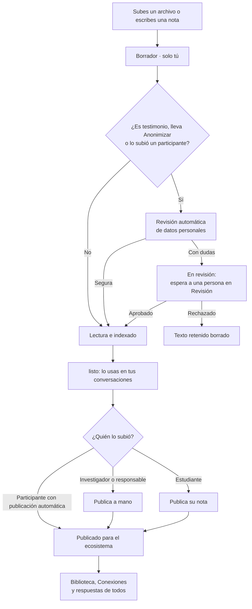

# Manual de usuario

- **Versión:** 1.5
- **Fecha:** 2026-11-12
- **Estado:** vigente
- **Fuentes:** `plan/funcionalidades.md` (inventario por pantalla, 2026-10-27), `plan/mapa-historias.md`, `apps/web/src/lib/nav.ts`, `apps/web/src/lib/miembros.ts`, `apps/web/src/lib/features.ts`, `apps/web/src/routes/` (textos de cada pantalla, leídos en `main` 687ff21e y revisados en `f971d54c` el 2026-11-12), `apps/backend/src/lib/permissions.ts`, `apps/backend/src/lib/holdReview.ts`, `apps/backend/src/lib/contentKind.ts`, `apps/backend/src/collections/Media.ts`, `apps/web/e2e/evidencia/`, `plan/ux-demo-backlog.md`, `TESTING.md`.

**Estados.** Lo que no lleva marca está **Implementado** y desplegado en dev (dev = `f971d54c`, desplegado el 2026-11-12 (citado del coordinador del cierre; no verificado en este documento)). Todo lo que está en `main` `f971d54c` está desplegado en dev. Lo que aún no existe está en [Etapa 2](#etapa-2).

## Para quién es y qué responde

Este manual es para las personas que usan Ecosistemas de Conocimiento: participantes, estudiantes, investigadores, responsables de un ecosistema y quien administra la plataforma. Dice qué puede hacer cada quien y cómo, tarea por tarea. No explica cómo funciona por dentro; eso está en [Arquitectura del sistema](../03-arquitectura/arquitectura-del-sistema.md).

Cada tarea tiene cuatro partes: **Quién**, **Pasos**, **Resultado** y, cuando hace falta, **Notas**.

## Roles

Un **ecosistema** es un espacio de trabajo con sus propios documentos, conversaciones y personas. Una persona puede estar en varios, con un rol en cada uno.

| Rol en pantalla | Qué hace, en corto |
|---|---|
| estudiante | Conversa, sube trabajos, ve su investigación (si el ecosistema tiene la vista de estudiante) |
| participante | Conversa y aporta. Lo que sube se publica solo cuando pasa la revisión automática |
| investigador | Todo lo anterior, más publicar a mano, subir testimonios, revisar y administrar miembros |
| responsable | Lo mismo que investigador; además guarda los Ajustes del ecosistema y puede cambiar su clave o apagarlo |
| administrador de la plataforma | Ve y administra todos los ecosistemas, y las opciones que afectan a toda la plataforma |

Hay un rol más, "administra", que no se ofrece en la pantalla Miembros. Quien lo tiene puede revisar documentos y administrar miembros, pero no entra a Ajustes ni a Administración.

### Qué secciones ve cada rol

| Sección | estudiante | participante | investigador | responsable | admin. plataforma |
|---|:-:|:-:|:-:|:-:|:-:|
| Conversaciones | ● | ● | ● | ● | ● |
| Mis documentos | ● | ● | ● | ● | ● |
| Biblioteca | ● | ● | ● | ● | ● |
| Conexiones | ● | ● | ● | ● | ● |
| Mi investigación | ● (con vista de estudiante) | | | | |
| Estudiantes | | | ● (con vista de estudiante) | ● (con vista de estudiante) | |
| Revisión | | | ● | ● | ● |
| Miembros | | | ● | ● | ● |
| Ajustes | | | | ● | ● |
| Administración | | | ● | ● | ● |

Si no ves una sección, tu rol no la tiene o el ecosistema la apagó en Ajustes.

**Ajustes es del responsable** (decisión del 2026-11-10; `apps/backend/src/lib/permissions.ts`, commit 50bde2ae). El investigador ya no ve ni guarda Ajustes.

## 1. Entrar y elegir ecosistema

### 1.1 Iniciar sesión

- **Quién:** todos.
- **Pasos:**
  1. Abre la dirección de la plataforma.
  2. Escribe tu correo electrónico y tu contraseña.
  3. Pulsa **Entrar**.
- **Resultado:** ves el menú. Si eres participante o estudiante, ves primero la pantalla **Iniciar**.
- **Notas:**
  - No hay registro abierto. Tu cuenta la crea un responsable o investigador de tu ecosistema, que te da una contraseña temporal.
  - No hay "olvidé mi contraseña" ni cambio de contraseña dentro de la plataforma. Pide ayuda a quien te dio de alta. Ver [Etapa 2](#etapa-2).
  - Tras varios intentos fallidos, la pantalla dice que la cuenta o la conexión quedó bloqueada un rato. Espera unos minutos. Payload bloquea la cuenta 10 minutos tras 5 fallos (citado de `apps/backend/src/lib/loginRateLimit.ts`, que cita los valores por omisión de Payload 3.88).
  - Una cuenta desactivada no puede entrar, y sus sesiones abiertas se cierran (`apps/backend/src/collections/Users.ts`).
  - La sesión dura hasta 2 horas (inferido: la cookie de la web dura 7 días, `apps/web/src/lib/server/auth.ts`, pero el token del backend vence a los 7200 s por omisión de Payload, citado de `apps/backend/src/collections/Users.ts`, y la web no lo renueva). Al vencer, vuelves a la pantalla de entrada.

### 1.2 Cerrar sesión

- **Quién:** todos.
- **Pasos:** pulsa **Cerrar sesión** en el menú o en la pantalla Iniciar.
- **Resultado:** vuelves a la pantalla de entrada.

### 1.3 Elegir ecosistema

- **Quién:** quien pertenece a dos o más ecosistemas.
- **Pasos:**
  1. Abre el panel de conversaciones.
  2. Pulsa el selector de ecosistema.
  3. Elige uno de la lista.
- **Resultado:** todo lo que ves (conversaciones, documentos, biblioteca, conexiones) queda acotado a ese ecosistema.
- **Notas:** con un solo ecosistema, en lugar del selector ves su nombre fijo.

### 1.4 Empezar con Iniciar

- **Quién:** participante y estudiante.
- **Pasos:** en la pantalla Iniciar, pulsa **Iniciar**.
- **Resultado:** se abre una conversación nueva de tipo **Resonancias**, lista para escribir.

## 2. Conversaciones

Hay dos tipos de conversación:

- **Generales:** preguntas al acervo del ecosistema. La respuesta cita sus fuentes.
- **Resonancias:** cuentas una experiencia. El asistente te entrevista y la relaciona con lo que ya hay en el acervo.

El tipo se elige al crear la conversación y no cambia después.

### 2.1 Crear una conversación

- **Quién:** todos.
- **Pasos:**
  1. En el panel de conversaciones, elige la pestaña **Generales** o **Resonancias**.
  2. Pulsa **Nueva conversación**.
- **Resultado:** aparece una conversación vacía.
- **Notas:** cada cuenta abre como máximo 60 conversaciones nuevas por hora; pasado eso ves "No se pudo crear la conversación". Implementado (`SESSION_RATELIMIT_CREATE_USER_MAX`, commit 36bf6cf5; el 60 es inferido, según el commit).

### 2.2 Hacer una pregunta

- **Quién:** todos.
- **Pasos:**
  1. Escribe en el cuadro de mensaje.
  2. Pulsa **Enviar**.
- **Resultado:** la respuesta aparece mientras se escribe. Debajo hay estrellas para valorarla. La conversación toma un título a partir de tu pregunta.
- **Notas:**
  - Una respuesta tarda de 8 a 14 s, a veces hasta 39 s (citado de `plan/ux-demo-backlog.md` #9, mediciones en dev).
  - **Esc** detiene una respuesta en curso.
  - Si la respuesta falla, la burbuja dice qué pasó y ofrece **Reintentar**, que vuelve a enviar la misma pregunta.
  - Si la respuesta llega vacía, la burbuja dice "La respuesta llegó vacía." y ofrece **Reintentar**. No se guarda un mensaje vacío.
  - Si la respuesta excede el límite de longitud, la burbuja dice "La respuesta excedió el límite de longitud." y no ofrece **Reintentar**. Implementado (commit 6406fadb).

### 2.3 Ver las fuentes de una respuesta

- **Quién:** todos.
- **Pasos:** pulsa **Fuentes consultadas** debajo de la respuesta.
- **Resultado:** ves la lista de documentos citados. Cada número `[N]` en el texto corresponde a una fuente. Puedes abrir cada una en la Biblioteca.
- **Notas:**
  - Si la respuesta incluye un párrafo que empieza con "Fuera de los documentos:", ese párrafo no viene del acervo.
  - Tus borradores solo se usan como fuente en la conversación donde los subiste.

### 2.4 Contar una experiencia (Resonancias)

- **Quién:** todos.
- **Pasos:**
  1. Abre o crea una conversación Resonancias.
  2. Escribe lo que quieres contar y envíalo.
- **Resultado:** el asistente responde con preguntas y relaciona tu experiencia con el acervo.

### 2.5 Valorar una respuesta

- **Quién:** todos.
- **Pasos:**
  1. Pulsa una estrella (de 1 a 5). Con teclado: flechas para moverte, Inicio y Fin para ir a los extremos.
  2. Si quieres, elige un motivo. Con 1 a 3 estrellas ves motivos como "Se lo inventó" o "Le faltó lo importante". Con 4 o 5, motivos como "Coincide con la fuente".
  3. Con **Otro** puedes escribir un comentario libre.
- **Resultado:** ves "Tu valoración". Si cambias la valoración, ves un aviso de que se guardó.
- **Notas:**
  - Para quitarla, pulsa **Quitar**.
  - El comentario libre solo lo leen investigadores y responsables.

### 2.6 Dictar con el micrófono

- **Quién:** todos, si el ecosistema tiene encendido **Micrófono en vivo**.
- **Pasos:**
  1. Pulsa **Grabar** (el botón del micrófono).
  2. Habla. El texto aparece mientras hablas.
  3. Pulsa **Detener grabación**.
- **Resultado:** la grabación se sube como documento de audio de la conversación y se transcribe como cualquier audio (tarea 2.12). El texto en vivo desaparece al detener; no pasa al cuadro de mensaje.
- **Notas:**
  - Solo reconoce español.
  - Las primeras palabras pueden tardar unos segundos en aparecer.
  - El texto en vivo solo se ve mientras grabas. No se guarda ni se envía (`apps/web/src/lib/components/Composer.svelte`, commit aa73e01f).

### 2.7 Pedir que te haga preguntas

- **Quién:** todos, en conversaciones Generales, si el ecosistema tiene encendido **Modo entrevista**.
- **Pasos:** activa el interruptor **Hazme preguntas**.
- **Resultado:** el asistente te pregunta en lugar de solo responder. El interruptor se recuerda por conversación.

### 2.8 Pedir un panorama del acervo

- **Quién:** todos, en conversaciones Generales.
- **Pasos:** pregunta algo como "¿Qué temas recorre el corpus de este ecosistema?".
- **Resultado:** la respuesta resume los temas a partir del mapa de conexiones y de la lista de lo publicado, con sus fuentes.

### 2.9 Mencionar un documento con @

- **Quién:** todos.
- **Pasos:**
  1. En el cuadro de mensaje escribe `@` y el inicio del nombre.
  2. Elige el documento de la lista.
- **Resultado:** la pregunta se responde tomando en cuenta ese documento.

### 2.10 Preguntar por una hoja de cálculo

- **Quién:** todos.
- **Pasos:**
  1. Sube un archivo `.xlsx`, `.xls` o `.csv` a la conversación (tarea 2.12).
  2. Espera a que diga **listo**.
  3. Pregunta por sus datos.
- **Resultado:** la respuesta usa los datos de la hoja.
- **Notas:** la hoja queda fijada como contexto. Si queda **En revisión**, el chat no puede leerla hasta que alguien la apruebe.

### 2.11 Renombrar o borrar una conversación

- **Quién:** todos, sobre sus propias conversaciones.
- **Pasos para renombrar:** pulsa **Cambiar nombre**, escribe el nombre nuevo y pulsa Enter.
- **Pasos para borrar:** pulsa **Borrar conversación** y confirma.
- **Resultado:** al borrar, desaparecen la conversación, sus mensajes, sus valoraciones y los documentos que solo estaban en ella.
- **Notas:** borrar no se puede deshacer.

### 2.12 Subir un documento o audio a la conversación

- **Quién:** todos.
- **Pasos:**
  1. Abre el panel **Documentos** de la conversación.
  2. Pulsa **Subir documento** (o **Subir documento o audio**).
  3. Elige el archivo.
- **Resultado:** aparece una tarjeta con la placa **Borrador · solo tú** y el estado de lectura: En cola, Extrayendo el texto, Indexando, y al final **listo**.
- **Notas:**
  - Tamaño máximo: 200 MiB por archivo (`apps/backend/src/collections/Media.ts`).
  - Formatos de documento: PDF, Word (`.docx`), Excel (`.xlsx`, `.xls`), CSV, HTML, Markdown y texto.
  - Formatos de audio: MP3, M4A, AAC, WAV, OGG, Opus, WebM y FLAC. De un video MP4, MOV o WebM solo se usa el audio.
  - Un audio de 55 s quedó listo entre 79 y 127 s en el entorno de pruebas (medido, `TESTING.md`, 2026-10-17, transcripción en CPU). En dev puede variar.
  - Un audio que sube un participante o un estudiante se guarda como testimonio y pasa por la revisión automática de datos personales. Un documento que suben también pasa por ella (`apps/backend/src/lib/autoPublish.ts`, `anonymiseParticipantUpload`).
  - Cada cuenta puede tener a la vez como máximo 2 subidas en curso; la siguiente espera unos segundos (`UPLOAD_MAX_CONCURRENT_PER_USER`, commit 780f614d; el 2 es inferido de que la app sube un archivo a la vez).

### 2.13 Escribir una nota

- **Quién:** todos.
- **Pasos:**
  1. En el panel Documentos pulsa **Nueva nota**.
  2. Escribe el título y el contenido. Puedes usar Markdown.
- **Resultado:** la nota se guarda sola mientras escribes.

### 2.14 Corregir una transcripción

- **Quién:** quien subió el audio, mientras sigue en borrador.
- **Pasos:**
  1. Abre la tarjeta del audio y la pestaña de transcripción.
  2. Pulsa editar, corrige el texto y guarda.
- **Resultado:** el texto corregido reemplaza al anterior para las búsquedas.
- **Notas:** una vez publicado, la transcripción ya no se puede corregir. Si el documento cambió mientras guardabas (por ejemplo, llegó un veredicto de revisión), ves "No se pudo guardar la corrección" con "El documento cambió mientras se guardaba. Vuelve a intentarlo." (commit fdab9a5f).

### 2.15 Elegir el tipo de aporte y anonimizar

- **Quién:** investigador, responsable, el rol "administra" y administrador de la plataforma (quien puede subir testimonios).
- **Pasos:**
  1. En el panel Documentos, en **Lo que vas a subir es:**, elige **Documento** o **Voz / testimonio**. En **Mis documentos**, al pulsar **Subir** y elegir el archivo, la misma elección aparece como **Tipo**.
  2. Si es Documento, **Anonimizar** aparece encendido. Apágalo solo si el documento no tiene datos personales.
  3. Sube el archivo.
- **Resultado:** un testimonio, o un documento con **Anonimizar**, pasa por la revisión automática de datos personales antes de poder publicarse.
- **Notas:**
  - **Anonimizar** arranca encendido (commits aa73e01f y 2dda9a8b).
  - Se sustituyen todos los nombres, también el tuyo. Para conservar tu nombre o los autores que citas, ve a la tarea 3.6.
  - El título también pasa por la anonimización. Quien no subió el documento ve el título anonimizado o, si todavía no lo hay, "Documento". Tú y la administración de la plataforma ven el nombre del archivo (`apps/backend/src/lib/contentKind.ts`, `titleFor`; commits b2a51aed y siguientes del 2026-11-10).

### 2.16 Fijar un documento como contexto

- **Quién:** todos.
- **Pasos:** en la tarjeta del documento, marca la casilla de fijar.
- **Resultado:** el documento acompaña cada mensaje que envíes en esa conversación.

## 3. Mis documentos

### 3.1 Ver todo lo que subí

- **Quién:** todos.
- **Pasos:** entra a **Mis documentos**.
- **Resultado:** ves todo lo que subiste, publicado o no, esté o no en una conversación.
- **Notas:**
  - El filtro **Sin conversación** muestra lo que subiste directo aquí.
  - Desde aquí también puedes pulsar **Subir** o **Nueva nota**; lo que crees queda sin conversación.

### 3.2 Usar un documento en otra conversación

- **Quién:** todos.
- **Pasos:**
  1. En la fila del documento pulsa **Usar en…**.
  2. Elige la conversación.
  3. Pulsa **Agregar**.
- **Resultado:** el mismo documento queda en las dos conversaciones. No se copia.
- **Notas:** desde el chat se hace con **Usar un documento de otra conversación**.

### 3.3 Descargar el original

- **Quién:** solo quien subió el archivo.
- **Pasos:** pulsa **Descargar original** (el ícono de flecha hacia abajo).
- **Resultado:** se descarga el archivo tal como lo subiste, con el nombre del documento. Desde el 2026-11-10 el archivo se guarda con un nombre neutro y la descarga le devuelve el del documento (commits 74306c42 y 28d84f03).

### 3.4 Eliminar un documento

- **Quién:** quien lo subió.
- **Pasos:** pulsa **Eliminar** y confirma.
- **Resultado:** el documento desaparece de la lista.
- **Notas:**
  - No se puede deshacer.

### 3.5 Reintentar o preparar conexiones otra vez

- **Quién:** quien subió el documento.
- **Pasos:** si la tarjeta muestra un error, pulsa el botón que aparece:
  - **Reintentar**: la lectura falló.
  - **Reintentar publicación**: la publicación falló.
  - **Preparar conexiones otra vez**: falló la extracción para Conexiones.
- **Resultado:** el proceso vuelve a empezar.
- **Notas:** un documento retenido por consentimiento no se vuelve a procesar ni se publica; el botón responde "Este documento está retenido hasta tener el consentimiento de sus autores. No se puede procesar ni publicar." (`apps/backend/src/lib/consentHold.ts`; commits 512dcc1f y ccce6281).

### 3.6 Elegir qué nombres se conservan

- **Quién:**
  - quien subió el documento o el testimonio;
  - quien puede revisar (investigador, responsable y el rol "administra"), solo en documentos retenidos o publicados (commit 50bde2ae);
  - el administrador de la plataforma.
- **Pasos:**
  1. Pulsa **Anonimización** en **Mis documentos**, en la página del documento en la Biblioteca o en **Revisión**.
  2. Enciende o apaga **Conservar al autor del documento** o **Conservar autores citados**, y pulsa **Guardar**. **Usar el del ecosistema** devuelve un interruptor al valor de Ajustes.
- **Resultado:** ves el estado, los nombres que quedaron visibles y cuántos datos se quitaron en cada paso. Cada interruptor dice si su valor viene del ecosistema o del documento.
- **Notas:**
  - **Conservar figuras públicas** solo lo cambia el administrador de la plataforma, y solo en un documento (no en un testimonio). Para los demás aparece bloqueado (`apps/backend/src/lib/anonymisationControls.ts`).
  - Cada cambio queda registrado con quién lo hizo, antes y después, sin texto.
  - Si una nueva revisión falla, la pantalla dice que está pendiente y ofrece **Reintentar**.
  - Un documento retenido por consentimiento no admite cambios aquí.
  - **Conservar al autor del documento** deja visible solo el nombre completo de quien subió, tal como figura en el ecosistema.
  - **Conservar autores citados** deja visibles nombres de citas, como "López (2020)", y de la lista de referencias, solo si la revisión automática los reconoce como públicos. Un apellido compuesto, como "García Márquez", se sigue quitando.
  - En un testimonio, quien sube casi nunca es quien habla. El nombre de quien habla se sigue quitando. La pantalla te avisa mientras un interruptor está encendido.
  - Si el documento estaba listo, en revisión o aprobado, vuelve a revisarse y queda como borrador. Si queda en revisión, no se publica. Si no eres participante, publícalo de nuevo a mano.
  - Si apagas un interruptor en **Ajustes**, los documentos que lo heredan vuelven a revisarse solos. Encenderlo no cambia los documentos ya revisados.
  - Si apagas un interruptor, los nombres que se habían conservado salen de la Biblioteca y de las respuestas.
  - La pantalla nunca muestra qué nombres se quitaron.

## 4. Biblioteca

### 4.1 Buscar y filtrar

- **Quién:** todos.
- **Pasos:**
  1. Entra a **Biblioteca**.
  2. Escribe en el buscador y pulsa Enter, o elige un filtro de tipo (voces, audios, PDF, Word, hojas de cálculo, páginas web, notas) o de lengua.
- **Resultado:** la lista muestra solo lo que coincide.
- **Notas:**
  - El buscador busca por el título que muestra la tarjeta; en un testimonio, por su título automático. Un documento anonimizado no aparece al buscar por el nombre de su archivo (`apps/web/src/lib/server/biblioteca.ts`; commits 00326d1d y b2a51aed).
  - El filtro de lengua se refiere a la lengua de las personas de las que trata el documento. Al usarlo, se ocultan los testimonios.

### 4.2 Leer un documento publicado

- **Quién:** todos.
- **Pasos:** pulsa el título en la lista.
- **Resultado:** ves el texto del documento. En testimonios y documentos anonimizados, ves la versión sin datos personales.
- **Notas:** un testimonio se titula "Testimonio" o con su título automático. Un documento anonimizado muestra su título anonimizado, o "Documento" si aún no lo tiene; solo quien lo subió y la administración de la plataforma ven el nombre del archivo. Así aparece también en el chat, las citas, Conexiones y Mi investigación (commits b2a51aed, 2dda9a8b, 2f21e91b, a2ba0e19, ed35b605).

## 5. Conexiones

### 5.1 Ver el mapa

- **Quién:** todos, si el ecosistema tiene encendido **Grafo**.
- **Pasos:** entra a **Conexiones**.
- **Resultado:** ves un mapa de temas, lugares, eventos y organizaciones que aparecen en lo publicado, y cuántas entidades muestra.
- **Notas:**
  - Solo aparece lo publicado. Los borradores nunca entran al mapa.
  - Las personas mencionadas en testimonios nunca aparecen.
  - El mapa muestra como máximo 1 500 entidades; si hay más, dice "1,500 de N entidades".

### 5.2 Cambiar entre 2D y 3D

- **Quién:** todos, si el ecosistema tiene encendido **Vista 3D del grafo**.
- **Pasos:** pulsa **3D**; para volver, **2D**.
- **Resultado:** el mapa cambia de vista. En 3D puedes elegir qué representa la altura.

### 5.3 Buscar en el mapa

- **Quién:** todos.
- **Pasos:** escribe en **Buscar en los documentos…**.
- **Resultado:** el mapa resalta lo que coincide y atenúa lo demás.

### 5.4 Explorar un tema

- **Quién:** todos.
- **Pasos:**
  1. Pulsa una entidad en el mapa o en la lista. Si no la ves, usa **Mostrar N más**.
  2. En el panel, pulsa una entidad relacionada.
- **Resultado:** ves el tema, sus vecinos y los **Documentos que sustentan esta conexión**, con enlaces a la Biblioteca.

### 5.5 Ver varios ecosistemas juntos

- **Quién:** quien pertenece a varios ecosistemas que tengan encendido **Incluir en el grafo combinado**.
- **Pasos:** en Conexiones, elige la vista de todos los ecosistemas.
- **Resultado:** ves un mapa combinado.

## 6. Mi investigación (estudiante)

Esta sección existe solo si el ecosistema tiene encendida la **Vista de estudiante**.

### 6.1 Ver mis temas y mis autores

- **Quién:** estudiante.
- **Pasos:** entra a **Mi investigación**. Para autores, abre la pestaña de autores.
- **Resultado:** ves hasta 30 temas sacados de tus trabajos publicados. Pulsa uno para abrirlo en el mapa.

### 6.2 Generar preguntas de investigación

- **Quién:** estudiante.
- **Pasos:** pulsa **Generar preguntas**.
- **Resultado:** aparecen preguntas propuestas a partir de tus temas.
- **Notas:** puede tardar hasta dos minutos (límite de espera de las pruebas de evidencia). Si lo pides muchas veces seguidas, verás "Intenta más tarde.".

### 6.3 Ver a mis compañeros

- **Quién:** estudiante.
- **Pasos:**
  1. Abre la pestaña **Compañeros**.
  2. Pulsa el nombre de un compañero.
- **Resultado:** ves sus temas y sus trabajos publicados.
- **Notas:** solo aparecen compañeros que aceptaron compartir.

### 6.4 Buscar solo en mis trabajos o en los de mis compañeros

- **Quién:** estudiante.
- **Pasos:** en la cabecera del chat, en **Buscar en**, elige **Todo el ecosistema**, **Mis trabajos** o **Mis compañeros**.
- **Resultado:** las respuestas se limitan a esos documentos.

### 6.5 Enviar una sugerencia

- **Quién:** estudiante.
- **Pasos:**
  1. Abre la pestaña de sugerencias.
  2. Elige el tipo: contenido, arquitectura o interacción.
  3. Escribe la sugerencia y envíala.
- **Resultado:** la sugerencia llega al equipo docente.

### 6.6 Dar o quitar consentimientos

- **Quién:** estudiante.
- **Pasos:** en la pestaña de privacidad, activa o desactiva cada interruptor.
- **Resultado:** el cambio se guarda al momento. Hay tres consentimientos:
  - mostrar tu nombre, tus temas y tus trabajos publicados a otros estudiantes;
  - compartir tu actividad con el equipo del ecosistema;
  - incluir tus testimonios, anonimizados, en el reporte docente.
- **Notas:** si el texto de un consentimiento cambió desde que lo aceptaste, la plataforma te pide aceptarlo otra vez.

### 6.7 Publicar mi nota

- **Quién:** estudiante.
- **Pasos:**
  1. Escribe una nota (tarea 2.13) de al menos 200 caracteres.
  2. Pulsa **Publicar en mi ecosistema** y confirma.
- **Resultado:** la placa pasa a **Publicando…** y luego a **Publicado**. Después aparece un tema nuevo en Mi investigación.
- **Notas:** la publicación pasa por la revisión de datos personales, la lectura y las conexiones. Las pruebas esperan hasta 10 minutos (límite de espera de `estudiante.v3.spec.ts`).

### 6.8 Publicar los cambios de mi nota

- **Quién:** estudiante, con una nota ya publicada.
- **Pasos:**
  1. Edita la nota.
  2. Pulsa **Publicar cambios**.
- **Resultado:** ves "Cambios publicados". Todos leen la versión nueva en la Biblioteca.
- **Notas:** una nota retenida por consentimiento no publica cambios: ves "No se pudo iniciar la publicación". Implementado (commit 17a5d985).

## 7. Estudiantes (docente)

### 7.1 Ver la actividad de un estudiante

- **Quién:** investigador y responsable, con la vista de estudiante encendida.
- **Pasos:**
  1. Entra a **Estudiantes**.
  2. Pulsa el nombre de un estudiante.
- **Resultado:** ves su reporte de actividad. Si el ecosistema lo permite y el estudiante aceptó, también sus testimonios anonimizados.
- **Notas:** solo aparecen estudiantes que dieron su consentimiento.

### 7.2 Leer las sugerencias

- **Quién:** investigador y responsable.
- **Pasos:** en **Estudiantes**, baja a la lista de sugerencias.
- **Resultado:** ves las sugerencias enviadas.

## 8. Revisión

Cuando la revisión automática no está segura de haber quitado todos los datos personales de un documento, lo detiene. Esos documentos esperan aquí a una persona.

### 8.1 Ver la cola

- **Quién:** investigador, responsable, administrador de la plataforma y el rol "administra".
- **Pasos:** entra a **Revisión**.
- **Resultado:** ves **Documentos retenidos**. Cada tarjeta dice cuántos datos se señalaron, sin mostrar el texto.

### 8.2 Revisar un documento

- **Quién:** los mismos.
- **Pasos:**
  1. Abre una tarjeta.
  2. Lee el texto. Los datos que siguen visibles aparecen resaltados y listados.
  3. Si hace falta, pulsa **Corregir el texto** y edítalo.
- **Resultado:** al editar, los resaltados desaparecen y un aviso te recuerda que el texto cambió.
- **Notas:** el título de la tarjeta es neutro ("Testimonio retenido", "Documento retenido" o un título automático hecho del texto ya anonimizado), nunca el nombre del archivo.

### 8.3 Aprobar o rechazar

- **Quién:** los mismos.
- **Pasos:**
  1. Pulsa **Aprobar y agregar a la biblioteca** y confirma, o
  2. Pulsa **Rechazar y borrar el texto retenido** y confirma.
- **Resultado:** al aprobar ves "Aprobado. El documento va a entrar a la biblioteca.". Al rechazar, el texto retenido se borra.
- **Notas:**
  - Las dos decisiones son definitivas.
  - Cada decisión queda registrada con quién la tomó y si editó el texto.
  - No todas las retenciones se aprueban tal cual (`apps/backend/src/lib/holdReview.ts`, `mustEditToApprove`; la pantalla aplica la misma regla):
    - **La revisión automática no pudo terminar:** no hay texto revisado que aprobar. Solo puedes rechazarlo.
    - **El modelo detuvo el documento** (etapa de contenido): **Aprobar** solo aparece después de corregir el texto. Mientras tanto ves "Para aprobarlo, corrige el texto.".
    - **La segunda revisión no pudo terminar:** igual que el caso anterior (commit 346b380d).
    - **La segunda revisión señaló un dato que no se pudo ubicar en el texto:** igual que el caso anterior. Implementado (commit ec6c4520).
    - **El documento no llegó a producir texto:** no hay nada que aprobar. Puedes rechazarlo.
  - Corregir significa cambiar palabras o números. Espacios, puntuación o mayúsculas no cuentan (commit 346b380d).
  - Si las opciones de anonimización del documento cambiaron después de la retención, no se puede aprobar. Vuelve a anonimizarlo desde **Anonimización** (tarea 3.6).

### 8.4 Retirar un documento publicado

- **Quién:** los mismos.
- **Pasos:** en **Revisión**, en la lista de publicados, pulsa **Rechazar** junto al documento.
- **Resultado:** el documento deja de estar publicado.
- **Notas:** es definitivo y no pide confirmación.

## 9. Miembros

### 9.1 Ver los miembros

- **Quién:** investigador, responsable, administrador de la plataforma y el rol "administra".
- **Pasos:** entra a **Miembros**.
- **Resultado:** ves la lista con correo, nombre y rol.

### 9.2 Agregar a una persona

- **Quién:** los mismos.
- **Pasos:**
  1. Escribe el correo, el nombre y elige el rol.
  2. Envía el formulario.
- **Resultado:** la plataforma muestra **una sola vez** una contraseña temporal.
- **Notas:**
  - Cópiala y entrégasela a la persona por un medio seguro. La plataforma no envía correos y no vuelve a mostrarla.
  - Si el correo ya existía, la pantalla responde igual, para no revelar quién tiene cuenta.

### 9.3 Cambiar el rol o quitar a alguien

- **Quién:** los mismos.
- **Pasos:** en la fila de la persona, cambia el rol en el selector, o pulsa quitar.
- **Resultado:** el cambio se aplica al momento.
- **Notas:** solo puedes asignar roles iguales o menores al tuyo.

## 10. Ajustes

### 10.1 Activar o desactivar funciones

- **Quién:** responsable y administrador de la plataforma (commit 50bde2ae).
- **Pasos:**
  1. Entra a **Ajustes**.
  2. Elige una pestaña: Conversación, Grafo, Publicación o Estudiantes.
  3. Cambia los interruptores y guarda.
- **Resultado:** el cambio aplica a todo el ecosistema.
- **Notas:**
  - Si apagas una función, sus opciones dependientes se ocultan pero no se borran.
  - **Conservar al autor del documento** y **Conservar autores citados** son el valor de partida de cada documento. Cada documento puede cambiarlo (tarea 3.6). Al apagar uno, los documentos que lo heredan vuelven a revisarse solos; al encenderlo, los ya revisados no cambian.
  - Mientras quedan documentos por volver a revisar, Ajustes dice cuántos ("Quedan N documentos por volver a anonimizar.") y cuántos volvieron a borrador. Si nada está en curso, ofrece **Reintentar** (`apps/web/src/routes/ajustes/anonimizacion.ts`).
  - Dos interruptores solo los cambia el administrador de la plataforma: **Conservar nombres de figuras públicas en documentos** y **Testimonios de estudiantes en el reporte**. Para los demás aparecen bloqueados.
  - Cada cambio de un interruptor de nombres queda registrado con quién lo hizo.

| Pestaña | Interruptor | Encendido al crear el ecosistema |
|---|---|---|
| Conversación | Subir audio | sí |
| Conversación | Micrófono en vivo | sí |
| Conversación | Modo entrevista | sí |
| Conversación | Conversaciones anteriores como contexto | sí |
| Grafo | Grafo | sí |
| Grafo | Vista 3D del grafo | sí |
| Grafo | Incluir en el grafo combinado | sí |
| Publicación | Publicar automáticamente lo de participantes | sí |
| Publicación | Títulos automáticos para testimonios | sí |
| Publicación | Conservar nombres de figuras públicas en documentos | no |
| Publicación | Conservar al autor del documento | no |
| Publicación | Conservar autores citados | no |
| Estudiantes | Vista de estudiante | no |
| Estudiantes | Testimonios de estudiantes en el reporte (anonimizados) | no |

### 10.2 Ajustar el estilo de respuesta

- **Quién:** administrador de la plataforma.
- **Pasos:**
  1. En **Ajustes**, abre la pestaña **Estilo de respuesta**.
  2. Escribe el estilo para Generales, Resonancias o Entrevista (hasta 1 500 caracteres cada uno).
  3. Guarda.
- **Resultado:** las respuestas de ese tipo de conversación siguen el estilo.

### 10.3 Elegir el respaldo del detector

- **Quién:** administrador de la plataforma.
- **Pasos:** en **Ajustes**, en la sección **Plataforma**, elige **Respaldo del detector**: **Según el entorno**, **Modelo alojado** o **Ninguno**, y guarda.
- **Resultado:** el cambio afecta a **todos** los ecosistemas, en 30 s como máximo (caché de 30 s, `TTL_MS` en `apps/backend/src/lib/platformSettings.ts`).
- **Notas:**
  - Con **Modelo alojado**, si el modelo local no responde, el texto se envía a un proveedor externo para revisarlo.
  - Con **Ninguno**, nunca se usa el proveedor externo, haya o no modelo local configurado. El documento se detiene para revisión humana (`apps/backend/src/lib/anonymise/detector.ts`).
  - **Según el entorno** usa lo que diga la configuración del servidor; la opción muestra cuál es.
  - El cambio queda registrado con quién lo hizo.

## 11. Administración

### 11.1 Ver el resumen

- **Quién:** investigador, responsable y administrador de la plataforma.
- **Pasos:** entra a **Administración**.
- **Resultado:** ves quién ha aportado, audios y transcripciones, uso del chat y opiniones sobre las respuestas.
- **Notas:** investigador y responsable ven solo sus ecosistemas.

### 11.2 Filtrar todos los documentos

- **Quién:** los mismos.
- **Pasos:** en la tabla de documentos, usa el buscador o los botones de **Filtrar por tipo** y por publicación.
- **Resultado:** la tabla muestra solo lo que coincide.

### 11.3 Cambiar de ecosistema

- **Quién:** administrador de la plataforma.
- **Pasos:** en **Buscar por nombre o clave…** escribe y pulsa Enter.
- **Resultado:** ves el ecosistema elegido.

### 11.4 Evaluaciones

- **Quién:** solo el administrador de la plataforma.
- **Pasos:**
  1. Desde Administración, abre **Evaluaciones**.
  2. Elige el ecosistema.
  3. Si no hay preguntas, pulsa **Cargar set inicial**, o agrega preguntas e ítems de privacidad y pulsa **Guardar**.
  4. Revisa el costo estimado y pulsa **Ejecutar**, luego **Confirmar**.
- **Resultado:** al terminar ves las métricas de la corrida y su costo.
- **Notas:**
  - Una corrida costó entre $0.041 y $0.043 y tardó unos 6 minutos (medido, corridas del 2026-10-29 en dev).
  - El costo se descuenta del presupuesto del ecosistema.
  - Qué significa cada métrica: [Evaluaciones de IA](../07-calidad/evaluaciones-de-ia.md).

## 12. Qué pasa con lo que subo

En corto:

1. **Todo empieza como borrador privado.** Nadie más lo ve. Solo se usa en la conversación donde lo subiste.
2. **Los testimonios pasan por la revisión de datos personales.** También los documentos con **Anonimizar** y todo lo que suben participantes y estudiantes. El título del documento pasa por la misma revisión. Se quitan todos los nombres, salvo los que elijas conservar (tarea 3.6). Si la revisión duda, el documento queda **En revisión** hasta que una persona lo apruebe o lo rechace.
3. **Publicar lo comparte con todo el ecosistema.** Aparece en la Biblioteca, en Conexiones y como fuente en las respuestas de todos.
4. **Lo de participantes se publica solo** cuando pasa la revisión, si el ecosistema tiene encendida la publicación automática.
5. **Las conversaciones también alimentan el acervo.** Cada pregunta y respuesta pasa por la revisión de datos personales y se usa para orientar respuestas futuras del ecosistema, si está encendido **Conversaciones anteriores como contexto**.
6. **Borrar una conversación** retira sus turnos del acervo y borra los documentos que solo estaban en ella.

## 13. Preguntas frecuentes

**¿Otras personas ven mis borradores?**
No. Un borrador es solo tuyo hasta que se publica.

**¿Por qué mi documento dice "En revisión"?**
La revisión automática encontró datos personales que no pudo quitar con seguridad. Una persona con acceso a Revisión debe aprobarlo o rechazarlo.

**¿Por qué mi nombre aparece como [Persona A]?**
La revisión automática quita todos los nombres. Para conservar el tuyo, enciende **Conservar al autor del documento** (tarea 3.6).

**¿Por qué un documento se llama solo "Documento"?**
Está anonimizado y su título todavía no pasó la revisión, o no se pudo limpiar. Quien lo subió sigue viendo el nombre del archivo.

**¿Por qué no veo una sección del menú?**
Tu rol no la tiene, o el ecosistema la apagó en Ajustes. Ajustes solo lo ve el responsable y la administración de la plataforma.

**Olvidé mi contraseña. ¿Qué hago?**
La plataforma no tiene recuperación de contraseña. Pide ayuda a quien te dio de alta.

**¿Puedo cambiar el idioma?**
No. La interfaz y el dictado solo están en español.

**¿El asistente puede equivocarse?**
Sí. Revisa las fuentes de cada respuesta. Un párrafo que empieza con "Fuera de los documentos:" no viene del acervo. Si una respuesta está mal, valórala con pocas estrellas y elige el motivo; eso ayuda al equipo.

**¿Puedo corregir un documento ya publicado?**
Una nota de estudiante sí, con **Publicar cambios**. Una transcripción publicada no. Para otros documentos, pide a un investigador que lo retire y vuelve a subirlo.

**¿Qué archivos puedo subir y de qué tamaño?**
Hasta 200 MiB. PDF, Word, Excel, CSV, HTML, Markdown, texto y la mayoría de formatos de audio comunes (ver tarea 2.12).

**Subí un audio y no termina.**
La transcripción y la lectura tardan más que un PDF. Si después de varios minutos muestra un error, pulsa **Reintentar**.

**¿Por qué la respuesta tardó tanto?**
Una respuesta suele tardar de 8 a 14 s y a veces hasta 39 s (citado de `plan/ux-demo-backlog.md` #9). Puedes detenerla con Esc.

## Etapa 2

Lo que sigue no existe en la plataforma. Está clasificado como funcionalidad nueva en la auditoría de login y permisos del 2026-11-10 y, si se hace, irá en la rama `etapa-2`, no en `main`. Estado: Pendiente.

- **Cambiar tu contraseña** desde la plataforma, y el cambio obligatorio de la contraseña temporal en el primer acceso (A-04).
- **Verificar el correo** cuando alguien lo cambia (A-03).

"Olvidé mi contraseña" no tiene plan: la instalación no tiene proveedor de correo (citado de `apps/backend/src/endpoints/miembros.ts`).

## Referencias

- `plan/funcionalidades.md`
- `plan/mapa-historias.md`
- `apps/web/src/lib/nav.ts`, `apps/web/src/lib/miembros.ts`, `apps/web/src/lib/features.ts`, `apps/web/src/lib/anonimizacion.ts`, `apps/web/src/lib/holds.ts`
- `apps/backend/src/lib/permissions.ts`, `apps/backend/src/lib/holdReview.ts`, `apps/backend/src/lib/contentKind.ts`, `apps/backend/src/lib/anonymisationControls.ts`
- `apps/backend/src/collections/Media.ts`
- `apps/web/e2e/evidencia/`
- `TESTING.md`
- [Historias de usuario](../02-requisitos/historias-de-usuario.md)
- [Matriz de roles y permisos](../02-requisitos/matriz-roles-y-permisos.md)
- [Funciones por ecosistema](../02-requisitos/funciones-por-ecosistema.md)
- [Protección de datos](../06-privacidad-y-seguridad/proteccion-de-datos.md)
- [Aviso de privacidad y consentimiento](../06-privacidad-y-seguridad/aviso-de-privacidad-y-consentimiento.md)
- [Evaluaciones de IA](../07-calidad/evaluaciones-de-ia.md)
